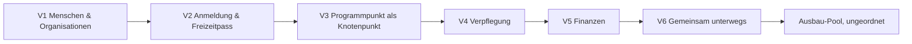

# Zeltlotse – Produkt-Roadmap

Stand: 2026-10-10 · Quelle: `.memlog.md` (Brainstorming-Protokoll dieser Sitzung) · Begleitdokument: `brainstorm-intent.md` (im selben Ordner)

## Zweck

Zeltlotse ist ein Planungswerkzeug für Freizeiten kirchlicher Jugendverbände (z. B. CVJM = Christlicher Verein Junger Menschen, EJW = Evangelisches Jugendwerk): Zeltlager, Junge-Erwachsene-Freizeit, Teens-Freizeit im Haus, Wanderfreizeit. Mehrere Organisationen nutzen dasselbe System getrennt voneinander (Mandantenfähigkeit, „multi-tenant“); jede Organisation plant mehrere Freizeiten. Technik-Rahmen: lokal testbar, später Betrieb als Dienst in Microsoft Azure (Hosting nur in der EU).

Grundhaltung: schlicht. Digitalisiert wird nur, wo heute Chaos durch unsaubere Informationsflüsse oder fehlende Struktur entsteht. Analoge Abläufe, die funktionieren, bleiben analog. Das Werkzeug ist Mittel zum Zweck.

Diese Roadmap teilt den Umfang in sechs aufeinander aufbauende Stufen (V1–V6) plus einen ungeordneten Ausbau-Pool. Jede Stufe ist so beschrieben, dass sie ohne weiteren Kontext eigenständig bearbeitet werden kann.

## Die drei Leitprinzipien

1. **Ein Mensch, ein Profil, viele Rollen.** Jede Person hat genau ein Profil, das ihr selbst gehört. Dieselbe Person kann Teilnehmende, Mitarbeitende, Elternteil oder Leitung sein – in verschiedenen Freizeiten und Organisationen.
2. **Der Programmpunkt ist der Knotenpunkt.** Aus dem Programmpunkt ergeben sich benötigtes Material und vorab entstehende Aufgaben – keine losgelösten Einzelfunktionen.
3. **Das Gegenteil eines Verwaltungsmolochs.** Negativbeispiel ChurchTools: viele Pop-ups, zig Gruppen und Unterkalender, schlechter Überblick, schwerfällige Konfigurierbarkeit.

### Leitplanken (gelten in jeder Stufe)

- Pro Objekt höchstens 1–2 Pflichtfelder (z. B. Aufgabe = nur Titel); alles andere optional und eingeklappt.
- Direkt an Ort und Stelle bearbeiten (Inline-Editing), keine Dialogfenster für normale Änderungen.
- Feste, durchdachte Struktur (Organisation > Freizeit > Bereiche) statt frei baubarer Gruppen – „Meinung statt Optionen“.
- Genau ein Ablauf pro Freizeit; Filter statt Unterkalender.
- Jede wichtige Information höchstens 2 Klicks von der Freizeit-Startseite entfernt.
- Benachrichtigungen standardmäßig still: nur „betrifft mich“-Hinweise, optional Tageszusammenfassung.
- Mitarbeitende kommen per Einladungslink hinein und sind nach 2 Minuten arbeitsfähig, ohne Anleitung.
- Jeder pflegt seinen Bereich (Küche ihre Rezepte, Programmverantwortliche ihren Programmpunkt) – nicht die Leitung alles.
- Module pro Freizeit nur an/aus schalten (z. B. Verpflegung, Zahlungen), keine tiefere Konfiguration.
- Vertrauen statt Rechte-Matrix: enges Team, wenig Hierarchie; Mitarbeitende dürfen fast alles sehen und tun, Leitung hat nur wenige exklusive Bereiche.
- Datensparsamkeit: nur erfragen, was eine Freizeit wirklich braucht.
- Gute Darstellung: anschaulich und grafisch statt Zahlenkolonnen; Zielgefühl „einfach, sorglos, schnell an die Information“.

### Querschnittsregeln (aus der Synthese)

- **Daten gehören dem Menschen, Organisationen leihen nur.** Freizeitpass liegt bei den Eltern, Nachweise bei den Mitarbeitenden; Freigaben sind zeitlich begrenzt und protokolliert; mit 18 wird die Person Eigentümerin ihres Profils. Das schafft Vertrauen (Antwort auf die Konto-Hürde) und grenzt von organisationszentrierten Systemen ab.
- **Einmal erfassen, alles ableiten.** Listen werden nie von Hand gepflegt: Material aus Programmpunkten, Einkaufsliste aus dem Essensplan, Sonderkost aus dem Freizeitpass, Verpflegungskosten aus dem Essensplan, Cockpit-Ampeln aus fehlenden Daten, Anschaffungsliste aus der Schadensliste.
- **Wiederverwendung über Bausteine statt Kopien.** Nie ganze Freizeiten kopieren. Wiederverwendet werden Fragenbaukasten, Aufgabenvorlagen, eingebundene Organisationsdokumente, Rezepte, Programmbibliothek und das Familienkonto.
- **Papier ist Rückfallebene, kein Versagen.** Druck und Export (PDF, CSV) sind Kernfunktion: Notfallordner, Küchenwand. Bis zum Offline-Modus (V6) ersetzt der Ausdruck die Offline-Nutzung.
- **Mechanismus „Angabe mit Stand“.** Eine Angabe trägt Datum (erfasst/zuletzt bestätigt), Herkunft (z. B. „von Eltern angegeben“ vs. „vom Team ergänzt“) und ggf. Ablaufdatum. Einmal in V1 gebaut, genutzt für Freizeitpass-Angaben, Nachweise und Veraltet-Markierung.

## Abhängigkeiten

Hinweis: Finanzen kommen bewusst nach der Verpflegung (V5), obwohl die Kalkulation im Freizeit-Ablauf zeitlich zuerst kommt – so können Verpflegungskosten direkt aus dem Essensplan abgeleitet werden.

---

## V1 – Menschen & Organisationen

**Ziel** – Verstreute Personendaten, doppelt gepflegte Adressen und das Hinterhertelefonieren nach Nachweisen (Führungszeugnis & Co.) verschwinden. Es entsteht das gemeinsame Fundament: wer gehört wozu, wer darf was sehen.

**Baut auf** – nichts (Grundstufe).

**Inhalt**
- *Profil-Modell „Ein Mensch, ein Profil, viele Rollen“*: ein Konto pro Person, gleiches Modell für Teilnehmende, Mitarbeitende und Eltern. Das Profil gehört der Person; Organisationen bekommen nur freigegebene Einsicht.
- *Volljährigkeits-Übergang*: mit 18 wird die Person Eigentümerin ihres Profils; die Eltern-Verbindung bleibt nur mit ihrer Zustimmung.
- *Familienkonto*: Eltern legen ein Konto an und darunter ihre Kinder; Adressen werden mitgenommen. Familiensituation abbildbar (getrennte Eltern mit unterschiedlichen Adressen, Kinder ggf. verteilt wohnend). Sorgeberechtigung pro Kind: welche Elternteile anmelden/ändern dürfen; beide sehen Anmeldungen. Notfallkontakte pro Familie hinterlegt.
- *Login*: Anmeldung per Magic-Link (Login-Link per E-Mail) statt Passwort; Mitarbeitende kommen per Einladungslink dazu.
- *Organisationen und Freizeiten*: feste Struktur Organisation > Freizeit; Freizeiten anlegen (Grunddaten). Module pro Freizeit an/aus.
- *Rollenmodell*: Org-Admin (1–2 pro Organisation), Org-Überblick (alle Freizeiten lesen, z. B. Hauptamt), Freizeitleitung (Rolle innerhalb der Freizeit), Team, Teilnehmende/Eltern. Mitarbeitende sehen nur Freizeiten, denen sie zugewiesen sind.
- *Organisationsübersicht* aller Freizeiten mit Warnhinweisen (Warnungen wachsen mit den späteren Stufen).
- *Mitarbeiter-Nachweise*: erweitertes Führungszeugnis, JuLeiCa (Jugendleiter-Card), Erste-Hilfe-Kurs, Menschenskinder-Schulung (Prävention sexualisierter Gewalt). Nachweise hängen an der Person (organisationsübergreifend), Upload als Bild/Zertifikat. Nach ausdrücklicher Freigabe sehen alle Organisationen, in denen die Person mitarbeitet (z. B. EJW und CVJM), die Nachweise.
- *Mitarbeitenden-Check*: Übersicht, wer welchen Nachweis hat und wann er abläuft; Erinnerung an die Person 2 Monate vor Ablauf (Führungszeugnis alle 5 Jahre); Organisation kann benachrichtigen, wenn ein Nachweis fehlt.
- *Mechanismus „Angabe mit Stand“* (Datum, Herkunft, Ablauf) als gemeinsamer Baustein.
- *Datenschutz-Kern*: strikte Mandantentrennung (eine Organisation sieht nie Daten einer anderen, außer was die Person selbst freigibt); Hosting nur in der EU; Datenauskunft per Klick (alle eigenen Daten herunterladen) und Konto löschen; Einwilligungen granular und widerrufbar; Rechtsrahmen pro Organisation klären (evangelische Träger i. d. R. DSG-EKD = Datenschutzgesetz der Evangelischen Kirche in Deutschland, statt direkt DSGVO = Datenschutz-Grundverordnung; CVJM-Vereine je nach Zuordnung); Vorlage für den AVV (Auftragsverarbeitungsvertrag) für Organisationen.
- Export/Druck der Personen- und Nachweisübersichten (PDF/CSV).

**Bewusst nicht drin**
- Anmeldung, Freizeitpass, Notfallfunktionen → V2.
- Kind mit eigenem Login im Familienkonto, Teilnehmer-Zugang, Gastzugang → V6.
- Unterorganisationen (Bezirk/Ortsverein) – vorerst weggelassen.
- Mitarbeiterpool/Anfragen über die Plattform – nie (Gewinnung passiert persönlich).
- Feingranulare Rechte-Matrix – nie.

**Fertig, wenn …**
- Eine Mitarbeiterin, die bei EJW und CVJM mitarbeitet, lädt ihr Führungszeugnis einmal hoch, gibt es frei – beide Organisationen sehen es, und sie wird 2 Monate vor Ablauf erinnert.
- Eine Familie mit getrennt lebenden Eltern legt sich mit zwei Kindern an; beide Elternteile sehen die Kinder, Notfallkontakte sind hinterlegt – ohne Rückfrage bei der Organisation.

**Leitprinzipien-Check**
- *Ein Mensch, ein Profil*: Kern dieser Stufe – Profil, Familienkonto und Nachweise gehören der Person.
- *Programmpunkt als Knotenpunkt*: noch nicht betroffen; Struktur Organisation > Freizeit bereitet ihn vor.
- *Kein Verwaltungsmoloch*: feste Struktur statt frei baubarer Gruppen, fünf klare Rollen statt Rechte-Matrix, Einladungslink statt Schulung, Magic-Link statt Passwort.

---

## V2 – Anmeldung & Freizeitpass

**Ziel** – Papieranmeldungen, Zettel mit Allergien, fehlende Einverständniserklärungen und der Notfallordner, der nie aktuell ist, verschwinden. Erste echt nutzbare Stufe: eine Freizeit kann vollständig digital angemeldet und im Notfall begleitet werden.

**Baut auf** – V1 (Profile, Familienkonto, Rollen, „Angabe mit Stand“, Datenschutz-Kern).

**Inhalt**
- *Landingpage pro Freizeit* (alles optional): Beschreibung, Ort mit Karte, Zeitraum, Preis, Altersgruppe, Packliste, Vorstellung der Mitarbeitenden mit Bild und Herkunft, FAQ (häufige Fragen).
- *Öffentlicher Anmeldelink* pro Freizeit, teilbar per WhatsApp/Gemeindebrief, ohne vorherige Installation.
- *Anmeldung vollständig digital* (keine Offline-Anmeldungen mehr):
  - Gast-Anmeldung ohne Konto (Daten dann jedes Mal neu eingeben);
  - danach Angebot „Konto aus diesen Daten erstellen?“ – mit einem Klick, nur Magic-Link bestätigen;
  - Wiederanmeldung in unter 3 Minuten für wiederkehrende Familien (alles vorausgefüllt, nur bestätigen);
  - volljährige Teilnehmende melden sich selbst mit eigenem Konto an.
- *Warteliste automatisch*: bei Absage rückt das nächste Kind nach, Eltern bekommen eine Nachricht.
- *Status für Eltern* jederzeit sichtbar: angemeldet / Warteliste / Freizeitpass unvollständig; Anmeldebestätigung.
- *Digitale Bestätigung* (Haken + Name + Datum) statt Papierunterschrift, z. B. Einverständnis Teilnahmebedingungen.
- *Vertrauensseite in Klartext*: wer sieht was, wie lange, wann wird gelöscht.
- *Freizeitpass pro Kind* – liegt bei den Eltern (Familienkonto), nicht bei der Freizeit:
  - Fragenbaukasten: Organisation pflegt Standardfragen (Schwimmer, Fotoerlaubnis, Medikamente …), jede Freizeit wählt per Haken aus; gleiche Frage = gleiche gespeicherte Antwort am Kind, wiederverwendbar für spätere Freizeiten;
  - Eltern sehen, welche Infos die Freizeit braucht, prüfen/korrigieren bisherige Antworten, ergänzen fehlende; kann früh ausgefüllt werden, nach der ersten Anmeldung Aufforderung zum Ausfüllen;
  - jede Angabe mit Stand (Datum, Herkunft); Veraltet-Markierung: Angaben älter als z. B. 12 Monate werden zur Bestätigung vorgelegt („Stimmt das noch?“);
  - während der Freizeit durch das Team ergänzbar (z. B. Intoleranzen), mit Herkunftsvermerk „vom Team ergänzt“;
  - zeitlich begrenzte Freigabe: Freizeit sieht den Pass ab Anmeldung bis 1–2 Wochen nach Freizeitende, danach automatischer Entzug;
  - Gesundheitsdaten (Allergien, Medikamente) als besonders schützenswert: nur im Freigabefenster sichtbar, Zugriffe protokolliert; Zugriffsprotokoll für Eltern einsehbar;
  - automatische Löschfristen (Freigabe endet nach Freizeit; Teilnehmerlisten nach gesetzlicher Aufbewahrungsfrist).
- *Fehlende-Unterlagen-Erinnerung*: App erinnert Eltern automatisch an fehlende Angaben/Bestätigungen.
- *Leitungs-Cockpit (Start)*: Startseite pro Freizeit mit Ampeln, z. B. Anmeldungen vs. Plätze, „Freizeitpass fehlt noch“.
- *Notfall & Schutzkonzept*:
  - Schnellsuche als Startbildschirm für Mitarbeitende während der Freizeit (Vorname, Spitzname, Foto); Freizeitpass schnell auffindbar;
  - Notfallkontakte aller Teilnehmenden für alle Mitarbeitenden der Freizeit sichtbar (wie heute der Notfallordner);
  - Notfall-/Sicherheitskette als kurze Checkliste pro Freizeit („Was habe ich jetzt zu tun?“);
  - Notfall-Button: zeigt Sicherheitskette, Leitung und 1–2 Ansprechpersonen am Heimatort mit Ein-Tipp-Anruf;
  - Schutzkonzept-Dokument der Organisation an jeder Freizeit; Mitarbeitende bestätigen vor der Freizeit „gelesen“;
  - Vorfall-Notiz: kurz festhalten, was passiert ist (Uhrzeit, Maßnahme) – landet bei der Leitung, Grundlage für die Dokumentationspflicht.
- *Druck*: Teilnehmerliste, Notfallordner/Notfallkarten als PDF (Rückfallebene bis zum Offline-Modus in V6).

**Bewusst nicht drin**
- Zelteinteilung (und damit Suche nach Zeltnummer) → Ausbau-Pool.
- Allgemeine Dokumentenverwaltung (Infobrief, Packliste als Dokument, Abschlussmappe) → V3.
- Offline-Notfallkarte auf dem Gerät → V6.
- Teilnehmerzahlungen → Ausbau-Pool; Zahlungssystem-Anbindung außerhalb des Umfangs.
- Papier-/Offline-Anmeldung – nie.

**Fertig, wenn …**
- Eine Zeltlager-Anmeldung läuft komplett ohne Papier: Link per WhatsApp, Gast-Anmeldung, Konto per Klick, Freizeitpass ausgefüllt, Einverständnis bestätigt – und im nächsten Jahr dauert die Wiederanmeldung unter 3 Minuten.
- Ein Mitarbeiter findet während der Freizeit in Sekunden über die Schnellsuche Allergien und Notfallkontakt eines Kindes und sieht per Notfall-Button, wen er anrufen muss; der ausgedruckte Notfallordner liegt als Rückfallebene bereit.

**Leitprinzipien-Check**
- *Ein Mensch, ein Profil*: Freizeitpass gehört dem Kind/den Eltern, wird nur geliehen (Freigabefenster, Protokoll); Antworten werden wiederverwendet.
- *Programmpunkt als Knotenpunkt*: noch nicht betroffen; Sonderkost-Daten werden später (V4) daraus abgeleitet.
- *Kein Verwaltungsmoloch*: Fragenbaukasten statt Pflichtfeld-Flut (Datensparsamkeit), Gast-Anmeldung ohne Konto-Zwang, Cockpit zeigt nur Fehlendes.

---

## V3 – Programmpunkt als Knotenpunkt

**Ziel** – Losgelöste Materiallisten, vergessene Vorbereitungsaufgaben, Parallel-Konflikte beim Verbandsmaterial und Dokumente, die niemand findet, verschwinden. Ablauf, Material, Aufgaben und Dokumente hängen zusammen.

**Baut auf** – V1 (Struktur, Rollen), V2 (Teilnehmende/Team einer Freizeit, Cockpit).

**Inhalt**
- *Ablauf/Programm*: genau ein Ablauf pro Freizeit als Wochenraster mit Zeitblöcken; minimale Programmpunkte; Tagesansicht; Teilnehmer-Version des Ablaufs (druckbar); Tagesleitung pro Tag vermerkt; Filter statt Unterkalender.
- *Ideenspeicher* und *Programmbibliothek* (Programmpunkte als wiederverwendbare Bausteine statt Freizeit-Kopie).
- *Material*:
  - Material hängt am Programmpunkt („Geländespiel Dienstag: 40 Leibchen, 2 Kompasse“) → Gesamtliste ergibt sich automatisch;
  - Materialstatus minimal: gebraucht / vorhanden / besorgt / eingepackt;
  - „Ich bringe das mit“ – Mitarbeitende tragen sich ein;
  - Organisations-Inventar (Zelte, Kochgeschirr, Beamer …); Freizeit reserviert daraus, Rest muss besorgt werden; Kiste höchstens als ein Gegenstand (z. B. „Medizinkiste“);
  - Inventar-Belegung als Zeitstrahl; Überschneidungen paralleler Freizeiten rot markiert; Konflikthinweis mit Kontakt („Spikeball auch bei Teenfreizeit Pfingsten – Leitung: Jonas“) zum direkten Absprechen statt Systemregel;
  - Schadens-/Verlustliste während der Freizeit → Anschaffungswunsch-Liste auf Organisationsebene.
- *Aufgaben*:
  - minimal: Titel (einziges Pflichtfeld), zuständig, Fälligkeit, erledigt-Haken;
  - zwei Quellen: frei angelegt oder automatisch aus Programmpunkt/Material (mit Rückverweis); Programmpunkt-Vorlage erzeugt Aufgaben („Geländespiel“ → „Leibchen zählen“, „Gelände erkunden“);
  - Zeitphasen statt Datum: Vorbereitung / Während / Nachbereitung, Datum optional;
  - „Ich übernehme“ mit einem Tipp, keine Zuweisung nötig;
  - Ansicht „Meine Aufgaben“ über alle Freizeiten;
  - Aufgabenvorlagen auf Organisationsebene (fallen bei jeder Freizeit an, standardmäßig übernommen, inkl. Nachbereitung); „Aufgabe in Vorlage übernehmen“ aus der Detailansicht (Beschreibung und Phase werden mitgenommen).
- *Dokumente*:
  - hängen dort, wo sie gebraucht werden (Freizeit, Programmpunkt, Person, Beleg); jedes Dokument gehört mindestens zur Freizeit („Freizeit allgemein“) oder Organisation – kein heimatloser Upload;
  - Abgrenzung: Organisation = gilt für mehrere/alle Freizeiten oder unabhängig davon (Schutzkonzept, Notfallplan, Hausordnung, Vertragsvorlagen, Satzung); Freizeit = nur diese eine;
  - Org-Dokumente in Freizeiten eingebunden statt kopiert – Aktualisierung wirkt überall;
  - drei Sichtbarkeiten: Team, Eltern/Teilnehmende (z. B. Infobrief, Packliste), öffentlich auf der Landingpage;
  - digitale Bestätigung (Haken + Name + Datum) für Unterschriften-Dokumente;
  - eine Suche, Umfang je nach Standort (in der Freizeit: Freizeit- + eingebundene Org-Dokumente; auf Org-Ebene: alles, was ich sehen darf); Treffer mit Kontext („Mietvertrag.pdf – Sommerlager 2026 > Haus“); Filter nach Freizeit, Jahr, Typ;
  - Freizeit-Abschlussmappe: Teilnehmerliste, Belege, Ablauf als ein PDF/ZIP fürs Archiv.
- *Elterninfo*: Infobrief, Packliste, Notfallnummern als PDF/Link für Eltern bereitstellen (über die Sichtbarkeit „Eltern/Teilnehmende“).
- *Cockpit-Ampeln erweitert*: unbesetzte Aufgaben, fehlende Dokumente.
- Druck: Wochenraster, Tagesansicht, Materialliste.

**Bewusst nicht drin**
- Zeitänderung am Programmpunkt löst Nachricht aus, Ansagen-Sammlung → V6.
- Volltextsuche in PDFs/Fotos per Texterkennung → Ausbau-Pool.
- Kanban-Board (zu kompliziert; einfache To-do-Liste reicht).
- Kisten-Inhalte einzeln protokollieren, formaler Rückgabe-Check – nie.
- Feste Aufgaben-Startlisten pro Freizeittyp – ersetzt durch Org-Vorlagen; personenbezogene Massen-Aufgaben und persönliche Vorab-/Nachher-Checklisten – nie.
- Tagesleitungs-Übergabe in der App – nie (läuft über die tägliche Mitarbeiterbesprechung).
- „Ganze Freizeit kopieren“ – nie.

**Fertig, wenn …**
- Die Programmverantwortliche legt „Geländespiel Dienstag“ aus der Programmbibliothek an; Leibchen und Kompasse erscheinen automatisch in der Materialliste, Vorbereitungsaufgaben entstehen, ein Teamer tippt „Ich übernehme“ – ohne dass die Leitung eine Liste pflegt.
- Zwei parallele Freizeiten reservieren denselben Spikeball; beide sehen den Konflikt mit Ansprechperson. Nach der Freizeit erzeugt ein Klick die Abschlussmappe.

**Leitprinzipien-Check**
- *Ein Mensch, ein Profil*: „Meine Aufgaben“ über alle Freizeiten; „Ich bringe das mit“ hängt an der Person.
- *Programmpunkt als Knotenpunkt*: Kern dieser Stufe – Material und Aufgaben werden aus dem Programmpunkt abgeleitet.
- *Kein Verwaltungsmoloch*: ein Ablauf, Phasen statt Termine, vier Materialzustände, keine Ordnerstruktur, Konflikte per Absprache statt Systemregel.

---

## V4 – Verpflegung

**Ziel** – Handgeschriebene Einkaufszettel, falsch hochgerechnete Mengen und Unsicherheit, wer was nicht essen darf, verschwinden. Die Küche bekommt eine Informationsübersicht – keine Prozesssteuerung (die Küchenleitung weiß, was zu tun ist).

**Baut auf** – V2 (Teilnehmende/Team mit Sonderkost aus dem Freizeitpass), V3 (Ablauf: Abwesenheiten, Ausflüge). Modul pro Freizeit an/aus.

**Inhalt** (Küche-Schnitt)
- *Essensplan*: steht vor der Freizeit komplett fest; Mahlzeiten pro Tag.
- *Rezepte*: vom Küchenchef selbst angelegt (einfacher Markdown-Editor; Markdown = schlichtes Textformat), Basis-Personenzahl (z. B. 3), Skalierung auf die tatsächliche Personenzahl; Rezepte als wiederverwendbarer Baustein.
- *Mengenfaktoren* nach Gruppe (Kinder / Jugendliche / Erwachsene).
- *Einkaufsliste* automatisch aus Essensplan + Mengen pro Tag; Allergen-Abgleich: pro Mahlzeit sichtbar, welche Personen betroffen sind (z. B. 3× laktosefrei), Ersatzportionen automatisch in der Einkaufsliste.
- *Küchen-Tagesansicht*: eine Seite pro Tag mit Mahlzeiten, Personenzahl und Sonderkost – ausdruckbar für die Küchenwand.
- *Sonderkost-Karte* mit Name + Foto der betroffenen Person für die Ausgabe.
- *Restetag*: Küche markiert „heute Restetag“ (Reste-Essen als eigener Mahlzeit-Typ) → reduziert automatisch die Einkaufsmenge für diesen Tag.
- *Mitesser-Zähler*: Tagesgäste (Pfarrer, Eltern beim Abschlussabend) per Schnellzahl zu einer Mahlzeit hinzufügen.
- *Abwesenheits-Zähler*: Personen, die zu einer Mahlzeit nicht da sind (Ausflug, Heimfahrt, Nachtwache), reduzieren die Portionszahl.

**Bewusst nicht drin**
- Einkaufs-Workflow (Freigabe durch Küchenchef, Abhaken vor Ort), Lunchpakete, Essensform-Einstellung und Buffet-Schilder, Restevermerk („zu viel/zu wenig“ → Mengenfaktoren), Anbindung einer Open-Food-Bibliothek → Ausbau-Pool.
- Offline-Küchenansicht → V6 (bis dahin: Ausdruck).
- Verpflegungskosten → V5.
- Resteregister mit automatischem Reste-Vorschlag – nie.
- Generierte Rezepte – nie (Rezepte werden selbst eingegeben).

**Fertig, wenn …**
- Der Küchenchef plant eine Woche Zeltlager mit eigenen Rezepten; Einkaufsliste inkl. laktosefreier Ersatzportionen entsteht automatisch, und die ausgedruckte Tagesansicht hängt an der Küchenwand.
- Am Ausflugstag sinkt die Portionszahl automatisch, beim Abschlussabend kommen 12 Eltern per Schnellzahl dazu, der Restetag senkt die Einkaufsmenge – ohne Rechnen von Hand.

**Leitprinzipien-Check**
- *Ein Mensch, ein Profil*: Sonderkost kommt aus dem Freizeitpass der Person, nicht aus einer separaten Küchenliste.
- *Programmpunkt als Knotenpunkt*: Abwesenheiten (Ausflug, Nachtwache) ergeben sich aus dem Ablauf.
- *Kein Verwaltungsmoloch*: Übersicht statt Prozesssteuerung; Restetag ist nur ein Haken; Einkaufsliste wird abgeleitet, nie gepflegt.

---

## V5 – Finanzen

**Ziel** – Kalkulationen in unverständlichen Tabellen, Belegzettel in Jackentaschen und offene Erstattungen an Mitarbeitende verschwinden. Kalkulierende sind keine Betriebswirte – Darstellung grafisch statt Zahlenkolonnen.

**Baut auf** – V1 (Personen für Erstattungen), V2 (geplante/tatsächliche Teilnehmerzahl), V3 (Belege als Dokumente), V4 (Essensplan für Verpflegungskosten).

**Inhalt** (Finanz-Schnitt)
- *Vorabkalkulation (Budget)* in wenigen Kategorien statt Kontenrahmen: Unterkunft, Verpflegung, Fahrt, Programm/Material, Mitarbeitende, Sonstiges.
- *Kostenarten*: fix (Haus pauschal) vs. pro Person/Tag; Gesamtsumme aus geplanter Teilnehmerzahl.
- *Mitarbeiter-Umlage*: Kosten der Mitarbeitenden werden auf die Teilnehmerbeiträge umgelegt.
- *Freie Einnahmeposten* mit Typ (Teilnehmerbeitrag, externer Zuschuss, Org-Zuschuss/Rabatt, Spende); flexible Ein-/Ausgaben-Übersicht.
- *Verpflegungskosten* grob aus Essensplan/Rezepten geschätzt statt manuell.
- *Beitragsrechner* als Balken-Gleichung: Ausgaben (inkl. Umlage) links, Einnahmen rechts, Lücke/Überschuss auf einen Blick; Schieberegler für Teilnehmer- und Mitarbeiterzahl, Beitrag pro Person passt sich live an („Bei 40 Teilnehmenden und Zuschuss X brauchen wir Y EUR“).
- *Belege*: vor/während der Freizeit als Foto/Dokument hochladen oder manuell eintragen; Zuordnung zu einer Kalkulationskategorie; wer hat bezahlt (Mitarbeiter oder Organisation); Status offen/erstattet.
- *Erstattungsübersicht pro Mitarbeiter* („Lisa bekommt noch 84,30 EUR“) – Kassierer überweist und hakt ab.
- *Soll-Ist-Vergleich* live pro Kategorie als Fortschrittsbalken (grün/gelb/rot bei Überschreitung).
- *Abrechnung als PDF* für Kassierer/Vorstand (Soll, Ist, Differenz, Belegliste).

**Bewusst nicht drin**
- Kostenaufteilung als Donut, Szenarien-Vergleich, Vorjahreskalkulation als Startwert, Teilnehmerzahlungen → Ausbau-Pool.
- Zahlungssystem-Anbindung – aktuell außerhalb des Umfangs (nicht „nie“).
- Live-Kalkulation über eingehende Anmeldungen (Break-even pro Anmeldung) – verworfen zugunsten der Vorabkalkulation.
- Offene Zahlungen im Fokus des Cockpits – bewusst nicht.

**Fertig, wenn …**
- Eine Freizeitleitung ohne Buchhaltungswissen stellt per Schieberegler fest, welcher Teilnehmerbeitrag bei 30 bzw. 40 Teilnehmenden nötig ist – die Verpflegungskosten kommen schon aus dem Essensplan.
- Während der Freizeit fotografieren Mitarbeitende ihre Kassenzettel; am Ende sieht der Kassierer, wem er wie viel erstatten muss, und druckt die Abrechnung für den Vorstand.

**Leitprinzipien-Check**
- *Ein Mensch, ein Profil*: Belege und Erstattungen hängen an der Person, die bezahlt hat.
- *Programmpunkt als Knotenpunkt*: Kosten fließen aus Planungsdaten (Essensplan, Material) statt aus Parallel-Listen.
- *Kein Verwaltungsmoloch*: sechs Kategorien statt Kontenrahmen, Grafik statt Zahlenkolonne, Belegfoto statt Formular.

---

## V6 – Gemeinsam unterwegs

**Ziel** – Zurufe über den Platz, veraltete WhatsApp-Gruppen, vergessene Ansagen und Funklöcher im Zeltlager verlieren ihren Schrecken. Team und (ältere) Teilnehmende sind während der Freizeit gemeinsam informiert – auch ohne Netz.

**Baut auf** – V1 (Profile, Familienkonto), V2 (Teilnehmende, Notfalldaten), V3 (Ablauf, Programmpunkte), V4 (Küchen-Tagesansicht).

**Inhalt**
- *Kommunikation*:
  - einfacher Kurznachrichten-Dienst (Instant Messenger): Tagesleitung/Mitarbeitende/Küche senden kurze Infos („Essen 13:30 statt 13:00“), Benachrichtigung und Anzeige in der App;
  - zwei Kanäle: „Team“ (nur Mitarbeitende) und „Alle“ (inkl. Teilnehmende), damit Interna nicht bei Teilnehmenden landen;
  - Zeitänderung direkt am Programmpunkt verschieben → automatisch Kurznachricht an alle;
  - Ansagen-Zettel: Mitarbeitende sammeln tagsüber Ansagen („Fundsachen“, „Duschzeiten“), die Tagesleitung liest beim Essen vor und hakt ab;
  - Notizen für die Mitarbeiterbesprechung: tagsüber notierte Punkte landen auf der Liste der nächsten Besprechung, werden besprochen und abgehakt;
  - Benachrichtigungen standardmäßig still (nur „betrifft mich“, optionale Tageszusammenfassung).
- *Teilnehmer-Zugang* (pro Freizeit optional anhakbar, sinnvoll bei Teens/Junge Erwachsene, bei Kinderfreizeiten aus):
  - Teilnehmende mit eigenem Konto sind automatisch Teil der Freizeit;
  - Gastzugang per QR-Code/Code (z. B. am ersten Abend) für alle ohne Konto: Namen wählen, Zugang nur für die Dauer der Freizeit;
  - Eltern laden ihr Kind ab einstellbarem Alter (z. B. 14) als eigenes Mitglied mit Login ins Familienkonto ein; Kind sieht eigene Freizeiten und Ablauf;
  - Teilnehmer-Version des Ablaufs in der App.
- *Offline*:
  - Offline-Modus für die Küchen-Tagesansicht;
  - Offline-Notfallkarte (Notfallkontakte, Sicherheitskette) auf den Geräten der Mitarbeitenden;
  - Offline-Daten verschlüsselt und nach Freizeitende automatisch gelöscht.

**Bewusst nicht drin**
- Tagesleitungs-Übergabe in der App – nie (läuft über die Mitarbeiterbesprechung).
- Benachrichtigungsflut (jede Änderung = Nachricht an alle) – nie.
- Alles aus dem Ausbau-Pool.

**Fertig, wenn …**
- Die Tagesleitung verschiebt das Mittagessen um 30 Minuten am Programmpunkt; alle Teilnehmenden einer Teens-Freizeit (per QR-Code eingeloggt) und das Team sehen die Info sofort – Interna im Team-Kanal bleiben unsichtbar.
- Im Zeltlager ohne Netz öffnet die Küche ihre Tagesansicht und ein Mitarbeiter die Notfallkarte eines Kindes; nach Freizeitende sind die Offline-Daten von den Handys gelöscht.

**Leitprinzipien-Check**
- *Ein Mensch, ein Profil*: Teilnehmende mit Konto nutzen dasselbe Profil; Kind-Login wächst im Familienkonto; Gastzugang ohne Konto-Zwang.
- *Programmpunkt als Knotenpunkt*: Zeitänderung am Programmpunkt löst die Nachricht aus – keine separate Kommunikation.
- *Kein Verwaltungsmoloch*: zwei Kanäle statt Gruppengewirr, stille Standard-Benachrichtigungen, Teilnehmer-Zugang nur als ein Haken.

---

## Ausbau-Pool (ungeordnet, nach V6 neu bewerten)

**Verpflegung**
- Einkaufs-Workflow: Küchenchef hakt an, für welche Tage/Posten eingekauft wird, gibt frei; Einkäufer hakt Gekauftes ab.
- Lunchpaket-Ausnahme: Mahlzeit als „Lunchpaket“, Sonderkost-Personen namentlich zum Beschriften.
- Essensform als Freizeit-Einstellung (Selbstbedienung/Ausgabe) und Buffet-Schilder pro Gericht (Allergene, vegetarisch).
- Restevermerk: „zu viel/zu wenig“ nach der Mahlzeit → fließt in Mengenfaktoren fürs nächste Jahr.
- Anbindung einer Open-Food-Bibliothek zur Mengenkalkulation.

**Finanzen**
- Kostenaufteilung als Donut („wohin geht ein Euro Beitrag“).
- Szenarien vergleichen („Pessimistisch 30 TN“ vs. „Realistisch 40 TN“; TN = Teilnehmende).
- Vorjahreskalkulation als Startwert (einzige Kopierfunktion für Finanzen).
- Teilnehmerzahlungen: pro Freizeit abschaltbar; Status offen/bezahlt/erlassen manuell; Eltern sehen Betrag, Bankverbindung, Verwendungszweck; Summe fließt in Soll-Ist.
- Zahlungssystem-Anbindung – aktuell außerhalb des Umfangs, spätere Anbindung möglich.

**Teilnehmende & Organisation**
- Zimmer-/Zelteinteilung per Drag & Drop mit Wunschpartnern aus der Anmeldung (danach Schnellsuche auch nach Zeltnummer).
- Zuschuss-Unterstützung: fertige Exportlisten für Zuschussanträge (Nice-to-have am Rande).
- Jahresrückblick im Stil „Spotify Wrapped“ mit Statistiken.
- Unterorganisationen (Bezirk/Ortsverein) – vorerst weggelassen.

**Dokumente**
- Volltextsuche in PDFs/Fotos per Texterkennung (OCR = Optical Character Recognition).

## Nie-Liste (bestätigt)

- Resteregister mit Erfassung übriger Gerichte/Zutaten und automatischem Reste-Vorschlag (der einfache Restetag ist in V4).
- Ganze Freizeit (Vorjahr) kopieren – Wiederverwendung nur über Bausteine.
- Papier-/Offline-Anmeldungen – Anmeldung läuft vollständig digital.
- Generierte Rezepte – Rezepte werden selbst eingegeben.
- Kisten-Inhalte einzeln protokollieren (Kiste höchstens als ein Gegenstand).
- Formaler Rückgabe-Check nach der Freizeit (stattdessen Schadens-/Verlustliste).
- Tagesleitungs-Übergabe in der App (läuft über die Mitarbeiterbesprechung).
- Personenbezogene Massen-Aufgaben (z. B. „Belege einreichen“ je Mitarbeiter) und persönliche Vorab-/Nachher-Checklisten.
- Feste Aufgaben-Startlisten pro Freizeittyp (ersetzt durch Aufgabenvorlagen der Organisation).
- Mitarbeiterpool bzw. Mitarbeiter-Anfragen über die Plattform (Gewinnung passiert persönlich).
- Live-Kalkulation über eingehende Anmeldungen (ersetzt durch Vorabkalkulation).
- Viele Pflichtfelder, feingranulare Rechte-Matrix, Pop-up-Bearbeitung, Unterkalender, frei baubare Gruppen, Benachrichtigungsflut.

Nicht auf dieser Liste: die Zahlungssystem-Anbindung – sie ist aktuell außerhalb des Umfangs, aber ausdrücklich nicht „nie“.
