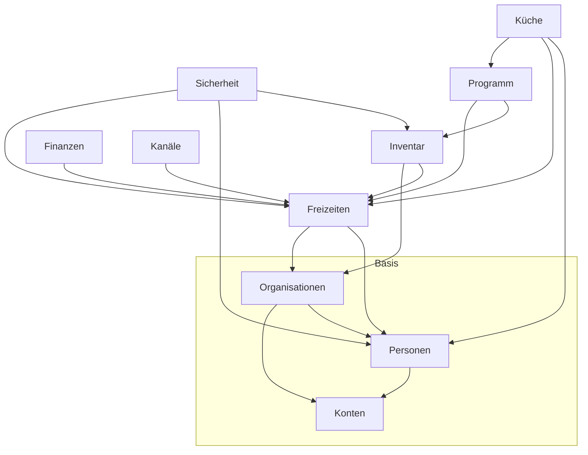
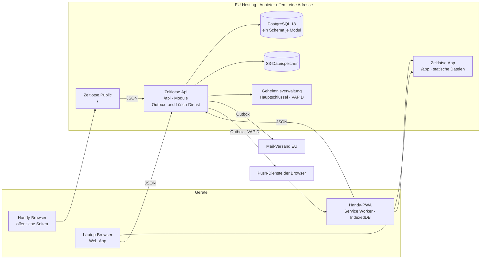
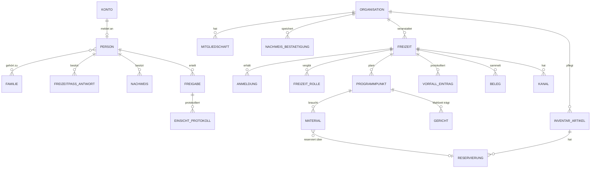

# Architektur-Gerüst – Zeltlotse

## Bauprinzip

**Modularer Monolith hinter einer API.** Der Server ist ein einziger Prozess mit einer PostgreSQL-Datenbank. Nach außen bietet er ausschließlich eine JSON-API an. Innen gliedert er sich in zehn fachliche Module. Jedes Modul besitzt eigene Tabellen in einem eigenen Schema und ist für andere Module nur über sein `*.Contracts`-Projekt erreichbar. Reaktionen über Modulgrenzen hinweg laufen als Ereignisse über eine Outbox. Zwei Clients sprechen mit der API: die Web-App und die öffentlichen Seiten.

| Teil | Ort | Inhalt |
| --- | --- | --- |
| API-Host | `src/Zeltlotse.Api` | ASP.NET Core: bindet alle Modul-Endpunkte unter `/api` ein, Identity, Autorisierung, Mandanten- und Freizeit-Kontext, Outbox- und Lösch-Dienst |
| Web-App | `src/Zeltlotse.App` | eigenständige Blazor-WebAssembly-PWA unter `/app`: Service Worker, schmale JS-Interop (IndexedDB, WebCrypto, Push) |
| Öffentliche Seiten | `src/Zeltlotse.Public` | schlanke, statisch servergerenderte Blazor-Seiten unter `/`, ohne WebAssembly; holt Daten nur über die API |
| Komponenten-Bibliothek | `src/Zeltlotse.Ui.Komponenten` | Razor Class Library: reine ELKW-Darstellungsbausteine, ELKW-CSS, Dunkel-Tokens; kennt weder API noch Datenformen |
| App-Bausteine | `src/Zeltlotse.Ui` | Razor Class Library: Autosave-Baustein, API-Clients, Freizeit-Kontext, zusammengesetzte Zeltlotse-Komponenten |
| Module | `src/Modules/<Modul>/Zeltlotse.<Modul>` | Fachlogik als Vertical Slices, eigener `DbContext`, eigenes Schema, eigene Migrationen und Outbox; alles `internal` außer Modul- und Endpunkt-Registrierung |
| Modul-Verträge | `src/Modules/<Modul>/Zeltlotse.<Modul>.Contracts` | nur serverintern: lesende Schnittstellen, DTOs zwischen Modulen, Ereignisse (`.Events`) |
| API-Verträge | `src/Zeltlotse.Api.Contracts` | nur die Datenformen der HTTP-API, ein Ordner je Modul; das einzige Vertragsprojekt, das die Clients nutzen |
| Gemeinsamer Kern | `src/Zeltlotse.SharedKernel` | Kennungen, Uhr, Kontext-Schnittstellen, Outbox, Verschlüsselung, Adapter-Schnittstellen (Dateien, Mail) |

## Invarianten und Regeln



*Ein Pfeil bedeutet: Das Modul darf die lesende Schnittstelle des Zielmoduls aufrufen. Ein Pfeil gilt nur direkt, nicht über Zwischenmodule weiter. Ereignisse darf jedes Modul abonnieren.*

### AD-1 – Modularer Monolith mit zehn Modulen [ADOPTED]

- **Binds:** all
- **Prevents:** dass Bausteine V1–V6 unabhängig voneinander gebaut werden und dabei kreuz und quer in fremde Daten greifen, oder dass Teile vorzeitig als eigene Dienste abgespalten werden.
- **Rule:** Es gibt genau diese Module: Konten, Personen, Organisationen, Freizeiten, Sicherheit, Programm, Inventar, Küche, Finanzen, Kanäle. Ein neues Modul erfordert eine Änderung dieses Gerüsts. Der Server läuft in einem Prozess, Microservices gibt es nicht.

### AD-2 – Abhängigkeitsrichtung [ADOPTED]

- **Binds:** all
- **Prevents:** Zyklen zwischen Modulen und Basis-Module, die Fachmodule kennen.
- **Rule:**
  - Ein Modul ruft die lesende Schnittstelle (`<Modul>.Contracts`) eines anderen Moduls nur entlang der Pfeile oben auf.
  - Ereignis-Typen (`<Modul>.Contracts.Events`) darf jedes Modul abonnieren.
  - Programm kennt Küche nicht.
  - Zusammengeführte Ansichten (Leitungs-Cockpit, Startseite der Freizeit, Familienübersicht) setzt der Client aus den Endpunkten der einzelnen Module zusammen. Kein Modul aggregiert Daten von Modulen, die von ihm abhängen.

### AD-3 – Datenbesitz pro Modul [ADOPTED]

- **Binds:** all
- **Prevents:** zwei Besitzer für dieselbe Entität, Abfragen über Schemagrenzen hinweg und kollidierende Migrationen.
- **Rule:**
  - Jedes Modul hat ein eigenes PostgreSQL-Schema mit eigenem `DbContext`, eigener Migrations-Historie und eigener Outbox-Tabelle. Nur dieses Modul liest und schreibt seine Tabellen.
  - Fremde Entitäten werden nur per Kennung referenziert. Fremdschlüssel und Joins über Schemagrenzen gibt es nicht.
  - Wer welche Kern-Entität besitzt, legt die Tabelle *Datenbesitz* unten fest.

### AD-4 – Kommunikation zwischen Modulen [ADOPTED]

- **Binds:** all
- **Prevents:** verlorene oder doppelte Folgeaktionen und Module, die sich gegenseitig schreibend aufrufen.
- **Rule:**
  - **Direkt nur lesen:** Module rufen einander nur lesend auf. Eine schreibende Benutzeraktion geht an den Endpunkt des Moduls, das die Daten besitzt.
  - **Folgeaktionen über Ereignisse:** Jede Folgeaktion in einem anderen Modul entsteht ausschließlich aus einem Ereignis und hat genau einen festgelegten Empfänger (Tabelle *Ereignis-Fluss* unten).
  - **Gleiche Transaktion:** Das auslösende Modul schreibt das Ereignis in derselben Transaktion wie die Änderung in seine Outbox.
  - **Zustellung:** Ein Hintergrunddienst stellt die Ereignisse zu, je Datensatz in der Reihenfolge ihrer Entstehung.
  - **Umschlag:** Jedes Ereignis hat einen einheitlichen Umschlag mit Ereignis-Kennung, Zeitpunkt, `OrganisationId` (falls vorhanden), Kennung des Datensatzes und dessen `Folgenummer` (AD-28).
  - **Inhalt:** Ein Ereignis trägt die fachlichen Fakten, die der Empfänger braucht, als Kennungen und Werte. Personendaten trägt es nie. Ereignis-Typen bestehen nur aus `Guid`, Zahlen, Datumswerten, Enums und Unter-Typen desselben `.Events`-Namensraums.
  - **Empfänger:** Jeder Empfänger ist ein eigener Command im Zielmodul (mit dem Umschlag als Eigenschaft) und wird in der Modul-Registrierung mit `EmpfaengtEreignis<TEreignis, TCommand>()` angemeldet. Mediator-Notifications werden dafür nicht verwendet.
  - **Zustellung je Empfänger:** Der Outbox-Dienst stellt ein Ereignis jedem Empfänger getrennt zu, mit eigenem DI-Scope, Mandanten-Kontext aus dem Umschlag und eigenen Wiederholversuchen.
  - **Inbox:** Sie speichert in derselben Transaktion wie die Folgeaktion das Paar (Ereignis-Kennung, Empfänger) und die höchste verarbeitete Folgenummer je (Datensatz, Empfänger). Bereits verarbeitete und ältere Ereignisse verwirft sie.

### AD-5 – API First mit zwei Clients [ADOPTED]

- **Binds:** Zeltlotse.Api, Zeltlotse.App, Zeltlotse.Public, Zeltlotse.Ui, NFR-8, NFR-9, NFR-17
- **Prevents:** Server-HTML neben der API, App-Code, der auf dem Server mitläuft, und öffentliche Seiten, die Eltern zuerst eine WebAssembly-App herunterladen lassen.
- **Rule:**
  - **API:** Der Server bietet nach außen nur JSON unter `/api` an. SignalR kommt dort später bei Bedarf hinzu.
  - **Web-App** (`Zeltlotse.App`): eine eigenständige Blazor-WebAssembly-PWA nach der offiziellen PWA-Vorlage unter `/app`. Sie umfasst alles nach dem Login und den QR-Teilnehmerzugang.
  - **Öffentliche Seiten** (`Zeltlotse.Public`): Freizeitseite, Anmeldelinks, Gast-Anmeldung, Vertrauensseite und Elterninfo-Link. Sie werden statisch auf dem Server gerendert, ohne WebAssembly, und holen ihre Daten über die API.
  - **Gemeinsame Grundlagen:** Beide Clients nutzen ausschließlich `Zeltlotse.Ui.Komponenten`, `Zeltlotse.Ui` und `Zeltlotse.Api.Contracts`. Modul-Projekte und Modul-Contracts referenzieren sie nie.
  - **Eine Adresse, ein Prozess:** API, öffentliche Seiten und die Dateien der Web-App laufen in einer ASP.NET-Core-Anwendung unter derselben Adresse (`/api`, `/`, `/app`), mit einem Reverse Proxy davor (AD-23).
  - **Public bleibt Client:** Die öffentlichen Seiten holen ihre Daten auch im selben Prozess nur über ihren HTTP-Client an `/api`, nie über Modul-Klassen. Diese Aufrufe tragen die Dienst-Kennung `PublicSeiten`, die der API-Host nur aus dem eigenen Prozess annimmt. Sie reichen die IP des Besuchers für die Zugriffsbegrenzung durch. So lässt sich Public später ohne Codeänderung in einen eigenen Container ziehen.
  - **API-Verträge:** `Zeltlotse.Api.Contracts` referenziert nichts außer der .NET-Basisbibliothek; Kennungen sind dort `Guid`. Jedes Modul schreibt nur in seinen Ordner `<Modul>/` (Namensraum `Zeltlotse.Api.Contracts.<Modul>`). Gemeinsame Typen (Phase, Rolle, Fehlercodes, Aktionsschlüssel, Freizeit-Kontext) liegen in `Gemeinsam/` und ändern sich nur mit einer Änderung dieses Gerüsts.
  - **Kompatibilität:** Änderungen an der API sind nur additiv. Ein Feld wird erst entfernt oder umbenannt, wenn die vorige App-Version nicht mehr im Umlauf sein kann. Jede Antwort trägt `X-Zeltlotse-Version`; weicht sie ab, bietet die App „Neu laden“ an.

### AD-6 – Mandantentrennung [ADOPTED]

- **Binds:** alle organisationseigenen Daten, NFR-2
- **Prevents:** dass eine Organisation Daten einer anderen sieht, weil ein Modul den Filter vergisst oder den Kontext falsch bestimmt.
- **Rule:**
  - **Kennung an jeder Zeile:** Jede organisationseigene Zeile trägt eine `OrganisationId`. Jeder Modul-`DbContext` filtert global nach dem Mandanten-Kontext aus `SharedKernel`.
  - **Quelle des Kontexts:**
    - bei Anfragen die adressierte Ressource, also Freizeit oder Organisation in der Route;
    - bei Zugangslinks das Token;
    - bei Ereignissen der Umschlag.

    Eine Auswahl im Client ist nie die Quelle. Fehlt der Kontext, liefert der Filter nichts.
  - **Ausnahmen vom Filter:** Ihn umgehen dürfen nur der Lösch-Dienst, die Datenauskunft (AD-16) und der personenbezogene Lesepfad (AD-26).
  - **Tests:** Automatische Tests prüfen den Filter für jede organisationseigene Entität.
  - **Vor dem Start als Dienst** für fremde Organisationen ist PostgreSQL Row Level Security zusätzlich Pflicht (gleicher Auslöser wie OP-6).

### AD-7 – Person ist nicht Konto [ADOPTED]

- **Binds:** Konten, Personen und jedes Modul, das Menschen referenziert; FR-1, FR-3, FR-4, FR-17, NFR-1
- **Prevents:** uneinheitliche Verweise auf Menschen, die Löschung und Rechte brechen, und Gast-Anmeldungen ohne Datenbesitzer.
- **Rule:**
  - **Getrennte Besitzer:** *Konten* besitzt nur die Anmeldung und die Zugangsdaten. *Personen* besitzt Profil, Familie und alle Personendaten (Tabelle *Datenbesitz*).
  - **Eine Kennung für Menschen:** Außerhalb von Konten wird ein Mensch immer über die `PersonId` referenziert, auch dann, wenn er nur handelt („abgehakt von“, „Beleg bezahlt von“). Die Kennung einer Anmeldung bleibt in Freizeiten.
  - **Profil ohne Konto:** Ein Profil kann ohne Konto existieren (Gast-Anmeldung). Hat es kein Konto und keine laufende Freigabe mehr, wird es gelöscht.
  - **Familie:** Ein zweiter Elternteil hat in der Familie dieselben Rechte wie der erste. Profile werden nie automatisch zusammengeführt.
  - **Übergabe mit 18:** Sie wechselt den Besitz von der Familie auf das eigene Konto.

### AD-8 – Freigabe per Durchgriff, keine Kopie [ADOPTED]

- **Binds:** Personen, Freizeiten, Sicherheit, Küche; FR-13, FR-22–FR-24, NFR-1, NFR-7
- **Prevents:** Freizeitpass-Stände, die zwischen Person und Freizeit auseinanderlaufen; Daten, die nach dem Freigabefenster liegen bleiben; Einsicht in Antworten, die eine Freizeit nicht abgefragt hat.
- **Rule:**
  - **Besitzer:** Die *Freigabe* gehört dem Modul Personen. Sie enthält Person, Freizeit, Stufe, die Kennungen der abgefragten Fragen und „gültig bis“.
  - **Stufen:** Die Stufe *Leitung* entsteht mit dem Eingang der Anmeldung, die Stufe *Team* mit ihrer Bestätigung. Eine Absage beendet die Freigabe sofort. Ausgelöst wird das jeweils über Ereignisse (AD-4).
  - **Zeitraum:** „Gültig bis“ ergibt sich aus dem Freigabe-Intervall, das beim Anlegen der Freizeit festgeschrieben wird (FR-24d).
  - **Lesen nur über Personen:** Jedes Lesen von Freizeitpass-Daten läuft über eine *zweckgebundene* Leseschnittstelle von `Personen.Contracts`, zum Beispiel „Freizeitpass anzeigen“, „Allergene für die Küche“, „Notfallangaben“ oder „Vollständigkeit“. Sie liefert nur die freigegebenen Fragen.
  - **Mengen statt Einzelabrufe:** Leseschnittstellen nehmen immer eine Menge von `PersonId` und eine `FreizeitId` entgegen.
  - **Zwecke ohne Menschen:** Lesen im Hintergrund (z. B. „Allergen-Mengen“ für die Einkaufsliste) geschieht nur über eigens benannte Methoden. Sie liefern nur abgeleitete Merkmale (Kennungen, Anzahlen), nie Antworttexte, und protokollieren den Zweck ohne lesende Person. Alle anderen Methoden verlangen die lesende Person aus dem Anfrage-Kontext und brechen ohne sie ab.
  - **Rollenprüfung:** Ob die anfragende Person Leitung oder Team ist, prüft Personen gegen eine eigene Liste der Freizeit-Rollen. Diese Liste wird ausschließlich über Ereignisse gepflegt. Einer Angabe des Aufrufers zur Stufe vertraut Personen nie.
  - **Protokoll:** Ins Einsicht-Protokoll kommen Inhaltszugriffe (wer, wessen, wann, Freizeit, Zweck), höchstens einmal pro lesender Person, betroffener Person und Tag. Die Abfrage „Vollständigkeit“ liefert keine Inhalte und wird nicht protokolliert.
  - **Keine Kopien:** Kein anderes Modul speichert Freizeitpass-Antworten. Ausgenommen sind nur abgeleitete Ansichten: der Druck des Notfallordners (FR-33) und die Offline-Daten (AD-18).

### AD-9 – Nachweise: nur die Bestätigung wandert [ADOPTED]

- **Binds:** Personen, Organisationen, FR-8–FR-12
- **Prevents:** Kopien von Führungszeugnissen bei Organisationen.
- **Rule:** Die Nachweis-Datei liegt nur im Modul Personen. Die Einsicht ist eine einmalige, befristete Freigabe für genau eine prüfende Person. Organisationen speichert nur die *Bestätigung*: Nachweisart, eingesehen am, gültig bis und von wem. Das Ablaufdatum wird berechnet (Ausstellungsdatum + Gültigkeit laut Org-Richtlinie) und nie von Hand gespeichert.

### AD-10 – Fester Fragenkatalog [ADOPTED]

- **Binds:** Personen, Freizeiten, Küche; FR-22, FR-23, FR-48
- **Prevents:** Antworten, die sich nicht vorausfüllen lassen, und einen Allergen-Abgleich, der freizeiteigene Fragen nicht versteht.
- **Rule:** Den Fragenkatalog besitzt das Modul Personen. Jede Frage hat eine feste Kennung und einen festen Antworttyp (z. B. Ja/Nein, Auswahl, Datum, Freitext), unter dem die Antworten gespeichert werden. Die Allergie-Frage ist eine Auswahl aus den 14 EU-Hauptallergenen plus Freitext für Sonstiges; nur die Auswahl fließt in den Abgleich der Küche. Ändert sich die Bedeutung einer Frage, bekommt sie eine neue Kennung. Freizeiten speichert nur, welche Kennungen eine Freizeit abfragt, getrennt für Teilnehmende und Mitarbeitende. Eigene Fragen der Leitung gibt es in der MVP nicht.

### AD-11 – Ein Muster für Zugangslinks [ADOPTED]

- **Binds:** Konten, Personen, Organisationen, Freizeiten, Kanäle; FR-2, FR-4, FR-5, FR-16, FR-64, FR-68
- **Prevents:** unterschiedlich sichere Link-Verfahren, Links, die Mail-Scanner verbrauchen, und weitergeleitete Links, die Rechte verschaffen.
- **Rule:**
  - **Token:** Jeder Link trägt ein zufälliges Token mit mindestens 128 Bit, festem Zweck und Ablauf.
  - **Speicherung:** Einmal-Links werden nur als Hash gespeichert. Dauerhaft geteilte Links werden zusätzlich verschlüsselt gespeichert, damit man sie erneut anzeigen und drucken kann. Sie lassen sich jederzeit erneuern; der alte Link ist danach ungültig.
  - **Einlösen:** Der Aufruf eines Links zeigt nur eine Seite. Eingelöst wird das Token erst mit einem POST.
  - **Begrenzung:** Alle Link-Endpunkte haben eine Zugriffsbegrenzung (Rate-Limiting).

  | Link | Nutzung | Ablauf | Bindung | Wirkung |
  | --- | --- | --- | --- | --- |
  | Login-Link + Login-Code | einmal | 15 Min. | Konto | Sitzung; den Code tippt man in der installierten App ein |
  | Org-Einladung | einmal | 7 Tage | Mail-Adresse | Org-Admin nach Annahme |
  | Familien-Einladung | einmal | 7 Tage | Mail-Adresse | zweiter Elternteil |
  | Profil-Übergabe 18 | einmal | 14 Tage | Mail-Adresse | Besitzwechsel |
  | Anmeldelink Teilnehmende / Mitarbeitende | mehrfach, teilbar | bis Freizeitende | Freizeit | nur Anmeldung absenden; **Rechte entstehen erst mit der Bestätigung durch die Leitung** |
  | Elterninfo-Link | mehrfach | bis Ende des Freigabefensters | Anmeldung | nur lesen |
  | QR-Teilnehmerzugang | mehrfach, teilbar | bis Freizeitende | Freizeit | Tausch gegen Gast-Sitzung (AD-12) |

### AD-12 – Anmelden und Rechte [ADOPTED]

- **Binds:** all; FR-2, Rollentabelle im PRD
- **Prevents:** Rechteprüfung nur in der Oberfläche, veraltete Rollen in der Sitzung und Zugangsschlüssel, die im Browser abgegriffen werden.
- **Rule:**
  - **Anmeldung:** ASP.NET Core Identity. Standard ist der Login-Link mit Code (AD-11), optional mit Passwort.
  - **Sitzung:** Sie läuft über ein Cookie, nach den Regeln in AD-25. Im Browser-Speicher liegen keine Tokens. Die Sitzung gleitet lange mit, damit sie im Lager nicht abläuft.
  - **Prüfung bei jeder Anfrage:** Jeder Endpunkt prüft die Rechte auf dem Server über eine zentrale Autorisierungs-Richtlinie, im Kontext **Organisation**, **Freizeit**, **Person/Familie**, **QR-Gast** oder **prüfende Person**.
  - **Herkunft der Rollen:** Die Rollen ermittelt der API-Host bei jeder Anfrage über `IKontextRollen` (Schnittstelle in `SharedKernel`, umgesetzt aus `Organisationen.Contracts` und `Freizeiten.Contracts`). In der Sitzung werden keine Rollen zwischengespeichert.
  - **QR-Gast:** Das QR-Token wird einmal gegen ein eigenes Gast-Cookie getauscht. Es enthält nur die Freizeit und eine Geräte-Kennung und erlaubt nur Lesen, mit einer Ausnahme: das eigene Push-Abo.
  - **Org-Rollen:** Org-Admin und Org-Überblick verschaffen keine Einsicht in die Inhalte einer Freizeit, wenn die Person dort nicht selbst mitarbeitet. Der Global Admin hat keinen Zugriff auf Freizeit- oder Personendaten.
  - **Oberfläche:** Das Ausblenden in der Oberfläche ist nie die Sicherung.

### AD-13 – Keine Nachricht ohne Menschen [ADOPTED]

- **Binds:** Kanäle, Freizeiten, Küche, Personen; FR-11, FR-20, FR-25, FR-50, FR-62, NFR-10
- **Prevents:** automatische Mails, Push-Nachrichten oder Planungsänderungen, die niemand bestätigt hat.
- **Rule:** Mail und Push entstehen nur aus einer ausdrücklich bestätigten Benutzeraktion und gehen ausschließlich über die Outbox (AD-4) hinaus. Ausnahmen sind nur Mails, die die Person selbst anfordert (Login-Link, Einladungen). Berechnungen wie Einkaufsliste, Ablaufdaten oder Phase laufen automatisch. Ändert eine Berechnung aber bestehende Planung (z. B. Gerichtstausch → Einkaufsliste), wird das erst nach Bestätigung übernommen.

### AD-14 – Anwendungsseitige Verschlüsselung mit Schlüssel pro Person [ADOPTED]

- **Binds:** all; NFR-1, NFR-4, NFR-5
- **Prevents:** Gesundheitsdaten, Führungszeugnisse und vertrauliche Notizen im Klartext in Datenbank, Dateispeicher oder Backups, und gelöschte Daten, die in Backups lesbar bleiben.
- **Rule:**
  - **Kennzeichnung:** Jedes Modul kennzeichnet besonders schützenswerte Felder und Dateien mit dem Attribut `[Besonders]`. Dazu gehören mindestens Freizeitpass-Antworten, Nachweis-Dateien, Einträge im Vorfall-Protokoll und archivierte Vorfall-Notizen, Team-Notizen (FR-26) und Ablehnungshinweise zu Nachweisen.
  - **Zentrale Verschlüsselung:** Diese Felder verschlüsselt `SharedKernel` zentral, bevor sie gespeichert werden.
  - **Schlüssel:** Daten mit Bezug zu einer Person werden mit dem **Schlüssel dieser Person** verschlüsselt, der selbst mit dem Hauptschlüssel verschlüsselt ist. Der Hauptschlüssel liegt getrennt von Datenbank und Dateispeicher.
  - **Löschen:** Wird der Personen-Schlüssel vernichtet, ist die Person gelöscht, auch in Backups (Crypto-Shredding).
  - **Grenzen:** In verschlüsselten Feldern wird nicht per Datenbank gesucht. Ein Architekturtest prüft, dass `[Besonders]`-Felder nur über die zentrale Verschlüsselung gespeichert werden.

### AD-15 – Dateien nur durch die App [ADOPTED]

- **Binds:** Personen, Freizeiten, Organisationen, Finanzen, Inventar; FR-8, FR-43, FR-58
- **Prevents:** öffentliche oder erratbare Datei-Links und schädliche Uploads.
- **Rule:**
  - **Ablage:** Dateien liegen im S3-kompatiblen Speicher hinter dem Adapter aus `SharedKernel`, unter dem Präfix des besitzenden Moduls.
  - **Auslieferung:** Öffentliche URLs gibt es nicht. Ausgeliefert wird nur über einen API-Endpunkt des besitzenden Moduls, mit Rechteprüfung und `Content-Disposition: attachment` (ausgenommen Bilder, die in der Seite angezeigt werden).
  - **Upload:** Erlaubt sind nur Bilder und PDF, mit Größengrenze. Der Dateityp wird am Inhalt geprüft, nicht an der Endung.
  - **Dokumente:** Freizeiten besitzt die Dokumente einer Freizeit, auch die an Programmpunkten. Org-Dokumente besitzt Organisationen; Freizeiten bindet sie per Kennung ein.

### AD-16 – Löschen und Auskunft als Pflicht jedes Moduls [ADOPTED]

- **Binds:** all; FR-14, FR-31, FR-58, NFR-5, NFR-6
- **Prevents:** ein Modul, das bei Konto-Löschung, Fristablauf oder Datenauskunft vergessen wird, und eine Löschung, die Daten mit Aufbewahrungspflicht vernichtet.
- **Rule:**
  - **Pflicht jedes Moduls:** Jedes Modul mit Personenbezug erfüllt den Vertrag *Datenauskunft* und reagiert auf das Ereignis *PersonGelöscht*.
  - **Lösch-Klasse:** Jede Entität mit Personenbezug gehört zu genau einer der drei Klassen:

    | Klasse | Beispiele | Bei *PersonGelöscht* | Nach Frist |
    | --- | --- | --- | --- |
    | personeneigen | Profil, Freizeitpass, Nachweise, Einwilligungen | sofort endgültig löschen (+ Personen-Schlüssel vernichten); läuft eine Freigabe, erst nach deren Ende | – |
    | aufbewahrungspflichtig für die Organisation | Beleg, archivierte Vorfall-Notiz, Beitrag-bezahlt-Vermerk | Personenbezug endgültig durch einen Platzhalter ersetzen, Rest bleibt | endgültig löschen nach Org-Frist |
    | Arbeitsdaten der Freizeit | Anmeldung, Team-Notiz, Kanal-Nachricht, Aufgaben-Übernahme | Personenbezug durch einen Platzhalter ersetzen | endgültig löschen nach Org-Frist |

  - **Täglicher Lauf:** Ein Lösch-Dienst ruft jedes Modul täglich mit den Fristen der Organisation auf.
  - **Kein Schein-Löschen:** Daten nur „als gelöscht markieren“ gibt es nicht.

### AD-17 – Phasen der Freizeit, Zeitpunkte und Schreibschutz [ADOPTED]

- **Binds:** Freizeiten und alle freizeitbezogenen Module; FR-24c, FR-45, FR-65
- **Prevents:** Module, die Phasen und Fristen unterschiedlich berechnen, und Schreibzugriffe nach dem Abschluss.
- **Rule:**
  - **Phasen:** *in Vorbereitung* vor dem Startdatum, *läuft* vom Start- bis zum Enddatum, *Nachbereitung* nach dem Enddatum bis zum Abschluss, *gelaufen* nach dem Abschluss durch die Leitung. Nur der Abschluss wird gespeichert, alle anderen Phasen werden aus Datum und Uhr abgeleitet.
  - **Einheitliche Zeitpunkte:** Phase, Freizeitende (Ende des letzten Freizeittages, 24:00 Uhr Europe/Berlin) und „gültig bis“ des Freigabefensters liefert ausschließlich `Freizeiten.Contracts`.
  - **Schreibschutz:** Bei *gelaufen* lehnt die Pipeline Commands mit dem Merkmal `IBenutzerCommand` (also von Endpunkten ausgelöste Commands) für diese Freizeit ab. Ereignis-Empfänger und Lösch-Dienst tragen dieses Merkmal nie und laufen weiter. Ausnahmen für Benutzer-Commands werden mit `[ErlaubtNachAbschluss]` erklärt, und zwar nur für:
    - Erstattungsvermerke an Belegen in Finanzen;
    - Anschaffungswünsche in Inventar.
  - **Kontext am Endpunkt:** Phase, Funktions-Schalter (AD-20) und Rollen löst der API-Host einmal pro Anfrage auf, nicht jedes Modul selbst.

### AD-18 – Offline (V6) [ADOPTED]

- **Binds:** Zeltlotse.App, Sicherheit, Küche; FR-65, NFR-11
- **Prevents:** Synchronisationskonflikte und Gesundheitsdaten, die unverschlüsselt oder länger als nötig auf Geräten liegen.
- **Rule:**
  - **Maßgeblich:** Der Server ist immer maßgeblich.
  - **App-Hülle:** Der Service Worker speichert nur die Dateien der App, nie API-Antworten. Alle API-Antworten tragen `Cache-Control: no-store`. Die App-Hülle startet ab V1 offline (Offline-Leiste, Notfall-Box mit 112).
  - **Offline lesbar:** Küchen-Tagesansicht, Notfallkarte (nur die nötigen Felder) und Sicherheitskette. Sie liegen verschlüsselt in IndexedDB, mit einem nicht exportierbaren WebCrypto-Schlüssel.
  - **Offline schreibbar:** nur das Vorfall-Protokoll, und zwar nur durch Anhängen von Einträgen. Der Server nimmt Einträge über die vom Gerät erzeugte Kennung idempotent an (doppeltes Senden zählt einmal).
  - **Löschen auf dem Gerät:** Jeder Offline-Datensatz hat ein lokales Ablaufdatum gleich dem Freizeitende und wird dann gelöscht, auch ohne Netz. Beim Abmelden werden alle Offline-Daten gelöscht. Antwortet die API beim Abgleich für eine Freizeit mit `403` oder `404`, löscht die App deren Offline-Daten sofort.
  - **Kennungen vom Gerät:** Nur Einträge des Vorfall-Protokolls bekommen ihre Kennung auf dem Gerät. Alle anderen Kennungen vergibt der Server.
  - **Speicher halten:** Die App fragt `navigator.storage.persist()` an, damit der Browser die Daten nicht vorzeitig räumt.

### AD-19 – Gleichzeitiges Bearbeiten [ADOPTED]

- **Binds:** all
- **Prevents:** stilles Überschreiben beim Autosave durch mehrere Teammitglieder und Konflikte eines Nutzers mit sich selbst.
- **Rule:**
  - **Versionsprüfung (Optimistic Locking):** Jede bearbeitbare Entität hat eine Versionsnummer, die PostgreSQL bei jeder Änderung selbst weiterzählt (`xmin`). Sie wird als `uint Version` mit `IsRowVersion()` eingebunden.
  - **Speichern (Autosave):** `PATCH /api/.../<ressource>/{ressourceId}` mit dem Körper `{ "version": n, "alterWert": …, "<feldname>": neuerWert }`, genau ein Feld. Die Antwort `200` liefert `{ "version": n, "<feldname>": gespeicherterWert }`, und der Client übernimmt die neue Version.
  - **Commands:** Pro bearbeitbarer Ressource gibt es genau einen Command `<Ressource>FeldAendern` mit einem geschlossenen Enum der bearbeitbaren Felder (in `Zeltlotse.Api.Contracts`). Statusfelder stehen nie darin. Statuswechsel sind `POST /api/.../<ressource>/{ressourceId}/<übergang>` mit eigenem Command (AD-28).
  - **Konflikt:** Hat sich seit der mitgeschickten Version nur ein *anderes* Feld geändert, wird angewendet. Weicht der aktuelle Wert *desselben* Felds vom mitgeschickten alten Wert ab, antwortet der Server mit `409` und ProblemDetails, und der Client zeigt den Konflikt an Ort und Stelle („Inzwischen geändert – neu laden?“).
  - **Ausnahme Vorfall-Protokoll:** Es besteht aus unveränderlichen Einträgen (AD-18) und hat keine Versionsprüfung. Eine Korrektur ist ein neuer Eintrag.
  - **Keine Live-Aktualisierung:** Der Client lädt beim Öffnen und bei der Rückkehr in die App neu. Die Kanal-Ansicht lädt zusätzlich neu, wenn ein Push eingeht.

### AD-20 – Funktions-Schalter pro Freizeit [ADOPTED]

- **Binds:** Freizeiten, Küche, Finanzen, Kanäle; FR-44, FR-64
- **Prevents:** abgeschaltete Funktionen, die nur in der Oberfläche versteckt sind, und Schalter, die zu viel abschalten (z. B. den Team-Kanal, wenn nur der Teilnehmer-Zugang aus ist).
- **Rule:**
  - **Besitzer:** Die Funktions-Schalter einer Freizeit besitzt Freizeiten: *Verpflegung*, *Finanzen*, *Teilnehmer-Zugang*.
  - **Wirkung:** Jeder Endpunkt erklärt, zu welchem Schalter er gehört. Ist der Schalter für die Freizeit aus, antwortet er mit `404`.
  - **Daten und Ereignisse:** Beim Abschalten bleiben die Daten erhalten. Die Pipeline prüft den Schalter nur für `IBenutzerCommand` (AD-17); Ereignis-Empfänger laufen weiter.

### AD-21 – Push über den offenen Web-Push-Standard [ADOPTED]

- **Binds:** Kanäle, Zeltlotse.App; FR-61, NFR-10
- **Prevents:** Abhängigkeit von Firebase oder Hersteller-SDKs und Push-Abos ohne Besitzer.
- **Rule:**
  - **Standard:** Push nach dem Web-Push-Standard mit eigenem VAPID-Schlüsselpaar.
  - **Besitzer der Abos:** Alle Push-Abos besitzt Kanäle, auch die der QR-Gäste. Ein Gast-Abo verfällt mit dem QR-Zugang.
  - **Inhalt:** Push-Nachrichten enthalten keine Gesundheitsdaten.

### AD-22 – Keine Personendaten in Logs [ADOPTED]

- **Binds:** all; NFR-4
- **Prevents:** Gesundheitsdaten oder Namen in Logs, Telemetrie oder Fehlermeldungen beim Hoster.
- **Rule:**
  - **Inhalt:** Logs, Traces und Fehlerdetails enthalten nur Kennungen, nie Namen, Mail-Adressen, Freizeitpass-Antworten oder Dateiinhalte.
  - **Technische Absicherung:** Felder mit Personenbezug tragen eine Datenklassifizierung. `Microsoft.Extensions.Compliance.Redaction` (mit `Microsoft.Extensions.Telemetry` und `EnableRedaction()`) schwärzt sie beim Loggen automatisch. Der HMAC-Schlüssel dafür liegt in der Geheimnisverwaltung.
  - **Werkzeug:** Geloggt wird nur über `ILogger` mit quellgenerierten `[LoggerMessage]`-Methoden. Die Ausgabe geht über OpenTelemetry. Die Trace-ID steht in jeder Fehlerantwort.
  - **Keine Geheimnisse in Telemetrie:** Aufgezeichnet wird nur die Routen-Vorlage (`http.route`), nie der Rohpfad oder Abfrageparameter. Token-Segmente werden vor dem Export durch `***` ersetzt, auch in Fehlermeldungen aus dem Browser. `EnableSensitiveDataLogging` und Fehlerdetails der Datenbank sind außerhalb der Tests verboten (Prüfung beim Start). Unerwartete Ausnahmen gehen nur mit Typ und Trace-ID in Log und Antwort.
  - **Sicherheitsprotokoll:** Sicherheitsrelevante Ereignisse kommen in eine eigene Tabelle mit fester Frist im Schema `betrieb`, das dem API-Host gehört. Module schreiben dorthin nur über `ISicherheitsprotokoll` aus `SharedKernel`, ebenfalls nur mit Kennungen. Dazu gehören Anmeldungen, fehlgeschlagene Link-Einlösungen, Rollenvergaben, Exporte und Löschungen.

### AD-23 – Betrieb [ADOPTED]

- **Binds:** all; NFR-3, NFR-18, NFR-19
- **Prevents:** Bindung an einen Anbieter und Unterschiede zwischen dem lokalen Stand und dem Betrieb.
- **Rule:**
  - **Auslieferung:** Als ein Container (API, öffentliche Seiten, Dateien der Web-App, Hintergrunddienste), mit den Abhängigkeiten PostgreSQL 18 und einem S3-kompatiblen Dateispeicher. Davor sitzt ein Reverse Proxy (eigener oder der des Hosters) für HTTPS; die App wertet dessen weitergeleitete Header nur von ihm aus.
  - **Lokal:** Aspire startet alles.
  - **Konfiguration und Geheimnisse:** Die Konfiguration kommt aus Umgebungsvariablen. Geheimnisse (DB, Hauptschlüssel, VAPID) liegen in der Geheimnisverwaltung des Hosts.
  - **Anbieterbindung:** Anbieterspezifischer Code steht nur in Adaptern (Dateien, Mail).
  - **Ort:** Daten und Backups liegen ausschließlich in der EU.

### AD-24 – Modulgrenzen werden automatisch geprüft [ADOPTED]

- **Binds:** all
- **Prevents:** dass Agenten beim Bauen AD-2, AD-3, AD-5, AD-14 oder AD-25 unbemerkt verletzen.
- **Rule:** Architekturtests (ArchUnitNET) laufen bei jedem Build. Sie schlagen fehl, wenn
  - ein Modul ein fremdes Modul-Projekt statt dessen Contracts referenziert;
  - eine lesende Contracts-Schnittstelle gegen die Pfeile aus AD-2 aufgerufen wird;
  - ein Client ein Modul-Projekt oder Modul-Contracts referenziert;
  - ein anderer Typ als ein Command-Handler, der Lösch-Dienst oder die Datenauskunft vom schreibenden `DbContext` abhängt (AD-27);
  - ein Modul-Projekt `Mediator.SourceGenerator` referenziert oder ein Handler `IMediator.Publish` bzw. die Outbox direkt aufruft (AD-27, AD-28);
  - ein Paar (Ereignis, Empfänger) im Code und die Tabelle *Ereignis-Fluss* nicht übereinstimmen (AD-4);
  - `Zeltlotse.Api.Contracts` eine Projekt-Referenz hat oder ein Modul Typen aus dem Ordner eines anderen Moduls verwendet (AD-5);
  - `Zeltlotse.Ui.Komponenten` etwas anderes als `Microsoft.AspNetCore.Components` und `Microsoft.AspNetCore.Components.Web` referenziert, oder `Zeltlotse.Public` einen `[NurInteraktiv]`-Baustein verwendet (AD-29);
  - außer der internen Dienst-Kennung der öffentlichen Seiten eine Ausnahme vom Antiforgery-Zwang registriert ist (AD-25);
  - ein `DbContext` ein fremdes Schema berührt (das Schema `betrieb` ist nur über `ISicherheitsprotokoll` erreichbar);
  - ein `[Besonders]`-Feld ohne die zentrale Verschlüsselung gespeichert wird;
  - ein ändernder Endpunkt ohne Schutz gegen gefälschte Anfragen registriert ist.

### AD-25 – Web-Sicherheit [ADOPTED]

- **Binds:** Zeltlotse.Api, Zeltlotse.App, Zeltlotse.Public
- **Prevents:** gefälschte Anfragen von fremden Seiten (CSRF), eingeschleuste Skripte und erratene Links.
- **Rule:**
  - **Cookie:** Sitzungs-Cookies haben das Präfix `__Host-` und sind `Secure`, `HttpOnly` und `SameSite=Lax`.
  - **Schutz vor gefälschten Anfragen:** Jeder ändernde Endpunkt verlangt einen Antiforgery-Header. Das wird zentral im API-Host erzwungen. Formulare der öffentlichen Seiten sind Blazor-Formulare mit dem eingebauten Antiforgery-Token von Blazor. Ihre internen Aufrufe an die API mit der Dienst-Kennung `PublicSeiten` (AD-5) gelten als geschützt; das ist die einzige Ausnahme.
  - **Erneute Anmeldung:** Vor Export, Konto-Löschung und Profil-Übergabe muss man sich erneut anmelden.
  - **Header:** Alle Antworten tragen `Content-Security-Policy` (nur eigene Quellen, `'wasm-unsafe-eval'` für die Web-App, keine Ressourcen von Drittanbietern), `Referrer-Policy: no-referrer`, `X-Content-Type-Options: nosniff` und `frame-ancestors 'none'`.
  - **Zugriffsbegrenzung:** Rate-Limiting gilt für Anmeldung, Zugangslinks und Gast-Anmeldung, und zwar je Besucher-IP (bei Public die durchgereichte).

### AD-26 – Personenbezogener Lesepfad über Organisationen hinweg [ADOPTED]

- **Binds:** Personen, Freizeiten, Organisationen; FR-3, FR-7, FR-20, FR-68; UX Familienübersicht, „Meine Freizeiten“
- **Prevents:** dass Eltern mit Kindern bei mehreren Organisationen oder Mitarbeitende in mehreren Organisationen ihre Übersicht nicht bekommen, oder dass dafür der Mandantenfilter allgemein gelockert wird.
- **Rule:**
  - **Eigene Endpunkte:** Es gibt ausdrücklich benannte Endpunkte „für eine Person“ (z. B. die eigenen Anmeldungen und die der Kinder, die eigene Mitarbeit). Nur sie dürfen über Organisationen hinweg lesen.
  - **Rechte:** Sie prüfen über `Personen.Contracts`, ob die Anfrage von der Person selbst oder einem Elternteil ihrer Familie kommt.
  - **Inhalt:** Sie liefern nur Status- und Übersichtsfelder, keine Inhalte einer Freizeit.
  - **Prüfung:** Der Architekturtest kennt diese Endpunkte namentlich.

### AD-27 – Schreiben über Commands, Lesen direkt [ADOPTED]

- **Binds:** alle Module
- **Prevents:** Änderungen, die an Validierung, Transaktion und Outbox vorbeigehen, und eine Unschärfe, welcher Stil wann gilt.
- **Rule:**
  - **Schreiben:** Jede schreibende Aktion ist ein Command von *Mediator* (MIT-Lizenz, Codegenerierung) mit genau einem Handler. Die Pipeline übernimmt in fester Reihenfolge: Validierung, Schreibschutz und Funktions-Schalter (nur `IBenutzerCommand`), Inbox (nur Ereignis-Empfänger), Transaktion und Outbox. Handler öffnen nie selbst eine Transaktion.
  - **Verdrahtung:** `Mediator.SourceGenerator` steckt nur im API-Host, `AddMediator` wird genau einmal aufgerufen, mit `ServiceLifetime.Scoped`. Modul-Projekte referenzieren nur `Mediator.Abstractions` und erlauben `InternalsVisibleTo("Zeltlotse.Api")` sowie dem eigenen Testprojekt. Commands, Handler und Validatoren bleiben `internal`. Jeder Command trägt `IModulCommand<TDbContext>` mit dem `DbContext` des eigenen Moduls, auf dem die Pipeline die Transaktion öffnet. Ein früher Test in V1 bestätigt, dass der Generator `internal`-Handler über `InternalsVisibleTo` erreicht; sonst werden sie `public` im Namensraum `*.Intern` und ein Architekturtest verbietet fremde Nutzung.
  - **Validierung:** Formprüfungen (Pflicht, Länge, Format) stehen als FluentValidation-Validator am Command im Slice. Fehlerschlüssel in der ProblemDetails-Antwort sind die JSON-Namen aus `Zeltlotse.Api.Contracts`. Abgelehnte Statusübergänge und andere Fachregeln enden in `409` mit einem Problemcode aus `Api.Contracts/Gemeinsam`. Die eingebaute Validierung der Minimal APIs wird nicht verwendet.
  - **Lesen:** Es geschieht direkt im Endpunkt, über den `<Modul>LeseDbContext` (ohne Änderungsverfolgung, `SaveChanges` wirft). Den schreibenden `DbContext` erhalten nur Command-Handler, der Lösch-Dienst und die Datenauskunft. Nutzen zwei Endpunkte dieselbe Abfrage, wandert sie in eine Abfrage-Klasse im Slice (kein Mediator). Endpunkte sind benannte Methoden in `internal static class <Fall>Endpunkt`.
  - **Personendaten:** Sie werden immer über die Leseschnittstelle von Personen geholt (AD-8).

### AD-28 – Status als Zustandsmaschine, Abläufe ohne Dirigent [ADOPTED]

- **Binds:** alle Module mit Status; Abläufe in *Ereignis-Fluss*
- **Prevents:** Status, die an mehreren Stellen gesetzt werden, und ein doppelt geführter Prozess-Zustand.
- **Rule:**
  - **Übergänge nur über Methoden:** Der Status eines Vorgangs (Anmeldung, Einsicht-Anfrage, Profil-Übergabe, Material) liegt in der Entität des besitzenden Moduls. Er ändert sich nur über Methoden der Entität (`Anmeldung.Bestaetigen()`), die ungültige Übergänge ablehnen. Einen Setter für den Status gibt es nicht.
  - **Vom Übergang zur Outbox:** Entitäten, die Ereignisse erzeugen, erben von `Aggregat` (SharedKernel). Eine Statusmethode legt das Ereignis in deren Liste `Ereignisse` und erhöht `long Folgenummer` um 1. Ausschließlich die Outbox-Stufe der Pipeline sammelt nach dem Handler die Ereignisse aller geänderten Aggregate ein und schreibt sie im selben `SaveChanges` in die Outbox. Die `Folgenummer` ist die Versionsnummer im Umschlag; `xmin` dient nur der Versionsprüfung beim Bearbeiten (AD-19).
  - **Keine Ablauf-Klassen:** Modulübergreifende Abläufe sind Ereignis-Ketten nach der Tabelle *Ereignis-Fluss*. Ablauf-Klassen (Process Manager) gibt es nicht.
  - **Durchlauf-Test:** Jeder modulübergreifende Ablauf hat einen Durchlauf-Test (AD-30).

### AD-29 – Gemeinsame Client-Bausteine [ADOPTED]

- **Binds:** Zeltlotse.App, Zeltlotse.Public, Zeltlotse.Ui; AD-19; UX: Autosave, Rückgängig, Inline-Hinweise
- **Prevents:** zehn verschiedene Umsetzungen von Autosave, Konflikt-Hinweis und Rechteanzeige.
- **Rule:**
  - **Autosave:** PATCH mit Version, „gespeichert“, Rückgängig und den Hinweis bei `409` macht ausschließlich der gemeinsame Autosave-Baustein (Feld-Komponente + Speicher-Dienst) in `Zeltlotse.Ui`.
  - **API-Aufrufe:** Sie laufen nur über die typisierten API-Clients je Modul in `Zeltlotse.Ui` (handgeschrieben, kein Generator).
  - **Rollen, Phase, Schalter:** Die Oberfläche bezieht sie aus genau einem Kontext-Endpunkt je Freizeit (`GET /api/freizeiten/{freizeitId}/kontext`, Besitzer: Freizeiten) über den Dienst *Freizeit-Kontext*. Der Endpunkt nutzt dieselbe Auflösung wie der API-Host und liefert zusätzlich `erlaubt: [Aktionsschlüssel]`, berechnet aus denselben Richtlinien wie die Endpunkte. Der Client leitet Rechte nie selbst aus Rollen ab.
  - **Zustand:** Einen globalen Zustandsspeicher gibt es nicht. Seiten laden beim Öffnen.
  - **JavaScript:** Es liegt in genau einem JS-Modul der Web-App hinter einer C#-Schnittstelle.
  - **Komponenten-Bibliothek:** Alle Darstellungsbausteine (Button, Card, Feld, Balken, Status-Chip, Inline-Bestätigung, Notfall-Box, untere Navigation, Leer-Zustand) liegen in `Zeltlotse.Ui.Komponenten`. Dieses Projekt hängt nur von ASP.NET Core Components ab, nicht von API, Datenformen oder `Zeltlotse.Ui`. Ein neues Oberflächenelement entsteht zuerst dort. Feature-Ordner setzen die Bausteine zu fachlichen Komponenten zusammen, verwenden aber keine eigenen ELKW-Klassen oder Stile. Komponenten-Bibliotheken von Drittanbietern gibt es nicht.
  - **Statisch oder interaktiv:** Jeder Baustein funktioniert entweder ohne Ereignis-Handler (nur HTML-Formulare und Links) oder ist mit `[NurInteraktiv]` gekennzeichnet. Die öffentlichen Seiten verwenden nur statisch taugliche Bausteine. Der Autosave-Baustein ist interaktiv und nur in der Web-App im Einsatz; die Gast-Anmeldung ist ein klassisches Formular (`[SupplyParameterFromForm]`, `FormName`).

### AD-30 – Testpflichten [ADOPTED]

- **Binds:** all
- **Prevents:** Lücken bei Rechten und Mandantentrennung, die erst im Betrieb auffallen, und Abläufe, die nur stückweise getestet sind.
- **Rule:**
  - **Test zuerst:** Gebaut wird testgetrieben, der Test entsteht vor dem Code.
  - **Pflichtfälle je Endpunkt:** Jeder Endpunkt hat HTTP-Tests gegen echtes PostgreSQL. Die Pflichtfälle hängen von der Art ab:

    | Art | Pflichtfälle |
    | --- | --- |
    | Organisation / Freizeit | berechtigt; falsche Rolle im eigenen Mandanten → `403`; fremde Organisation → `404` |
    | persönlich (`/api/ich/...`, AD-26) | die Person selbst; Elternteil der Familie; fremde Person (auch aus derselben Organisation) → `404`; Antwort enthält nur die erlaubten Übersichtsfelder |
    | Token (öffentlich, QR) | gültiges Token; abgelaufenes oder erneuertes Token → `404`; Token mit anderem Zweck → `404`; Token für Freizeit X liest Freizeit Y nicht |
  - **Durchlauf-Test:** Jeder Ablauf aus *Ereignis-Fluss* hat einen Durchlauf-Test mit sofort abgearbeiteter Outbox.
  - **Fachlogik:** Fristen und Phasen werden mit künstlicher Uhr (`FakeTimeProvider`) getestet.
  - **Oberfläche:** Die gemeinsamen Bausteine aus AD-29 und jeder Baustein der Komponenten-Bibliothek haben bUnit-Tests.
  - **Ende-zu-Ende:** Die Kernabläufe Gast-Anmeldung, Login und Notfall haben Playwright-Tests in Handy-Größe mit axe-Prüfung auf WCAG 2.2 AA.

## Konsistenz-Konventionen

| Thema | Konvention |
| --- | --- |
| Sprache im Code | Fachbegriffe auf Deutsch wie im PRD-Glossar (`Freizeit`, `Freizeitpass`, `Programmpunkt`), Technik-Begriffe auf Englisch (`Handler`, `Endpoint`, `DbContext`) |
| Modul-Aufbau | Vertical Slices: ein Ordner pro Anwendungsfall (`Anmeldungen/Bestaetigen/`) mit Endpunkt, Handler und Validierung |
| Endpunkte | Minimal APIs. Pfade `/api/organisationen/{orgId}/...` bzw. `/api/freizeiten/{freizeitId}/<modul>/...`, damit die Ressource den Kontext trägt (AD-6). Personenbezogene Endpunkte unter `/api/ich/<modul>/...` (AD-26), markiert mit `.Organisationsuebergreifend()`. Je Modul eine `Map<Modul>Endpoints()`-Erweiterung |
| Kennungen | UUID Version 7 über `Guid.CreateVersion7(timeProvider.GetUtcNow())`, vergeben vom Server (Ausnahme Vorfall-Protokoll, AD-18) |
| Zeit | Gespeichert in UTC (`timestamptz`), angezeigt in Europe/Berlin. Daten ohne Uhrzeit als `date`. Die Uhr nur über `TimeProvider`. Tagesgrenzen gelten in Europe/Berlin |
| Fehlerform | ProblemDetails (RFC 9457). Validierungsfehler pro Feld, damit der Client sie direkt am Feld zeigt |
| Ereignisse | Benannt in der Vergangenheit (`AnmeldungBestaetigt`), Umschlag nach AD-4, versioniert im Contracts-Projekt |
| Autosave | Form und Konfliktregel nach AD-19. Rückgängig ist ein erneuter PATCH mit dem alten Wert |
| Outbox | Eigenbau in `SharedKernel`, eine Outbox- und Inbox-Tabelle je Modulschema, ein Zustell-Dienst im API-Host (Zustellung je Empfänger, AD-4) |
| Migrationen | EF-Core-Migrationen je Modul (eigene Historie im eigenen Schema). Der API-Host wendet sie beim Start in fester Modulreihenfolge an (Basis zuerst) |
| Web-App-Aufbau | Ein Projekt mit Feature-Ordnern je Server-Modul (`Features/Kueche/...`). Seiten und modulspezifische Komponenten liegen dort, Gemeinsames in `Zeltlotse.Ui` |
| Logging | `ILogger` + `[LoggerMessage]`, strukturiert, Ausgabe über OpenTelemetry (lokal Aspire-Dashboard). Unerwartete Fehler im Browser gehen an einen API-Endpunkt, nur mit Fehlerart, Seite und Trace-ID |
| Sprache der Oberfläche | Nur Deutsch, ohne Du/Sie (UX-Vorgabe). Keine Technik für Mehrsprachigkeit |
| Gestaltung | ELKW-CSS über `Zeltlotse.Ui.Komponenten` (Stil nahbar, Farbwelt 09, eigene Dunkel-Tokens laut DESIGN.md, WCAG 2.2 AA). Keine Komponentenbibliothek von Drittanbietern, keine Dialoge oder Pop-ups |
| Druck | Den Notfallordner druckt der Browser über Druck-CSS (ELKW-Druckbausteine). Keine PDF-Bibliothek |
| Konfiguration | `appsettings` + Umgebungsvariablen. Geheimnisse nie im Repository |
| Tests | xUnit v3 auf Microsoft.Testing.Platform (`global.json`). HTTP-Tests über `WebApplicationFactory` gegen `postgres:18` (Testcontainers, ein Container pro Testlauf). Ein Testprojekt je Modul, dazu je ein Projekt für Architektur-, Durchlauf-, UI- und Ende-zu-Ende-Tests |

## Stack

| Name | Version |
| --- | --- |
| .NET SDK / Runtime (LTS) | 10.0.401 / 10.0.12 |
| C# | 14 |
| ASP.NET Core (Minimal APIs, Identity, statisches Server-Rendering) | 10.0 |
| Blazor WebAssembly (eigenständig, PWA-Vorlage) | 10.0 |
| Entity Framework Core | 10.0 |
| Npgsql.EntityFrameworkCore.PostgreSQL | 10.0.3 |
| PostgreSQL | 18 (18.6) |
| Aspire | 13.6.1 |
| Mediator.SourceGenerator / Mediator.Abstractions (martinothamar) | 3.0.2 |
| FluentValidation | 12.1.1 |
| Microsoft.Extensions.Compliance.Redaction + Microsoft.Extensions.Telemetry | 10.10.0 |
| Microsoft.Extensions.TimeProvider.Testing | 10.10.0 |
| Lib.Net.Http.WebPush | aktuelle stabile Version beim Anlegen |
| xunit.v3 | 4.0.2 |
| Testcontainers.PostgreSql | 4.16.0 |
| TngTech.ArchUnitNET (+ .xUnitV3) | 0.13.4 |
| bUnit | 2.11.3 |
| Microsoft.Playwright | 1.63.0 |
| Deque.AxeCore.Playwright | 4.13.0 |

## Struktur-Gerüst

### Systemüberblick und Betrieb



Es gibt zwei Umgebungen: **lokal** (Aspire mit API, öffentlichen Seiten, PostgreSQL und Dateispeicher) und **Betrieb** (EU-Anbieter). Eine Staging-Umgebung ist zurückgestellt.

### Datenbesitz



| Modul | Besitzt |
| --- | --- |
| Konten | Konto, Anmeldeverfahren, Login-Links und -Codes, Global-Admin-Kennzeichen |
| Personen | Person/Profil, Familie, Fragenkatalog, Freizeitpass-Antwort, Nachweis-Datei, Einwilligung, Freigabe, ereignisgepflegte Freizeit-Rollenliste, Einsicht-Protokoll, Profil-Übergabe, Personen-Schlüssel |
| Organisationen | Organisation, Mitgliedschaft und Org-Rollen, Org-Richtlinien (Nachweise, Freigabe-Intervall, Löschfristen), Nachweis-Bestätigung, Org-Dokumente |
| Freizeiten | Freizeit, Abschluss, Freizeit-Rolle (Leitung/Team), Anmeldelinks, Anmeldung, gewählte Fragen-Kennungen, Funktions-Schalter, Dokumente der Freizeit und der Programmpunkte, Team-Notizen, Vertrauensseite, QR-Zugang |
| Sicherheit | Sicherheitskette, Schutzkonzept-Bestätigung, Vorfall-Eintrag, archivierte Vorfall-Notiz |
| Programm | Wochenraster, Programmpunkt (inkl. Mahlzeiten), Material, Aufgabe, Aufgaben-Vorlage, Programmbibliothek |
| Inventar | Inventar-Artikel, Reservierung, Schaden/Verlust, Anschaffungswunsch |
| Küche | Rezept, Gericht-Vormerkung, Einkaufsliste und -posten, Restetag |
| Finanzen | Kalkulation, Einnahmeposten, Beleg, Beitrag-bezahlt-Vermerk |
| Kanäle | Kanal, Nachricht, Push-Abo (auch Gäste), Ansagen-Zettel, Besprechungsnotiz |

### Ereignis-Fluss (Folgeaktionen)

| Ereignis (Auslöser) | Empfänger → Folgeaktion |
| --- | --- |
| `AnmeldungEingegangen` (Freizeiten) | Personen → Freigabe, Stufe Leitung |
| `AnmeldungBestaetigt` (Freizeiten) | Personen → Freigabe, Stufe Team; Organisationen → Mitgliedschaft (nur Mitarbeitende, FR-7) |
| `AnmeldungAbgesagt` (Freizeiten) | Personen → Freigabe beenden |
| `FreizeitRolleGeaendert` (Freizeiten) | Personen → Freizeit-Rollenliste aktualisieren |
| `FreizeitAbgeschlossen` (Freizeiten) | Sicherheit → Vorfall-Notizen archivieren; Kanäle → Gast-Abos beenden |
| `ErsteHilfeEntnommen` (Sicherheit) | Inventar → Eintrag auf der Schadens- und Verlustliste (FR-32) |
| `PersonGeloescht` (Personen) | jedes Modul mit Personenbezug → Lösch-Klasse anwenden (AD-16) |
| `NachweisEingesehen` (Personen) | Organisationen → Nachweis-Bestätigung speichern (AD-9) |
| `ProfilUebergabeAngenommen` (Personen) | Konten → Konto der volljährigen Person mit dem Profil verbinden |
| `ReservierungGeaendert` (Inventar) | Programm → Materialstatus aktualisieren |

Jeder Ereignis-Typ in einem `*.Contracts.Events`-Namensraum steht in dieser Tabelle; ein Status, der von einem anderen Modul abhängt, ändert sich nur durch einen Empfänger von hier.

### Quellbaum

```text
zeltlotse/
  Zeltlotse.slnx
  global.json                     # SDK, Microsoft.Testing.Platform
  Directory.Packages.props        # zentrale Paketversionen
  src/
    Zeltlotse.AppHost/            # Aspire
    Zeltlotse.ServiceDefaults/    # Telemetrie, Health Checks
    Zeltlotse.Api/                # API-Host: /api, Identity, Kontext, Hintergrunddienste
    Zeltlotse.App/                # Blazor-WebAssembly-PWA (/app), Features/<Modul>/
    Zeltlotse.Public/             # öffentliche Seiten, statisch servergerendert (/)
    Zeltlotse.Ui.Komponenten/     # ELKW-Darstellungsbausteine + CSS, ohne API-Wissen
    Zeltlotse.Ui/                 # Autosave-Baustein, API-Clients, Freizeit-Kontext
    Zeltlotse.Api.Contracts/      # HTTP-Datenformen, Ordner je Modul
    Zeltlotse.SharedKernel/
    Modules/
      Personen/
        Zeltlotse.Personen/
        Zeltlotse.Personen.Contracts/
      ...                         # je Modul das gleiche Paar
  tests/
    Zeltlotse.ArchitectureTests/
    Zeltlotse.<Modul>.Tests/      # Fachlogik + HTTP-Tests des Moduls
    Zeltlotse.Ablaeufe.Tests/     # Durchlauf-Tests (AD-28)
    Zeltlotse.Ui.Tests/           # bUnit
    Zeltlotse.E2E.Tests/          # Playwright + axe
```

## Anforderungen → Architektur

| Bereich | Liegt in | Geregelt durch |
| --- | --- | --- |
| V1 Konten, Login, Übergabe 18 (FR-1–4) | Konten, Personen | AD-7, AD-11, AD-12, AD-25 |
| V1 Organisationen, Rollen (FR-5–7) | Organisationen, Freizeiten | AD-4, AD-6, AD-12 |
| V1 Nachweise, Einsicht (FR-8–13) | Personen, Organisationen | AD-8, AD-9, AD-14, AD-15 |
| V1 Datenauskunft, Löschen (FR-14) | alle Module | AD-14, AD-16 |
| V2 Freizeitseite, Anmeldung, Elterninfo (FR-15–21, 66–68) | Zeltlotse.Public, Freizeiten | AD-5, AD-11, AD-13, AD-26 |
| V2 Freizeitpass (FR-22–26) | Personen, Freizeiten | AD-8, AD-10, AD-14 |
| V2 Cockpit, Schnellsuche (FR-27–28) | Client setzt die Endpunkte zusammen; Suche: Freizeiten (Teilnehmerliste) + Personen (Freizeitpass) | AD-2, AD-8 |
| V2 Sicherheit, Vorfall, Notfallordner (FR-29–33) | Sicherheit | AD-8, AD-14, AD-16, AD-18 |
| V3 Programm, Material, Aufgaben, Bibliothek (FR-34–36, 39–41, 69) | Programm | AD-2, AD-19 |
| V3 Inventar, Schäden (FR-37–38) | Inventar | AD-4, AD-6 |
| V3 Dokumente, Funktions-Schalter, Phasen (FR-43–45) | Freizeiten | AD-15, AD-17, AD-20 |
| V4 Küche (FR-46–53) | Küche | AD-2, AD-8, AD-10, AD-13, AD-20 |
| V5 Finanzen (FR-54–60) | Finanzen | AD-7, AD-15, AD-16, AD-20 |
| V6 Kanäle, Push, QR-Zugang (FR-61–64) | Kanäle, Freizeiten, Zeltlotse.App | AD-11, AD-12, AD-13, AD-21 |
| V6 Offline (FR-65) | Zeltlotse.App, Sicherheit, Küche | AD-18 |
| Datenschutz, EU, Löschfristen (NFR-1–7) | alle | AD-6–AD-9, AD-14, AD-16, AD-22, AD-23 |

## Zurückgestellt

| Thema | Warum es warten kann | Auslöser |
| --- | --- | --- |
| Hosting-Anbieter (z. B. Hetzner DE, Azure EU), Container-Aufteilung | AD-23 hält jeden EU-Anbieter offen; bis dahin nur lokal | vor der ersten echten Freizeit |
| Backups (Häufigkeit, Aufbewahrung, getrennte Sicherung des Hauptschlüssels, Wiederherstellungstest) | erst mit einem Host sinnvoll; Crypto-Shredding (AD-14) deckt das Löschen in Backups ab | vor der ersten echten Freizeit |
| Überwachung und Alarmierung (Erreichbarkeit, Outbox-Stau, Fehlerquote) | die Telemetrie liefert Aspire; Ziele und Kanäle hängen vom Host ab | vor der ersten echten Freizeit |
| Staging-Umgebung, CI/CD-Pipeline | ändert keine Invariante; Architekturtests laufen mit `dotnet test` | erster Echtbetrieb |
| Row Level Security (AD-6, Stufe 2) | Stufe 1 reicht für den bekannten Kreis | vor dem Start als Dienst (OP-6) |
| Datenschutz-Folgenabschätzung, Umgang mit Führungszeugnissen nach Art. 10 DSGVO, Aufbewahrung des Einsicht- und Sicherheitsprotokolls | fachliche Prüfung, ändert keine Modulgrenze | Prüfung OP-6 |
| Mail-Anbieter | Adapter steht; Anbieter austauschbar | vor der ersten echten Anmeldung |
| Rotation von Hauptschlüssel und VAPID-Schlüssel | Verfahren hängt vom Host ab | mit der Hosting-Wahl |
| Passkeys als Anmeldeweg | in .NET 10 Identity eingebaut; PRD verlangt Link + optionales Passwort | nach der MVP |
| Live-Aktualisierung über SignalR | AD-5/AD-19 lassen sie in der API nachrüstbar | wenn Neuladen bei Rückkehr nicht reicht |
| Größenbudget und Lazy Loading der Web-App | Lazy Loading braucht eigene Projekte je Feature; erst bei messbarem Bedarf | erste Messung in V1, spätestens vor V6 |
| Ablauf-Klassen (Process Manager) | AD-28 deckt die heutigen Abläufe ab | wenn ein Ablauf Fristen oder Rückabwicklung über mehrere Module braucht |
| Ziel für Logs und Telemetrie im Betrieb | OpenTelemetry ist anbieterneutral | mit der Hosting-Wahl |
| Eigene Fragen der Leitung | AD-10 hält den Katalog fest | nach der MVP |
| Bezahlmodell, Selbstregistrierung von Organisationen, Zugang für Drittsysteme (Token-Anmeldung) | NFR-19: nicht verbauen, nicht bauen | Start als Dienst |
| App-Store-Hülle der PWA | NFR-8: später optional | nach der MVP |
