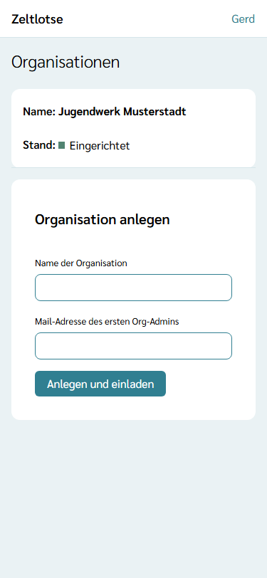
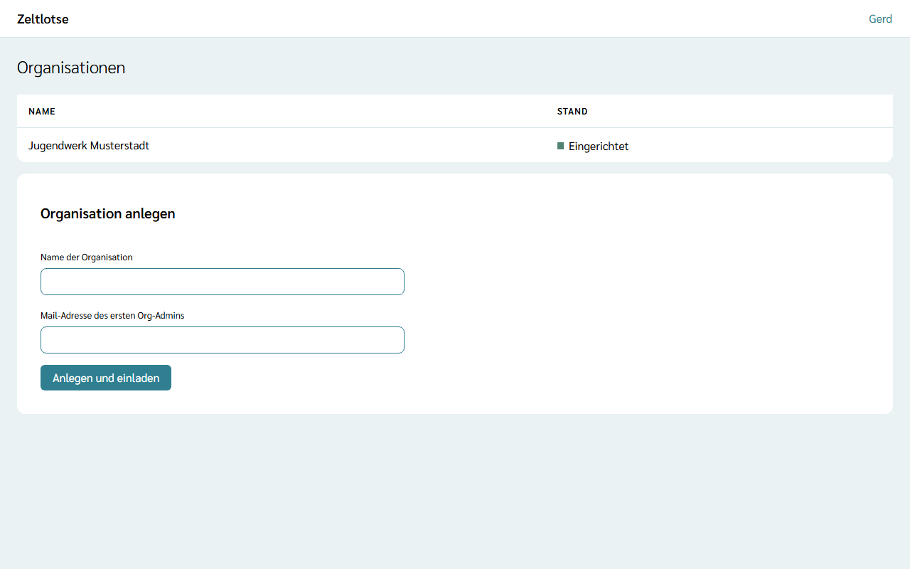

**Wer:** die Person, die Zeltlotse betreibt. In Zeltlotse heißt diese Rolle **Global Admin**. Wer Global Admin ist, steht in der Einstellung des Servers (Liste `Zeltlotse:GlobalAdmins` mit Mail-Adressen); beim Start übernimmt Zeltlotse diese Liste. Eine Seite zum Ernennen gibt es nicht. Fehlt zu einer Mail-Adresse der Liste noch ein Konto, legt Zeltlotse es an; die Anmeldung geht dann wie für alle per Login-Link (siehe [Anmelden](/erste-schritte/anmelden/)).

## Was der Global Admin darf

- **Organisationen anlegen** und dabei den **ersten Org-Admin einladen**,
- die **Liste aller Organisationen** mit ihrem Stand sehen.

Der Global Admin sieht **keine Personendaten**: keine Rollenlisten einer Organisation, keine Freizeiten, keine Freizeitpässe. Ohne eigene Rolle in einer Organisation ist deren Seite für ihn nicht verfügbar. Alles Weitere in der Organisation regelt der [Org-Admin](/org-admin/).

## Organisation anlegen

1. Auf der Startseite **Organisationen verwalten** wählen.
2. Unter **Organisation anlegen** den **Namen der Organisation** (höchstens 100 Zeichen) und die **Mail-Adresse des ersten Org-Admins** eintragen.
3. **Anlegen und einladen** wählen. Danach steht dort „Gespeichert: Die Organisation ist angelegt, die Einladung ist verschickt.“

Die eingeladene Person bekommt eine Mail „Einladung zu Zeltlotse“ mit einem Link. Wie es dort weitergeht, steht unter [Einladung annehmen](/org-admin/einladung-annehmen/).

## Stand einer Organisation

| Stand | Bedeutung |
| --- | --- |
| Einladung offen | Der erste Org-Admin hat die Einladung noch nicht angenommen. |
| Eingerichtet | Mindestens ein Org-Admin hat seine Einladung angenommen. |

Die Einladung gilt **7 Tage** und nur **einmal**. Eine neue Einladung für den ersten Org-Admin kann der Global Admin in dieser Version nicht verschicken; weitere Personen lädt der Org-Admin selbst ein.
