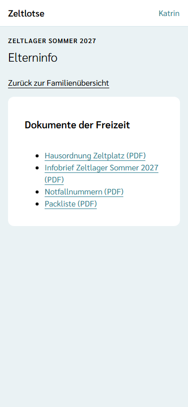
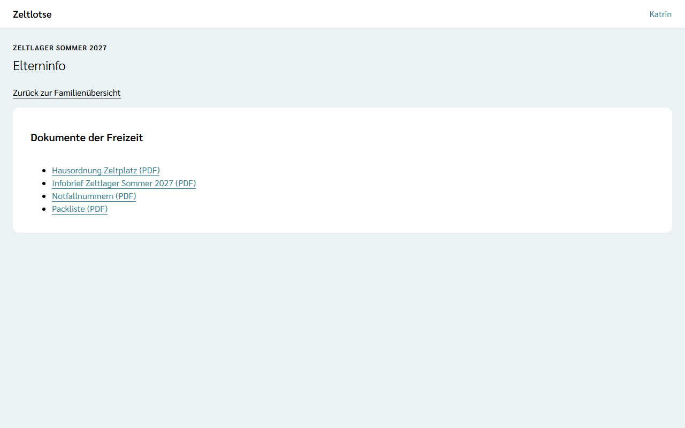
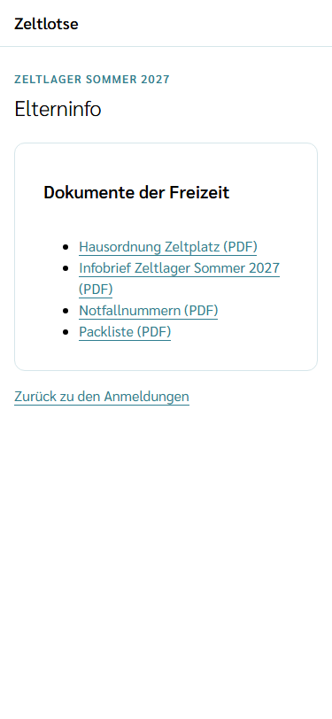
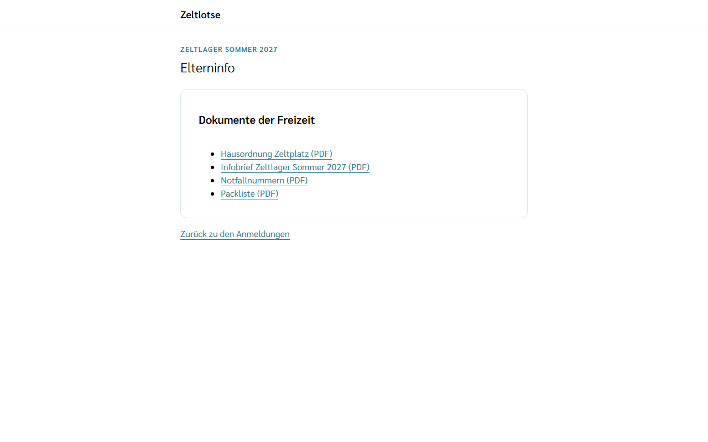

Die **Elterninfo** einer Anmeldung zeigt die Dokumente, die die Leitung für Eltern und Teilnehmende freigegeben hat: zum Beispiel Infobrief, Packliste, Notfallnummern oder die Hausordnung des Zeltplatzes. Welche Dokumente dort stehen, entscheidet die Freizeit mit der Sichtbarkeit „Eltern und Teilnehmende“ (siehe [Dokumente ablegen](/mitarbeitende/dokumente/#wer-ein-dokument-sieht)). Dokumente nur für das Team stehen nicht in der Elterninfo; öffentliche Dokumente stehen auf der [Freizeitseite](/eltern/freizeitseite/).

## Im Familienkonto

In der Familienübersicht steht unter jeder Anmeldung, die nicht abgesagt ist, der Link **Elterninfo**. Er öffnet die Seite **Elterninfo** mit dem Namen der Freizeit oben und der Liste der Dokumente, jeweils mit der Art der Datei, etwa „Packliste (PDF)“. Ein Tipp lädt die Datei herunter. Gibt es noch keine Dokumente, steht „Noch keine Elterninfo.“ **Zurück zur Familienübersicht** führt zurück.

Volljährige Teilnehmende sehen die Elterninfo ihrer eigenen Anmeldung genauso. Sind Geschwister in derselben Freizeit angemeldet, steht unter jeder ihrer Anmeldungen dieselbe Elterninfo.

## Über den Gast-Link

Wer als Gast ohne Konto angemeldet hat, findet auf der Seite des **Gast-Links** aus der Eingangsmail bei jeder Anmeldung, die nicht abgesagt ist, den Link **Elterninfo**. Er zeigt dieselben Dokumente wie im Konto, ohne Anmeldung. **Zurück zu den Anmeldungen** führt zum Gast-Link zurück.

Die Elterninfo gilt so lange wie der Gast-Link: bis zum Ende des Freigabefensters der Freizeit. Danach steht dort „Dieser Link ist nicht mehr gültig.“ Mit einem Konto bleibt die Elterninfo in der Familienübersicht erreichbar (siehe [Kind anmelden](/eltern/kind-anmelden/)).

## Gut zu wissen

- Eine abgesagte Anmeldung hat keine Elterninfo mehr.
- Die Dateien kommen immer als Download; Zeltlotse zeigt sie nicht in der Seite an.
- Ändert die Leitung ein Dokument oder seine Sichtbarkeit, zeigt die Elterninfo beim nächsten Öffnen den neuen Stand.
