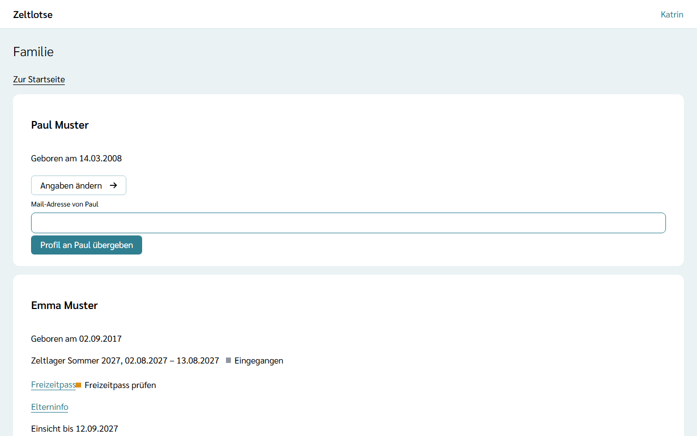
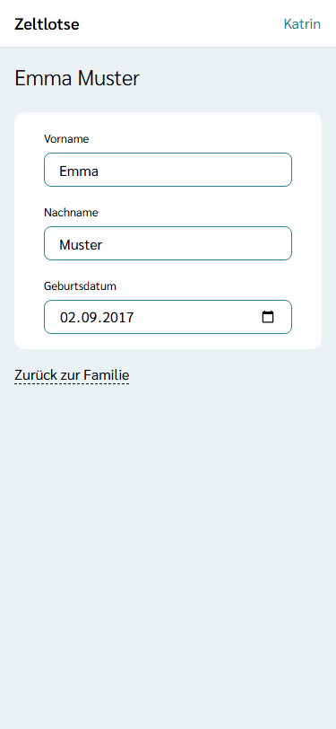
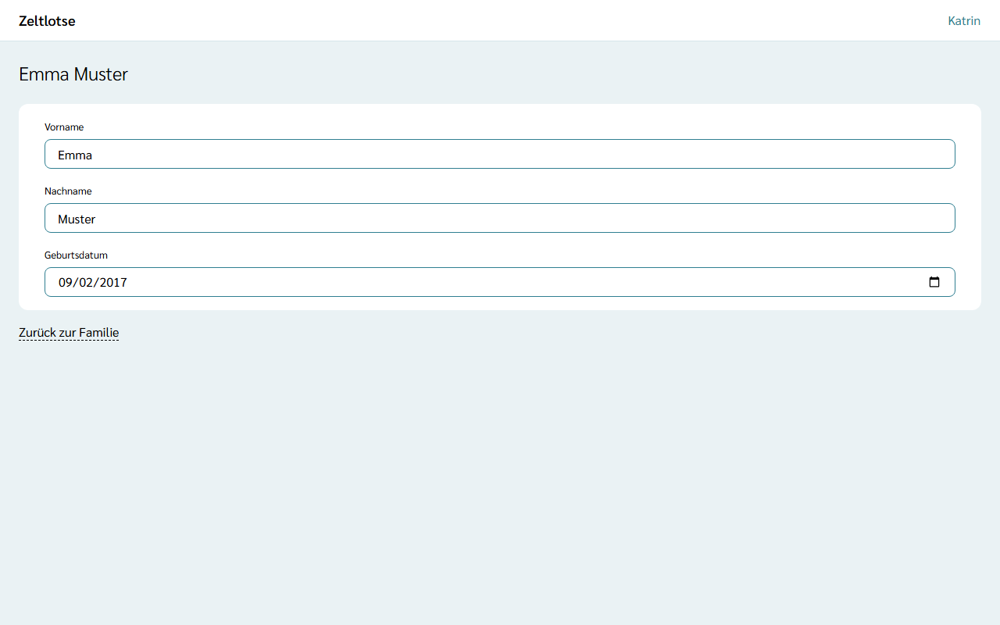
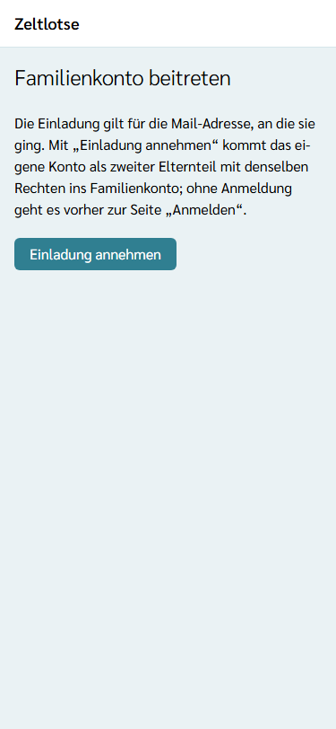
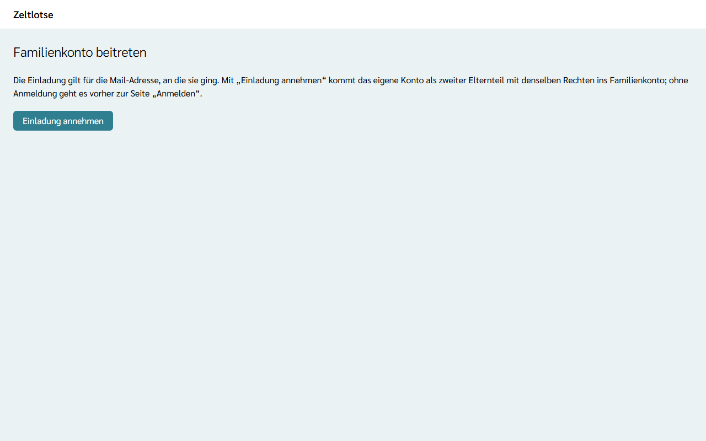

Im **Familienkonto** liegen die Profile der Kinder. Eltern verwalten sie dort, bis ein Kind volljährig ist und sein Profil selbst übernimmt (siehe [Profil übergeben](/eltern/profil-uebergeben/)). Ein Familienkonto hat höchstens **zwei Eltern**, beide mit denselben Rechten.

Das Familienkonto entsteht von selbst beim ersten „Kind hinzufügen“ oder „Einladung schicken“; wer das tut, ist sein erster Elternteil. Nach dem Anmelden steht auf der Startseite dann die Card **Familie** mit den Namen der Kinder und dem Knopf **Familie öffnen**. Auch auf der Seite „Konto“ führt der Knopf **Familienkonto öffnen** dorthin.

## Kind hinzufügen

1. Auf der Seite **Familie** zur Card **Kind hinzufügen** gehen.
2. **Vorname** und **Geburtsdatum** eintragen; beide sind Pflicht (mit „*“ markiert). Der **Nachname** ist freiwillig.
3. **Kind hinzufügen** wählen. Es erscheint „Gespeichert: Das Kind ist hinzugefügt.“, und das Kind steht als eigene Card in der Liste.

Kinder stehen nach Geburtsdatum, das älteste zuerst. Jede Card zeigt den Namen, „Geboren am …“ und die Freizeiten, zu denen das Kind angemeldet ist, mit Zeitraum und Status, zum Beispiel „Eingegangen“ oder „Bestätigt“, darunter den Link **Elterninfo** mit den Dokumenten der Freizeit für Eltern (siehe [Elterninfo](/eltern/elterninfo/)) und, an wen sich eine Absage richtet (siehe [Kind anmelden](/eltern/kind-anmelden/#absagen)). Eigene Anmeldungen stehen in der Card **Eigene Anmeldungen**. Einen Anmelden-Knopf gibt es hier nicht; angemeldet wird über den Anmeldelink der Freizeit (siehe [Kind anmelden](/eltern/kind-anmelden/)). Fehlt eine Angabe oder stimmt sie nicht, steht der Fehler direkt am Feld, etwa „Fehler: Geburtsdatum fehlt.“ oder „Fehler: Das Geburtsdatum liegt in der Zukunft.“

:::note[Ab 18 ein eigenes Konto]
Wer schon 18 ist, lässt sich nicht als Kind hinzufügen („Fehler: Kinder ab 18 legen ein eigenes Konto an.“); Volljährige melden sich mit ihrer eigenen Mail-Adresse selbst an. Ein später geändertes Geburtsdatum darf ein Kind im Familienkonto dagegen volljährig machen, dann erscheint bei ihm die [Übergabe](/eltern/profil-uebergeben/).
:::

## Angaben eines Kindes ändern

1. In der Card des Kindes **Angaben ändern** wählen.
2. Vorname, Nachname oder Geburtsdatum ändern. Jede Angabe speichert beim Verlassen des Feldes; danach steht dort „Gespeichert“ mit „Rückgängig“.
3. **Zurück zur Familie** führt zur Seite „Familie“ zurück.

Haben beide Eltern dasselbe Feld gleichzeitig geändert, steht am Feld „Inzwischen geändert – neu laden?“. Nach „Neu laden“ zeigt das Feld den gespeicherten Wert.

## Zweiten Elternteil einladen

1. Auf der Seite **Familie** zur Card **Zweiten Elternteil hinzufügen** gehen. Sie erscheint nur, solange das Familienkonto weniger als zwei Eltern hat.
2. Die **Mail-Adresse** des anderen Elternteils eintragen und **Einladung schicken** wählen.
3. Es erscheint „Gespeichert: Die Einladung ist verschickt.“ Die Card **Eltern** zeigt die Einladung mit „eingeladen, gültig bis …“.

Die Einladung gilt **7 Tage** und nur einmal. Eine neue Einladung ersetzt eine ältere, noch offene; dann gilt nur der Link aus der neuesten Mail. Hat das Familienkonto schon zwei Eltern, erscheint „Fehler: Das Familienkonto hat schon zwei Eltern.“

## Einladung annehmen

1. In der Mail „Einladung ins Familienkonto“ den Link öffnen.
2. Es erscheint die Seite **Familienkonto beitreten**. Das Öffnen allein nimmt noch nichts an.
3. **Einladung annehmen** wählen.
4. Ohne Anmeldung erscheint zuerst die Seite „Anmelden“. Mit **derselben Mail-Adresse** anmelden, an die die Einladung ging, am einfachsten mit dem **Login-Code**. Danach erscheint wieder „Familienkonto beitreten“; dort noch einmal **Einladung annehmen** wählen.
5. Zeltlotse zeigt die Seite **Familie** mit den Kindern des Familienkontos.

Erscheint „Fehler: Diese Einladung ist nicht mehr gültig oder gilt für eine andere Mail-Adresse.“, ist die Einladung älter als 7 Tage, schon angenommen, durch eine neuere ersetzt, oder die Anmeldung läuft mit einer anderen Mail-Adresse. Dann mit der eingeladenen Mail-Adresse anmelden oder um eine neue Einladung bitten.

Erscheint „Fehler: Dieses Konto gehört schon zu einer anderen Familie, oder das Familienkonto hat schon zwei Eltern.“, ist das eigene Konto bereits Elternteil eines anderen Familienkontos, oder das eingeladene Familienkonto hat inzwischen zwei Eltern. Jede Person kann nur zu einem Familienkonto gehören.
