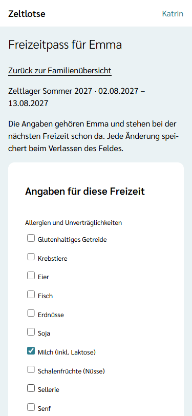
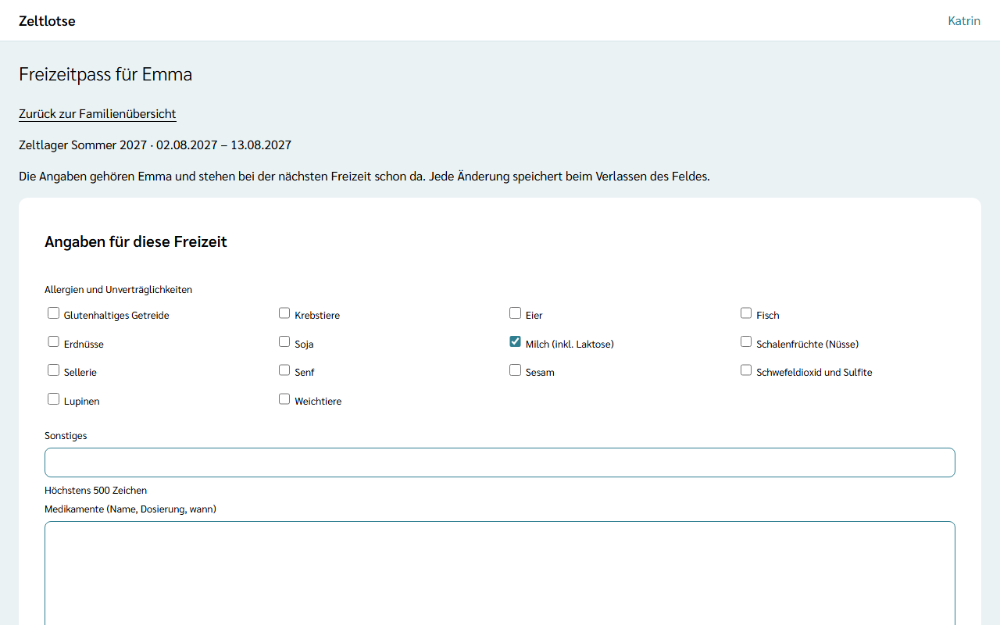
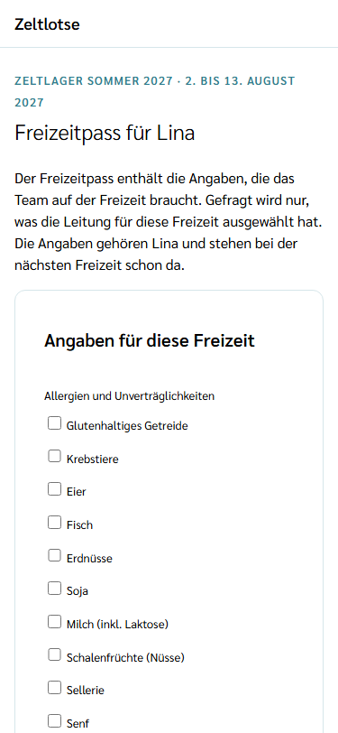
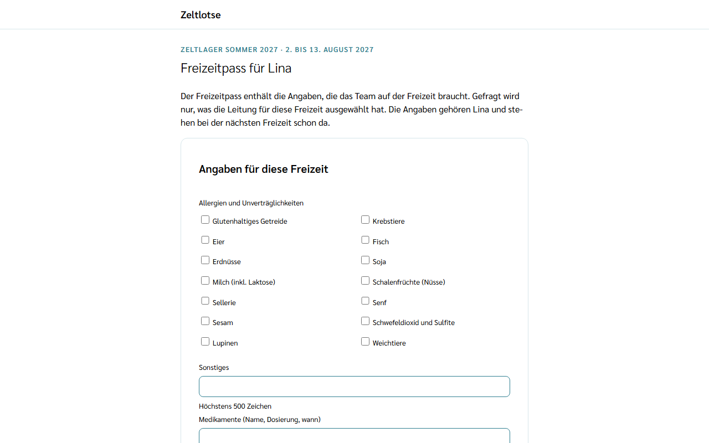

Der **Freizeitpass** enthält die Angaben, die das Team auf einer Freizeit über eine Person braucht, zum Beispiel Allergien, Medikamente und Notfallkontakte. Gefragt wird nur, was die Leitung für diese Freizeit ausgewählt hat; fragt sie etwas nicht ab, erscheint die Frage gar nicht erst.

Die Antworten **gehören der Person**, nicht der Freizeit. Bei der nächsten Freizeit stehen sie deshalb schon da: Wer im nächsten Jahr wieder anmeldet, prüft nur, ob noch alles stimmt.

## Mit Konto: aus der Familienübersicht

1. Die Seite **Familie** öffnen (siehe [Familienkonto](/eltern/familienkonto/)).
2. Unter der Freizeit in der Card des Kindes **Freizeitpass** wählen. Für eigene Anmeldungen steht der Link in der Card **Eigene Anmeldungen**.

Fehlt eine abgefragte Angabe oder ist sie älter als 12 Monate, steht neben dem Link **Freizeitpass prüfen**.

Direkt nach einer Anmeldung mit Konto führt auch der Knopf **Freizeitpass für … ausfüllen** auf der Seite „Anmeldung eingegangen“ dorthin (siehe [Kind anmelden](/eltern/kind-anmelden/#mit-konto-anmelden)).

## Angaben eintragen

Die Seite zeigt nur die Fragen dieser Freizeit, immer in derselben Reihenfolge. **Allergien, Medikamente und Notfallkontakte** stehen immer oben und sind nie zugeklappt.

| Frage | Eingabe |
| --- | --- |
| **Allergien und Unverträglichkeiten** | Kästchen für die 14 Hauptallergene (zum Beispiel Milch, Eier, Erdnüsse, Glutenhaltiges Getreide), dazu das Feld **Sonstiges** für alles andere. |
| **Medikamente (Name, Dosierung, wann)** | Freier Text. |
| **Notfallkontakte (Name, Telefon)** | Freier Text, zum Beispiel „Katrin Muster (Mutter), 0123 456780“. |
| **Ernährung** | Kästchen „Vegetarisch“, „Vegan“, „Kein Schweinefleisch“ und das Feld **Sonstiges**. |
| **Krankheiten und Einschränkungen**, **Krankenversicherung**, **Weitere Hinweise für das Team** | Freier Text. |
| **Letzte Tetanus-Impfung** | Datum. |
| **Kann schwimmen**, **Zecken dürfen vom Team entfernt werden** | Ja oder Nein. |

Jede Angabe **speichert sofort**: ein Kästchen oder Ja/Nein beim Antippen, ein Textfeld beim Verlassen des Feldes. Danach steht „Gespeichert“ mit „Rückgängig“ am Feld. Freier Text darf höchstens 2000 Zeichen lang sein, „Sonstiges“ höchstens 500. Ein leeres Feld heißt „keine Angabe“.

Hat jemand anderes (etwa der zweite Elternteil) dieselbe Angabe gerade geändert, steht „Inzwischen geändert – neu laden?“ am Feld; **Neu laden** zeigt den aktuellen Stand.

Fragt die Freizeit nichts ab, steht dort „Diese Freizeit fragt keine Angaben ab.“

## „Stimmt das noch?“

Wurde eine Angabe seit mehr als **12 Monaten** weder geändert noch bestätigt, steht darüber **Stimmt das noch?**. Ist die Angabe noch richtig, **Stimmt** wählen; der Hinweis verschwindet, und die Angabe gilt wieder für 12 Monate. Sonst die Angabe einfach ändern – auch das bestätigt sie.

## Als Gast: über den Gast-Link

Ohne Konto geht es über den **Gast-Link** aus der Mail nach der Gast-Anmeldung (siehe [Kind anmelden](/eltern/kind-anmelden/#der-gast-link)):

1. Den Gast-Link öffnen. Unter jeder Anmeldung steht der Knopf **Freizeitpass für …**.
2. Die Fragen ausfüllen. Bei einer Angabe, die älter als 12 Monate ist, steht „Stimmt das noch?“ mit dem Haken **Stimmt noch: …**.
3. **Speichern** wählen. Oben erscheint „Gespeichert: Freizeitpass gespeichert.“

Gespeichert werden nur Angaben, die sich geändert haben; eine unveränderte Angabe gilt nur dann als bestätigt, wenn der Haken „Stimmt noch“ gesetzt ist. Ist etwas ungültig, etwa ein unmögliches Datum, steht oben eine Fehlerübersicht mit Links zu den Feldern und am Feld der Fehler; die Eingaben bleiben stehen.

Wird aus der Gast-Anmeldung später ein Konto (**Konto aus diesen Daten erstellen**), stehen die Antworten dort schon im Freizeitpass.

## Wer die Angaben sieht

Die Angaben sind verschlüsselt gespeichert und gehören der Person. Für die Freizeit gilt die **Freigabe**: Einsicht bekommt sie nur befristet und nur in die Fragen, die sie abgefragt hat – die Leitung ab dem Eingang der Anmeldung, das Team ab der Bestätigung, bis zum Ende des Freigabefensters. Einzelheiten stehen unter [Was passiert mit meinen Daten](/daten/).
