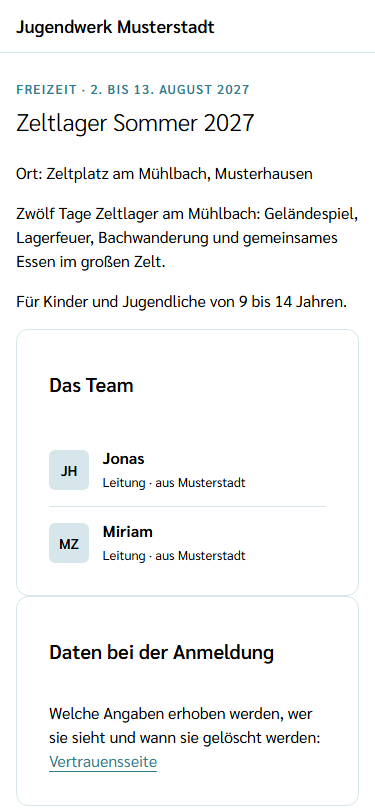
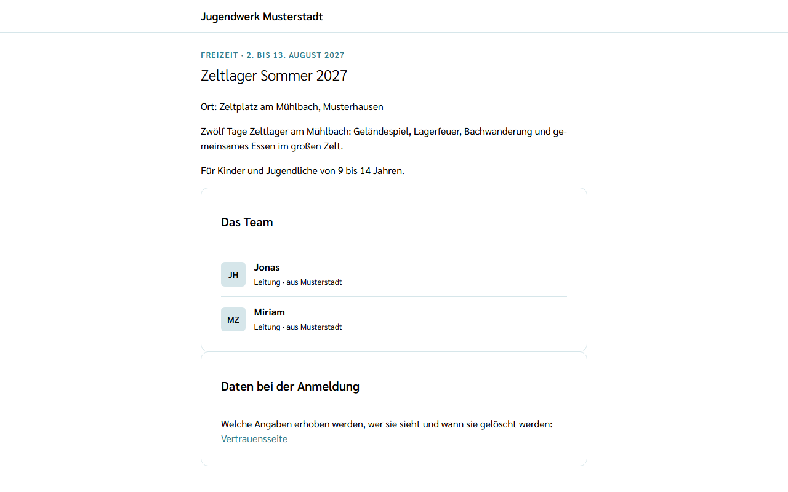
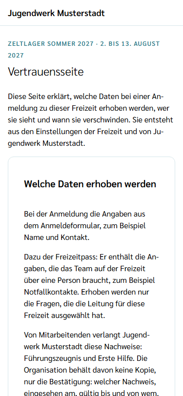
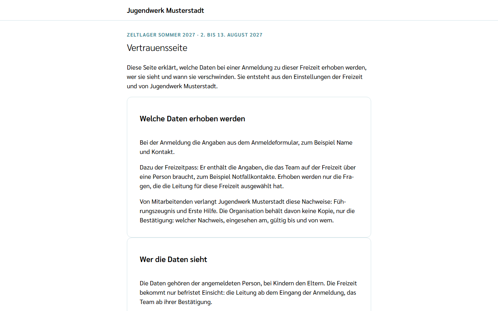

Jede Freizeit hat eine öffentliche **Freizeitseite**. Sie öffnet sich über den **Anmeldelink**, den die Leitung verteilt, zum Beispiel per Mail, im Gemeindebrief oder im WhatsApp-Status. Für die Freizeitseite braucht es weder ein Konto noch eine Installation; sie funktioniert im Browser am Handy und am Laptop.

## Was die Freizeitseite zeigt

- oben den **Namen der Organisation**, die die Freizeit veranstaltet,
- den **Zeitraum**, zum Beispiel „Freizeit · 2. bis 13. August 2027“,
- den **Namen** der Freizeit, den **Ort** und die **Beschreibung**,
- **Das Team:** je Person einen Kreis mit den Initialen von Vor- und Nachname, den Vornamen, die Rolle und, wenn die Person sie in ihrem Profil eingetragen hat, die Herkunft, zum Beispiel „Leitung · aus Musterstadt“. Der volle Nachname, Mail-Adressen und Fotos stehen dort nicht.
- den Link zur **Vertrauensseite**.

Das Anmeldeformular selbst kommt in einer späteren Version auf diese Seite.

## Ausgebucht

Hat die Leitung eine Höchstzahl für Teilnehmende festgelegt und sind so viele Anmeldungen bestätigt, steht auf der Freizeitseite der Status **Ausgebucht** mit dem Satz „Anmelden ist trotzdem möglich, eine Zusage gibt es erst, wenn ein Platz frei wird.“ Eine Warteliste gibt es nicht; wer nachrückt, entscheidet die Leitung. Ohne Höchstzahl ist eine Freizeit nie ausgebucht. Über den Anmeldelink für Mitarbeitende erscheint „Ausgebucht“ nie, denn Mitarbeitende können immer dazukommen.

## Vertrauensseite

Die Vertrauensseite erklärt in drei Abschnitten, was mit den Daten bei einer Anmeldung zu dieser Freizeit passiert:

- **Welche Daten erhoben werden** – die Angaben aus dem Anmeldeformular und der **Freizeitpass**, also die Angaben, die das Team auf der Freizeit über eine Person braucht. Dazu die Nachweise, die die Organisation von Mitarbeitenden verlangt.
- **Wer die Daten sieht** – die Leitung ab Eingang der Anmeldung, das Team ab der Bestätigung, beide nur bis zum Ende des **Freigabefensters**. Das Datum steht auf der Seite.
- **Wann die Daten verschwinden** – nach welchen Fristen die Organisation die Daten der Freizeit und Bestätigungen von Nachweisen löscht, in Monaten.

Alle Werte kommen aus den gespeicherten Einstellungen der Freizeit und der Organisation. Ändert die Organisation zum Beispiel eine Löschfrist, zeigt die Vertrauensseite sofort den neuen Wert. Unten führt **Zurück zur Freizeitseite** zurück.

## Link nicht mehr gültig

Erscheint „Dieser Anmeldelink ist nicht mehr gültig.“, ist die Freizeit vorbei oder die Leitung hat einen neuen Link erzeugt. Die Leitung der Freizeit kann den aktuellen Link schicken.

Die Regeln, die für alle Organisationen gleich gelten, stehen unter [Was passiert mit meinen Daten](/daten/).
