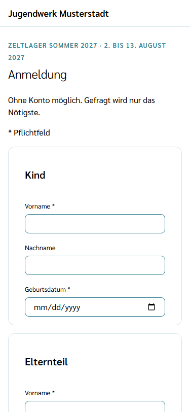
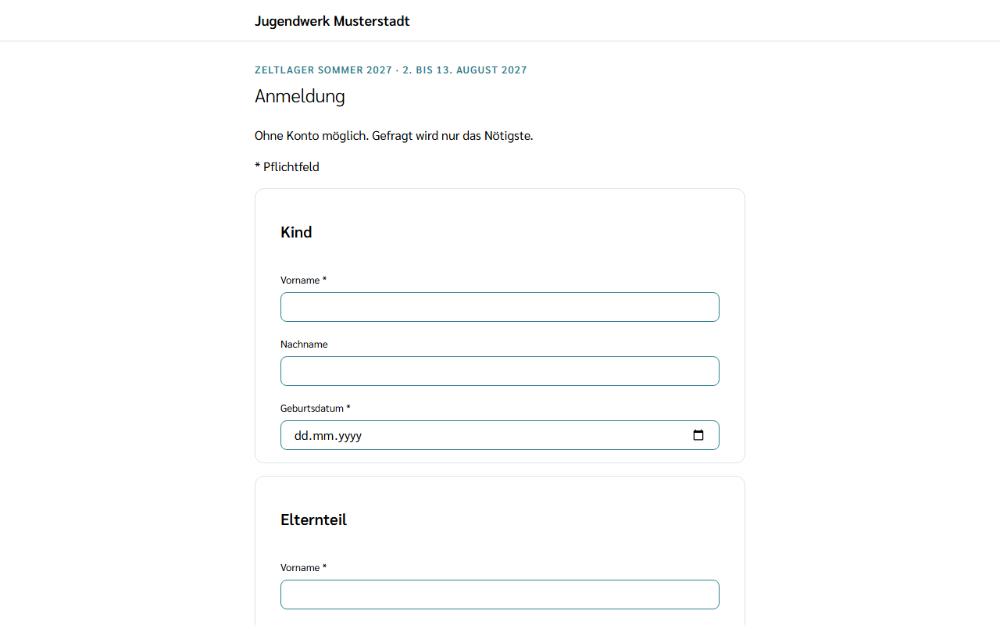
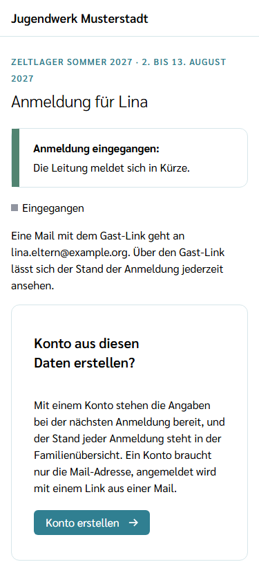
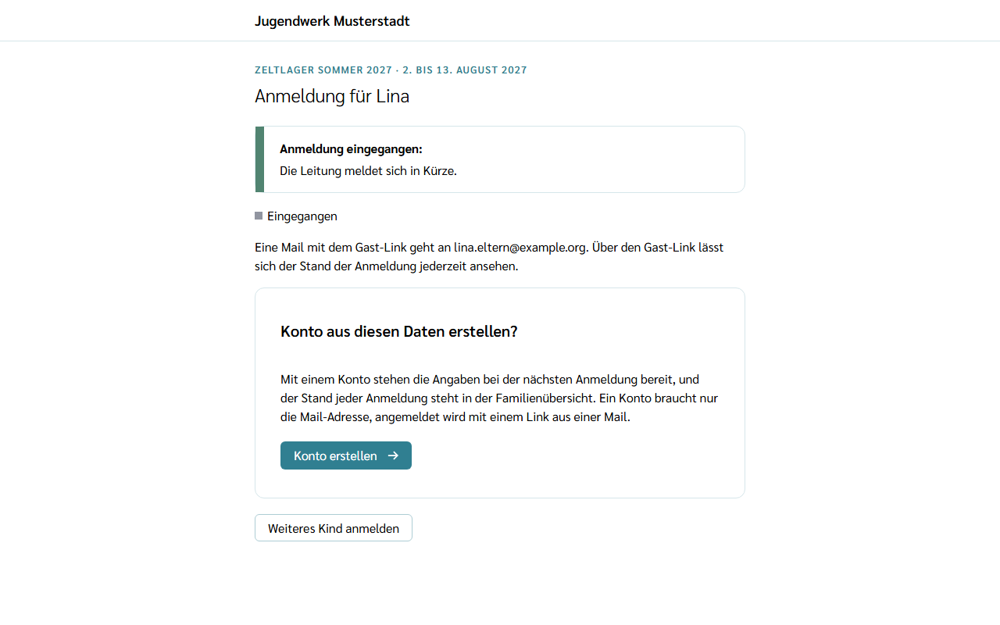
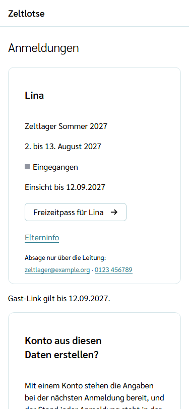
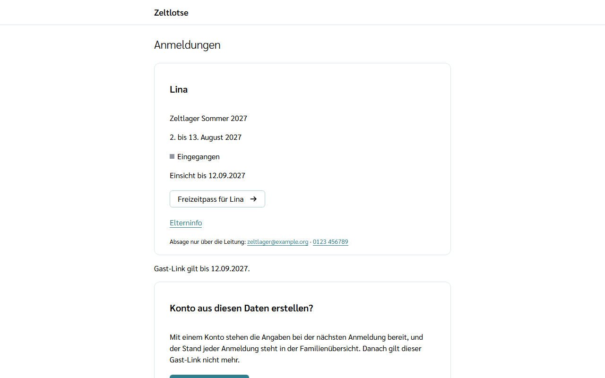
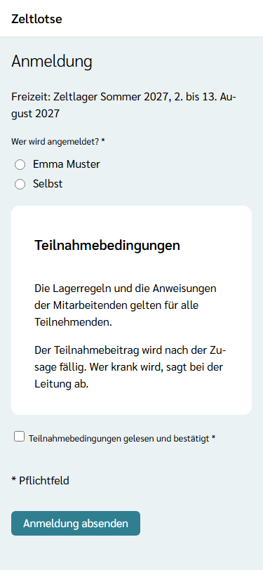
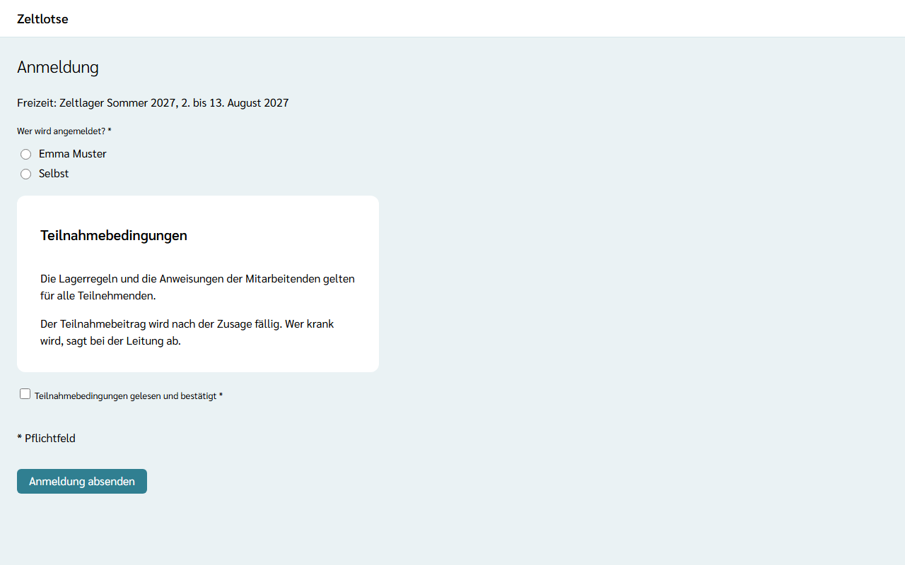

Angemeldet wird immer über den **Anmeldelink für Teilnehmende**, den die Leitung einer Freizeit verteilt. Er öffnet die [Freizeitseite](/eltern/freizeitseite/). Darauf stehen zwei Wege:

- **Anmelden** – als Gast, ohne Konto. Gefragt wird nur das Nötigste.
- **Mit Konto anmelden** – mit dem Familienkonto; die Angaben der Kinder sind dort schon gespeichert.

Die Familienübersicht hat keinen eigenen Anmelden-Knopf: Jede Freizeit hat ihren eigenen Anmeldelink.

## Als Gast anmelden

Eine Gast-Anmeldung ist für **Kinder unter 18** gedacht. Wer selbst 18 oder älter ist oder im Team mitarbeitet, meldet sich mit einem Konto an (siehe unten und [Für das Team anmelden](/mitarbeitende/anmelden/)).

1. Auf der Freizeitseite **Anmelden** wählen. Es erscheint das Formular **Anmeldung** mit dem Satz „Ohne Konto möglich. Gefragt wird nur das Nötigste.“
2. Im Abschnitt **Kind** Vorname und Geburtsdatum eintragen, der Nachname ist freiwillig.
3. Im Abschnitt **Elternteil** Vorname und E-Mail eintragen, der Nachname ist freiwillig. An diese Mail-Adresse gehen später Bestätigung oder Absage.
4. Die **Teilnahmebedingungen** der Freizeit lesen und **Teilnahmebedingungen gelesen und bestätigt** ankreuzen. Damit sind sie digital bestätigt; ein Papier zum Unterschreiben gibt es nicht. Hat die Leitung keine eigenen Teilnahmebedingungen hinterlegt, steht dort „Für diese Freizeit sind keine eigenen Teilnahmebedingungen hinterlegt.“
5. **Anmeldung absenden** wählen.

Felder mit „*“ sind Pflicht. Fehlt eine Angabe oder fehlt der Haken, steht oben eine Fehlerübersicht mit Links zu den betroffenen Feldern und am Feld der Fehler, etwa „Fehler: Geburtsdatum fehlt.“ Die eingetragenen Angaben bleiben stehen. Ohne Haken legt Zeltlotse nichts an. Ist das Kind schon 18, erscheint am Geburtsdatum „Fehler: Volljährige melden sich mit Konto an.“ mit dem Link **Mit Konto anmelden**.

Über den Link **Vertrauensseite** im Formular steht, welche Angaben erhoben werden, wer sie sieht und wann sie gelöscht werden.

Ist die Freizeit ausgebucht, steht oben im Formular „Ausgebucht“ mit dem Satz „Anmelden ist trotzdem möglich, eine Zusage gibt es erst, wenn ein Platz frei wird.“ Absenden bleibt möglich.

## Anmeldung eingegangen

Nach dem Absenden zeigt die Seite **Anmeldung für …** mit der Meldung „Anmeldung eingegangen: Die Leitung meldet sich in Kürze.“ und dem Status **Eingegangen**. Bestätigt ist die Anmeldung damit noch nicht; das entscheidet die Leitung.

Gleichzeitig geht eine Mail mit dem Betreff „Anmeldung eingegangen: …“ an die Mail-Adresse des Elternteils. Sie enthält den **Gast-Link**.

## Geschwister nacheinander anmelden

Auf der Seite „Anmeldung für …“ steht der Knopf **Weiteres Kind anmelden**. Er öffnet das Formular noch einmal: Die Angaben zum Elternteil stehen schon da und lassen sich nicht ändern, die Felder für das Kind sind leer. Kind eintragen, Teilnahmebedingungen bestätigen, **Anmeldung absenden**. Das Kind gehört zur selben Gast-Familie und steht unter demselben Gast-Link; auch dafür kommt eine Mail.

Die Elternangaben werden nur innerhalb dieser Seite weitergereicht, auf dem Gerät speichert Zeltlotse nichts. Wer den Anmeldelink später neu öffnet, gibt die Elternangaben neu ein – oder erstellt vorher ein Konto.

## Der Gast-Link

Der Gast-Link aus der Mail öffnet die Seite **Anmeldungen**: je angemeldetem Kind Vorname, Freizeit, Zeitraum, Status und, solange nicht abgesagt, der Knopf **Freizeitpass für …** (siehe [Freizeitpass ausfüllen](/eltern/freizeitpass/#als-gast-über-den-gast-link)), der Link **Elterninfo** mit Infobrief, Packliste und Notfallnummern (siehe [Elterninfo](/eltern/elterninfo/#über-den-gast-link)) und der Kontakt der Leitung für Absagen (siehe [Absagen](#absagen)). Darunter steht, bis wann der Gast-Link gilt.

- Er gilt bis zum Ende des **Freigabefensters** der Freizeit, also so lange, wie die Freizeit die Angaben sehen darf. Ist bei der Leitung noch keine Anmeldung angekommen, gilt er **einen Tag**.
- Hat ein Konto die Angaben übernommen, gilt der Gast-Link nicht mehr.
- Sagt die Leitung die einzige Anmeldung ab, endet der Gast-Link sofort; die Absage steht in der Mail.
- Ein ungültiger Gast-Link zeigt „Dieser Link ist nicht mehr gültig.“

## Konto aus diesen Daten erstellen

Nach der Gast-Anmeldung und auf dem Gast-Link steht die Card **Konto aus diesen Daten erstellen?** mit dem Knopf **Konto erstellen**. Mit einem Konto stehen die Angaben bei der nächsten Anmeldung bereit, und die Familienübersicht zeigt den Status jeder Anmeldung.

1. **Konto erstellen** wählen. Ohne Anmeldung erscheint zuerst die Seite „Anmelden“: mit einer Mail-Adresse anmelden, für die es noch keine eigenen Angaben gibt, am einfachsten mit dem Login-Code. Ein neues Konto entsteht dabei von selbst.
2. Auf der Seite **Konto aus diesen Daten erstellen** steht „Die Angaben aus der Gast-Anmeldung kommen in dieses Konto“. **Angaben übernehmen** wählen.
3. Es erscheint „Gespeichert: Die Angaben sind übernommen.“ **Neu anmelden** wählen und wieder anmelden. Danach öffnet sich die **Familie** mit den Kindern und ihrem Anmeldestatus.

Danach gilt der Gast-Link nicht mehr. Hat das Konto schon eigene Angaben (etwa einen Namen, Kinder oder eine Rolle in einer Freizeit), erscheint „Hinweis: Dieses Konto hat schon eigene Angaben. Die Gast-Anmeldung bleibt über den Gast-Link erreichbar.“ Zeltlotse führt zwei Profile nie von selbst zusammen.

## Mit Konto anmelden

1. Auf der Freizeitseite **Mit Konto anmelden** wählen. Ohne Anmeldung erscheint zuerst die Seite „Anmelden“; danach geht es zurück zur Anmeldung.
2. Unter **Wer wird angemeldet?** ein Kind unter 18 aus dem Familienkonto oder **Selbst** wählen. Volljährige Kinder stehen nicht in der Liste; sie melden sich mit ihrem eigenen Konto an.
3. Die Teilnahmebedingungen lesen, **Teilnahmebedingungen gelesen und bestätigt** ankreuzen und **Anmeldung absenden** wählen.
4. Es erscheint „Anmeldung eingegangen: Die Leitung meldet sich in Kürze.“ mit dem Knopf **Freizeitpass für … ausfüllen** und dem Weg **Zur Familienübersicht**. Der Freizeitpass zeigt nur die Fragen dieser Freizeit; Angaben aus einer früheren Freizeit stehen schon da (siehe [Freizeitpass ausfüllen](/eltern/freizeitpass/)).

Eine Mail gibt es bei dieser Anmeldung nicht; der Status steht in der Familienübersicht. Ist ein Kind schon angemeldet, erscheint „Hinweis: … ist für diese Freizeit schon angemeldet.“

## Status in der Familienübersicht

Auf der Seite **Familie** steht in der Card jedes Kindes jede Freizeit mit Zeitraum und Status, zum Beispiel „Zeltlager Sommer 2027, 02.08.2027 – 13.08.2027 · Eingegangen“. Eigene Anmeldungen stehen in einer eigenen Card **Eigene Anmeldungen**. Unter jeder Anmeldung führt der Link **Freizeitpass** zum Freizeitpass; fehlt eine abgefragte Angabe oder ist sie älter als 12 Monate, steht daneben **Freizeitpass prüfen**. Siehe [Familienkonto](/eltern/familienkonto/).

Der Status ist eines von drei Wörtern:

- **Eingegangen** – die Leitung hat noch nicht entschieden,
- **Bestätigt** – das Kind ist dabei,
- **Abgesagt** – das Kind ist nicht dabei.

Bestätigt oder sagt die Leitung ab, kommt eine Mail „Anmeldung bestätigt: …“ bzw. „Anmeldung abgesagt: …“. Sie geht an genau eine Adresse: an das eigene Konto der angemeldeten Person; sonst an den Elternteil der Familie mit Konto, dessen Profil zuerst angelegt wurde; sonst an die Mail-Adresse der Gast-Anmeldung. Der zweite Elternteil sieht den Status in der Familienübersicht.

## Absagen

Absagen geht nur über die Leitung; einen Absage-Knopf gibt es nicht. Unter jeder Anmeldung, die nicht abgesagt ist, steht deshalb „Absage nur über die Leitung:“ mit der Mail-Adresse und der Telefonnummer, die die Leitung dafür eingetragen hat. Ein Tipp darauf öffnet das Mail-Programm bzw. wählt die Nummer. Hat die Leitung keinen Kontakt eingetragen, steht dort „Absage nur über die Leitung der Freizeit.“ Dasselbe steht auf dem Gast-Link. Wer nachrückt, wenn ein Platz frei wird, entscheidet die Leitung.

Wie lange eine Freizeit die Angaben sieht und wann Gast-Angaben gelöscht werden, steht unter [Was passiert mit meinen Daten](/daten/).
