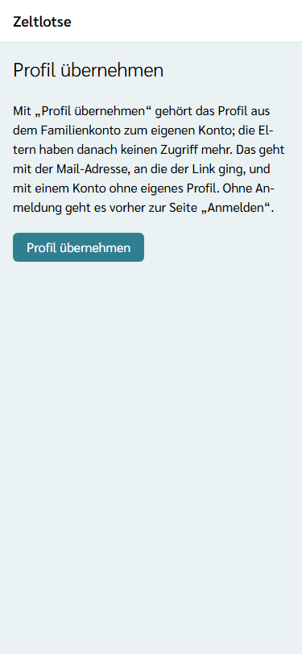
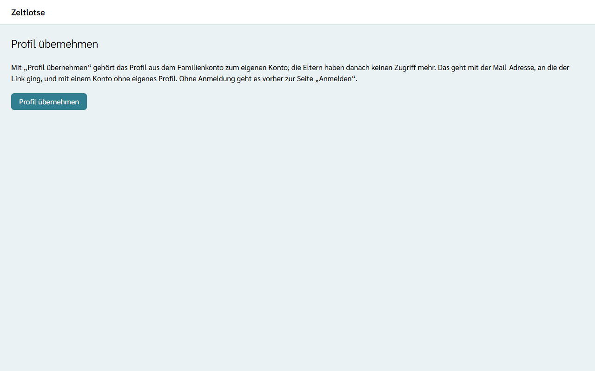

Wird ein Kind **18**, kann es sein Profil aus dem Familienkonto selbst übernehmen. Danach gehört das Profil zum eigenen Konto des Kindes, und das Familienkonto hat **keinen Zugriff** mehr darauf. Ab dem 18. Geburtstag zeigt die Seite **Familie** in der Card des Kindes das Feld „Mail-Adresse von …“ und den Knopf **Profil an … übergeben**. Bei jüngeren Kindern fehlen beide.

## Übergabe auslösen

1. Auf der Seite **Familie** in der Card des volljährigen Kindes die **Mail-Adresse des Kindes** eintragen.
2. **Profil an … übergeben** wählen. An derselben Stelle erscheint die Frage „Profil an … übergeben? Danach hat das Familienkonto keinen Zugriff mehr.“
3. **Ja, übergeben** wählen; „Nein“ bricht ab, ohne etwas zu verschicken.
4. Es erscheint „Gespeichert: Die Übergabe ist verschickt.“ Die Card zeigt „Übergabe verschickt an …, gültig bis …“.

Das Kind bekommt die Mail „Profil in Zeltlotse übernehmen“ mit einem Link. Der Link gilt **14 Tage** und nur einmal. Eine neue Übergabe ersetzt eine ältere, noch offene. Bis das Kind übernimmt, bleibt das Profil im Familienkonto.

:::caution[Erneut anmelden nach 10 Minuten]
Die Übergabe verlangt eine frische Anmeldung. Liegt die letzte Anmeldung länger als **10 Minuten** zurück, führt „Ja, übergeben“ zuerst zur Seite „Anmelden“. Nach der Anmeldung (am einfachsten mit dem Login-Code) geht es zurück zur Seite „Familie“; dort die Übergabe noch einmal auslösen. So kann niemand an einem fremden, noch angemeldeten Gerät ein Profil weitergeben.
:::

## Was das Kind tut

1. In der Mail „Profil in Zeltlotse übernehmen“ den Link öffnen.
2. Es erscheint die Seite **Profil übernehmen**. Das Öffnen allein übernimmt noch nichts.
3. **Profil übernehmen** wählen.
4. Ohne Anmeldung erscheint zuerst die Seite „Anmelden“. Mit **der Mail-Adresse anmelden, an die der Link ging**. Gibt es dazu noch kein Konto, entsteht es dabei. Danach wieder **Profil übernehmen** wählen.
5. Es erscheint „Gespeichert: Das Profil ist übernommen. Zum Abschluss neu anmelden.“ **Neu anmelden** wählen und sich noch einmal anmelden. Danach zeigt die Seite „Konto“ den eigenen Namen aus dem Profil.

Übernehmen geht nur mit einem Konto **ohne eigenes Profil**: ohne eingetragenen Namen, ohne Rolle in einer Freizeit und nicht selbst Elternteil eines Familienkontos. Profile werden nie automatisch zusammengeführt. Hat das Konto schon ein eigenes Profil, erscheint „Fehler: Dieses Konto hat schon ein eigenes Profil. Zum Übernehmen mit einer Mail-Adresse ohne eigenes Profil anmelden.“ Dann abmelden und mit einer anderen Mail-Adresse anmelden, an die die Eltern die Übergabe erneut schicken.

## Wenn der Link nicht mehr gilt

Erscheint „Dieser Link ist nicht mehr gültig. Die Eltern können die Übergabe erneut auslösen.“, ist der Link älter als 14 Tage, schon benutzt, durch eine neuere Übergabe ersetzt, oder die Anmeldung läuft mit einer anderen Mail-Adresse als der, an die er ging. Dann mit der richtigen Mail-Adresse anmelden oder die Eltern bitten, die Übergabe auf der Seite „Familie“ noch einmal auszulösen.

## Ohne Übergabe

Übergeben die Eltern nicht, legt das volljährige Kind bei der nächsten Anmeldung zu einer Freizeit einfach ein **eigenes Konto** mit eigener Mail-Adresse an. Das Profil im Familienkonto bleibt dann bei den Eltern.
