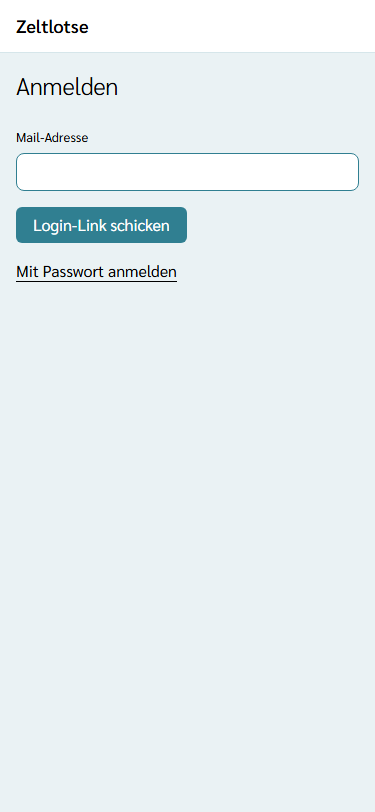
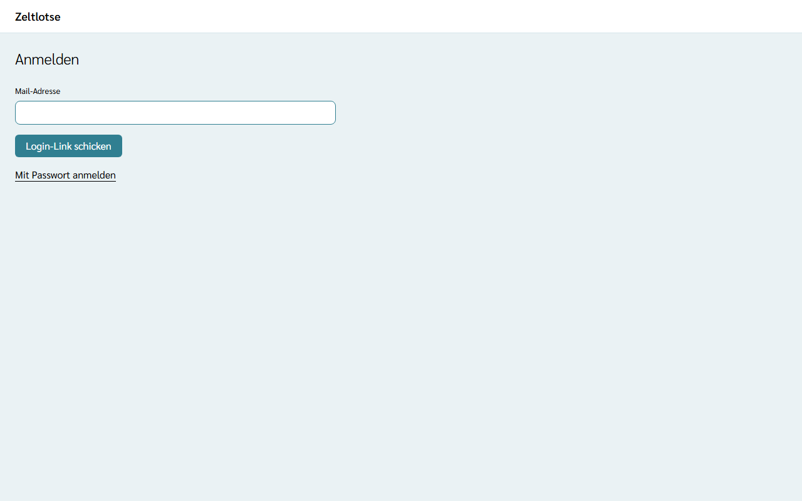
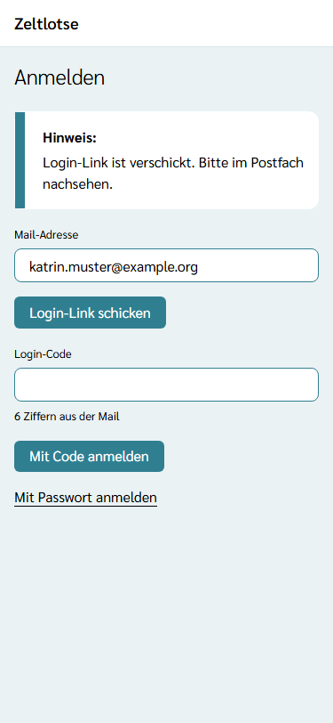
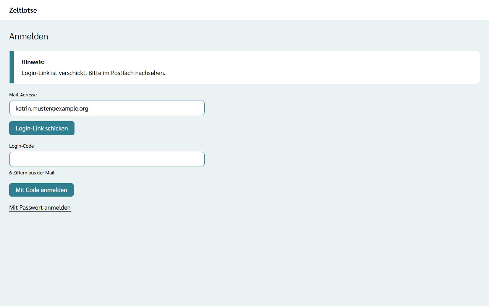

Für die Web-App braucht es ein Konto. Ein Konto entsteht beim ersten Anmelden mit der eigenen Mail-Adresse, eine eigene Registrierung gibt es nicht. Zum Anmelden genügt die Mail-Adresse: Zeltlotse schickt einen **Login-Link** und einen **Login-Code**. Ein Passwort ist freiwillig.

## Anmelden per Login-Link

1. Die Web-App öffnen (Adresse von Zeltlotse mit dem Zusatz `/app/`). Ohne Anmeldung erscheint die Seite „Anmelden“.
2. Die Mail-Adresse eintragen und „Login-Link schicken“ wählen.
3. In der Mail „Anmelden bei Zeltlotse“ den Link öffnen und auf der Seite, die sich öffnet, „Anmelden“ wählen.

Danach zeigt die Startseite die Begrüßung mit Vornamen. Gibt es zur Mail-Adresse noch kein Konto, legt dieser Schritt das Konto an; ein neues Konto begrüßt nur mit „Hallo“, bis der Vorname auf der Seite „Konto“ eingetragen ist.

Link und Code gelten **15 Minuten** und nur **einmal**. Wer einen neuen Link anfordert, macht den vorigen ungültig. Ist ein Link abgelaufen oder schon benutzt, steht dort „Dieser Link ist nicht mehr gültig.“ – der Knopf „Neuen Link schicken“ führt zurück zur Seite „Anmelden“.

## Anmelden per Code in der installierten App

Ist Zeltlotse am Handy installiert, öffnet der Link aus der Mail oft den Browser statt der App. Dafür steht in derselben Mail ein **Login-Code** mit 6 Ziffern:

1. In der installierten App die Mail-Adresse eintragen und „Login-Link schicken“ wählen.
2. Unter dem Hinweis „Login-Link ist verschickt. Bitte im Postfach nachsehen.“ erscheint das Feld „Login-Code“.
3. Den Code aus der Mail eintippen und „Mit Code anmelden“ wählen.

Stimmt der Code nicht, erscheint „Fehler: Der Code stimmt nicht oder ist abgelaufen.“ Nach 5 falschen Versuchen gelten weder der Code noch der Login-Link aus derselben Mail; „Neuen Link schicken“ verschickt dann neuen Link und neuen Code.

## Konto: Profil, Passwort und Abmelden

Nach dem Anmelden steht oben rechts in der App-Leiste der Vorname (oder „Konto“). Er führt zur Seite **Konto**:

- **Profil:** Vorname und Nachname. Jede Änderung speichert beim Verlassen des Feldes; danach steht „Gespeichert“ am Feld, mit „Rückgängig“.
- **Passwort festlegen:** Ein Passwort ist freiwillig und hat 10 bis 200 Zeichen. Nach „Passwort speichern“ steht dort „Gespeichert: Passwort ist festgelegt.“ Ein neues Passwort meldet alle anderen Geräte ab; das eigene Gerät bleibt angemeldet.
- **Familienkonto öffnen:** führt zur Seite „Familie“ mit den Kindern im Familienkonto (siehe [Familienkonto](/eltern/familienkonto/)).
- **Abmelden:** Der Knopf „Abmelden“ beendet die Anmeldung auf diesem Gerät und führt zur Seite „Anmelden“.

## Mit Passwort anmelden

Ist ein Passwort festgelegt, geht die Anmeldung auch ohne Login-Mail, nur mit Mail-Adresse und Passwort: Auf der Seite „Anmelden“ den Link „Mit Passwort anmelden“ wählen, Mail-Adresse und Passwort eintragen und „Anmelden“ wählen. Stimmt etwas nicht, steht dort „Fehler: Mail-Adresse oder Passwort stimmt nicht.“ Der Login-Link funktioniert weiterhin, auch mit Passwort. Ist das Passwort vergessen, genügt ein Login-Link: Damit ist die Anmeldung wieder möglich, und auf der Seite „Konto“ lässt sich ein neues Passwort festlegen.

## Wie lange die Anmeldung hält

Die Anmeldung bleibt auf dem Gerät **30 Tage** bestehen und verlängert sich bei jeder Nutzung, damit sie im Lager nicht abläuft. Ist sie abgelaufen oder wurde anderswo ein neues Passwort festgelegt, zeigt die Web-App beim nächsten Schritt die Seite „Anmelden“.
