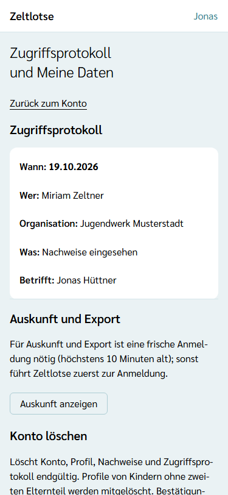
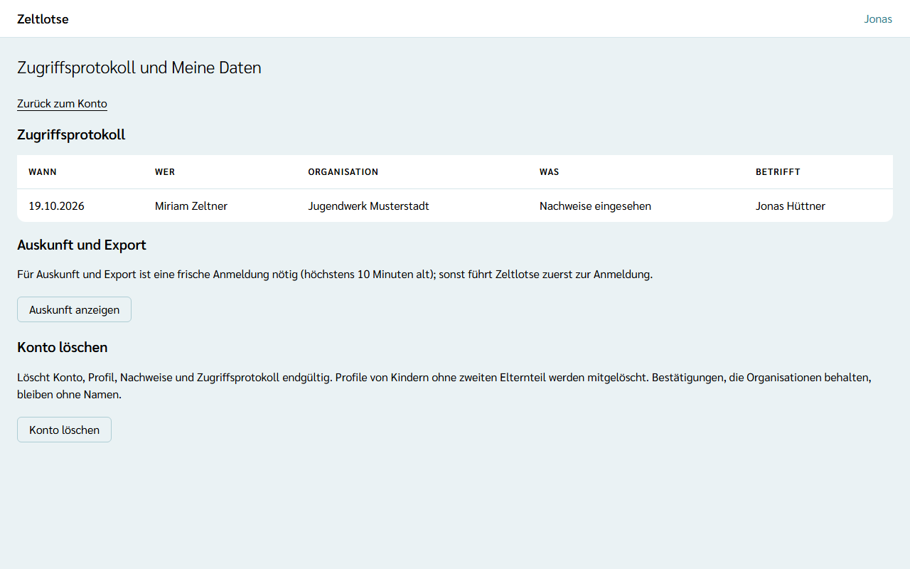
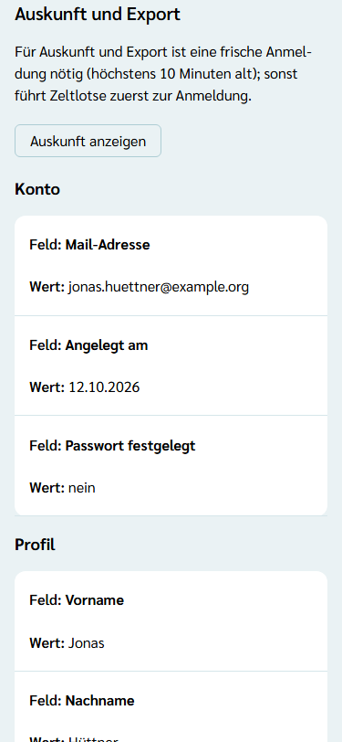
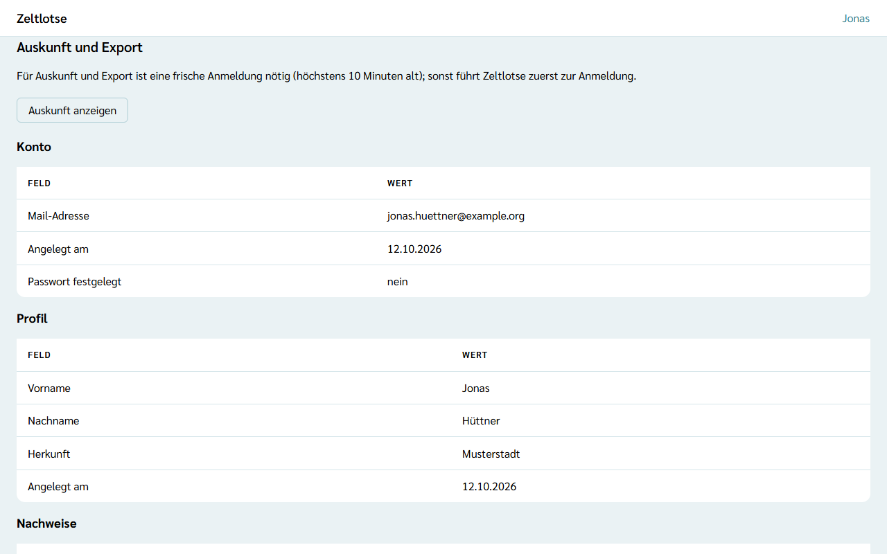
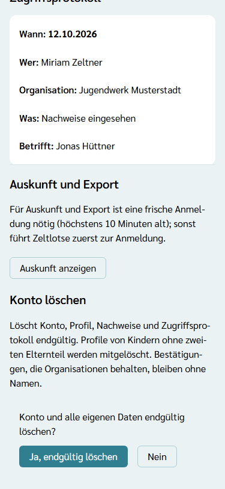
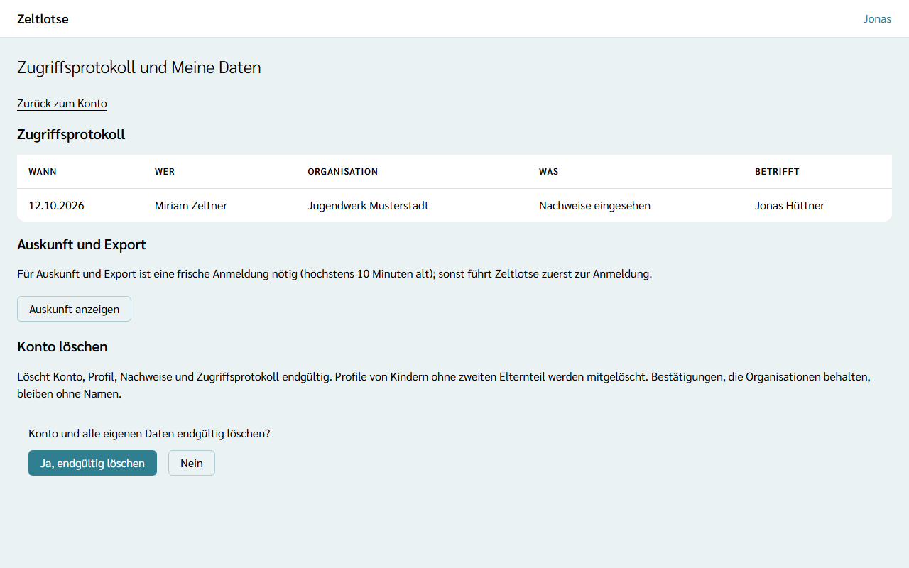

Auf der Seite **Zugriffsprotokoll und Meine Daten** steht, wer wann Einsicht in die eigenen Daten hatte. Dort gibt es auch eine **Auskunft** über alle gespeicherten Daten, einen **Export** als PDF oder CSV und den Knopf **Konto löschen**. Die Seite öffnet sich über die Seite **Konto** (oben rechts der Vorname) mit dem Knopf **Meine Daten öffnen** in der Card „Zugriffsprotokoll und Meine Daten“.

## Zugriffsprotokoll: wer Einsicht hatte

Die Tabelle zeigt jede Einsicht in die eigenen Daten, neueste zuerst:

- **Wann:** der Tag der Einsicht.
- **Wer:** die Person, die eingesehen hat. Ist ihr Konto gelöscht, steht dort „Gelöschte Person“. Beim „Allergen-Abgleich der Küche“ steht dort „Niemand persönlich (Abgleich)“: Die Küche sieht nur Anzahlen, keine einzelne Person.
- **Organisation:** für welche Organisation sie eingesehen hat.
- **Was:** wofür eingesehen wurde:
  - „Nachweise eingesehen“ – die Prüfung von Führungszeugnis, JuLeiCa und anderen Nachweisen (siehe [Nachweise](/mitarbeitende/nachweise/)),
  - „Freizeitpass eingesehen“ – Leitung oder Team einer Freizeit hat die Angaben im Freizeitpass angesehen (siehe [Freizeitpass](/eltern/freizeitpass/)),
  - „Allergen-Abgleich der Küche“ – die Küche hat für die Ersatzportionen die angekreuzten Allergene gezählt; sie sieht dabei nur Anzahlen, keine Namen (siehe [Einkaufsliste](/kueche/einkaufsliste/#allergen-abgleich-und-ersatzportionen)).
- **Betrifft:** wessen Daten. Eltern sehen hier auch die Einsichten in die Daten ihrer Kinder im Familienkonto, der zweite Elternteil ebenso.

Festgehalten wird jede Einsicht, höchstens einmal am Tag je Person und Zweck. Hatte noch niemand Einsicht, steht dort „Bisher hatte niemand Einsicht.“

## Auskunft anzeigen

Der Knopf **Auskunft anzeigen** zeigt alle Daten, die Zeltlotse zur eigenen Person gespeichert hat, je Bereich mit Feld und Wert: zum Beispiel Konto, Profil, Familie, Nachweise, Einsicht-Anfragen, Zugriffsprotokoll, Rollen in Organisationen, Nachweis-Bestätigungen, Mitarbeit in Freizeiten und das Sicherheitsprotokoll. Bereiche ohne Daten fehlen. Die Auskunft gilt nur für die eigene Person; für Kinder gibt es keine eigene Auskunft.

:::note[Erneute Anmeldung]
Für Auskunft und Export muss die letzte Anmeldung höchstens **10 Minuten** zurückliegen. Ist sie älter, führt Zeltlotse zuerst zur Seite „Anmelden“ und danach zurück auf diese Seite. Dann noch einmal **Auskunft anzeigen** wählen. Jede Auskunft wird im Sicherheitsprotokoll festgehalten, nur mit Kennungen.
:::

## Als PDF oder CSV speichern

Unter der Auskunft stehen zwei Knöpfe:

- **Als PDF speichern** öffnet den Druckdialog des Browsers. Dort als Ziel „Als PDF speichern“ wählen. Gedruckt wird nur die Seite selbst, ohne App-Leiste, Navigation und Knöpfe.
- **Als CSV herunterladen** speichert eine Datei `zeltlotse-meine-daten-JJJJ-MM-TT.csv` mit den Spalten Bereich, Feld und Wert. Sie lässt sich mit einem Tabellenprogramm öffnen; Umlaute bleiben erhalten. Werte, die mit `=`, `+`, `-` oder `@` beginnen, bekommen ein Hochkomma davor, damit das Tabellenprogramm sie nicht als Formel ausführt.

Beide Dateien enthalten persönliche Daten. Sie gehören nur auf ein eigenes Gerät.

## Konto löschen

**Konto löschen** löscht Konto, Profil, Nachweise samt Dateien und das Zugriffsprotokoll **endgültig**:

1. Auf der Seite „Zugriffsprotokoll und Meine Daten“ unten **Konto löschen** wählen.
2. Die Frage „Konto und alle eigenen Daten endgültig löschen?“ mit **Ja, endgültig löschen** bestätigen. „Nein“ bricht ab.

Danach steht dort „Gelöscht: Das Konto ist gelöscht.“, und die Anmeldung auf diesem Gerät ist beendet, kurz danach auch auf allen anderen Geräten. Auch hier muss die letzte Anmeldung höchstens 10 Minuten zurückliegen.

Was beim Löschen geschieht:

- **Eigene Daten:** Profil, Nachweise mit Dateien, Einsicht-Anfragen, Erinnerungen und das Zugriffsprotokoll über die eigene Person sind sofort gelöscht. Der Schlüssel der Person wird vernichtet; was mit ihm verschlüsselt war, ist danach auch in Sicherungskopien unlesbar.
- **Kinder:** Ist die Person der einzige Elternteil im Familienkonto, werden die Profile der Kinder und das Familienkonto mitgelöscht. Gibt es einen zweiten Elternteil, bleiben die Kinder bei ihm.
- **Organisationen und Freizeiten:** Rollen in Organisationen und Freizeiten und die eigenen Nachweis-Bestätigungen werden gelöscht. Wo die Person bei anderen etwas geprüft oder eingesehen hat, bleibt der Eintrag ohne Namen stehen („Gelöschte Person“).
- **Neu anfangen:** Eine spätere Anmeldung mit derselben Mail-Adresse beginnt mit einem neuen, leeren Konto.

Mehr zu den Regeln steht unter [Was passiert mit meinen Daten](/daten/).
