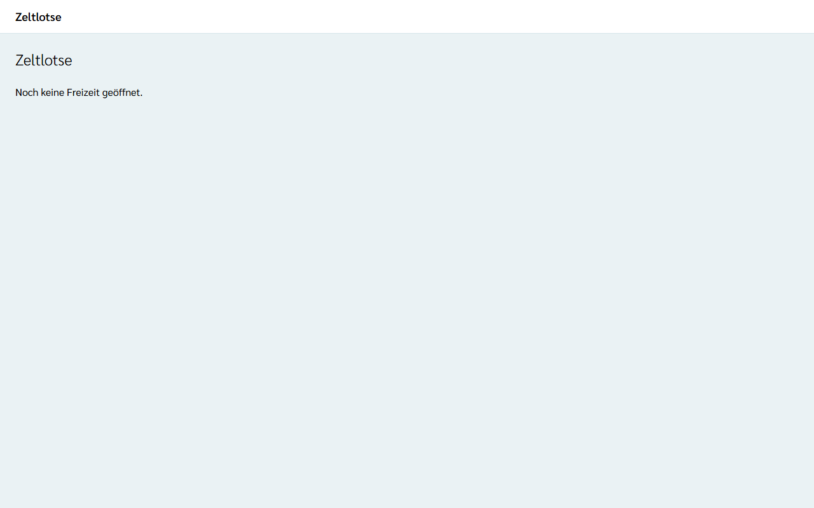
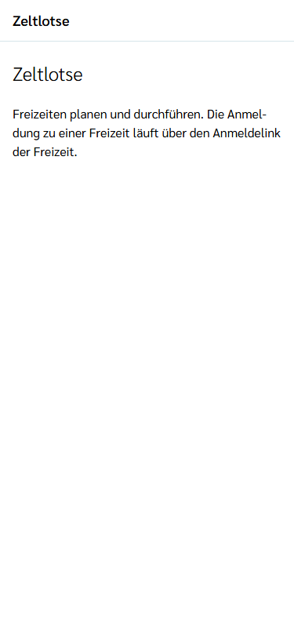
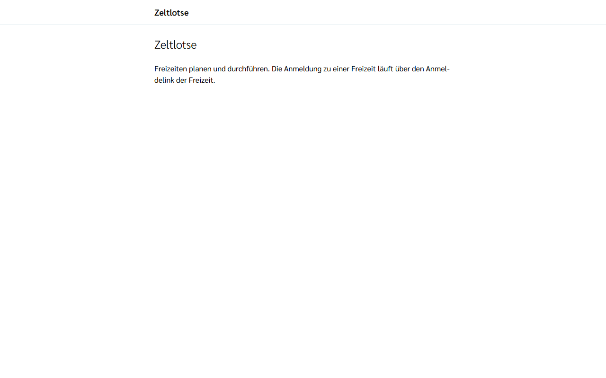
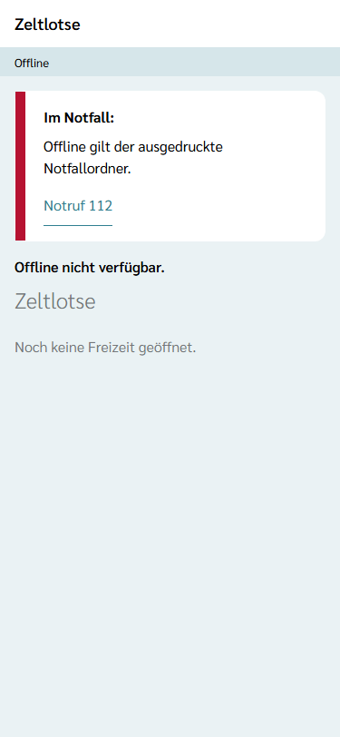
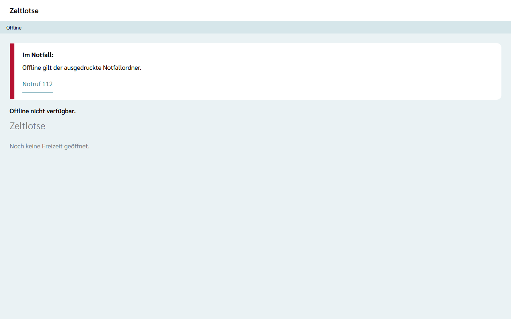

Zeltlotse besteht aus zwei Teilen unter derselben Adresse:

- der **Web-App** für alles nach der Anmeldung, im Browser am Laptop oder installiert am Handy, und
- den **öffentlichen Seiten** wie Freizeitseite und Anmeldelink, die ohne Installation und ohne Konto funktionieren.

## Web-App im Browser öffnen

Die Web-App liegt unter der Adresse von Zeltlotse mit dem Zusatz `/app/`. Nach dem Öffnen zeigt die Startseite, welche Freizeit gerade geöffnet ist. Solange keine Freizeit gewählt ist, steht dort „Noch keine Freizeit geöffnet.“

## Am Handy installieren

Zeltlotse ist eine installierbare Web-App. Sie braucht keinen App-Store:

1. Die Web-App im Browser des Handys öffnen.
2. Android: im Menü des Browsers „Zum Startbildschirm hinzufügen“ oder „App installieren“ wählen (die Bezeichnung hängt vom Browser ab).
3. iPhone: in Safari auf „Teilen“ tippen und „Zum Home-Bildschirm“ wählen.
4. Danach startet Zeltlotse über das Symbol auf dem Startbildschirm wie eine App.

## Öffentliche Seiten ohne Installation

Freizeitseite, Anmeldelinks und Gast-Link öffnen sich direkt im Browser, ohne Installation und ohne Konto. Eltern melden ein Kind also auch dann an, wenn sie Zeltlotse sonst nicht nutzen. Die Anmeldung zu einer Freizeit läuft über den Anmeldelink, den die Leitung der Freizeit verteilt.

## Ohne Netz: Offline-Ansicht mit Notfall-Box

Wurde die Web-App einmal mit Netz geöffnet, startet sie auch ohne Netz. Dann gilt:

- Oben erscheint die **Offline-Leiste**: „Offline“, und wenn bekannt, die Uhrzeit der letzten Aktualisierung.
- Die **Notfall-Box** zeigt „Im Notfall:“ und den Link **„Notruf 112“**, der direkt die 112 wählt.
- Alles andere ist ausgegraut und mit „Offline nicht verfügbar.“ gekennzeichnet. Ohne Netz gilt der ausgedruckte Notfallordner.

Sobald das Netz zurück ist, verschwinden Offline-Leiste und Notfall-Box, und alle Inhalte sind wieder bedienbar.
