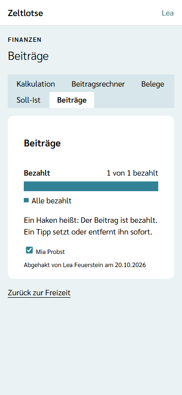
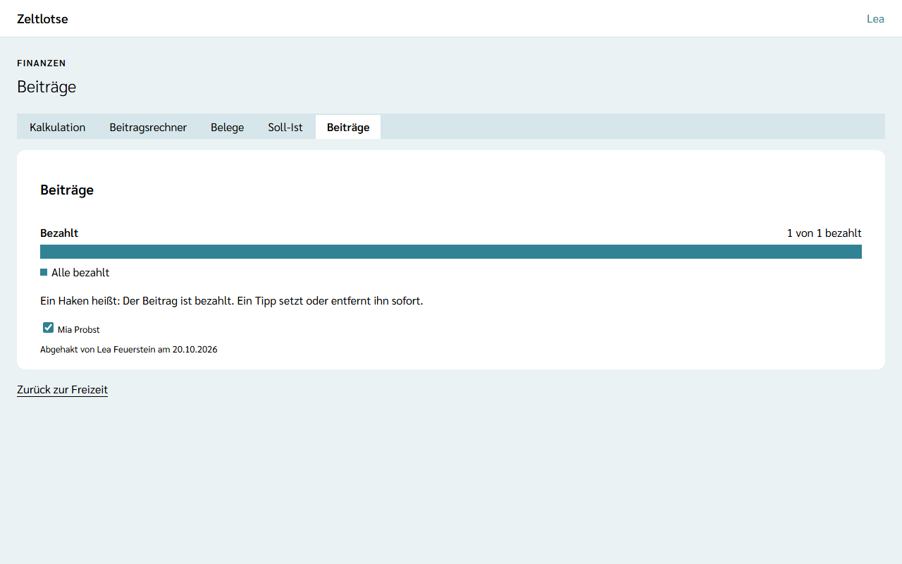

**Wer:** Leitung und Team einer Freizeit. Jedes Teammitglied kann einen Beitrag als bezahlt abhaken und den Haken wieder entfernen.

Die Seite **Beiträge** zeigt, welche Teilnehmenden ihren Beitrag schon bezahlt haben. Wer das Geld bekommen oder auf dem Konto gesehen hat, setzt den Haken. Zeltlotse merkt sich dazu, wer den Haken gesetzt hat und wann. So muss niemand nachfragen, ob das schon jemand geprüft hat.

Die Beiträge gibt es nur, wenn die Leitung das Modul **Finanzen** eingeschaltet hat – siehe [Module schalten](/leitung/module-schalten/). Ist das Modul aus, zeigt ein gespeicherter Link „Diese Seite ist nicht verfügbar.“ Die Haken bleiben dabei erhalten und sind nach dem Einschalten wieder da.

## Der Weg zu den Beiträgen

Startseite der Freizeit → Knopf **Finanzen** → Reiter **Beiträge**. Oben stehen die Reiter **Kalkulation · Beitragsrechner · Belege · Soll-Ist · Beiträge**.

## Wer in der Liste steht

In der Liste stehen alle **bestätigten Teilnehmenden** der Freizeit, nach Namen sortiert. Nicht dabei sind:

- Anmeldungen, die noch **eingegangen** sind – sie erscheinen, sobald die Leitung sie bestätigt;
- **abgesagte** Anmeldungen;
- **Mitarbeitende** – für sie gibt es hier keinen Beitrag.

Wird eine Anmeldung abgesagt, nachdem ihr Beitrag abgehakt war, verschwindet sie aus der Liste und zählt nicht mehr mit. Der Haken selbst bleibt gespeichert. Gibt es noch keine bestätigten Teilnehmenden, steht dort „Noch keine bestätigten Teilnehmenden.“

## Abhaken und wieder öffnen

Oben in der Card **Beiträge** steht ein Balken, zum Beispiel „1 von 2 bezahlt“. Das Statuswort heißt **Alle bezahlt** oder **Offen** (als Warnung gefärbt), solange noch Beiträge fehlen.

Darunter steht je Person ein Haken mit ihrem Namen:

- **Ein Tipp auf einen offenen Haken** setzt ihn sofort, ohne Rückfrage. Darunter steht dann, wer ihn gesetzt hat, zum Beispiel „Abgehakt von Lea Feuerstein am 20.10.2026“.
- **Ein Tipp auf einen gesetzten Haken** entfernt ihn wieder, ebenfalls sofort. Das ist für Versehen gedacht; der Vermerk ist danach weg.

Haben zwei Personen fast gleichzeitig denselben Haken gesetzt, zählt nur einer: Es bleibt bei der Person, die zuerst abgehakt hat. Ein zweiter Haken ändert daran nichts. Klappt das Speichern nicht, etwa weil das Netz wegbricht, steht der Fehler direkt am Haken, und der Haken zeigt wieder den alten Stand. Ein neuer Tipp versucht es noch einmal.

Zeltlotse speichert nur „bezahlt“ oder „offen“ – keinen Betrag, keine Teilzahlung und keinen Erlass.

## Nach dem Abschluss

Nach dem Abschluss der Freizeit steht oben „Diese Freizeit ist abgeschlossen und nur lesbar.“ Die Haken bleiben sichtbar, mit „Abgehakt von …“, lassen sich aber nicht mehr ändern. Anders als beim Haken „Erstattet“ an den [Belegen](/finanzen/belege/) gibt es hier keine Ausnahme.

## Datenschutz

Ein Haken speichert nur drei Dinge: die teilnehmende Person und wer den Haken gesetzt hat – beides als Verweis auf die Person – und wann. Die Namen holt die Seite aus der Personenliste der Freizeit. Einen Verlauf gibt es nicht: Wird der Haken entfernt, ist auch der Vermerk weg.

Den Vermerk muss die Organisation aufbewahren. Löscht eine Person ihr Konto, bleibt der Vermerk darum gespeichert. Eine gelöschte teilnehmende Person steht danach nicht mehr in der Liste und zählt nicht mehr mit. Hat die gelöschte Person selbst den Haken gesetzt, steht dort „Abgehakt von Gelöschte Person“. Nach Ablauf der Löschfrist der Organisation für Freizeit-Daten löscht Zeltlotse die Vermerke endgültig – siehe [Was passiert mit meinen Daten](/daten/#finanzen). Abschalten des Moduls Finanzen löscht nichts.

## Noch nicht dabei

- Beträge, Teilzahlungen und erlassene Beiträge gibt es nicht; ein Haken heißt nur „bezahlt“.
- Eltern sehen hier nichts, und Zeltlotse verschickt keine Zahlungsinfos oder Erinnerungen.
- Die Beiträge fließen nicht in [Soll-Ist](/finanzen/soll-ist/) ein.
