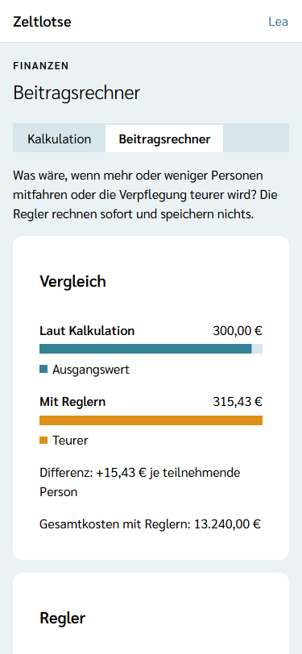
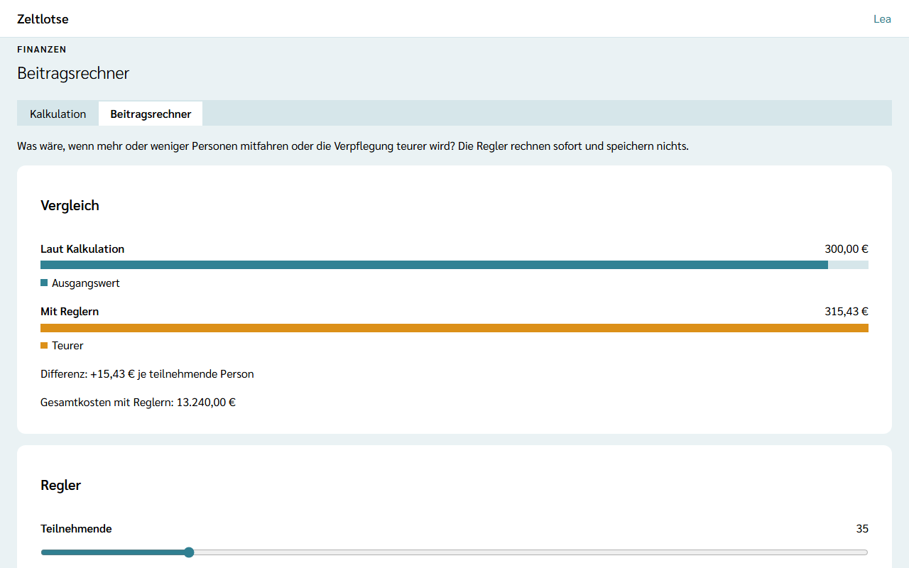

**Wer:** Leitung und Team einer Freizeit.

Der **Beitragsrechner** beantwortet Was-wäre-wenn-Fragen: Was kostet die Freizeit pro Teilnehmenden, wenn nur 35 statt 40 Kinder mitfahren? Was, wenn die Verpflegung pro Tag einen Euro teurer wird? Drei Schieberegler verändern den Teilnehmerbeitrag sofort. **Gespeichert wird dabei nichts** – die [Kalkulation](/finanzen/kalkulation/) bleibt, wie sie ist.

Den Beitragsrechner gibt es nur mit dem Modul **Finanzen** – siehe [Module schalten](/leitung/module-schalten/).

## Der Weg zum Beitragsrechner

Startseite der Freizeit → Knopf **Finanzen** → Reiter **Beitragsrechner**.

## Die Regler

- **Teilnehmende** – von 0 bis 200 (oder bis zur Planzahl, wenn sie höher ist), in Schritten von 1,
- **Mitarbeitende** – von 0 bis 100 (oder bis zur Planzahl), in Schritten von 1,
- **Tagessatz Verpflegung pro Person und Tag** – von 0 bis 30 € (oder bis zum gespeicherten Tagessatz), in Schritten von 0,50 €. Liegt der gespeicherte Tagessatz zwischen zwei Schritten, zum Beispiel bei 7,25 €, verschiebt sich das Raster, damit er dabei ist: dann geht der Regler von 0,25 € bis 30,25 €.

Beim Öffnen stehen die Regler auf den Werten der Kalkulation. Sie lassen sich mit Maus oder Finger ziehen oder nach einem Tipp mit den **Pfeiltasten** in festen Schritten bewegen. Der aktuelle Wert steht als Zahl neben jedem Regler. **Zurücksetzen** stellt alle Regler wieder auf die Werte der Kalkulation.

## Der Vergleich

Die Card **Vergleich** zeigt zwei Balken auf einer gemeinsamen Skala; der größere Beitrag füllt den Balken ganz:

- **Laut Kalkulation** – der Teilnehmerbeitrag mit den gespeicherten Werten,
- **Mit Reglern** – der Teilnehmerbeitrag mit den Werten der Regler, dazu das Wort **Günstiger**, **Gleich** oder **Teurer**.

Darunter stehen die **Differenz** in Euro je teilnehmende Person, zum Beispiel „+15,43 €“, und die Gesamtkosten mit Reglern. Der Beitragsrechner rechnet nach derselben Regel wie die Kalkulation, mit denselben Kosten der übrigen Kategorien und denselben Einnahmen (siehe [Die Rechenregel](/finanzen/kalkulation/#die-rechenregel)). Steht der Regler „Teilnehmende“ auf 0, heißt es „Ohne Teilnehmende lässt sich kein Beitrag berechnen.“

Soll ein ausprobierter Wert gelten, trägt ihn jemand in der [Kalkulation](/finanzen/kalkulation/) ein.

## Nach dem Abschluss

Nach dem Abschluss der Freizeit steht oben „Diese Freizeit ist abgeschlossen und nur lesbar.“ Die Regler bleiben bedienbar, weil sie nichts speichern.

## Noch nicht dabei

Reglerstellungen speichern, mehrere Szenarien vergleichen und eine Aufteilung der Kosten als Torte gibt es nicht. Belege und der Vermerk „Beitrag bezahlt“ kommen mit einer späteren Version.
