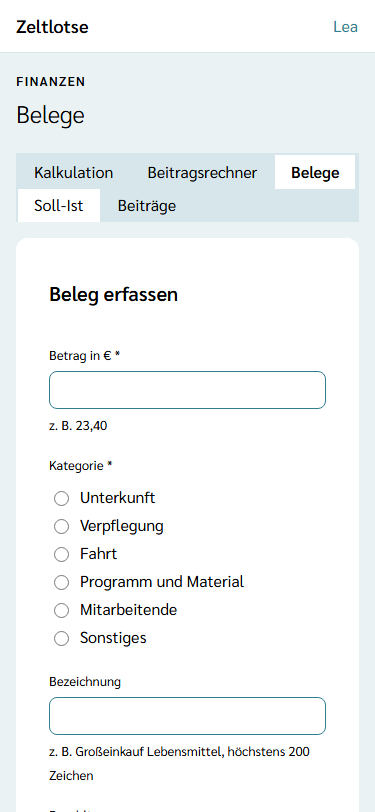
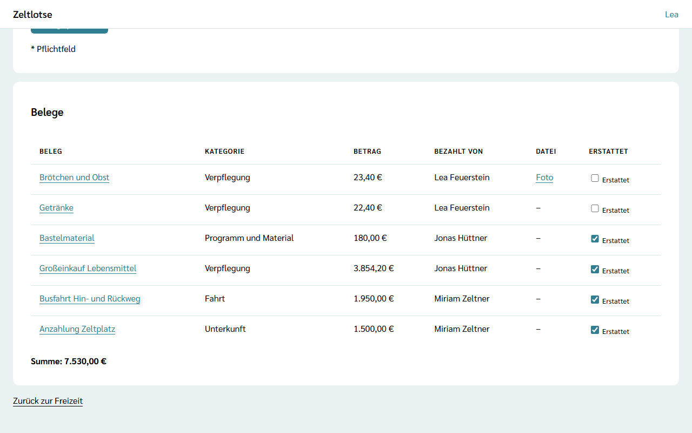
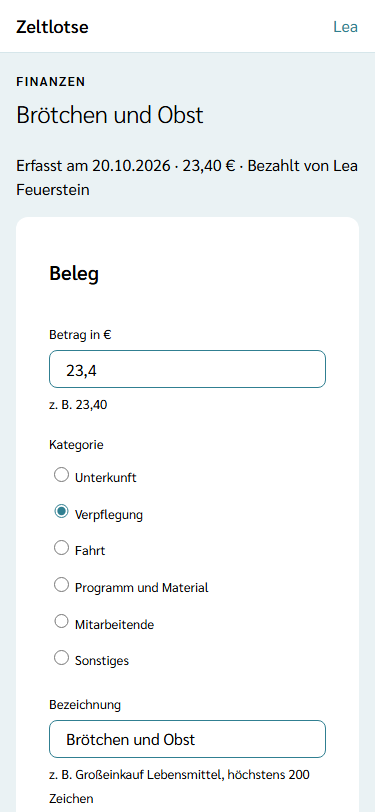
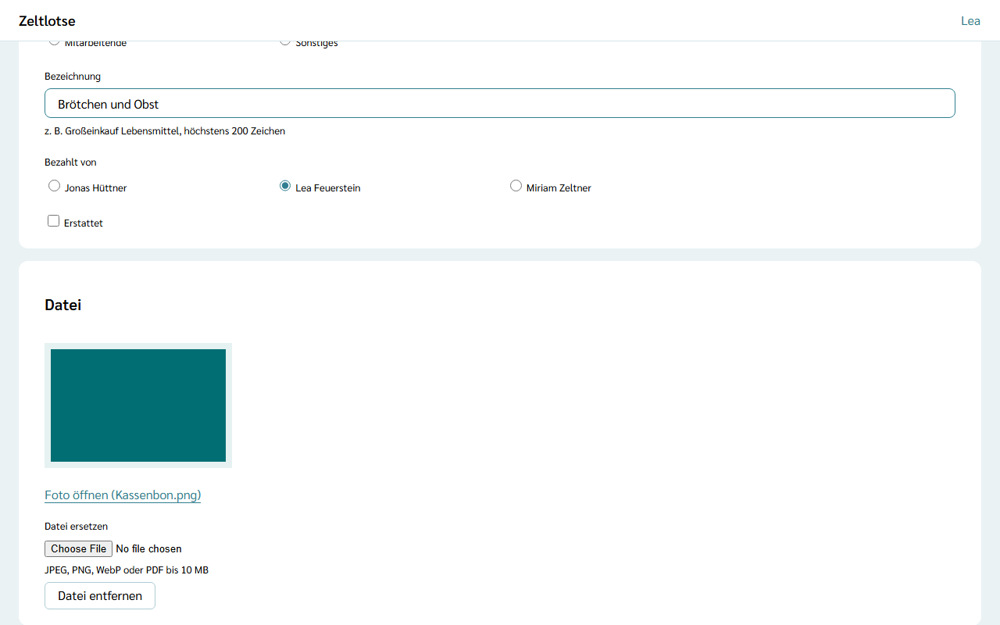

**Wer:** Leitung und Team einer Freizeit. Jedes Teammitglied kann Belege erfassen, ändern und als erstattet abhaken.

Ein **Beleg** hält eine Ausgabe der Freizeit fest: was es gekostet hat, in welche Kategorie es gehört, wer es ausgelegt hat und ob das Geld schon zurückgezahlt ist. Ein Foto vom Kassenbon oder eine Rechnung als PDF lässt sich dazulegen. Aus den Belegen rechnet Zeltlotse den Vergleich mit der Kalkulation – siehe [Soll-Ist](/finanzen/soll-ist/).

Die Belege gibt es nur, wenn die Leitung das Modul **Finanzen** eingeschaltet hat – siehe [Module schalten](/leitung/module-schalten/). Ist das Modul aus, zeigt ein gespeicherter Link „Diese Seite ist nicht verfügbar.“ Die Belege bleiben dabei erhalten und sind nach dem Einschalten wieder da.

## Der Weg zu den Belegen

Startseite der Freizeit → Knopf **Finanzen** → Reiter **Belege**. Oben stehen die Reiter **Kalkulation · Beitragsrechner · Belege · Soll-Ist · Beiträge**.

## Einen Beleg erfassen

Die Card **Beleg erfassen** hat nur zwei Pflichtfelder:

- **Betrag in €** – zum Beispiel „23,40“. Es gelten dieselben Regeln wie in der [Kalkulation](/finanzen/kalkulation/#werte-eintragen): 0 bis 1.000.000 €, höchstens zwei Nachkommastellen, Komma oder Punkt, keine Tausenderpunkte.
- **Kategorie** – eine der sechs Kategorien der Kalkulation: Unterkunft, Verpflegung, Fahrt, Programm und Material, Mitarbeitende oder Sonstiges.

Dazu kommen auf Wunsch:

- **Bezeichnung** – zum Beispiel „Großeinkauf Lebensmittel“, höchstens 200 Zeichen. Ohne Bezeichnung heißt der Beleg wie seine Kategorie.
- **Bezahlt von** – vorgewählt ist **Ich**. Wer für jemand anderen einträgt, wählt dort eine Person aus Leitung oder Team. Andere Personen gehen nicht.
- **Foto oder PDF** – am Handy lässt sich direkt ein Foto vom Kassenbon aufnehmen. Erlaubt sind Fotos (JPEG, PNG, WebP) und PDF bis 10 MB.

**Beleg speichern** legt den Beleg an. Erst danach lädt Zeltlotse die Datei hoch. Klappt das Hochladen nicht, etwa weil das Netz im Zeltlager wegbricht, bleibt der Beleg trotzdem gespeichert. Dann steht dort „Fehler: Datei nicht hochgeladen.“ mit **Erneut versuchen**; das lädt dieselbe Datei an denselben Beleg. Ist die Datei zu groß oder kein Foto und kein PDF, steht der Fehler am Feld, und der Beleg ist ohne Datei gespeichert. Die Datei lässt sich später auf der Seite des Belegs nachreichen.

Fehlt der Betrag oder die Kategorie, steht oben eine Fehlerübersicht mit Sprunglinks, und am Feld steht, was fehlt.

## Die Liste der Belege

Die Card **Belege** zeigt alle Belege der Freizeit, die neuesten zuerst: **Beleg** (Link zur Seite des Belegs), **Kategorie**, **Betrag**, **Bezahlt von**, **Datei** („Foto“ öffnet das Foto, „PDF“ lädt das PDF herunter) und den Haken **Erstattet**. Darunter steht die **Summe** aller Belege.

Der Haken **Erstattet** speichert sofort; darunter steht „Gespeichert“ mit **Rückgängig**. Hat jemand anderes denselben Haken inzwischen geändert, steht dort „Inzwischen geändert – neu laden?“.

## Einen Beleg ändern oder löschen

Ein Klick auf den Beleg in der Liste öffnet seine Seite. Oben stehen die Bezeichnung und „erfasst am“, Betrag und wer bezahlt hat. Ein eigenes Belegdatum gibt es nicht; Zeltlotse merkt sich, wann der Beleg erfasst wurde.

- **Beleg** – Betrag, Kategorie, Bezeichnung und „Bezahlt von“ speichern beim Verlassen des Felds bzw. sofort beim Wählen; darunter steht „Gespeichert“ mit **Rückgängig**. Dazu der Haken **Erstattet**.
- **Datei** – ein Foto steht als Bild auf der Seite, ein PDF als Link **PDF herunterladen**. **Datei ersetzen** lädt eine neue Datei hoch, die die alte ersetzt. **Datei entfernen** klappt eine Rückfrage auf („Die Datei entfernen? Der Beleg bleibt.“ – „Ja, entfernen“ / „Nein“).
- **Beleg löschen** klappt eine Rückfrage auf („„Brötchen und Obst“ löschen? Die Datei wird mitgelöscht.“ – „Ja, löschen“ / „Nein“). Danach geht es zurück zur Liste.

## Erstattet – auch nach dem Abschluss

Wer etwas aus eigener Tasche bezahlt hat, bekommt das Geld von der Freizeit zurück. Sobald das passiert ist, setzt jemand aus Leitung oder Team den Haken **Erstattet**. Wer noch Geld bekommt, zeigt [Soll-Ist](/finanzen/soll-ist/#erstattungen). Überweisungen macht Zeltlotse nicht, und einen Abrechnungsabschluss gibt es nicht.

Nach dem Abschluss der Freizeit steht oben „Diese Freizeit ist abgeschlossen. Nur „Erstattet“ lässt sich noch ändern.“ Die Card „Beleg erfassen“ fehlt, die Werte eines Belegs stehen als Text da, und Datei und Beleg lassen sich nicht mehr entfernen. Der Haken **Erstattet** bleibt bedienbar, denn oft wird erst nach der Freizeit erstattet.

## Datenschutz

Ein Beleg nennt, wer bezahlt hat. Zeltlotse speichert dafür nur den Verweis auf die Person; den Namen holt die Seite aus der Freizeit. In die Bezeichnung gehören keine Namen von Personen. Fotos und PDFs liegen nur in Zeltlotse und lassen sich nur von Leitung und Team der Freizeit öffnen.

Belege muss die Organisation aufbewahren. Löscht eine Person ihr Konto, bleibt ihr Beleg darum erhalten; bei „Bezahlt von“ steht dann „Gelöschte Person“. Nach Ablauf der Löschfrist der Organisation für Freizeit-Daten löscht Zeltlotse die Belege samt Fotos und PDFs endgültig – siehe [Was passiert mit meinen Daten](/daten/#finanzen). Abschalten des Moduls Finanzen löscht nichts.

## Noch nicht dabei

- Den Text eines Kassenbons liest Zeltlotse nicht aus; Betrag und Kategorie trägt jemand von Hand ein.
- Teilnehmerbeiträge sind keine Belege; ob ein Beitrag bezahlt ist, steht unter [Beiträge](/finanzen/beitraege/).
