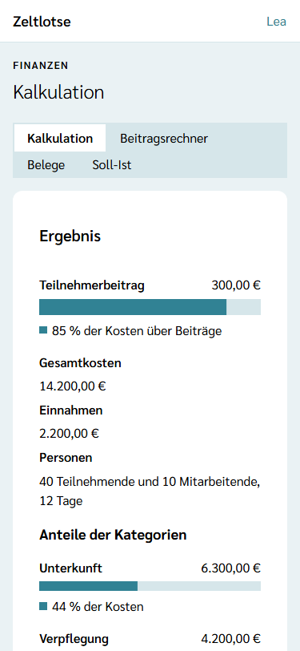
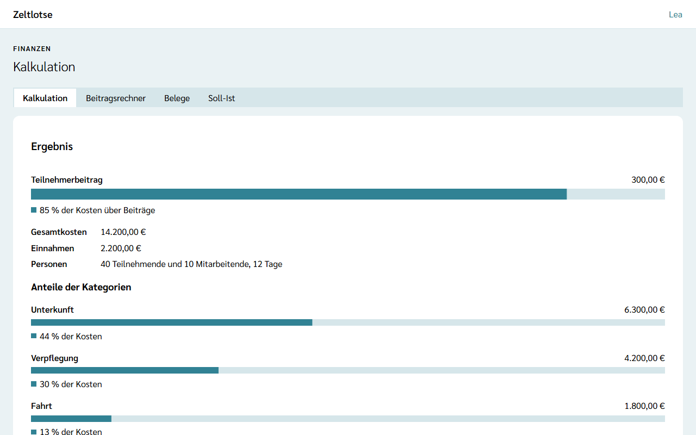

**Wer:** Leitung und Team einer Freizeit.

Mit der **Kalkulation** plant die Freizeit ihre Kosten und Einnahmen. Zeltlotse rechnet daraus die Gesamtkosten und den **Teilnehmerbeitrag**: den Betrag, den jede teilnehmende Person zahlen muss, damit die Kosten gedeckt sind.

Die Kalkulation gibt es nur, wenn die Leitung das Modul **Finanzen** eingeschaltet hat – siehe [Module schalten](/leitung/module-schalten/). Ist das Modul aus, fehlt der Knopf „Finanzen“, und ein gespeicherter Link zeigt „Diese Seite ist nicht verfügbar.“ Die Kalkulation bleibt dabei erhalten und ist nach dem Einschalten wieder da.

## Der Weg zur Kalkulation

Startseite der Freizeit → Knopf **Finanzen**. Oben stehen die Reiter **Kalkulation · Beitragsrechner · Belege · Soll-Ist**.

## Was die Seite zeigt

- **Ergebnis** – ganz oben der Balken **Teilnehmerbeitrag** mit dem Betrag, zum Beispiel „300,00 €“, und wie viel Prozent der Kosten über die Beiträge laufen. Darunter Gesamtkosten, Einnahmen sowie Personen und Tage. Je Kategorie zeigt ein Balken die Kosten und ihren Anteil an den Gesamtkosten, zum Beispiel „44 % der Kosten“.
- **Planzahlen** – die geplanten **Teilnehmenden** und **Mitarbeitenden**, je eine ganze Zahl von 0 bis 1000. Darunter stehen die Tage der Freizeit; sie kommen aus dem Zeitraum der Freizeit (erster bis letzter Tag, beide mitgezählt) und lassen sich hier nicht ändern.
- **Je Kategorie eine Card** – Unterkunft, Verpflegung, Fahrt, Programm und Material, Mitarbeitende und Sonstiges, immer in dieser Reihenfolge. Jede Kategorie hat zwei Beträge: **Fixkosten** und **Kosten pro Person und Tag**. Bei der Verpflegung heißt der zweite Betrag **Tagessatz pro Person und Tag**. Unter den Feldern stehen die Kosten der Kategorie. Die Mitarbeitenden zählen in allen Kosten pro Person und Tag schon als Personen mit, ihre Unterkunft und Verpflegung stehen also bereits dort. Die Kategorie **Mitarbeitende** ist nur für Kosten, die allein für sie anfallen, zum Beispiel eine Schulung, die Erstattung von Fahrtkosten oder ein Dankeschön.
- **Einnahmen** – Zuschüsse, Spenden und Rabatte der Organisation, jeweils mit Bezeichnung und Betrag.

## Werte eintragen

Alle Felder speichern beim Verlassen des Felds; darunter steht „Gespeichert“ mit **Rückgängig**. Danach rechnet die Seite Kosten und Teilnehmerbeitrag neu. Hat jemand anderes dasselbe Feld inzwischen geändert, steht dort „Inzwischen geändert – neu laden?“; **Neu laden** zeigt den aktuellen Stand.

Beträge sind Euro von 0 bis 1.000.000 mit höchstens zwei Nachkommastellen. Komma und Punkt gelten beide als Dezimaltrenner („7,50“ oder „7.50“), Tausenderpunkte nicht: „1.250“ wird abgelehnt, richtig ist „1250“. Nach dem Speichern steht ein Betrag ohne überflüssige Nullen da, aus „7,50“ wird „7,5“. Negative Beträge gibt es nicht.

Eine neue Einnahme kommt über das Formular **Einnahme hinzufügen**: **Bezeichnung** (Pflicht, höchstens 200 Zeichen, zum Beispiel „Zuschuss Landesjugendplan“) und **Betrag** (leer heißt 0). Ein Rabatt der Organisation ist ebenfalls eine Einnahme und wird mit positivem Betrag eingetragen. **Entfernen** an einer Einnahme klappt eine Rückfrage auf („„Rabatt der Organisation“ entfernen?“ – „Ja, entfernen“ / „Nein“). In die Bezeichnungen gehören keine Namen von Personen.

## Die Rechenregel

> Personen = Teilnehmende + Mitarbeitende
>
> Kosten einer Kategorie = Fixkosten + Kosten pro Person und Tag × Personen × Tage
>
> Teilnehmerbeitrag = (Gesamtkosten − Einnahmen) ÷ Teilnehmende

Die Mitarbeitenden zählen also als Personen mit – sie essen und schlafen ja auch –, zahlen aber keinen Beitrag. Die Kosten für die Mitarbeitenden tragen die Beiträge der Teilnehmenden.

Ein Beispiel: 12 Tage, 40 Teilnehmende und 10 Mitarbeitende sind 50 Personen. Verpflegung mit 7 € Tagessatz kostet 7 € × 50 × 12 = 4.200 €. Unterkunft mit 2.000 € Fixkosten und 10 € pro Person und Tag kostet 2.000 € + 10 € × 50 × 12 = 8.000 €. Zusammen sind das 12.200 €. Mit 1.200 € Zuschuss ergibt sich (12.200 € − 1.200 €) ÷ 40 = **275,00 €** Teilnehmerbeitrag.

**Rundung und Grenzen:**

- Der Teilnehmerbeitrag wird kaufmännisch auf den Cent gerundet: 1.000 € für 3 Teilnehmende ergeben 333,33 €.
- Sind die Einnahmen höher als die Kosten, ist der Beitrag 0,00 €; einen negativen Beitrag gibt es nicht.
- Ohne Teilnehmende steht dort „Ohne Teilnehmende lässt sich kein Beitrag berechnen.“

Die Kalkulation rechnet mit den **Planzahlen**, nicht mit den Anmeldungen: Wer sich anmeldet oder absagt, ändert die Kalkulation nicht. Auch der Essensplan und die Einkaufsliste der [Küche](/kueche/) fließen nicht ein; der Tagessatz der Verpflegung ist eine eigene Schätzung.

## Nach dem Abschluss

Nach dem Abschluss der Freizeit ist die Kalkulation nur lesbar: Oben steht „Diese Freizeit ist abgeschlossen und nur lesbar.“, alle Werte stehen als Text da, und das Formular „Einnahme hinzufügen“ fehlt.

## Datenschutz

Die Kalkulation enthält keine Personendaten: nur Zahlen, Beträge und die Bezeichnungen der Einnahmen. Zeltlotse merkt sich nicht, wer einen Wert geändert hat. Die Kalkulation wird mit den übrigen Daten der Freizeit nach der Frist der Organisation gelöscht – siehe [Was passiert mit meinen Daten](/daten/#finanzen).

## Noch nicht dabei

- Was tatsächlich ausgegeben wurde, steht in den [Belegen](/finanzen/belege/); den Vergleich mit der Kalkulation zeigt [Soll-Ist](/finanzen/soll-ist/).
- Der Vermerk **„Beitrag bezahlt“** je Anmeldung kommt mit einer späteren Version.
- Eine Kalkulation aus dem Vorjahr übernehmen und mehrere Szenarien speichern gibt es nicht; zum Ausprobieren dient der [Beitragsrechner](/finanzen/beitragsrechner/).
