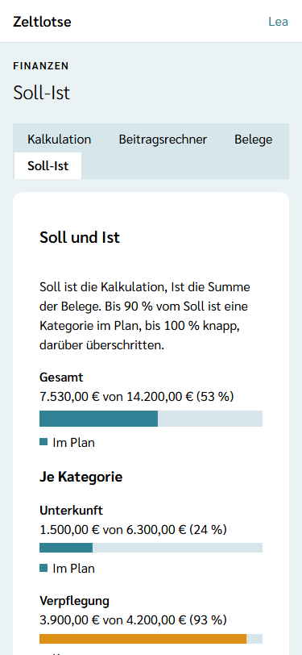
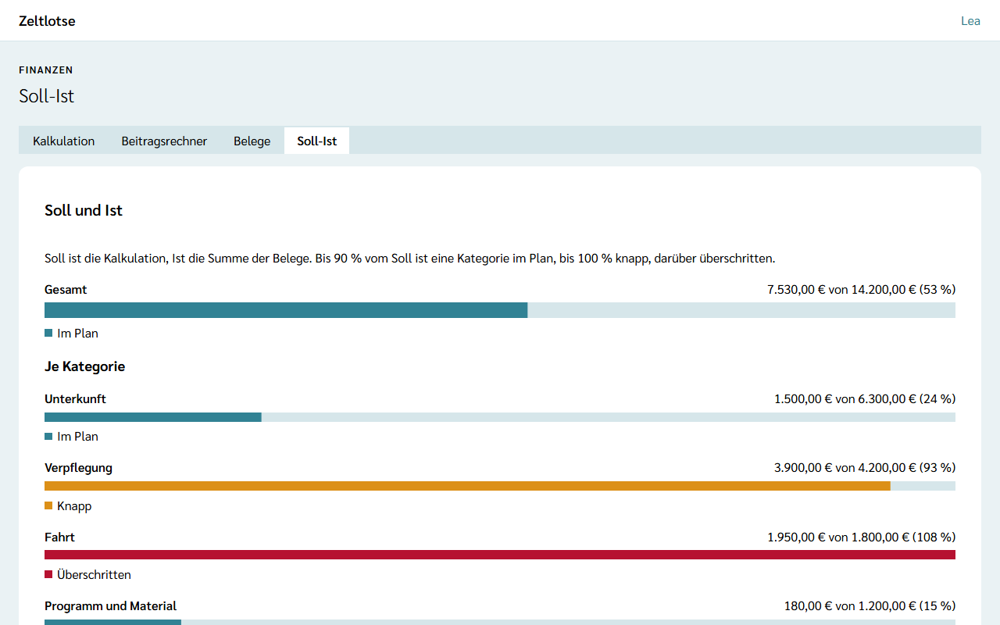

**Wer:** Leitung und Team einer Freizeit.

**Soll-Ist** vergleicht die Kalkulation (das **Soll**) mit den [Belegen](/finanzen/belege/) (das **Ist**). So sieht das Team schon während der Freizeit, ob das Geld reicht, und wer noch Geld bekommt, weil er oder sie etwas ausgelegt hat.

Soll-Ist gibt es nur, wenn die Leitung das Modul **Finanzen** eingeschaltet hat – siehe [Module schalten](/leitung/module-schalten/).

## Der Weg zu Soll-Ist

Startseite der Freizeit → Knopf **Finanzen** → Reiter **Soll-Ist**.

## Soll und Ist

Die Card **Soll und Ist** zeigt oben groß den Balken **Gesamt**, darunter je Kategorie einen Balken. Jeder Balken nennt Ist und Soll, zum Beispiel „3.900,00 € von 4.200,00 € (93 %)“, und ein Statuswort:

- **Im Plan** – die Belege liegen bei höchstens 90 % des Solls.
- **Knapp** – über 90 % bis 100 % des Solls. Der Balken ist als Warnung gefärbt.
- **Überschritten** – mehr als das Soll. Der Balken ist als Fehler gefärbt.

Das **Soll** einer Kategorie sind ihre Kosten laut [Kalkulation](/finanzen/kalkulation/), also Fixkosten plus Kosten pro Person und Tag × Personen × Tage. Was in der Kalkulation noch nicht eingetragen ist, zählt als 0 €. Das **Ist** ist die Summe aller Belege dieser Kategorie, egal ob schon erstattet. Eine Kategorie ohne Soll und ohne Belege ist im Plan; kommen dort Belege dazu, ist sie überschritten.

Zeltlotse rechnet Soll-Ist bei jedem Öffnen der Seite neu. Ein neuer Beleg oder eine geänderte Kalkulation steht also sofort darin; einen Abrechnungsabschluss gibt es nicht.

## Erstattungen

Die Card **Erstattungen** zeigt je Person, die einen Beleg bezahlt hat, einen Balken. Die Zahl nennt, wie viel noch zu erstatten ist, zum Beispiel „noch 45,80 €“; der Balken zeigt den Anteil, der schon erstattet ist. Das Statuswort heißt **Bekommt noch Geld** (als Warnung gefärbt) oder **Alles erstattet**. Ganz oben steht, wer noch am meisten bekommt.

Erstattet ist ein Beleg, sobald jemand bei ihm den Haken **Erstattet** setzt – in der Liste der [Belege](/finanzen/belege/#die-liste-der-belege) oder auf der Seite des Belegs. Das geht auch nach dem Abschluss der Freizeit. Gibt es noch keine Belege, steht dort „Noch keine Belege.“

## Nach dem Abschluss

Soll-Ist bleibt nach dem Abschluss lesbar. Ändern lässt sich danach nur noch der Haken **Erstattet** an den Belegen.

## Noch nicht dabei

- Die Teilnehmerbeiträge fließen nicht in Soll-Ist ein; ob ein Beitrag bezahlt ist, lässt sich mit einer späteren Version vermerken.
- Überweisungen, eine Abschlussmappe und ein Budget-Balken im Leitungs-Cockpit gibt es nicht.
