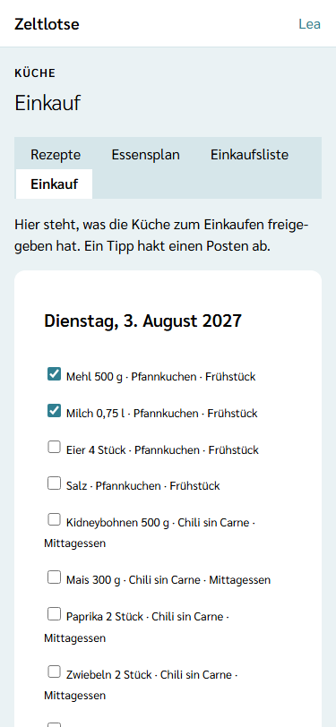
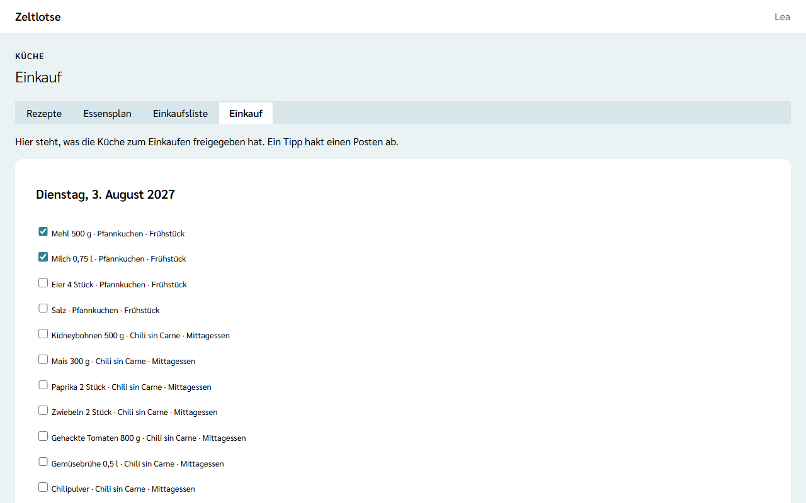

**Wer:** Leitung und Team einer Freizeit. Küche und Einkauf sind keine eigenen Rollen, sondern Aufgaben im Team: Wer einkauft, arbeitet mit den Rechten des Teams.

Die Küche entscheidet auf der [Einkaufsliste](/kueche/einkaufsliste/), was eingekauft werden soll: Sie **gibt Posten frei**, einzeln oder einen ganzen Tag auf einmal. Wer einkauft, öffnet die Seite **Einkauf**. Dort steht nur, was freigegeben ist, und jeder Posten lässt sich mit einem Tipp **abhaken**.

Beides gibt es nur, wenn die Leitung das Modul **Verpflegung** eingeschaltet hat – siehe [Module schalten](/leitung/module-schalten/). Ist das Modul aus, zeigt ein gespeicherter Link „Diese Seite ist nicht verfügbar.“; Freigaben und Haken bleiben erhalten.

## Posten freigeben

Auf der Einkaufsliste hat jede Tabelle zwei Spalten dafür:

- **Freigegeben** – ein Kästchen je Posten. Ein Tipp gibt den Posten frei oder nimmt die Freigabe zurück. Zeltlotse speichert sofort; darunter steht „Gespeichert“ mit **Rückgängig**.
- **Gekauft** – dort steht „gekauft“, sobald jemand den Posten beim Einkaufen abgehakt hat.

Über jeder Tabelle steht, wie weit der Tag ist, zum Beispiel „11 von 12 freigegeben · 2 gekauft“.

## Einen ganzen Tag freigeben

Unter der Zählzeile stehen zwei Knöpfe:

- **Ganzen Tag freigeben** – gibt alle Posten dieses Tags frei: die Zutaten aller Gerichte an den Mahlzeiten des Tags und die eigenen Posten mit diesem Tag. Der Knopf steht da, solange noch ein Posten des Tags nicht freigegeben ist.
- **Freigabe zurücknehmen** – nimmt die Freigabe aller Posten des Tags zurück. Der Knopf steht da, sobald ein Posten freigegeben ist.

Ob ein Posten schon **gekauft** ist, ändern beide Knöpfe nicht. In der Card „Ohne Tag“ betreffen die Knöpfe nur die eigenen Posten ohne Tag.

Freigeben und Abhaken sind voneinander unabhängig: Es gibt keine feste Reihenfolge. Nimmt die Küche die Freigabe eines gekauften Postens zurück, bleibt er gekauft und verschwindet nur von der Seite „Einkauf“.

## Der Weg zum Einkauf

Startseite der Freizeit → Knopf **Küche** → Reiter **Einkauf**. Die vier Reiter **Rezepte · Essensplan · Einkaufsliste · Einkauf** stehen oben auf allen Küche-Seiten.

Je Tag steht eine Card, zum Beispiel „Dienstag, 3. August 2027“, mit einem Kästchen je freigegebenem Posten, zum Beispiel „Mehl 500 g · Pfannkuchen · Frühstück“ oder bei eigenen Posten „Äpfel 3 kg“. Tage ohne Freigegebenes fehlen. Ist noch nichts freigegeben, steht dort „Noch nichts zum Einkaufen freigegeben.“ mit dem Knopf **Einkaufsliste öffnen**.

Die Seite zeigt keine Allergen-Übersicht und keine Ersatzportionen. Sie fragt dafür auch keine Freizeitpässe ab – siehe [Datenschutz](#datenschutz). Was für die Ersatzportionen nötig ist, ergänzt die Küche auf der Einkaufsliste als [eigenen Posten](/kueche/einkaufsliste/#eigene-posten) und gibt ihn frei; dann steht er auch hier.

## Abhaken beim Einkaufen

Ein Tipp auf das Kästchen hakt den Posten ab. Zeltlotse speichert sofort; darunter steht „Gespeichert“ mit **Rückgängig**. Ein zweiter Tipp nimmt den Haken wieder weg. Am Handy ist die ganze Zeile groß genug für den Finger.

Hat jemand anderes den Posten inzwischen abgehakt, den Haken entfernt oder die Küche die Freigabe zurückgenommen, steht „Inzwischen geändert – neu laden?“. **Neu laden** zeigt den aktuellen Stand. Von selbst aktualisiert sich die Seite nicht: Was andere inzwischen abgehakt haben, zeigt sie erst nach **Neu laden** oder wenn die Seite neu geöffnet wird.

Wer einen Posten abgehakt hat, speichert Zeltlotse nicht – nur, dass er gekauft ist.

## Gerichte tauschen nach dem Einkauf

Was schon gekauft ist, ist da. Darum zeigt die Vorschau beim [Tauschen eines Gerichts](/kueche/essensplan/#ein-gericht-tauschen) unter **Vorher** nur die Posten, die noch **nicht gekauft** sind. Gibt es gekaufte, steht unter dem Vergleich zum Beispiel „2 schon gekaufte Posten stehen nicht im Vergleich.“

Nach **Übernehmen** gehören die Posten des bisherigen Rezepts nicht mehr zur Liste, mit ihrer Freigabe und ihrem Haken. Die Posten des neuen Rezepts sind **offen und nicht freigegeben** – auch dann, wenn das alte Rezept eine gleichnamige Zutat hatte, denn die neue Menge kann größer sein. Die Küche gibt das neue Gericht bewusst frei. Mengen von Hand wandern wie bisher mit.

## Wenn sich die Zahl der Personen oder ein Rezept ändert

Bestätigt die Leitung nach dem Einkauf weitere Anmeldungen, rechnet die Einkaufsliste die Mengen neu. Ein gekaufter Posten **bleibt gekauft**, auch wenn seine Menge jetzt größer ist. Die Küche prüft dann die Menge und ergänzt, was fehlt, zum Beispiel als [eigenen Posten](/kueche/einkaufsliste/#eigene-posten).

Dasselbe gilt, wenn die Küche nach dem Einkauf ein [Rezept](/kueche/rezepte/) ändert: Gekaufte Posten bleiben gekauft, und die Küche prüft die Menge. Eine neu hinzugefügte Zutat steht als Posten auf der Liste, der noch **nicht freigegeben** ist.

## Nach dem Abschluss

Nach dem Abschluss der Freizeit sind Einkaufsliste und Einkauf nur lesbar: Oben steht „Diese Freizeit ist abgeschlossen und nur lesbar.“ Auf der Seite „Einkauf“ steht bei jedem Posten „gekauft“ oder „offen“, ohne Kästchen; auf der Einkaufsliste stehen „freigegeben“ und „gekauft“ als Text, die Knöpfe fehlen.

## Datenschutz

Freigabe und Haken enthalten keine Personendaten: Zeltlotse speichert weder, wer freigegeben, noch, wer abgehakt hat. Die Seite „Einkauf“ fragt keine Freizeitpässe ab und steht darum nicht im Zugriffsprotokoll. Den Allergen-Abgleich gibt es nur auf der [Einkaufsliste](/kueche/einkaufsliste/#allergen-abgleich-und-ersatzportionen).

## Noch nicht dabei

Die Tagesansicht der Küche, der Restetag und Einkaufen ohne Netz (offline) kommen mit einer späteren Version.
