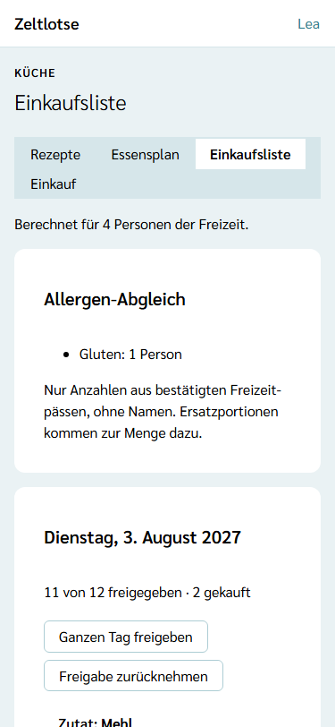

**Wer:** Leitung und Team einer Freizeit. Küche ist keine eigene Rolle; wer kocht oder einkauft, arbeitet mit den Rechten des Teams.

Die **Einkaufsliste** entsteht von selbst aus den Gerichten im [Essensplan](/kueche/essensplan/): Je Gericht und Zutat steht ein Posten mit der Menge, hochgerechnet auf die Personen der Freizeit. Zeltlotse rechnet die Liste bei jedem Öffnen neu; bestätigt die Leitung eine weitere Anmeldung, passen die Mengen beim nächsten Öffnen. Gespeichert werden nur, was die Küche von Hand ändert: Mengen von Hand und eigene Posten.

Die Einkaufsliste gibt es nur, wenn die Leitung das Modul **Verpflegung** eingeschaltet hat – siehe [Module schalten](/leitung/module-schalten/).

## Der Weg zur Einkaufsliste

Startseite der Freizeit → Knopf **Küche** → Reiter **Einkaufsliste**. Oben steht, für wie viele Personen gerechnet ist, zum Beispiel „Berechnet für 4 Personen der Freizeit.“; es zählen dieselben Personen wie bei den [Rezepten](/kueche/rezepte/#die-hochrechnung).

Je Tag steht eine Card, zum Beispiel „Dienstag, 3. August 2027“, mit einer Tabelle:

- **Zutat** – die Bezeichnung aus dem Rezept,
- **Menge** – die hochgerechnete Menge oder die Menge von Hand,
- **Einheit**,
- **Gericht · Mahlzeit** – zum Beispiel „Pfannkuchen · Frühstück“,
- **von Hand** – steht dort, wenn die Menge von Hand gesetzt ist oder der Posten selbst ergänzt wurde,
- **Freigegeben** – ein Kästchen: Ist es angekreuzt, steht der Posten auf der Seite **Einkauf** für die Einkaufenden,
- **Gekauft** – „gekauft“, sobald jemand den Posten beim Einkaufen abgehakt hat.

Über jeder Tabelle steht, wie viele Posten des Tags freigegeben und gekauft sind, zum Beispiel „11 von 12 freigegeben · 2 gekauft“, darunter die Knöpfe **Ganzen Tag freigeben** und **Freigabe zurücknehmen**. Wie Freigeben und Abhaken zusammenspielen, steht unter [Einkaufen: freigeben und abhaken](/kueche/einkauf/).

Innerhalb eines Tages stehen die Posten in der Reihenfolge der Mahlzeiten. Gleiche Zutaten aus verschiedenen Gerichten fasst Zeltlotse **nicht** zusammen und rechnet keine Einheiten um: So bleibt jede Zeile nachvollziehbar. Eigene Posten ohne Tag stehen zuletzt in der Card „Ohne Tag“. Ist noch nichts vorgemerkt und nichts ergänzt, steht dort „Noch nichts auf der Einkaufsliste.“

## Mengen von Hand

Die Menge eines Postens lässt sich direkt in der Tabelle ändern, zum Beispiel 500 g Mehl statt 400 g. Zeltlotse speichert beim Verlassen des Felds; darunter steht „Gespeichert“ mit **Rückgängig**, und in der Spalte „von Hand“ steht „von Hand“. Die Menge folgt den Regeln der [Zutaten](/kueche/rezepte/#zubereitung-und-zutaten): Komma oder Punkt, keine Tausenderpunkte.

Eine Menge von Hand **bleibt**, auch wenn sich die Zahl der Personen ändert. Wird das Gericht getauscht, wandert sie mit, wenn das neue Rezept dieselbe Zutat mit derselben Einheit hat – siehe [Ein Gericht tauschen](/kueche/essensplan/#ein-gericht-tauschen). Ein **leeres** Feld nimmt die Menge von Hand zurück; dann gilt wieder die berechnete Menge. Hat jemand anderes die Menge inzwischen geändert, steht „Inzwischen geändert – neu laden?“.

## Eigene Posten

Unter den Tagen steht das Formular **Posten ergänzen**, zum Beispiel für Obst oder für die Zutaten eines Ersatzgerichts:

- **Bezeichnung** – Pflicht, höchstens 200 Zeichen, zum Beispiel „Äpfel“,
- **Menge** und **Einheit** – freiwillig, wie bei Zutaten,
- **Tag** – freiwillig, ein Tag der Freizeit; ohne Tag steht der Posten zuletzt.

In der Card **Hand-Posten** lassen sich die eigenen Posten mit denselben Feldern ändern (gespeichert beim Verlassen des Felds). **Entfernen** klappt eine Rückfrage auf („„Äpfel“ entfernen?“ – „Ja, entfernen“ / „Nein“).

## Allergen-Abgleich und Ersatzportionen

Die Card **Allergen-Abgleich** zeigt, wie viele Personen welches Allergen im Freizeitpass angegeben haben, zum Beispiel „Gluten: 1 Person“. Unter jedem Tag steht je Gericht mit betroffenen Personen eine Zeile wie „Pfannkuchen · Frühstück: 1 Ersatzportion einplanen (enthält Gluten)“.

**Wer zählt:**

- Es zählen dieselben Personen wie bei der Hochrechnung: bestätigte Teilnehmende sowie Leitung und Team.
- Von ihnen zählen nur Freizeitpässe, die das Team sehen darf: Die Anmeldung ist bestätigt, die Freizeit fragt die Allergie-Frage ab, und das Freigabefenster läuft noch. Eingegangene Anmeldungen zählen nicht.
- Es zählen nur die angekreuzten **14 EU-Hauptallergene**, nicht der Freitext „Sonstiges“.
- Eine **Ersatzportion** braucht jede Person, die mindestens ein Allergen des Rezepts angegeben hat – also eines, das an einer seiner Zutaten angekreuzt ist. Jede Person zählt dabei einmal, auch wenn sie mehrere Allergene des Rezepts hat.

Die Ersatzportionen kommen **zusätzlich** zur Menge; die Hauptmenge bleibt so, wie sie auf der Rezeptseite steht. Was es als Ersatz gibt, weiß Zeltlotse nicht: Die Zutaten dafür ergänzt die Küche als eigene Posten. Etwas zu viel einzukaufen ist hier der sichere Fehler.

Fragt die Freizeit die Allergie-Frage weder für Teilnehmende noch für Mitarbeitende ab, steht in der Card „Diese Freizeit fragt keine Allergien ab.“, und es gibt keine Ersatzportionen. Nennt kein bestätigter Freizeitpass ein Allergen, steht dort „Keine Allergien in den bestätigten Freizeitpässen.“

## Datenschutz

Die Küche sieht beim Abgleich **nur Anzahlen**: keine Namen, keine Antworten und keinen Freitext. Zeltlotse speichert in der Küche keine Allergie-Angaben, sondern fragt sie bei jedem Öffnen neu ab. Jeder Abgleich steht im Zugriffsprotokoll der betroffenen Personen als „Allergen-Abgleich der Küche“, ohne Namen eines Teammitglieds und höchstens einmal am Tag – siehe [Was passiert mit meinen Daten](/daten/#einsicht-und-zugriffsprotokoll).

## Nach dem Abschluss

Nach dem Abschluss der Freizeit ist die Einkaufsliste nur lesbar: Oben steht „Diese Freizeit ist abgeschlossen und nur lesbar.“; Mengen, „freigegeben“ und „gekauft“ stehen als Text da, und „Posten ergänzen“, die Hand-Posten, „Entfernen“ und die Knöpfe zur Freigabe fehlen.

## Noch nicht dabei

Eine Summe gleicher Zutaten über alle Gerichte, die Tagesansicht der Küche, der Restetag und Einkaufen ohne Netz (offline) kommen mit einer späteren Version.
