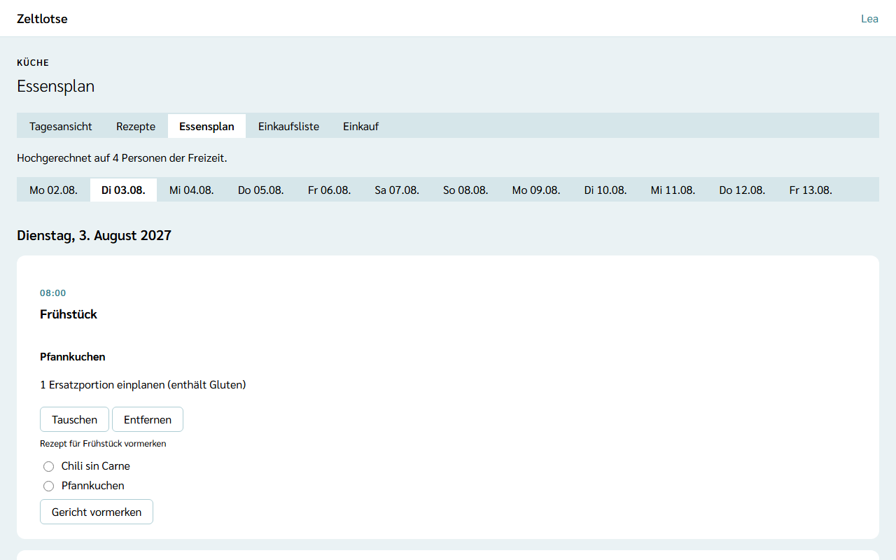
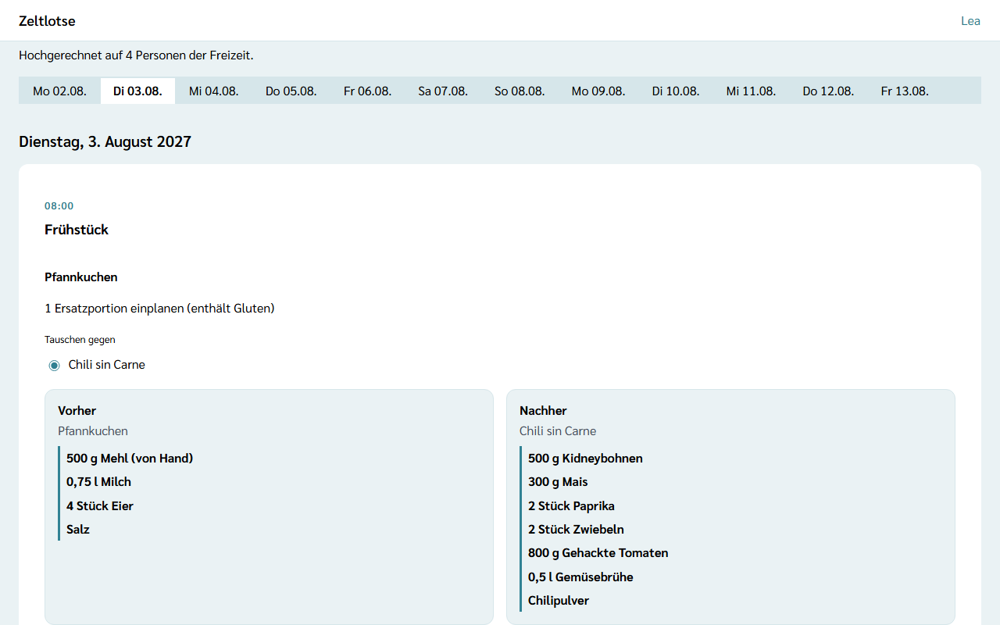
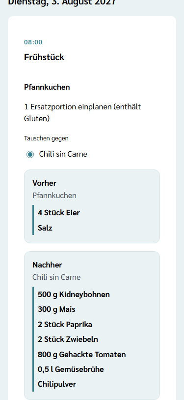

**Wer:** Leitung und Team einer Freizeit. Küche ist keine eigene Rolle; wer kocht oder einkauft, arbeitet mit den Rechten des Teams.

Im **Essensplan** legt die Küche fest, welches Rezept es zu welcher Mahlzeit gibt. Ein Rezept an einer Mahlzeit heißt **Gericht**. Aus den Gerichten berechnet Zeltlotse die [Einkaufsliste](/kueche/einkaufsliste/).

Den Essensplan gibt es nur, wenn die Leitung das Modul **Verpflegung** eingeschaltet hat – siehe [Module schalten](/leitung/module-schalten/). Ist das Modul aus, zeigt ein gespeicherter Link „Diese Seite ist nicht verfügbar.“; die Gerichte bleiben erhalten.

## Der Weg zum Essensplan

Startseite der Freizeit → Knopf **Küche** → Reiter **Essensplan**. Die fünf Reiter **Tagesansicht · Rezepte · Essensplan · Einkaufsliste · Einkauf** stehen oben auf allen Küche-Seiten.

Darunter steht je Tag der Freizeit ein Reiter, zum Beispiel „Di 03.08.“. Gewählt ist der heutige Tag, wenn er zur Freizeit gehört, sonst der erste Tag. Der gewählte Tag steht in der Adresse; ein Lesezeichen öffnet also genau diesen Tag.

Je Mahlzeit steht eine Card: **Frühstück**, **Mittagessen** und **Abendessen** mit ihrer Uhrzeit. Die Mahlzeiten sind die festen Programmpunkte aus dem [Wochenraster](/mitarbeitende/programm/); Zeltlotse legt sie an, sobald der Essensplan das erste Mal geöffnet wird. Ohne Gericht steht in der Card „Noch nichts vorgemerkt.“

## Ein Gericht vormerken

In jeder Mahlzeit-Card stehen unter „Rezept für Frühstück vormerken“ die Rezepte der Freizeit zur Auswahl. Ein Rezept wählen und **Gericht vormerken** tippen – das Gericht steht danach in der Card. An einer Mahlzeit können mehrere Gerichte stehen, zum Beispiel ein Hauptgericht und ein Nachtisch.

Gibt es noch keine Rezepte, steht oben „Noch keine Rezepte.“ mit dem Knopf **Rezepte öffnen** – siehe [Rezepte und Mengen](/kueche/rezepte/).

**Entfernen** am Gericht klappt eine Rückfrage auf („„Pfannkuchen“ entfernen?“ – „Ja, entfernen“ / „Nein“). Mit dem Gericht verschwinden seine Posten auf der Einkaufsliste und seine Mengen von Hand. Wird ein Rezept gelöscht, verschwinden alle Gerichte mit diesem Rezept.

## Ersatzportionen

Unter jedem Gericht steht, für wie viele Personen ein Ersatz nötig ist, zum Beispiel „1 Ersatzportion einplanen (enthält Gluten)“. Zeltlotse gleicht dazu die Allergene des Rezepts mit den Freizeitpässen ab – wie, steht unter [Einkaufsliste](/kueche/einkaufsliste/#allergen-abgleich-und-ersatzportionen). Die Ersatzportionen kommen **zusätzlich** zur Menge des Rezepts; was es als Ersatz gibt, entscheidet die Küche. Fragt die Freizeit keine Allergien ab, steht oben „Diese Freizeit fragt keine Allergien ab.“, und es gibt keine Ersatzportionen.

## Ein Gericht tauschen

Ein Tausch ändert die Planung und damit die Einkaufsliste. Darum zeigt Zeltlotse zuerst eine **Vorschau**, und erst eine Bestätigung ändert etwas:

1. Am Gericht **Tauschen** tippen.
2. Unter „Tauschen gegen“ das neue Rezept wählen.
3. Zeltlotse zeigt **Vorher** und **Nachher** – am Laptop nebeneinander, am Handy untereinander: links die noch nicht gekauften Posten des bisherigen Rezepts, rechts genau die Posten, die nach dem Tausch auf der Einkaufsliste stehen. Was sich ändert, ist **fett** markiert. Was schon gekauft ist, steht nicht im Vergleich; darunter steht dann zum Beispiel „2 schon gekaufte Posten stehen nicht im Vergleich.“
4. Dann eine der drei Möglichkeiten:
   - **Übernehmen** – tauscht das Gericht; der Essensplan bleibt offen und meldet „Pfannkuchen gegen Chili sin Carne getauscht.“
   - **Anpassen** – tauscht das Gericht und öffnet die Einkaufsliste an diesem Tag, um dort Mengen anzupassen.
   - **Abbrechen** – schließt die Vorschau, nichts ändert sich.

Mengen, die auf der Einkaufsliste von Hand gesetzt sind, wandern mit, wenn das neue Rezept eine Zutat mit derselben Bezeichnung (Groß- und Kleinschreibung egal) und derselben Einheit hat. Alle anderen Mengen von Hand des Gerichts entfallen. Die Vorschau zeigt das schon.

Freigabe und Haken der Posten wandern **nicht** mit: Nach dem Tausch sind die Posten des neuen Rezepts offen und nicht freigegeben – siehe [Einkaufen: freigeben und abhaken](/kueche/einkauf/#gerichte-tauschen-nach-dem-einkauf).

Hat jemand anderes das Gericht inzwischen getauscht, steht „Inzwischen geändert – neu laden?“ mit dem Knopf **Neu laden**; getauscht wird dann nichts.

## Restetag

Eine Mahlzeit lässt sich in der [Tagesansicht](/kueche/tagesansicht/) als [Restetag](/kueche/tagesansicht/#restetag-setzen-und-zurücknehmen) markieren. Im Essensplan steht dann als erste Zeile in der Card der Mahlzeit „Restetag: Reste verwerten.“ Die Gerichte bleiben vorgemerkt; der Restetag ändert weder Essensplan noch Einkaufsliste. Posten freigeben und abhaken steht unter [Einkaufen: freigeben und abhaken](/kueche/einkauf/).

## Nach dem Abschluss

Nach dem Abschluss der Freizeit ist der Essensplan nur lesbar: Oben steht „Diese Freizeit ist abgeschlossen und nur lesbar.“; Vormerken, Tauschen und Entfernen fehlen.

## Datenschutz

Gerichte enthalten keine Personendaten. Für die Ersatzportionen sieht die Küche nur Anzahlen, nie Namen; jeder Abgleich steht im Zugriffsprotokoll der betroffenen Personen – siehe [Was passiert mit meinen Daten](/daten/#küche).

## Noch nicht dabei

Den Essensplan ohne Netz (offline) gibt es noch nicht.
