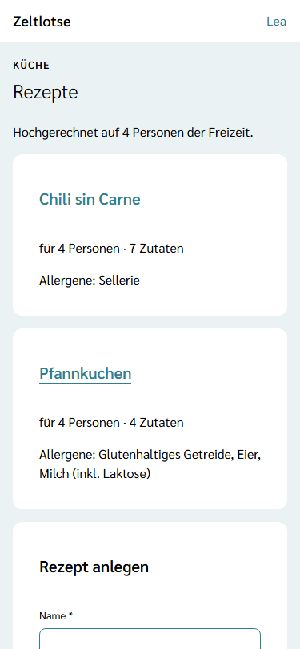
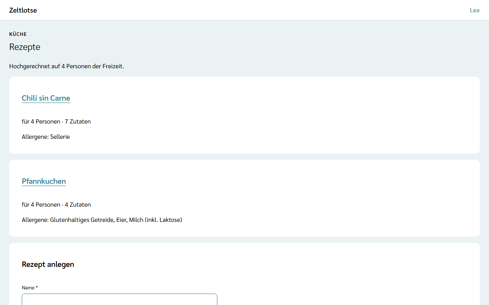
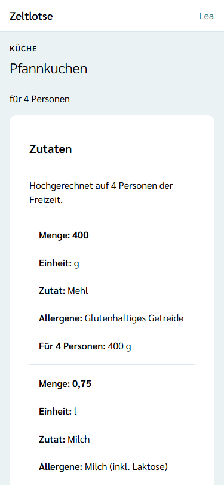
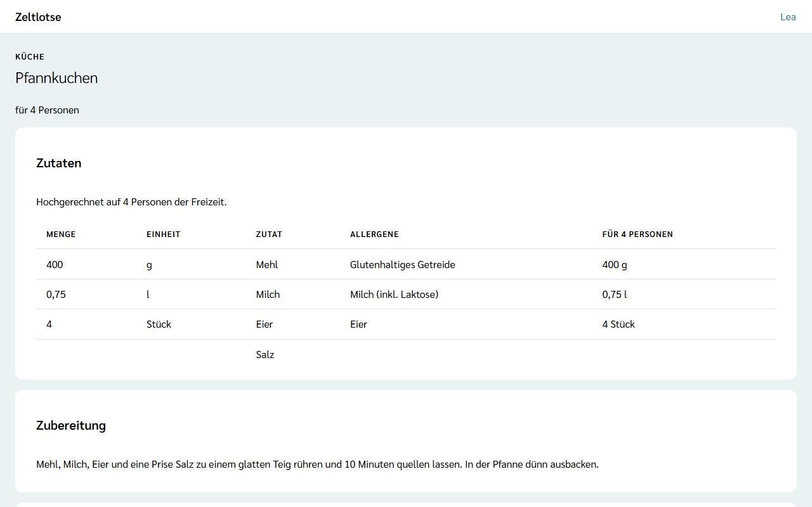

**Wer:** Leitung und Team einer Freizeit. Küche ist keine eigene Rolle; wer kocht oder einkauft, arbeitet mit den Rechten des Teams.

Die Küche hält ihre Rezepte in Zeltlotse fest: Name, für wie viele Personen das Rezept gedacht ist, die Zubereitung und die Zutaten mit Menge, Einheit und Allergenen. Zeltlotse rechnet jede Menge automatisch auf die Zahl der Personen hoch, die die Freizeit verpflegt.

Rezepte gibt es nur, wenn die Leitung das Modul **Verpflegung** für die Freizeit eingeschaltet hat – siehe [Module schalten](/leitung/module-schalten/). Ist das Modul aus, fehlt der Knopf „Küche“, und ein gespeicherter Link zu einem Rezept zeigt „Diese Seite ist nicht verfügbar.“ Die Rezepte bleiben dabei erhalten und sind nach dem Einschalten wieder da.

## Der Weg zu den Rezepten

Startseite der Freizeit → Knopf **Küche**. Die Seite **Rezepte** zeigt je Rezept eine Card: den Namen als Link zum Rezept, „für 4 Personen“ mit der Zahl der Zutaten und die Allergene aller Zutaten. Darüber steht, auf wie viele Personen Zeltlotse hochrechnet, zum Beispiel „Hochgerechnet auf 4 Personen der Freizeit.“ Ohne Rezepte steht dort „Noch keine Rezepte.“

## Ein Rezept anlegen

Unter den Rezepten steht das Formular **Rezept anlegen**:

- **Name** – Pflicht, höchstens 200 Zeichen, zum Beispiel „Pfannkuchen“,
- **Basis-Personenzahl** – Pflicht, eine ganze Zahl von 1 bis 1000: Für so viele Personen gelten die Mengen im Rezept.

**Rezept anlegen** speichert das Rezept und öffnet es. Fehlt eine Angabe oder ist sie ungültig, steht oben eine Übersicht der Fehler mit Sprunglinks, und der Fehler steht direkt am Feld.

## Zubereitung und Zutaten

Auf der Seite des Rezepts stehen in der Card **Rezept bearbeiten** der Name, die Basis-Personenzahl und die **Zubereitung** als freier Text. Zeltlotse speichert beim Verlassen des Felds; darunter steht „Gespeichert“ mit **Rückgängig**. Hat jemand anderes dasselbe Feld inzwischen geändert, steht dort „Inzwischen geändert – neu laden?“.

Neue Zutaten kommen über das Formular **Zutat hinzufügen**:

- **Bezeichnung** – Pflicht, höchstens 200 Zeichen, zum Beispiel „Mehl“,
- **Menge** – freiwillig, eine Zahl größer 0 mit höchstens drei Nachkommastellen, mit Komma oder Punkt („1,5“ oder „1.5“); ohne Menge, etwa bei „Salz“, bleibt das Feld leer,
- **Einheit** – freiwillig, höchstens 30 Zeichen, zum Beispiel „g“, „l“ oder „Stück“.

Eine Menge darf Komma oder Punkt als Dezimaltrenner haben, aber keine Tausenderpunkte: erlaubt sind Zahlen bis 1.000.000 mit höchstens drei Nachkommastellen, also „1000“ statt „1.000“. Zeltlotse rechnet keine Einheiten um: Was in der Einheit steht, steht so in der Tabelle. Eine Menge steht immer mit Komma da, „1.5“ wird zu „1,5“.

Je Zutat gibt es eine eigene Card mit ihren Feldern. Dort lassen sich Bezeichnung, Menge und Einheit ändern und die **Allergene** ankreuzen. **Entfernen** klappt eine Rückfrage auf („„Salz“ entfernen?“ – „Ja, entfernen“ / „Nein“). **Rezept löschen** ganz unten löscht nach einer Rückfrage das Rezept mit allen Zutaten.

## Allergene

Zur Auswahl stehen die **14 EU-Hauptallergene** – dieselben wie bei der Allergie-Frage im Freizeitpass: Glutenhaltiges Getreide, Krebstiere, Eier, Fisch, Erdnüsse, Soja, Milch (inkl. Laktose), Schalenfrüchte (Nüsse), Sellerie, Senf, Sesam, Schwefeldioxid und Sulfite, Lupinen und Weichtiere. Ein Klick auf ein Kästchen speichert sofort. Auf der Seite **Rezepte** stehen am Rezept alle Allergene seiner Zutaten zusammen.

## Die Hochrechnung

Oben in der Card **Zutaten** steht die Tabelle mit Menge, Einheit, Zutat, Allergenen und der Spalte **Für 4 Personen** (mit der Personenzahl der Freizeit). Dort steht jede Menge hochgerechnet:

> Menge × Personen der Freizeit ÷ Basis-Personenzahl, auf zwei Nachkommastellen gerundet.

Ein Beispiel: Ein Rezept für 4 Personen braucht 1,5 kg Mehl. Verpflegt die Freizeit 6 Personen, steht in der Spalte „Für 6 Personen“ **2,25 kg**. Eine Zutat ohne Menge bleibt dort leer. Die hochgerechneten Mengen sind auf zwei Nachkommastellen gerundet, nicht auf ganze Stück: Aus 4 Eiern für 4 Personen werden bei 6 Personen „6 Stück“, aus 1 Ei aber „1,5 Stück“.

**Wer zählt:** Jede Person zählt gleich – Kinder wie Mitarbeitende. Zeltlotse zählt die bestätigten Teilnehmenden und alle Personen mit einer Rolle in der Freizeit (Leitung und Team); wer beides ist, zählt einmal. Eingegangene oder abgesagte Anmeldungen zählen nicht. Bestätigt die Leitung eine Anmeldung, rechnet Zeltlotse beim nächsten Öffnen mit der neuen Zahl. Eine Zahl von Hand gibt es nicht; wer für mehr oder weniger Personen kochen will, ändert die Basis-Personenzahl.

Ist noch niemand bestätigt, steht dort „Noch niemand bestätigt – Mengen gelten für die Basis.“, und die Spalte zur Hochrechnung fehlt.

Nach jedem gespeicherten Feld lädt die Seite die Tabelle neu; die hochgerechneten Mengen passen also sofort zur neuen Menge oder Basis.

## Nach dem Abschluss

Nach dem Abschluss der Freizeit sind die Rezepte nur lesbar: Oben steht „Diese Freizeit ist abgeschlossen und nur lesbar.“; Felder, Formulare, „Entfernen“ und „Rezept löschen“ fehlen. Tabelle und Zubereitung bleiben sichtbar.

## Datenschutz

Rezepte gehören zur Freizeit und enthalten keine Personendaten. Deshalb gehören **keine Namen** in Name, Zubereitung oder Bezeichnungen – also nicht „Ohne Nüsse für Emma“, sondern das Allergen ankreuzen. Mit den übrigen Daten der Freizeit löscht Zeltlotse die Rezepte nach der Frist der Organisation – siehe [Was passiert mit meinen Daten](/daten/#küche).

## Noch nicht dabei

Gerichte an den Mahlzeiten, der Abgleich der Allergene mit den Freizeitpässen, die Einkaufsliste, die Tagesansicht der Küche und der Restetag kommen mit einer späteren Version. Rezepte gelten heute nur in ihrer Freizeit; eine Rezeptsammlung der Organisation und das Kopieren von Rezepten in eine andere Freizeit gibt es nicht.
