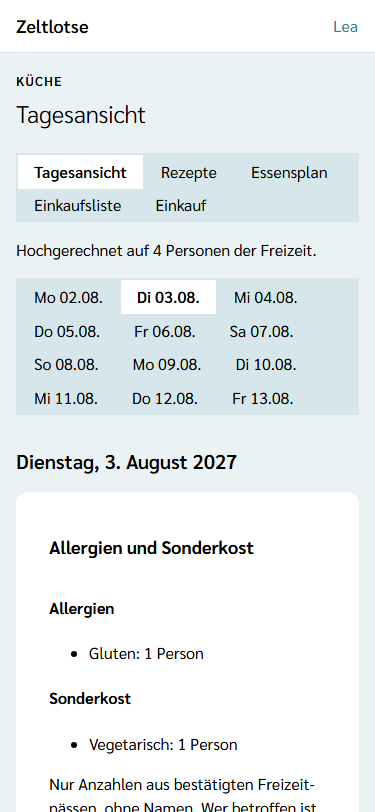
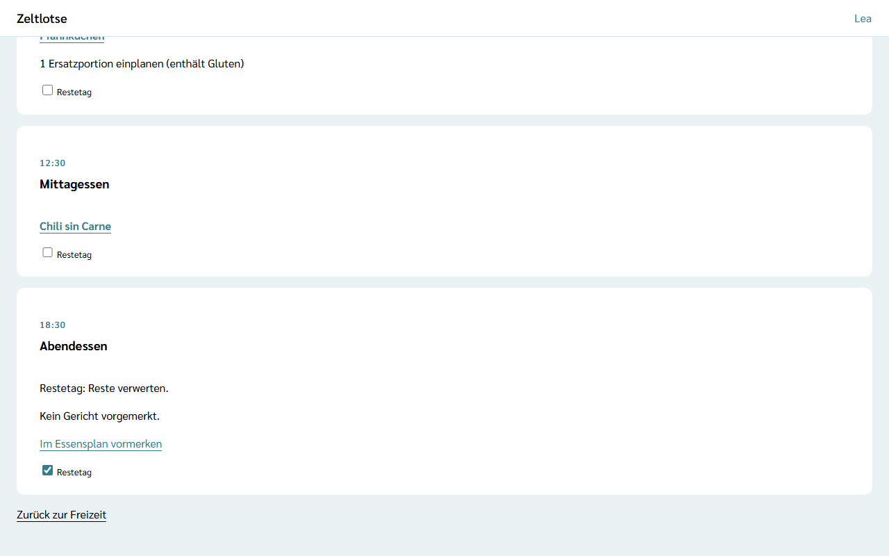

**Wer:** Leitung und Team einer Freizeit. Küche ist keine eigene Rolle, sondern eine Aufgabe im Team.

Die **Tagesansicht** ist die Sicht der Küche für den Kochtag: Sie zeigt für einen Tag die Mahlzeiten mit ihren Gerichten und Ersatzportionen und dazu, wie viele Personen Allergien oder Sonderkost haben. Eine Mahlzeit lässt sich dort spontan als **Restetag** markieren.

Die Tagesansicht gibt es nur, wenn die Leitung das Modul **Verpflegung** eingeschaltet hat – siehe [Module schalten](/leitung/module-schalten/). Ist das Modul aus, zeigt ein gespeicherter Link „Diese Seite ist nicht verfügbar.“; Restetage bleiben erhalten.

## Der Weg zur Tagesansicht

Startseite der Freizeit → Knopf **Küche** → Reiter **Tagesansicht**. Die fünf Reiter **Tagesansicht · Rezepte · Essensplan · Einkaufsliste · Einkauf** stehen oben auf allen Küche-Seiten.

## Einen Tag wählen

Unter den Küche-Reitern stehen die Tage der Freizeit als Reiter, zum Beispiel „Di 03.08.“. Ohne Wahl zeigt die Tagesansicht **heute**, wenn heute ein Tag der Freizeit ist, sonst den **ersten Tag** der Freizeit. Ein Tipp auf einen anderen Tag zeigt diesen Tag; die Adresse merkt sich die Wahl, ein Lesezeichen öffnet also wieder denselben Tag.

## Was die Seite zeigt

Oben steht, für wie viele Personen gerechnet ist, zum Beispiel „Hochgerechnet auf 4 Personen der Freizeit.“ Darunter folgen für den gewählten Tag:

- **Allergien und Sonderkost** – je Allergen und je Sonderkost die Zahl der Personen, zum Beispiel „Gluten: 1 Person“ und „Vegetarisch: 1 Person“. Sonderkost ist die Auswahl der Frage „Ernährung“ im Freizeitpass: vegetarisch, vegan oder kein Schweinefleisch.
  - Fragt die Freizeit die Allergie-Frage nicht ab, steht dort „Diese Freizeit fragt keine Allergien ab.“, bei der Frage „Ernährung“ entsprechend „Diese Freizeit fragt keine Sonderkost ab.“ Welche Fragen eine Freizeit stellt, legt die Leitung fest – siehe [Fragen des Freizeitpasses](/leitung/freizeitpass-fragen/).
  - Nennt kein bestätigter Freizeitpass etwas, steht dort „Keine Allergien in den bestätigten Freizeitpässen.“ bzw. „Keine Sonderkost in den bestätigten Freizeitpässen.“
- **Je Mahlzeit eine Card** – Frühstück, Mittag- und Abendessen mit Uhrzeit. Darin stehen die vorgemerkten Gerichte; der Name führt zum [Rezept](/kueche/rezepte/) mit den hochgerechneten Mengen. Braucht ein Gericht Ersatzportionen, steht darunter zum Beispiel „1 Ersatzportion einplanen (enthält Gluten)“ – wie im [Essensplan](/kueche/essensplan/). Ohne Gericht steht dort „Kein Gericht vorgemerkt.“ mit dem Link **Im Essensplan vormerken**, der den Essensplan an diesem Tag öffnet.

Die Sonderkost gilt für den ganzen Tag, nicht je Gericht: Rezepte haben kein Merkmal „vegetarisch“. Die Küche sieht die Zahlen und plant selbst, zum Beispiel ein zweites Gericht oder eigene Posten auf der [Einkaufsliste](/kueche/einkaufsliste/#eigene-posten).

## Wer zählt

Die Zahlen kommen aus den Freizeitpässen derselben Personen, für die Zeltlotse die Mengen hochrechnet. Es zählen nur:

- Personen, deren Anmeldung die Leitung **bestätigt** hat – eine nur eingegangene Anmeldung zählt nicht;
- Personen, deren **Freigabe** noch läuft und die Frage enthält;
- die **angekreuzte Auswahl**. Der Freitext „Sonstiges“ fließt nie ein.

Die Tagesansicht nennt **keine Namen**. Wer genau betroffen ist, sieht das Team über die Schnellsuche „Person suchen“ oder im Freizeitpass der Person – siehe [Freizeitpässe](/mitarbeitende/freizeitpaesse/); dieser Blick steht wie jeder andere im Zugriffsprotokoll.

## Restetag setzen und zurücknehmen

In jeder Mahlzeit-Card steht das Kästchen **Restetag**. Ein Tipp markiert die Mahlzeit als Restetag: Zeltlotse speichert sofort, darunter steht „Gespeichert“ mit **Rückgängig**, und an der Mahlzeit steht „Restetag: Reste verwerten.“ Ein zweiter Tipp oder **Rückgängig** nimmt die Markierung zurück. Hat jemand anderes den Restetag inzwischen geändert, steht „Inzwischen geändert – neu laden?“; **Neu laden** zeigt den aktuellen Stand.

Der Restetag ist **nur eine Markierung**. Er ändert nichts am Essensplan und nichts am Einkauf: Die Gerichte der Mahlzeit bleiben vorgemerkt, die Einkaufsliste rechnet weiter mit ihnen, und Freigaben und Haken bleiben, wie sie sind. Was schon gekauft ist, ist ohnehin da. Soll ein Gericht an einen anderen Tag, nutzt die Küche **Entfernen** oder **Tauschen** im [Essensplan](/kueche/essensplan/). Im Essensplan steht an der Mahlzeit ebenfalls „Restetag: Reste verwerten.“

## Datenschutz

Für die Zahlen liest Zeltlotse die angekreuzten Allergene und die Auswahl der Frage „Ernährung“ aus den Freizeitpässen. Die Küche bekommt davon nur Anzahlen, ohne Namen, und speichert nichts davon. Jeder Abruf steht im Zugriffsprotokoll der betroffenen Personen – als „Allergen-Abgleich der Küche“ und als „Sonderkost-Abgleich der Küche“, ohne lesende Person und höchstens einmal am Tag. Fragt die Freizeit eine Frage nicht ab, liest Zeltlotse dafür nichts und schreibt auch nichts ins Protokoll – siehe [Zugriffsprotokoll und Meine Daten](/erste-schritte/meine-daten/) und [Was passiert mit meinen Daten](/daten/#küche).

Der Restetag selbst enthält keine Personendaten; Zeltlotse speichert nicht, wer ihn gesetzt hat.

## Nach dem Abschluss

Nach dem Abschluss der Freizeit ist die Tagesansicht nur lesbar: Oben steht „Diese Freizeit ist abgeschlossen und nur lesbar.“ Das Kästchen **Restetag** und der Link **Im Essensplan vormerken** fehlen; an einer Mahlzeit, die ein Restetag war, steht weiter „Restetag: Reste verwerten.“

## Ohne Netz

Während der Freizeit liegt die Tagesansicht jedes Tages verschlüsselt auf den Geräten von Leitung und Team und öffnet sich auch ohne Netz; das Kästchen **Restetag** ist dann ausgegraut. Mehr dazu unter [Ohne Netz arbeiten](/mitarbeitende/offline/#küchen-tagesansicht-ohne-netz).
