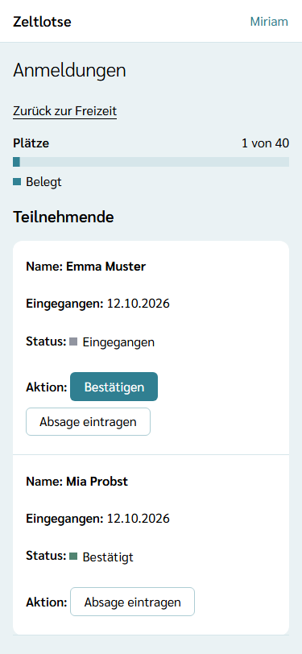
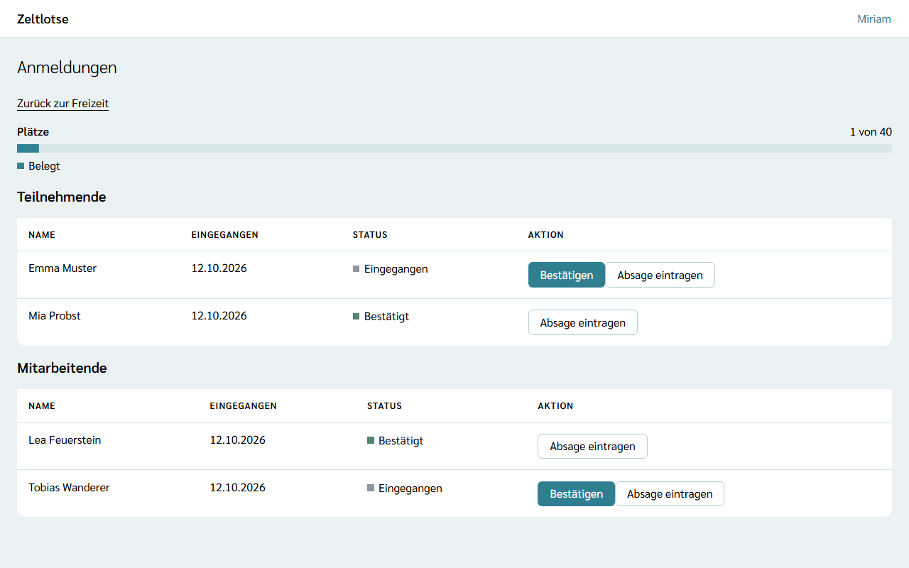
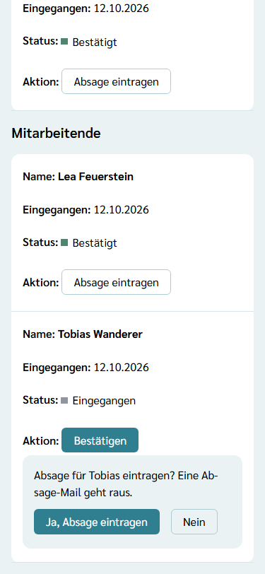
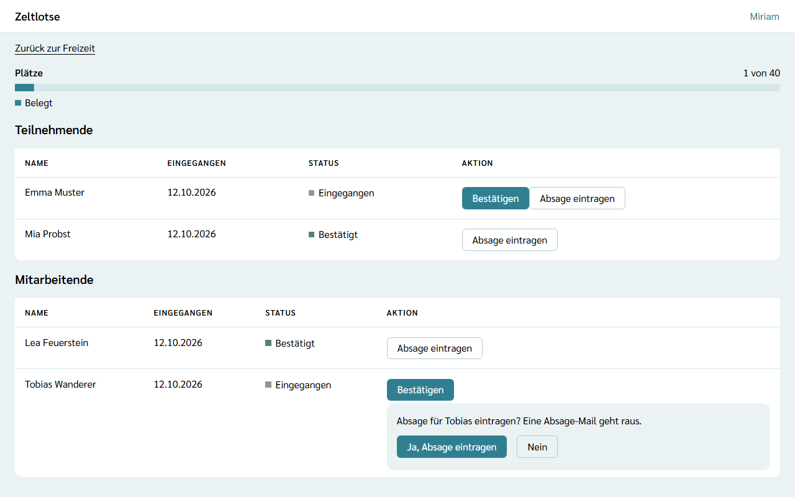
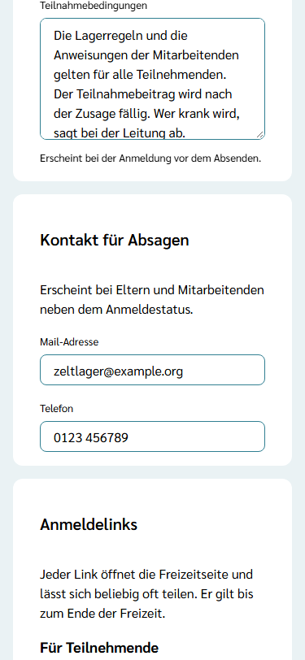
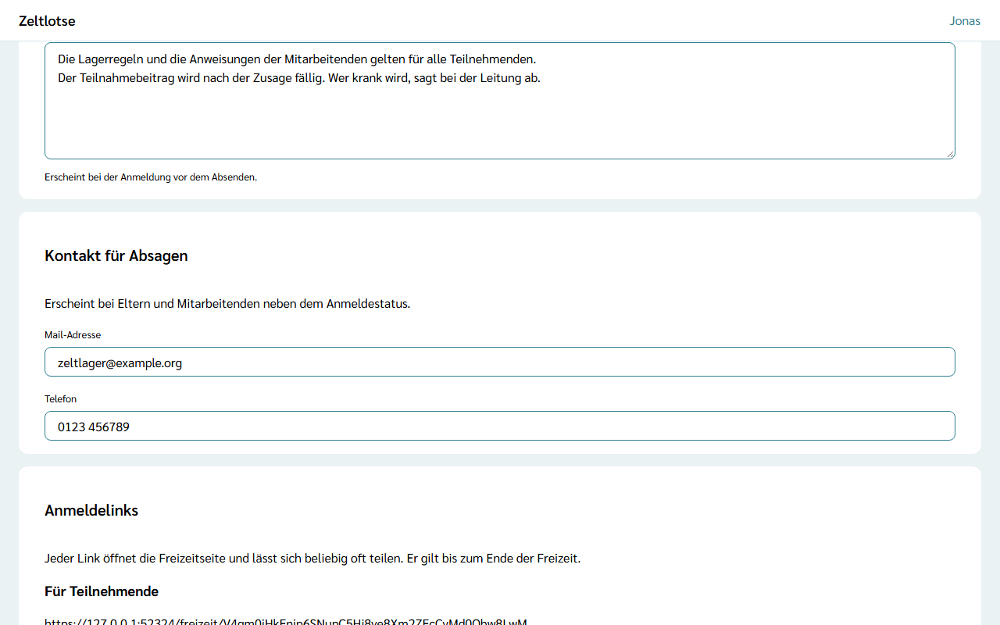

Jede Anmeldung über einen Anmeldelink kommt als **Eingegangen** bei der Leitung an. Ob jemand dabei ist, entscheidet die Leitung: Sie **bestätigt** die Anmeldung oder trägt eine **Absage** ein. Eltern und Mitarbeitende sagen nicht selbst in Zeltlotse ab; sie wenden sich an die Leitung (siehe [Kontakt für Absagen](#kontakt-für-absagen)).

Diese Seite gibt es nur für die Leitung. Das Team sieht weder die Seite noch den Knopf.

## Die Seite „Anmeldungen“

Auf der Startseite der Freizeit führt der Knopf **Anmeldungen** zur Liste. Oben steht der Balken **Plätze**: die bestätigten Teilnehmenden im Verhältnis zur Höchstzahl, zum Beispiel „1 von 40“, mit einem Statuswort:

- **Belegt** – es sind noch Plätze frei,
- **Ausgebucht** – die Höchstzahl ist erreicht; die Freizeitseite zeigt jetzt „Ausgebucht“,
- **Überbelegt** – es sind mehr Teilnehmende bestätigt als Plätze da sind,
- **Ohne Höchstzahl** – die Leitung hat keine Höchstzahl festgelegt; dann steht nur die Zahl der Bestätigten, etwa „3 bestätigt“.

Mitarbeitende zählen nicht mit.

Darunter stehen zwei Abschnitte, **Teilnehmende** und **Mitarbeitende**, je mit Name, Datum des Eingangs, Status und Aktion. Die Reihenfolge ist die des Eingangs. Der Status steht als Wort:

- **Eingegangen** – noch nicht entschieden,
- **Bestätigt** – die Person ist dabei,
- **Abgesagt** – die Person ist nicht dabei; das ist endgültig.

Gibt es noch keine Anmeldung, steht im Abschnitt „Noch keine Anmeldungen.“ Hat jemand sein Konto gelöscht, steht an der Anmeldung „Gelöschte Person“.

## Bestätigen

Bei einer eingegangenen Anmeldung **Bestätigen** wählen. Der Knopf selbst ist die Entscheidung, eine Rückfrage gibt es nicht. Danach steht oben „… ist bestätigt. Eine Mail geht raus.“, und die Liste lädt neu.

Mit der Bestätigung passiert von selbst:

- **Mail:** Es geht genau eine Mail „Anmeldung bestätigt: …“ hinaus. Sie geht an genau eine Adresse: an das eigene Konto der angemeldeten Person; sonst an den Elternteil der Familie mit Konto, dessen Profil zuerst angelegt wurde; sonst an die Mail-Adresse der Gast-Anmeldung. Gibt es keine Adresse, geht keine Mail hinaus.
- **Freizeitpass:** Ab jetzt sieht auch das Team den Freizeitpass der Person (siehe [Was passiert mit meinen Daten](/daten/)).
- **Bei Mitarbeitenden:** Die Person wird **Team** der Freizeit. Sie findet die Freizeit auf ihrer Startseite und bekommt die Rechte des Teams. Mit der ersten bestätigten Mitarbeit wird sie außerdem **Mitarbeitende der Organisation**. Ist die Person schon Leitung, bleibt sie Leitung.

Auch eine ausgebuchte Freizeit lässt sich weiter bestätigen; wer nachrückt, entscheidet allein die Leitung. Eine Warteliste gibt es nicht: Nachrücken heißt, eine eingegangene Anmeldung zu bestätigen. Der Balken zeigt dann „Überbelegt“.

## Absage eintragen

Eingegangene und bestätigte Anmeldungen lassen sich absagen:

1. **Absage eintragen** wählen. An derselben Stelle erscheint „Absage für … eintragen? Eine Absage-Mail geht raus.“
2. **Ja, Absage eintragen** wählen, oder **Nein**, um abzubrechen.

Danach steht oben „Absage für … eingetragen. Eine Mail geht raus.“ Mit der Absage passiert von selbst:

- **Mail:** Eine Mail „Anmeldung abgesagt: …“ geht an dieselbe Adresse wie bei der Bestätigung, mit dem Kontakt für Absagen, wenn er eingetragen ist.
- **Freizeitpass:** Die Freizeit sieht den Freizeitpass ab sofort nicht mehr.
- **Bei Mitarbeitenden:** Die Rolle im Team endet; die Freizeit verschwindet von der Startseite der Person. Mitarbeitende der Organisation bleibt sie.
- **Gast-Link:** War es die einzige Anmeldung einer Gast-Familie, gilt ihr Gast-Link nicht mehr, und Zeltlotse löscht die Gast-Angaben beim nächsten Löschlauf.

Eine Absage ist endgültig. Dieselbe Person lässt sich danach nicht erneut zu dieser Freizeit anmelden.

Wurde eine Anmeldung inzwischen schon entschieden, etwa von der zweiten Leitung, erscheint „Diese Anmeldung wurde schon entschieden.“, und die Liste zeigt den aktuellen Stand.

## Kontakt für Absagen

Eltern und Mitarbeitende sehen neben dem Anmeldestatus, an wen sie sich für eine Absage wenden. Diesen Kontakt trägt die Leitung selbst ein: in den **Einstellungen** der Freizeit im Abschnitt **Kontakt für Absagen**, mit **Mail-Adresse** und **Telefon**. Jede Angabe speichert beim Verlassen des Feldes. Ein leeres Feld löscht die Angabe.

In der Familienübersicht und auf dem Gast-Link steht dann unter jeder nicht abgesagten Anmeldung „Absage nur über die Leitung:“ mit der Mail-Adresse und der Telefonnummer als Links. Ohne Kontakt steht dort „Absage nur über die Leitung der Freizeit.“ Die Mail-Adresse muss ein „@“ enthalten und darf höchstens 254 Zeichen haben, die Telefonnummer höchstens 40 Zeichen.
