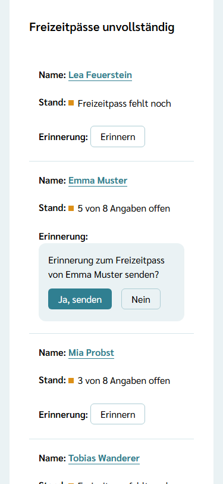
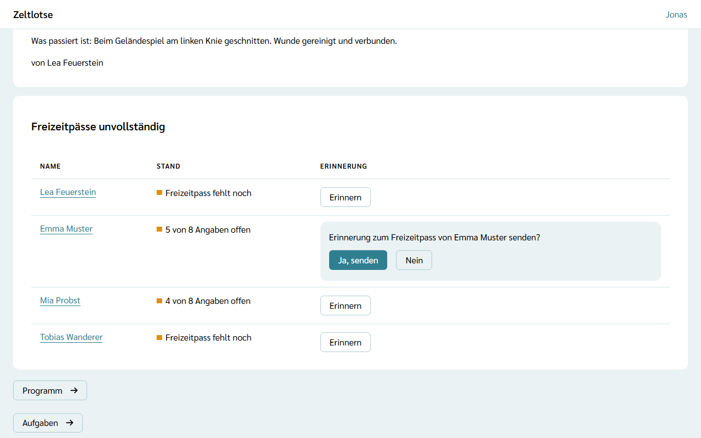

Für die Leitung ist die Startseite der Freizeit das **Leitungs-Cockpit**. Es zeigt auf einer Seite, wo die Freizeit steht: wie viele Anmeldungen es gibt, was noch offen ist und wessen Freizeitpass unvollständig ist. Das Team sieht diese Teile nicht; für das Team bleibt die Startseite, wie sie unter [Freizeit öffnen](/leitung/freizeit-oeffnen/) beschrieben ist.

## Anmeldestand

Die Card **Anmeldungen** zeigt den Balken **Plätze**: bestätigte Teilnehmende im Verhältnis zur Höchstzahl, zum Beispiel „1 von 40“. Darunter stehen je Art die Zahlen, etwa „Teilnehmende: 1 eingegangen, 1 bestätigt“ und „Mitarbeitende: 1 eingegangen, 1 bestätigt“. Abgesagte Anmeldungen zählen nicht mit. Der Knopf **Anmeldungen** führt zur Liste, in der die Leitung bestätigt und Absagen einträgt (siehe [Anmeldungen bestätigen und absagen](/leitung/anmeldungen/)).

Lässt sich der Anmeldestand gerade nicht laden, fehlt die Card; der Knopf **Anmeldungen** bleibt.

## Warnhinweise

Die Card **Warnhinweise** sammelt, was noch offen ist, je Art eine Zeile:

- **„4 Freizeitpässe unvollständig“** – der Link springt zur Tabelle weiter unten.
- **„Bei 2 Personen im Team fehlen Nachweise oder laufen vor dem Ende der Freizeit ab.“** – mit dem Knopf **Nachweise prüfen** (siehe [Fehlende Nachweise und Erinnerungen](/leitung/nachweise-erinnern/)).
- **„Sicherheitskette ist noch nicht eingerichtet“** – der Link führt zur Card **Sicherheitskette** in den Einstellungen. Die Zeile verschwindet, sobald die Kette eingerichtet ist (siehe [Sicherheitskette einrichten](/leitung/sicherheitskette/)).
- **„3 Aufgaben sind noch nicht übernommen“** – der Link führt zu den Aufgaben (siehe [Aufgaben übernehmen und abhaken](/mitarbeitende/aufgaben/)). Gezählt werden Aufgaben, die niemand übernommen und niemand abgehakt hat, und zwar nur die, die jetzt dran sind: vor der Freizeit die der Vorbereitung, während der Freizeit dazu die für die Zeit der Freizeit, danach alle. Nach dem Abschluss gibt es die Zeile nicht mehr.

Gibt es mindestens eine Zeile, steht darüber „Achtung: 2 Punkte sind offen.“, gezählt wird je Zeile. Ist nichts offen, steht dort „Alles erledigt: Keine offenen Punkte.“ Lässt sich ein Teil gerade nicht laden, fehlt seine Zeile, und „Keine offenen Punkte.“ erscheint nicht.

Vor den Cards des Cockpits steht außerdem die Card **Meine Aufgaben** mit den eigenen offenen Aufgaben; sie sehen Leitung und Team gleichermaßen (siehe [Aufgaben übernehmen und abhaken](/mitarbeitende/aufgaben/#meine-aufgaben)).

## Unvollständige Freizeitpässe

Die Card **Freizeitpässe unvollständig** listet alle Personen dieser Freizeit, deren Freizeitpass noch offene Angaben hat, sortiert nach Nachname. Die eigene Person steht nicht in der Liste und lässt sich nicht selbst erinnern. In der Spalte **Stand** steht:

- **„Freizeitpass fehlt noch“** – keine der abgefragten Angaben ist vollständig.
- **„5 von 8 Angaben offen“** – ein Teil fehlt noch.

Als offen zählt eine abgefragte Angabe, die leer ist oder die zuletzt vor mehr als 12 Monaten bestätigt wurde. Das ist dieselbe Regel, nach der die Eltern „Stimmt das noch?“ sehen. Gezählt werden die Anmeldungen ab dem Eingang, ob schon bestätigt oder nicht, solange das [Freigabefenster](/daten/#freigabefenster-wann-die-einsicht-endet) läuft. Abgesagte Anmeldungen fallen heraus. Wer alle Angaben gemacht hat, verschwindet aus der Liste.

Die Liste zeigt nur Zahlen, keine Antworten. Darum entsteht dabei kein Eintrag im Zugriffsprotokoll. Der Name führt zum Freizeitpass der Person (siehe [Freizeitpässe ansehen](/mitarbeitende/freizeitpaesse/)); erst der Blick dort auf die Angaben steht im Zugriffsprotokoll.

## Erinnern

In jeder Zeile steht der Knopf **Erinnern**:

1. **Erinnern** wählen. Darunter klappt die Frage „Erinnerung zum Freizeitpass von … senden?“ auf. Bis hierhin geht keine Mail hinaus.
2. **Ja, senden** wählen. Es erscheint „Gesendet: Die Erinnerung zum Freizeitpass von … geht per Mail hinaus.“, und in der Zeile steht danach „Erinnert am TT.MM.JJJJ“. Das sieht auch die andere Leitung.

Was beim Erinnern passiert:

- Die Mail „Erinnerung: Freizeitpass in Zeltlotse“ geht an die Person selbst, wenn sie ein Konto hat. Bei Kindern geht sie an einen Elternteil mit Konto, nach einer Gast-Anmeldung an die Mail-Adresse des Gast-Zugangs.
- Die Mail nennt den Namen der Leitung und wessen Freizeitpass gemeint ist, mit einem Link auf **Familie**. Wer ohne Konto angemeldet hat, öffnet den Freizeitpass über den Gast-Link aus der Mail zur Anmeldung. Fragen und Antworten stehen nicht in der Mail.
- Je Person geht in dieser Freizeit **höchstens eine Erinnerung am Tag** hinaus, auch wenn beide Leitungen erinnern. Ein zweiter Versuch am selben Tag zeigt „Fehler: Zum Freizeitpass von … wurde heute schon erinnert.“
- Zeltlotse erinnert nie von selbst. Eine Mail geht nur hinaus, wenn eine Leitung ausdrücklich bestätigt.
