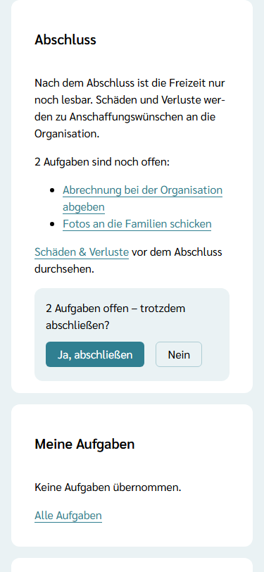
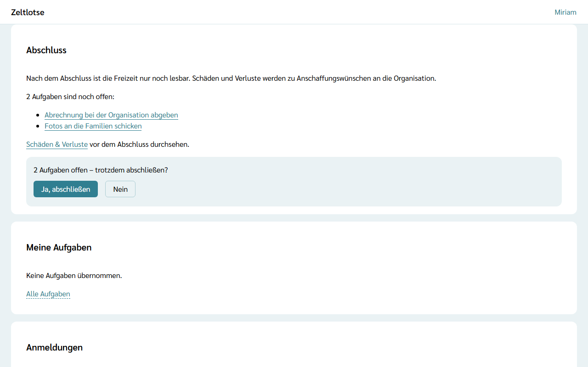
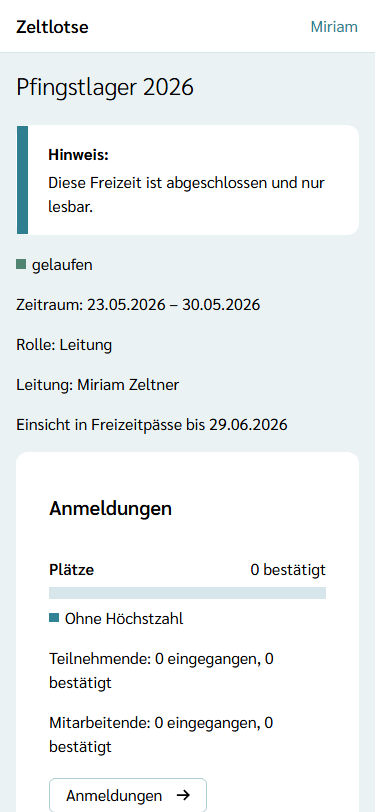
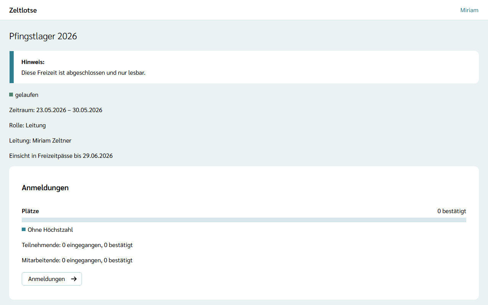
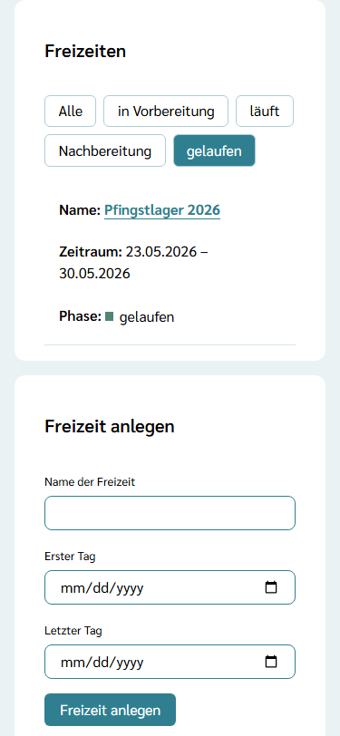
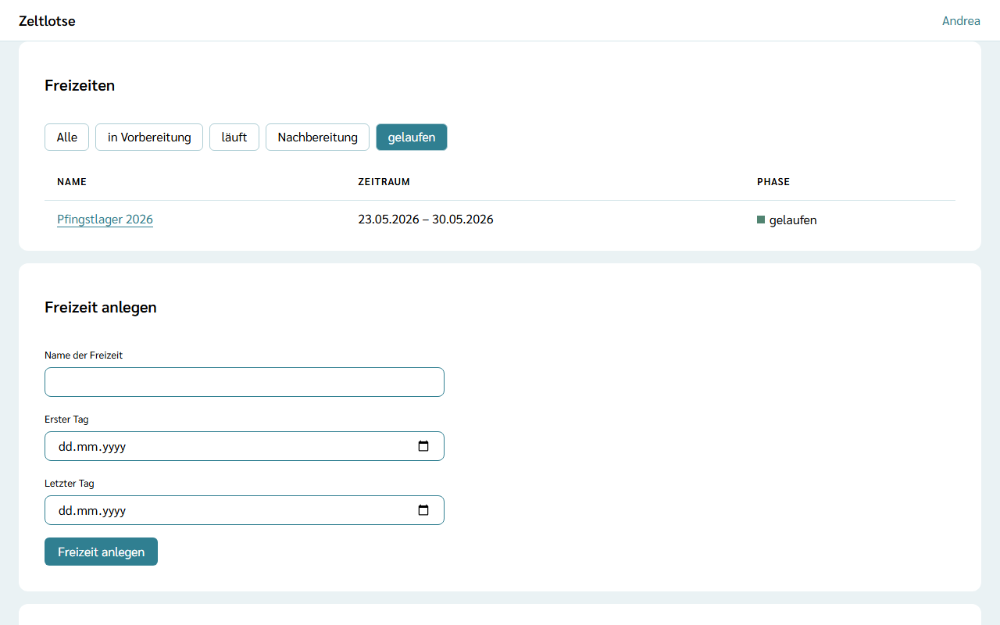

Nach dem letzten Freizeittag ist die Freizeit in der **Nachbereitung**: Fotos verschicken, Zeltplatz übergeben, Schäden nachtragen. Ist alles erledigt, schließt die Leitung die Freizeit ab. Danach ist sie **gelaufen** und nur noch lesbar. Abschließen darf **nur die Leitung**.

## Die Card „Abschluss“

In der Nachbereitung steht auf der Startseite der Freizeit die Card **Abschluss**. Sie zeigt, was noch offen ist:

- **Offene Aufgaben:** alle Aufgaben der Freizeit, die noch niemand abgehakt hat, je mit Link auf die Aufgabe, zum Beispiel „2 Aufgaben sind noch offen:“. Sind alle abgehakt, steht dort „Alle Aufgaben sind erledigt.“ (siehe [Aufgaben übernehmen und abhaken](/mitarbeitende/aufgaben/)).
- **Schäden & Verluste:** der Link auf die Liste der Freizeit, damit vor dem Abschluss nichts fehlt (siehe [Schäden und Verluste eintragen](/mitarbeitende/schaeden-verluste/)).

Das Team sieht die Card auch, aber ohne den Knopf zum Abschließen.

## Abschließen

1. Auf der Startseite der Freizeit in der Card **Abschluss** auf **Freizeit abschließen** tippen.
2. Es klappt eine Rückfrage auf. Sind alle Aufgaben erledigt, lautet sie „Freizeit abschließen? Danach ist sie nur lesbar.“ Sind noch Aufgaben offen, nennt sie die Zahl, zum Beispiel „2 Aufgaben offen – trotzdem abschließen?“.
3. **Ja, abschließen** schließt die Freizeit ab, **Nein** klappt die Rückfrage wieder zu.

Offene Punkte halten den Abschluss nicht auf: Die Rückfrage warnt nur. Vor dem Ende des letzten Freizeittages gibt es die Card nicht; die Freizeit lässt sich erst in der Nachbereitung abschließen.

## Was nach dem Abschluss passiert

- **Nur lesbar:** Oben auf der Startseite steht „Diese Freizeit ist abgeschlossen und nur lesbar.“ Die Phase heißt **gelaufen**. Anmeldungen, Programm, Material, Aufgaben, Dokumente, Einstellungen, Sicherheitskette, Schutzkonzept (auch die Bestätigung „gelesen“), Team-Notizen, Reservierungen im Inventar, das Vorfall-Protokoll und die [Kanäle](/mitarbeitende/kanaele/) lassen sich ansehen, aber nicht mehr ändern. Auch Erinnerungen und Einsicht-Anfragen zu Nachweisen und Freizeitpässen dieser Freizeit gehen nicht mehr, und eine offene Einladung als Leitung lässt sich nicht mehr annehmen. Zeltlotse prüft das auf dem Server: Auch ein geöffneter Link oder ein zweites Gerät ändert nichts mehr. Mit dem Abschluss löscht Zeltlotse außerdem alle Benachrichtigungs-Abos der Freizeit, die von Leitung und Team und die aus dem [Teilnehmer-Zugang](/leitung/teilnehmer-zugang/).
- **Anmelden geht nicht mehr:** Anmeldelinks gelten nur bis zum Ende des letzten Freizeittages; danach steht dort „Dieser Anmeldelink ist nicht mehr gültig.“
- **Schäden und Verluste** werden zu **Anschaffungswünschen** an die Organisation. Diese Liste bleibt beschreibbar: Wer noch etwas vergessen hat, trägt es nach – siehe [Anschaffungswünsche](/org-admin/anschaffungswuensche/).
- **Vorfall-Notizen** kommen ins [Archiv der Organisation](/org-admin/vorfall-archiv/); dort sehen Org-Admins sie, bis die Frist für Freizeit-Daten abläuft.
- **Keine Nachricht:** Der Abschluss schickt keine Mail an Team oder Eltern.
- **Kein Zurück:** Eine abgeschlossene Freizeit lässt sich nicht wieder öffnen.

## Gelaufene Freizeiten in der Organisation

Auf der Seite der Organisation stehen alle Freizeiten in der Card **Freizeiten**. Über der Tabelle wählt eine Leiste die Phase: **Alle**, **in Vorbereitung**, **läuft**, **Nachbereitung** oder **gelaufen**. So zeigt die Tabelle nur die Freizeiten einer Phase, etwa nur die laufenden oder nur die gelaufenen. **Alle** zeigt wieder jede Freizeit. Nach dem Anlegen einer Freizeit steht die Leiste wieder auf **Alle**. Gibt es in einer Phase keine Freizeit, steht dort „Keine Freizeit in dieser Phase.“

## Noch nicht dabei

Die Rückfrage vor dem Abschluss nennt keine Belege, die noch nicht erstattet sind; wer noch Geld bekommt, zeigt [Soll-Ist](/finanzen/soll-ist/#erstattungen). Der Haken „Erstattet“ an den [Belegen](/finanzen/belege/) lässt sich auch nach dem Abschluss noch setzen. Die Haken „bezahlt“ unter [Beiträge](/finanzen/beitraege/) dagegen nicht: Offene Beiträge klärt die Leitung darum vor dem Abschluss.
