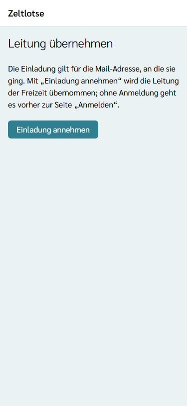
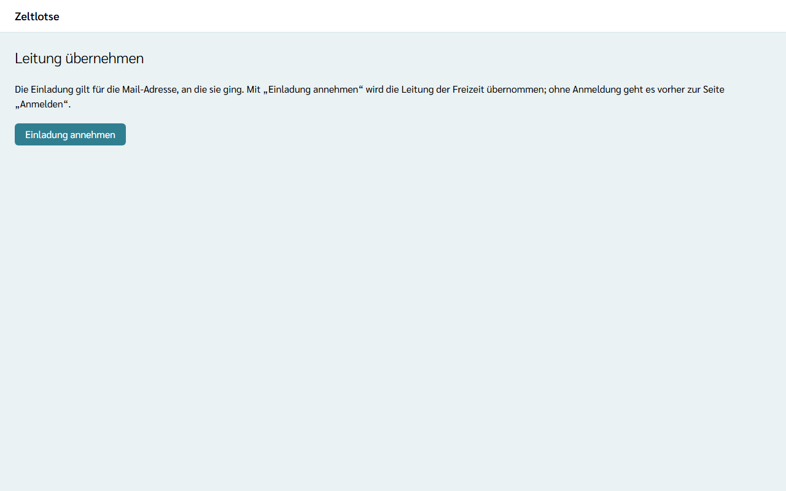
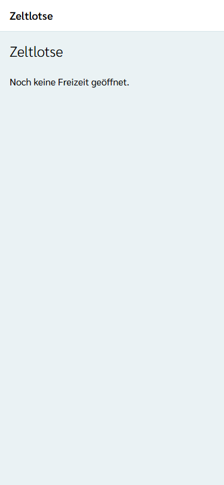
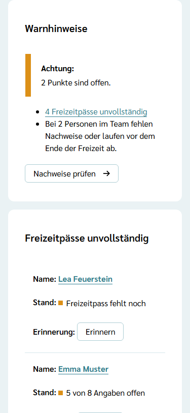
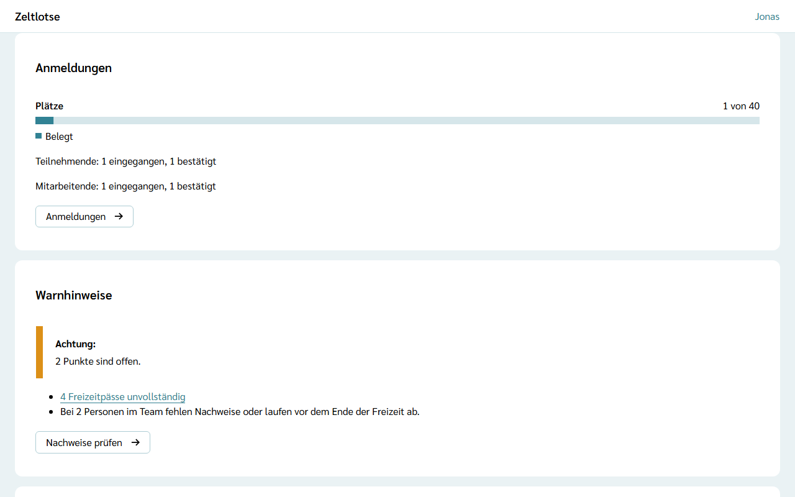

Die Leitung einer Freizeit setzt der Org-Admin per **Einladung** ein (siehe [Freizeit anlegen](/org-admin/freizeit-anlegen/)).

## Einladung annehmen

1. In der Mail „Einladung als Leitung in Zeltlotse“ stehen der Name der Freizeit, die Rolle „Leitung“ und ein Link. Den Link öffnen.
2. Es erscheint die Seite **Leitung übernehmen**. Das Öffnen allein nimmt noch nichts an.
3. **Einladung annehmen** wählen.
4. Ohne Anmeldung erscheint zuerst die Seite „Anmelden“. Mit **derselben Mail-Adresse** anmelden, an die die Einladung ging, am einfachsten mit dem **Login-Code** aus der Login-Mail. Danach erscheint wieder die Seite „Leitung übernehmen“; dort noch einmal **Einladung annehmen** wählen.
5. Zeltlotse zeigt die Startseite der Freizeit mit „Rolle: Leitung“.

Erscheint „Fehler: Diese Einladung ist nicht mehr gültig oder gilt für eine andere Mail-Adresse.“, ist die Einladung älter als 7 Tage, schon angenommen, durch eine neuere ersetzt, oder die Anmeldung läuft mit einer anderen Mail-Adresse. Dann mit der eingeladenen Mail-Adresse anmelden oder den Org-Admin um eine neue Einladung bitten. Wer den Login-Link statt des Codes nutzt, landet in einem neuen Fenster auf der Startseite; dann den Einladungslink einfach noch einmal öffnen.

## Freizeit auf der Startseite

Nach dem Anmelden zeigt die Startseite für jede eigene Freizeit eine Card mit Name, Zeitraum, Phase und eigener Rolle. **Freizeit öffnen** führt zur Startseite der Freizeit. Leitet eine Person Freizeiten in mehreren Organisationen, stehen alle untereinander, die neueste zuerst.

## Startseite der Freizeit

Die Startseite der Freizeit zeigt:

- den **Namen** und die **Phase** der Freizeit,
- den **Zeitraum** vom ersten bis zum letzten Tag,
- die eigene **Rolle**,
- wer die **Leitung** hat,
- bis wann die Freizeit **Einsicht in Freizeitpässe** hat,
- für die Leitung das **Leitungs-Cockpit** (siehe [Leitungs-Cockpit](/leitung/cockpit/)):
  - die Card **Anmeldungen** mit dem Balken **Plätze**, den Zahlen je Art und dem Knopf **Anmeldungen** (siehe [Anmeldungen bestätigen und absagen](/leitung/anmeldungen/)),
  - die Card **Warnhinweise** mit unvollständigen Freizeitpässen und fehlenden Pflicht-Nachweisen im Team und dem Knopf **Nachweise prüfen** (siehe [Fehlende Nachweise und Erinnerungen](/leitung/nachweise-erinnern/)),
  - die Card **Freizeitpässe unvollständig** mit dem Knopf **Erinnern**,
- für Leitung und Team den Knopf **Freizeitpässe** (siehe [Freizeitpässe ansehen](/mitarbeitende/freizeitpaesse/)),
- für die Leitung den Knopf **Einstellungen** mit der Freizeitseite und den Anmeldelinks (siehe [Freizeitseite einrichten](/leitung/freizeitseite-einrichten/)).

Nur wer in der Freizeit eine Rolle hat, sieht diese Seite. Org-Admin und Org-Überblick ohne eigene Rolle in der Freizeit bekommen „Diese Seite ist nicht verfügbar.“

## Phasen der Freizeit

Zeltlotse leitet die Phase aus dem Zeitraum und der Uhrzeit ab; die Tagesgrenzen gelten in deutscher Zeit:

| Phase | Wann |
| --- | --- |
| **in Vorbereitung** | bis zum Beginn des ersten Tages (00:00 Uhr) |
| **läuft** | vom ersten Tag 00:00 Uhr bis zum Ende des letzten Tages (24:00 Uhr) |
| **Nachbereitung** | nach dem Ende des letzten Tages, bis die Leitung die Freizeit abschließt |
| **gelaufen** | nach dem Abschluss durch die Leitung |

Das Abschließen einer Freizeit kommt in einer späteren Version.

## Freigabefenster

Die Leitung sieht Freizeitpässe nur befristet. Das **Freigabefenster** beginnt am Ende des letzten Freizeittages und dauert so viele Tage, wie beim Anlegen der Freizeit festgeschrieben wurde – heute 30 Tage. Endet eine Freizeit am 13.08.2027, steht auf der Startseite „Einsicht in Freizeitpässe bis 12.09.2027“; ab dem 13.09.2027 um 00:00 Uhr endet die Einsicht. Einzelheiten stehen unter [Was passiert mit meinen Daten](/daten/#freigabefenster-wann-die-einsicht-endet).
