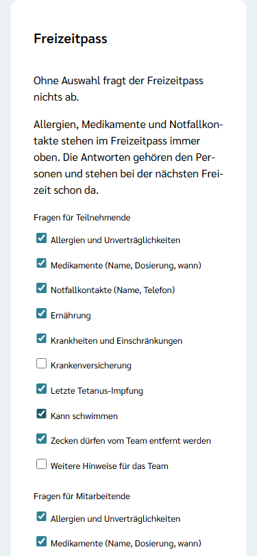
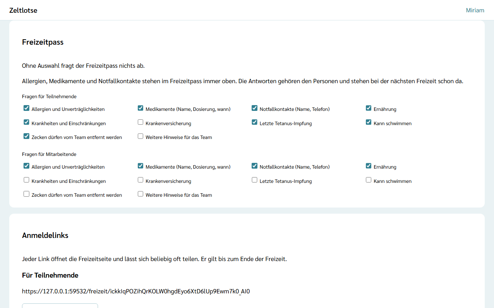

Der **Freizeitpass** sammelt die Angaben, die das Team auf der Freizeit braucht. Welche Fragen er enthält, legt **nur die Leitung** fest, getrennt für Teilnehmende und Mitarbeitende. Die Fragen kommen aus einem festen Katalog; eigene Fragen gibt es nicht. Eine neue Freizeit fragt **nichts** ab, es gibt keinen Pflichtkern.

## Fragen auswählen

1. Die Freizeit öffnen und auf der Startseite **Einstellungen** wählen (siehe [Freizeitseite einrichten](/leitung/freizeitseite-einrichten/)).
2. Im Abschnitt **Freizeitpass** unter **Fragen für Teilnehmende** und **Fragen für Mitarbeitende** die gewünschten Fragen ankreuzen.

Jeder Haken speichert sofort; danach steht „Gespeichert“ mit „Rückgängig“ darunter. Ohne Auswahl fragt der Freizeitpass nichts ab.

## Der Katalog

| Frage | Antwort |
| --- | --- |
| Allergien und Unverträglichkeiten | Auswahl aus den 14 Hauptallergenen der EU, dazu „Sonstiges“ |
| Medikamente (Name, Dosierung, wann) | Freier Text |
| Notfallkontakte (Name, Telefon) | Freier Text |
| Ernährung | Vegetarisch, Vegan, Kein Schweinefleisch, dazu „Sonstiges“ |
| Krankheiten und Einschränkungen | Freier Text |
| Krankenversicherung | Freier Text |
| Letzte Tetanus-Impfung | Datum |
| Kann schwimmen | Ja oder Nein |
| Zecken dürfen vom Team entfernt werden | Ja oder Nein |
| Weitere Hinweise für das Team | Freier Text |

Im Freizeitpass stehen die Fragen immer in dieser Reihenfolge: Allergien, Medikamente und Notfallkontakte zuerst.

## Was die Auswahl bewirkt

- **Nur Ausgewähltes wird erhoben.** Eltern, Volljährige und Mitarbeitende sehen im Freizeitpass nur die Fragen dieser Freizeit für ihre Art der Anmeldung.
- **Die Vertrauensseite** nennt die gewählten Fragen je Zielgruppe; ohne Auswahl steht dort „Der Freizeitpass fragt derzeit nichts ab.“ (siehe [Freizeitseite und Vertrauensseite](/eltern/freizeitseite/)).
- **Antworten gehören der Person.** Wer schon bei einer früheren Freizeit geantwortet hat, findet die Angaben vorausgefüllt; Angaben älter als 12 Monate tragen dort „Stimmt das noch?“.
- **Weniger ist mehr.** Jede Frage ist eine Angabe mehr, die Familien pflegen müssen. Wer zum Beispiel keine Allergien abfragt, bekommt auch keine Allergie-Angaben für die Küche.

Ist die Freizeit abgeschlossen, lässt sich die Auswahl nicht mehr ändern.
