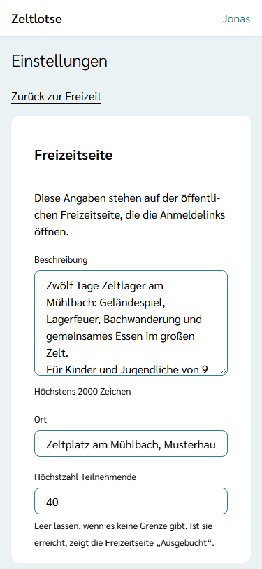
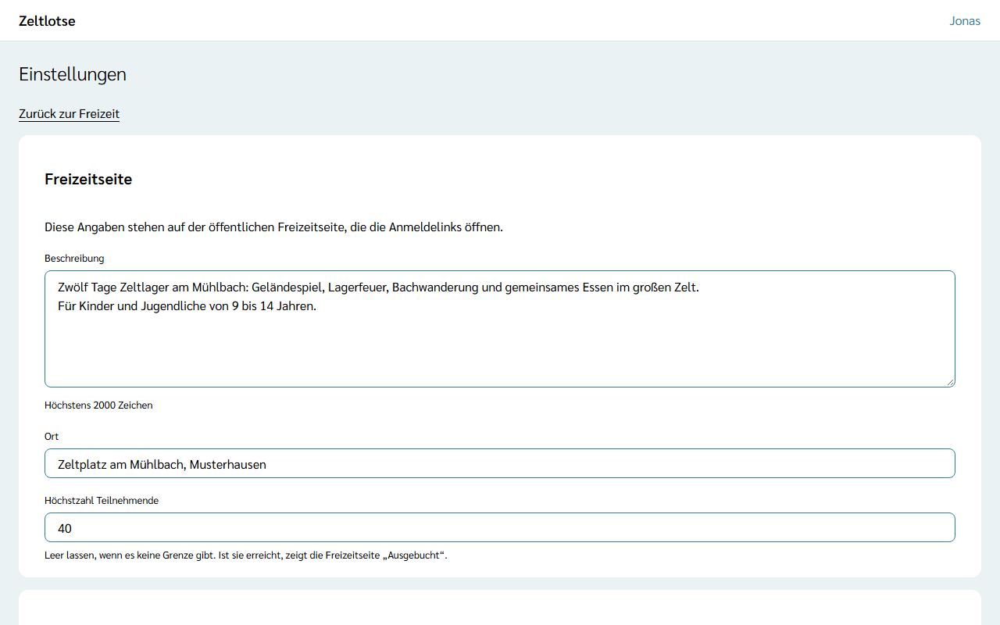

Die öffentliche Freizeitseite ist das, was Eltern und Mitarbeitende über den **Anmeldelink** sehen (siehe [Freizeitseite und Vertrauensseite](/eltern/freizeitseite/)). Die Angaben der Freizeitseite und die Anmeldelinks pflegt **nur die Leitung**.

## Einstellungen öffnen

1. Die Freizeit öffnen (siehe [Freizeit öffnen](/leitung/freizeit-oeffnen/)).
2. Auf der Startseite der Freizeit **Einstellungen** wählen. Das Team sieht diesen Knopf nicht.

## Freizeitseite

Im Abschnitt **Freizeitseite** stehen vier Felder. Jede Angabe speichert beim Verlassen des Feldes; danach steht „Gespeichert“ mit „Rückgängig“ am Feld.

| Feld | Bedeutung |
| --- | --- |
| **Beschreibung** | Freier Text für die Freizeitseite, mehrzeilig, höchstens 2000 Zeichen. Jede Zeile wird ein eigener Absatz. |
| **Ort** | Wo die Freizeit stattfindet, höchstens 100 Zeichen. |
| **Höchstzahl Teilnehmende** | 1 bis 1000 oder leer. Sind so viele Teilnehmende bestätigt, zeigt die Freizeitseite „Ausgebucht“; anmelden bleibt trotzdem möglich. Leer heißt: nie ausgebucht. Mitarbeitende zählen nicht mit. |
| **Teilnahmebedingungen** | Freier Text, mehrzeilig, höchstens 4000 Zeichen. Erscheint bei der Anmeldung vor dem Absenden; wer anmeldet, bestätigt sie mit einem Haken. Bleibt das Feld leer, steht im Formular „Für diese Freizeit sind keine eigenen Teilnahmebedingungen hinterlegt.“ |

Name und Zeitraum der Freizeit legt der Org-Admin beim Anlegen fest. Das Team auf der Freizeitseite ergibt sich aus der Leitung und dem Team der Freizeit; die Herkunft trägt jede Person selbst in ihrem Konto ein (siehe [Anmelden](/erste-schritte/anmelden/)).

Hat jemand anderes dasselbe Feld inzwischen geändert, erscheint „Inzwischen geändert – neu laden?“ am Feld.

## Kontakt für Absagen

Im Abschnitt **Kontakt für Absagen** stehen **Mail-Adresse** und **Telefon**. Sie erscheinen bei Eltern und Mitarbeitenden neben dem Anmeldestatus und in der Absage-Mail, denn abgesagt wird nur über die Leitung. Eingetragen wird hier, was Eltern sehen sollen, etwa eine eigene Mail-Adresse für die Freizeit; die Mail-Adresse des eigenen Kontos erscheint nie von selbst. Einzelheiten stehen unter [Anmeldungen bestätigen und absagen](/leitung/anmeldungen/#kontakt-für-absagen).

## Anmeldelinks

Jede Freizeit hat zwei Anmeldelinks:

- **Für Teilnehmende** – für Eltern und volljährige Teilnehmende,
- **Für Mitarbeitende** – für das Team.

Beide öffnen dieselbe Freizeitseite. Über den Link für Teilnehmende melden Eltern ihre Kinder als Gast oder mit Konto an ([Kind anmelden](/eltern/kind-anmelden/)); über den Link für Mitarbeitende meldet sich das Team mit dem eigenen Konto an ([Für das Team anmelden](/mitarbeitende/anmelden/)). Ein Link lässt sich beliebig oft teilen und gilt bis zum Ende des letzten Freizeittages. Der Link steht als Text auf der Seite und lässt sich von dort kopieren. **Freizeitseite öffnen** zeigt die Seite so, wie Eltern sie sehen. Der Aufruf allein meldet niemanden an; Rechte entstehen erst, wenn die Leitung eine Anmeldung bestätigt (siehe [Anmeldungen bestätigen und absagen](/leitung/anmeldungen/)).

Steht bei einer Art „Noch kein Link.“, fehlt der Link oder lässt sich nicht mehr lesen, etwa bei einer Freizeit aus einer älteren Version; **Link erzeugen** erzeugt dann einen neuen.

## Link erneuern

Ist ein Link an die falsche Stelle geraten, erzeugt **Neuen Link erzeugen** einen neuen:

1. **Neuen Link erzeugen** wählen. An derselben Stelle erscheint „Der bisherige Link wird ungültig.“
2. **Ja, neuen Link erzeugen** wählen, oder **Nein**, um abzubrechen.
3. Es erscheint „Gespeichert: Neuer Link für … ist erzeugt.“ und der neue Link.

Der bisherige Link zeigt ab sofort nur noch „Dieser Anmeldelink ist nicht mehr gültig.“ Den neuen Link danach an alle schicken, die sich noch anmelden sollen. Der andere Link (für Teilnehmende bzw. Mitarbeitende) bleibt unverändert.

Ist die Freizeit abgeschlossen, lassen sich Einstellungen und Links nicht mehr ändern.
