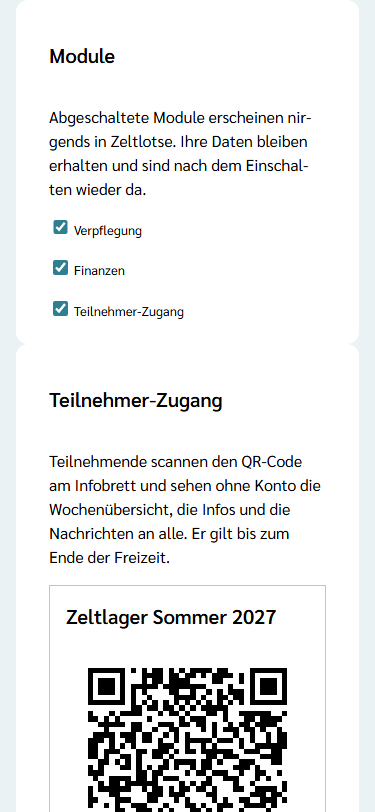
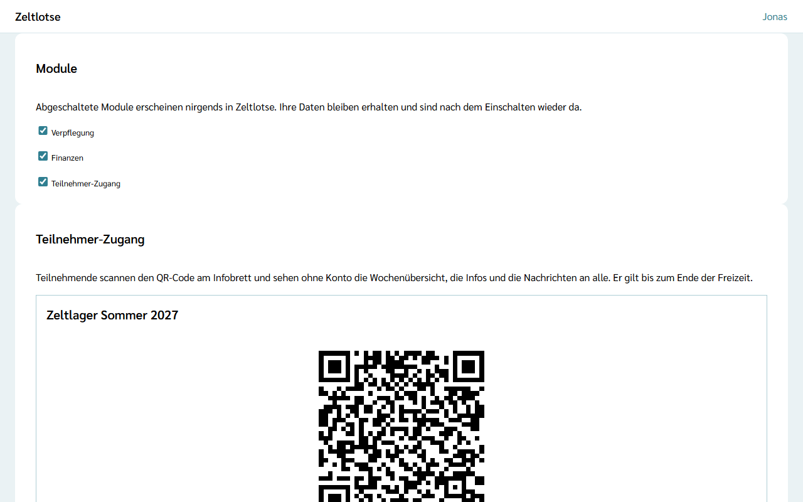

Nicht jede Freizeit braucht alles. Eine Kinderbibelwoche ohne Übernachtung kocht nicht und rechnet keine Belege ab. Deshalb legt die Leitung fest, welche **Module** ihre Freizeit nutzt. Eine neue Freizeit startet ohne Module; die Leitung schaltet ein, was sie braucht. Das darf **nur die Leitung**.

Es gibt drei Module: die **Verpflegung** mit der Küche, die **Finanzen** mit Kalkulation, Beitragsrechner, Belegen und Soll-Ist und den **Teilnehmer-Zugang** mit dem QR-Code für das Infobrett.

## Die drei Module

- **Verpflegung** – die Küche: die [Tagesansicht](/kueche/tagesansicht/), die [Rezepte](/kueche/rezepte/) mit hochgerechneten Mengen, der [Essensplan](/kueche/essensplan/) mit Gerichten an den Mahlzeiten und die [Einkaufsliste](/kueche/einkaufsliste/) mit Allergen-Abgleich, auf der Startseite der Knopf **Küche** (siehe [Küche](/kueche/)).
- **Finanzen** – die [Kalkulation](/finanzen/kalkulation/) mit Kosten, Einnahmen und Teilnehmerbeitrag, der [Beitragsrechner](/finanzen/beitragsrechner/), die [Belege](/finanzen/belege/), [Soll-Ist](/finanzen/soll-ist/) und die [Beiträge](/finanzen/beitraege/), auf der Startseite der Knopf **Finanzen**.
- **Teilnehmer-Zugang** – der QR-Code, mit dem Teilnehmende ohne Konto die Wochenübersicht, die Infos und den Kanal „Alle“ sehen; er endet mit der Freizeit. Ist das Modul an, erscheint in den Einstellungen die Card **Teilnehmer-Zugang** zum Drucken, Kopieren und Erneuern (siehe [Teilnehmer-Zugang per QR-Code](/leitung/teilnehmer-zugang/)).

Alles andere gehört immer dazu und lässt sich nicht abschalten: Anmeldungen, Freizeitpass, Sicherheit, Programm mit den Mahlzeiten im Wochenraster, Material, Aufgaben und Dokumente.

## An- und abschalten

Auf der Startseite der Freizeit führt der Knopf **Einstellungen** zur Card **Module**, ganz unten nach der Card „Anmeldelinks“. Dort steht der Hinweis, dass abgeschaltete Module nirgends in Zeltlotse erscheinen und ihre Daten nach dem Einschalten wieder da sind. Darunter steht je Modul ein Kästchen: **Verpflegung**, **Finanzen** und **Teilnehmer-Zugang**.

Ein Klick auf das Kästchen schaltet das Modul an oder ab und speichert sofort. Danach steht dort „Gespeichert“ mit **Rückgängig**. Hat jemand aus der Leitung dasselbe Modul inzwischen umgeschaltet, steht dort „Inzwischen geändert – neu laden?“.

## Was „abgeschaltet“ heißt

- **Nirgends sichtbar:** Ein abgeschaltetes Modul erscheint für niemanden in Zeltlotse, weder für die Leitung noch für das Team.
- **Auch über Links nicht erreichbar:** Wer eine gespeicherte Adresse oder einen geteilten Link zu einem abgeschalteten Modul öffnet, bekommt „Diese Seite ist nicht verfügbar.“ Zeltlotse prüft das auf dem Server, nicht nur in der Oberfläche.
- **Teilnehmer-Zugang aus:** Ein schon aufgehängter QR-Code zeigt dann „Diese Freizeit ist zu Ende.“ mit dem Zusatz „Wurde der QR-Code erneuert, hilft ein neuer Scan am Infobrett. Sonst hat die Leitung den Zugang ausgeschaltet.“, und an Teilnehmende gehen keine Benachrichtigungen mehr. Nach dem Einschalten gilt derselbe QR-Code wieder.
- **Daten bleiben:** Abschalten löscht nichts. Was im Modul schon eingetragen war, ist nach dem Einschalten wieder da. Gelöscht werden diese Daten erst mit allen anderen Daten der Freizeit nach der Frist der Organisation (siehe [Was passiert mit meinen Daten](/daten/)).
- **Nach dem Abschluss** der Freizeit lässt sich nichts mehr umschalten. Die Card zeigt dann beim Klick „Diese Freizeit ist abgeschlossen und nur lesbar.“

Das Team sieht die Card „Module“ nicht; die Einstellungen sind für das Team nicht verfügbar.
