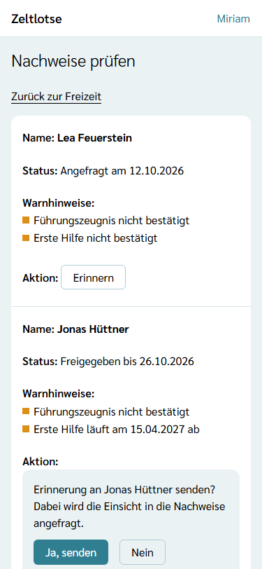
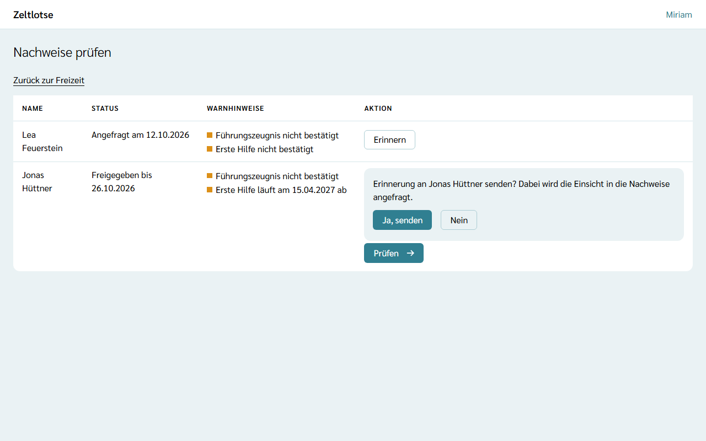

Die Leitung sieht, wem im Team ein Nachweis fehlt, den die Organisation verlangt, oder bei wem er vor dem Ende der Freizeit abläuft. Wer betroffen ist, lässt sich mit einem Klick per Mail erinnern.

## Wann es einen Warnhinweis gibt

Welche Nachweise **Pflicht** sind, legt die Organisation in ihrer [Richtlinie für Nachweise](/org-admin/nachweis-richtlinie/) fest, zum Beispiel Führungszeugnis und Erste Hilfe. Für jede Person mit Rolle in der Freizeit prüft Zeltlotse jeden Pflicht-Nachweis:

- **„… nicht bestätigt“** – die Organisation hat für diesen Nachweis keine Bestätigung. Ob die Person schon etwas hochgeladen hat, weiß die Organisation nicht; sie kennt nur geprüfte und bestätigte Nachweise.
- **„… läuft am TT.MM.JJJJ ab“** – die Bestätigung gilt heute noch, aber nicht bis zum letzten Tag der Freizeit.
- **„… abgelaufen am TT.MM.JJJJ“** – die Bestätigung ist schon abgelaufen und galt auch nicht bis zum Ende der Freizeit.

Eine Bestätigung gilt einschließlich ihres Tages „gültig bis“. Gilt sie mindestens bis zum letzten Tag der Freizeit, gibt es keinen Warnhinweis. Nach der Freizeit verschwinden deshalb Warnhinweise zu Nachweisen, die bis zum Ende gegolten haben. Die eigenen Nachweise und Personen aus anderen Freizeiten tauchen hier nicht auf.

Warnhinweise und **Erinnern** gibt es nur in der Freizeit, nicht auf der Seite „Nachweise prüfen“ der Organisation für den Org-Admin. Ändert der Org-Admin in der Richtlinie, was **Pflicht** ist, gilt das sofort für die Warnhinweise aller Freizeiten der Organisation.

## Meldung auf der Startseite

Fehlt im Team etwas, steht auf der Startseite der Freizeit über dem Knopf **Nachweise prüfen** zum Beispiel „Achtung: Bei 2 Personen im Team fehlen Nachweise oder laufen vor dem Ende der Freizeit ab.“ Ist alles in Ordnung, entfällt die Meldung.

## Warnhinweise in der Liste

In **Nachweise prüfen** steht bei jeder Person in der Spalte **Warnhinweise**, was fehlt oder abläuft, etwa „Führungszeugnis nicht bestätigt“ und „Erste Hilfe läuft am 15.04.2027 ab“. Personen ohne Warnhinweis haben dort keinen Eintrag. Lassen sich die Warnhinweise gerade nicht laden, bleibt die Liste nutzbar; die Spalte bleibt dann leer.

## Erinnern

Bei einer Person mit Warnhinweis steht der Knopf **Erinnern**:

1. **Erinnern** wählen. Darunter klappt die Frage „Erinnerung an … senden? Dabei wird die Einsicht in die Nachweise angefragt.“ auf. Bis hierhin geht keine Mail hinaus.
2. **Ja, senden** wählen. Es erscheint „Gesendet: Die Erinnerung an … geht per Mail hinaus.“, und in der Zeile steht danach „Erinnert am TT.MM.JJJJ“. Das sieht auch die andere Leitung.

Was beim Erinnern passiert:

- Die Person bekommt eine Mail „Erinnerung: Nachweise in Zeltlotse“ mit dem Namen der Leitung und einem Link auf ihre Seite **Nachweise**. Die Mail nennt keine einzelnen Nachweise.
- Gibt es noch keine offene Anfrage zur Einsicht, fragt die Erinnerung sie an; wer erinnert, ist dann die prüfende Person. Eine schon offene Anfrage bleibt, wie sie ist.
- Je Person geht in dieser Freizeit **höchstens eine Erinnerung am Tag** hinaus, auch wenn beide Leitungen erinnern. Ein zweiter Versuch am selben Tag zeigt „Fehler: … wurde heute schon erinnert.“
- Zeltlotse erinnert nie von selbst. Eine Mail geht nur hinaus, wenn eine Leitung ausdrücklich bestätigt.

## Was die Person danach tut

Die Person öffnet den Link aus der Mail und landet auf ihrer Seite **Nachweise**. Dort ergänzt sie fehlende Nachweise oder lädt ein neueres Dokument hoch und gibt die Anfrage mit **Freigeben** frei (siehe [Nachweise](/mitarbeitende/nachweise/)). Danach steht bei ihr in der Liste „Freigegeben bis …“, und die Leitung prüft wie unter [Nachweise prüfen](/leitung/nachweise-pruefen/) beschrieben. Sobald die Organisation die Nachweise bestätigt hat und sie bis zum Ende der Freizeit gelten, verschwinden die Warnhinweise.
