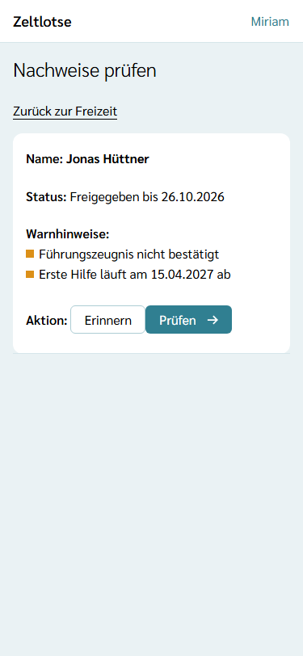
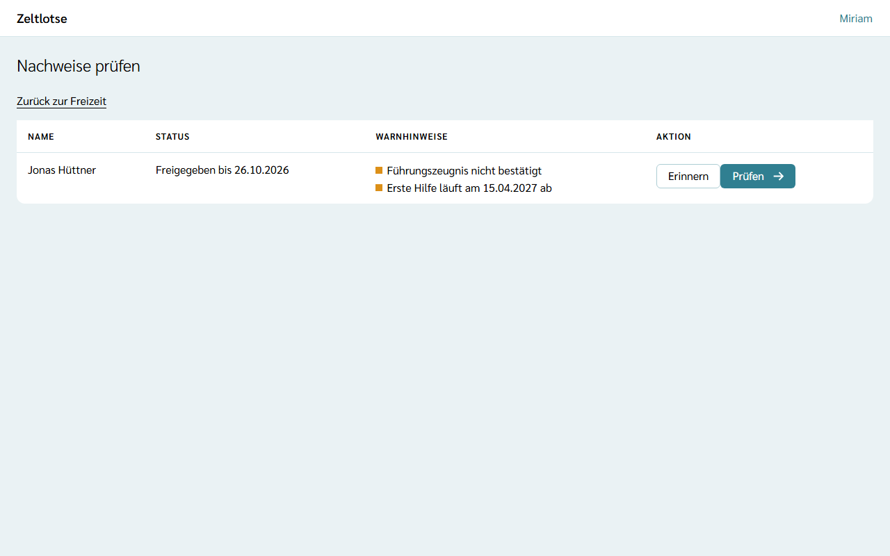
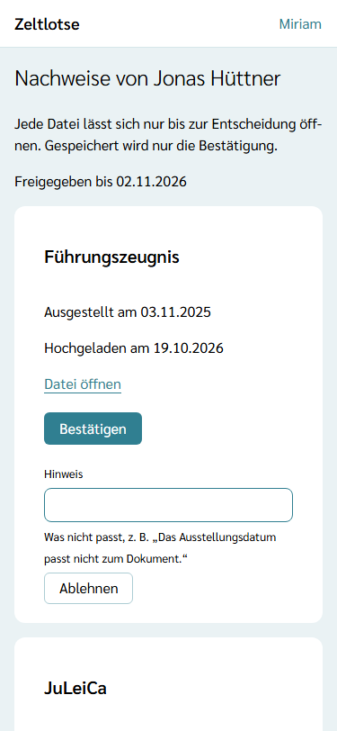
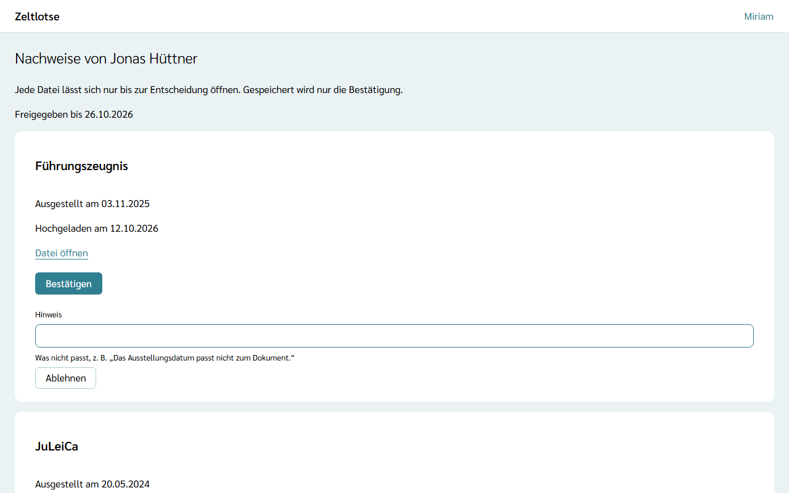

Die Leitung prüft die Nachweise der Personen, die in der Freizeit mitarbeiten, etwa das Führungszeugnis. Die Dateien bleiben am Profil der Person; Zeltlotse speichert bei der Organisation nur die **Bestätigung** (welcher Nachweis, eingesehen am, gültig bis, von wem).

Fehlt im Team ein Pflicht-Nachweis oder läuft er vor dem Ende der Freizeit ab, zeigt die Liste Warnhinweise, und die Leitung kann die Person erinnern; das steht unter [Fehlende Nachweise und Erinnerungen](/leitung/nachweise-erinnern/).

## Die Liste

Auf der Startseite der Freizeit führt der Knopf **Nachweise prüfen** zur Liste. Sie zeigt jede Person mit Rolle in der Freizeit, außer der eigenen, mit dem Stand ihrer Einsicht:

- „Noch nicht angefragt“,
- „Angefragt am …“ – die Person hat noch nicht freigegeben,
- „Freigegeben bis …“ – die Dateien lassen sich prüfen,
- „Freigabe abgelaufen am …“ – die 14 Tage sind vorbei; die Person muss erneut freigeben,
- „Geprüft am …“ – alles ist entschieden.

## Einsicht anfragen

Die erste Mitarbeit einer Person in der Organisation fragt die Einsicht von selbst an. Danach fragt die Organisation von Hand an: Steht bei einer Person **Einsicht anfragen**, gibt es gerade keine offene Anfrage; ein Klick fragt neu an. Wer selbst anfragt, ist danach die prüfende Person. Je Person und Organisation gibt es höchstens eine offene Anfrage; eine Anfrage, deren Freigabe abgelaufen ist, bleibt offen, bis die Person erneut freigibt.

## Prüfen

1. Bei einer Person mit „Freigegeben bis …“ **Prüfen** wählen.
2. Wer zuerst „Prüfen“ wählt, übernimmt die Prüfung. Ab dann ist sie oder er **die eine prüfende Person**; andere Leitungen und der Org-Admin sehen diese Einsicht nicht mehr. Eine Anfrage, die von selbst entstanden ist, kann jede Leitung einer Freizeit übernehmen, in der die Person mitarbeitet, oder ein Org-Admin.
3. Es öffnet sich die Seite „Nachweise von …“ mit einer Card je Nachweis: Art, „Ausgestellt am …“, „Hochgeladen am …“ und der Link **Datei öffnen**. Ein Foto öffnet sich in einem neuen Tab; ein PDF lädt der Browser herunter.
4. Passt alles, **Bestätigen** wählen. Passt etwas nicht, im Feld **Hinweis** kurz notieren, was fehlt oder falsch ist, und **Ablehnen** wählen.

## Danach endet der Zugriff

Jede Datei lässt sich nur bis zur Entscheidung öffnen. Nach „Bestätigen“ oder „Ablehnen“ verschwindet der Link „Datei öffnen“, und die Datei ist für die prüfende Person in Zeltlotse nicht mehr erreichbar. Dasselbe gilt, wenn die Freigabe nach 14 Tagen abläuft; die Seite zeigt dann „Die Freigabe ist am TT.MM.JJJJ abgelaufen. Die Person muss erneut freigeben.“

:::caution[Heruntergeladene Datei löschen]
Ein PDF landet beim Öffnen im Download-Ordner des Geräts, und auch ein Foto lässt sich aus dem Browser auf dem Gerät speichern. Zeltlotse kann solche Kopien nicht zurückholen. Darum jede Datei, die auf dem Gerät gespeichert wurde (Foto oder PDF), nach der Prüfung löschen, auch aus dem Papierkorb.
:::

- **Bestätigt:** Die Organisation speichert die Bestätigung mit „gültig bis“ aus ihrer [Richtlinie für Nachweise](/org-admin/nachweis-richtlinie/).
- **Abgelehnt:** Die Person sieht den Hinweis an ihrem Nachweis. Sind alle Nachweise entschieden und war eine Ablehnung dabei, fragt Zeltlotse die Einsicht von selbst neu an, wieder für dieselbe prüfende Person und nur für die abgelehnten Nachweise.

## Wer prüft die Leitung?

Die eigenen Nachweise prüft niemand selbst; die eigene Person steht nicht in der Liste. Die Nachweise einer Leitung prüft die andere Leitung der Freizeit. Gibt es nur eine Leitung, prüft der Org-Admin auf der [Seite der Organisation](/org-admin/nachweis-richtlinie/). Ist diese Leitung zugleich der einzige Org-Admin, kann niemand prüfen, denn die eigenen Nachweise prüft niemand selbst; dann setzt die Organisation einen zweiten Org-Admin ein (siehe [Rollen vergeben](/org-admin/rollen-vergeben/)).
