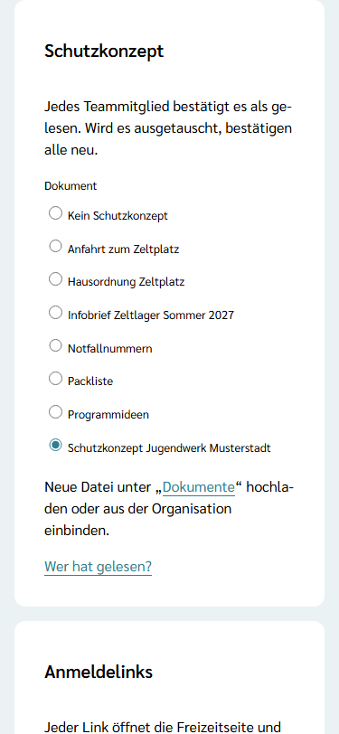
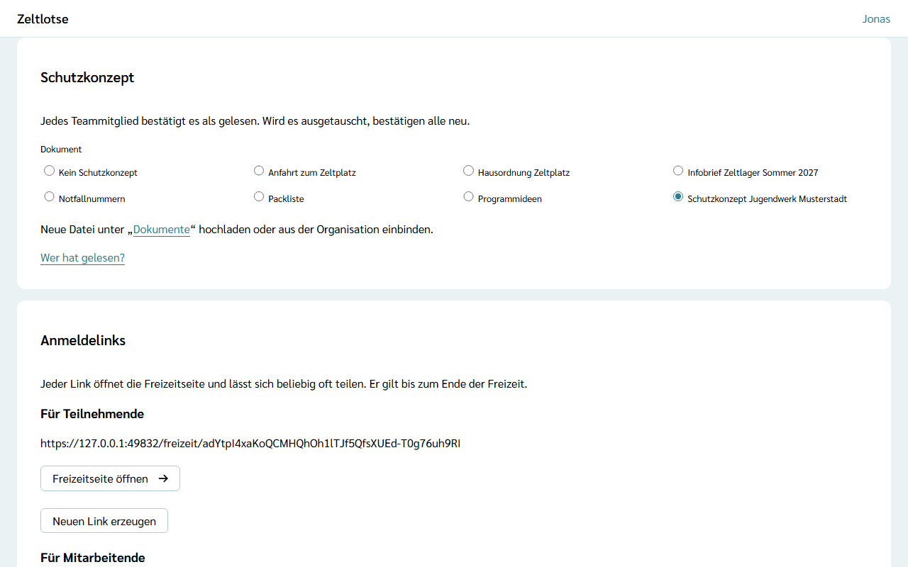

Das **Schutzkonzept** ist ein Dokument der Freizeit, das jedes Mitglied von Leitung und Team als gelesen bestätigt. Welches Dokument das ist, legt nur die Leitung fest. Wie das Team es liest und bestätigt, steht unter [Schutzkonzept lesen](/mitarbeitende/schutzkonzept/).

## Das Dokument wählen

Auf der Startseite der Freizeit führt der Knopf **Einstellungen** zur Card **Schutzkonzept**, direkt nach der Card „Sicherheitskette“. Dort steht „Jedes Teammitglied bestätigt es als gelesen. Wird es ausgetauscht, bestätigen alle neu.“

Unter **Dokument** stehen als Auswahl **Kein Schutzkonzept** und alle Dokumente der Freizeit nach Titel. Das Schutzkonzept kann sein:

- **eine eigene Datei** der Freizeit, die Leitung oder Team unter **Dokumente** hochgeladen haben, oder
- **ein Org-Dokument**, das die Freizeit unter **Dokumente** eingebunden hat. So nutzen alle Freizeiten der Organisation dasselbe Schutzkonzept, ohne Kopie.

Fehlt das Dokument noch, führt der Link **Dokumente** in der Card zur Seite „Dokumente“; dort lässt es sich hochladen oder aus der Organisation einbinden (siehe [Dokumente ablegen](/mitarbeitende/dokumente/)). Eine eingebundene Datei hat die Sichtbarkeit „Team“; Eltern sehen das Schutzkonzept nur, wenn die Sichtbarkeit dort geändert wird.

Die Wahl speichert sofort. Danach steht dort „Gespeichert“ mit **Rückgängig**. Hat jemand anderes inzwischen ein anderes Dokument gewählt, steht dort „Inzwischen geändert – neu laden?“. Nach dem Abschluss der Freizeit lässt sich nichts mehr ändern.

## Austausch und gelöschte Dokumente

- **Ein anderes Dokument wählen** heißt: Alle bestätigen neu. Es zählen nur Bestätigungen für das gewählte Dokument; ältere Bestätigungen bleiben im Hintergrund bis zur Löschfrist.
- **Wird das Dokument entfernt** (unter „Dokumente“ oder vom Org-Admin), gilt das wie „Kein Schutzkonzept“. Die Card zeigt dann „Kein Schutzkonzept“ als gewählt.

## Wer gelesen hat

Der Link **Wer hat gelesen?** in der Card und der Knopf **Schutzkonzept** auf der Startseite führen zur Seite „Schutzkonzept“. Die Card **Team** zeigt dort den Balken „… von … gelesen“ und je Person „gelesen am …“ oder „noch nicht gelesen“. Diese Liste sehen Leitung und Team.

Eine Erinnerung an Personen, die noch nicht gelesen haben, und einen Warnhinweis im Leitungs-Cockpit gibt es noch nicht; beides kommt später. Jedes Mitglied sieht den Hinweis auf der eigenen Startseite, solange es nicht bestätigt hat.

## Gut zu wissen

- Zeltlotse speichert zu jeder Bestätigung nur Person, Dokument und Zeitpunkt. Sie steht in der Datenauskunft der Person im Abschnitt „Schutzkonzept“.
- Löscht eine Person ihr Konto, verschwinden ihre Bestätigungen. Nach der Frist für Freizeit-Daten der Organisation löscht Zeltlotse alle Bestätigungen der Freizeit (siehe [Was passiert mit meinen Daten](/daten/)).
