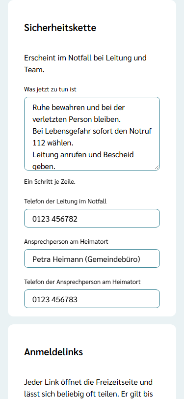
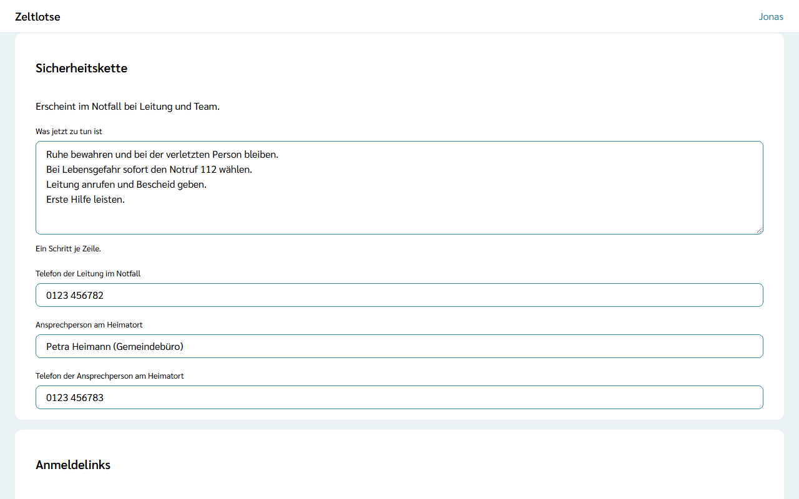

Die **Sicherheitskette** sagt dem Team im Notfall, was jetzt zu tun ist und wen es anruft. Leitung und Team sehen sie auf der Seite „Sicherheitskette“ (siehe [Notfall](/mitarbeitende/notfall/)). Einrichten darf sie nur die Leitung.

## Die Card „Sicherheitskette“ in den Einstellungen

Auf der Startseite der Freizeit führt der Knopf **Einstellungen** zur Card **Sicherheitskette** mit dem Satz „Erscheint im Notfall bei Leitung und Team.“ Sie hat vier Felder:

- **Was jetzt zu tun ist** – die Schritte im Notfall, **ein Schritt je Zeile**. Auf der Sicherheitskette erscheinen sie nummeriert in dieser Reihenfolge; leere Zeilen fallen weg. Höchstens 2000 Zeichen.
- **Telefon der Leitung im Notfall** – die Nummer, unter der die Leitung im Notfall erreichbar ist. Profile in Zeltlotse haben kein Telefon; darum steht die Nummer hier. Die Namen der Leitung zeigt die Sicherheitskette von selbst.
- **Ansprechperson am Heimatort** – zum Beispiel „Petra Heimann (Gemeindebüro)“. Dieses Feld ist freiwillig.
- **Telefon der Ansprechperson am Heimatort**.

Eine Telefonnummer braucht mindestens eine Ziffer und höchstens 40 Zeichen. Erlaubt sind nur Ziffern, Leerzeichen und + ( ) / -, ein „+“ nur ganz vorn; sonst steht am Feld „Fehler: Die Telefonnummer darf nur Ziffern, Leerzeichen und + ( ) / - enthalten.“ Gewählt werden später nur „+“ und die Ziffern. Beginnt die Nummer mit „+“, fällt eine „(0)“ weg: „+49 (0) 7443 1234“ wählt „+4974431234“.

Jedes Feld speichert beim Verlassen. Danach steht am Feld „Gespeichert“ mit **Rückgängig**. Ein geleertes Feld ist wieder leer. Hat jemand anderes dasselbe Feld inzwischen geändert, steht dort „Inzwischen geändert – neu laden?“. Nach dem Abschluss der Freizeit lässt sich die Sicherheitskette nur noch lesen.

## Wann sie „eingerichtet“ ist

Die Sicherheitskette gilt als **eingerichtet**, sobald drei Felder ausgefüllt sind: **Was jetzt zu tun ist**, **Telefon der Leitung im Notfall** und **Telefon der Ansprechperson am Heimatort**. Der Name am Heimatort zählt nicht mit.

Solange sie nicht eingerichtet ist,

- zeigt die Seite „Sicherheitskette“ oben „Hinweis: Die Sicherheitskette ist noch nicht eingerichtet.“ – Suchfeld, Namen der Leitung und „Notruf 112“ stehen trotzdem da;
- steht im [Leitungs-Cockpit](/leitung/cockpit/) unter **Warnhinweise** die Zeile **„Sicherheitskette ist noch nicht eingerichtet“**. Sie führt direkt zu dieser Card in den Einstellungen und verschwindet, sobald die Kette eingerichtet ist.

## Gut zu wissen

- Die Sicherheitskette ist in jeder Phase über den Knopf **Sicherheitskette** auf der Startseite erreichbar. So prüft die Leitung das Ergebnis, und das Team liest die Kette schon vor der Freizeit.
- Während der Freizeit führen außerdem die Notfall-Box auf der Startseite und der Eintrag **Notfall** in der App-Leiste dorthin.
- Name und Telefon am Heimatort sind Angaben der Freizeit, die die Leitung pflegt, so wie der Kontakt für Absagen. Sie gehören zu keinem Konto in Zeltlotse.
