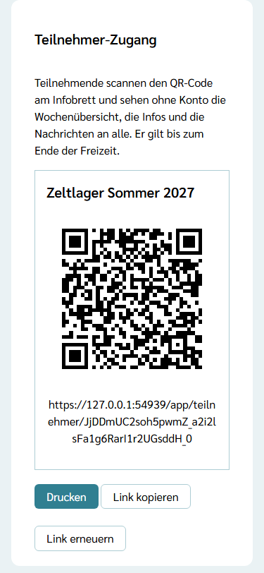
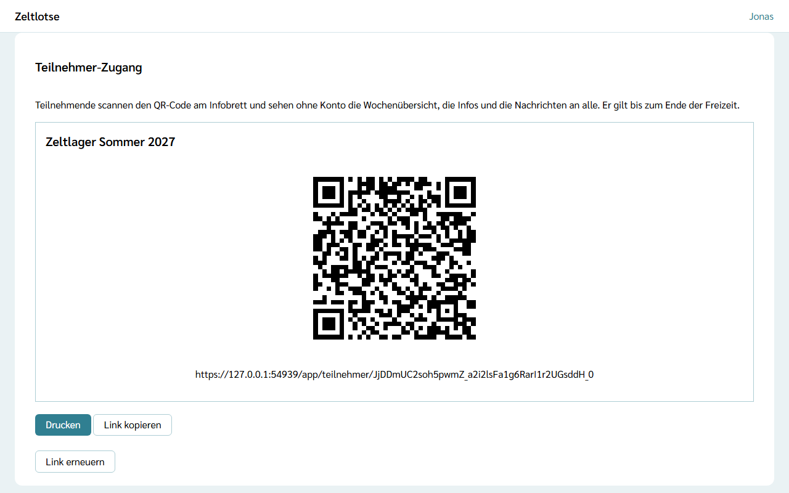
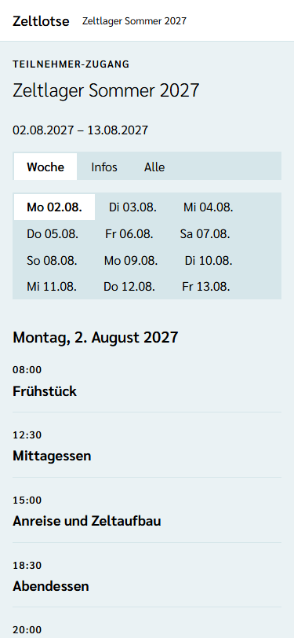
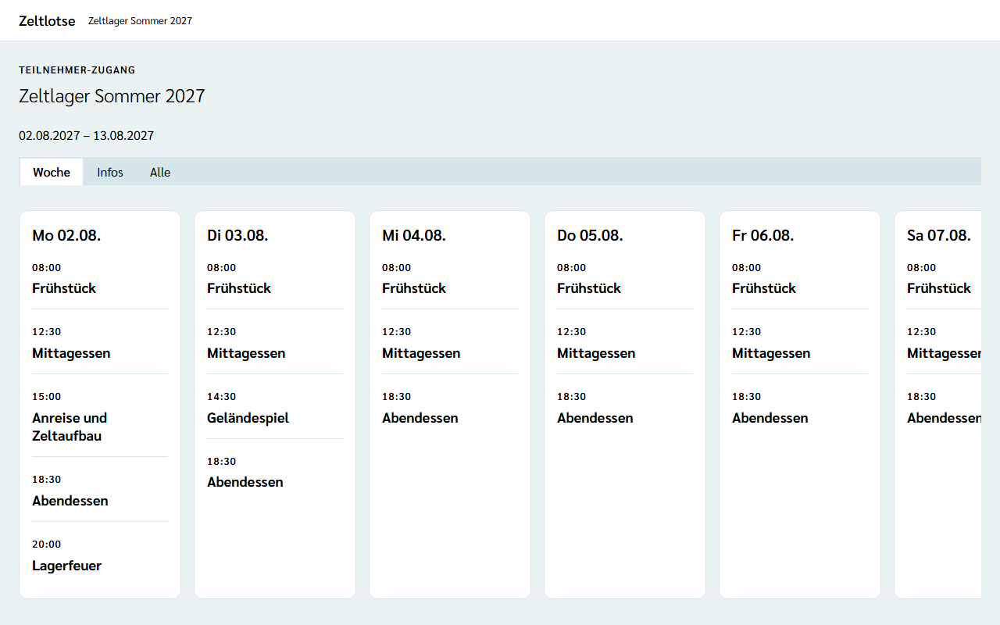
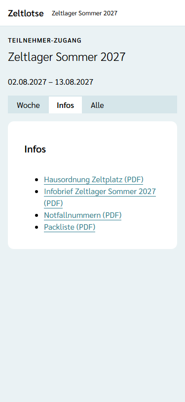
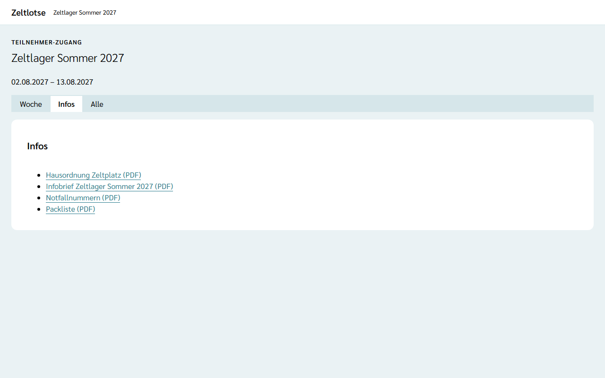
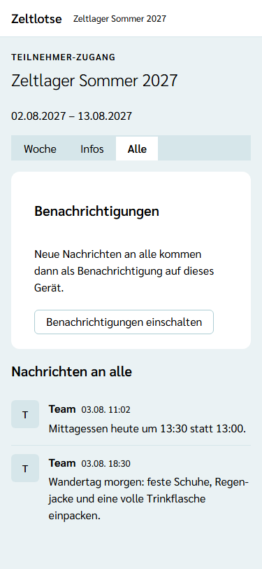
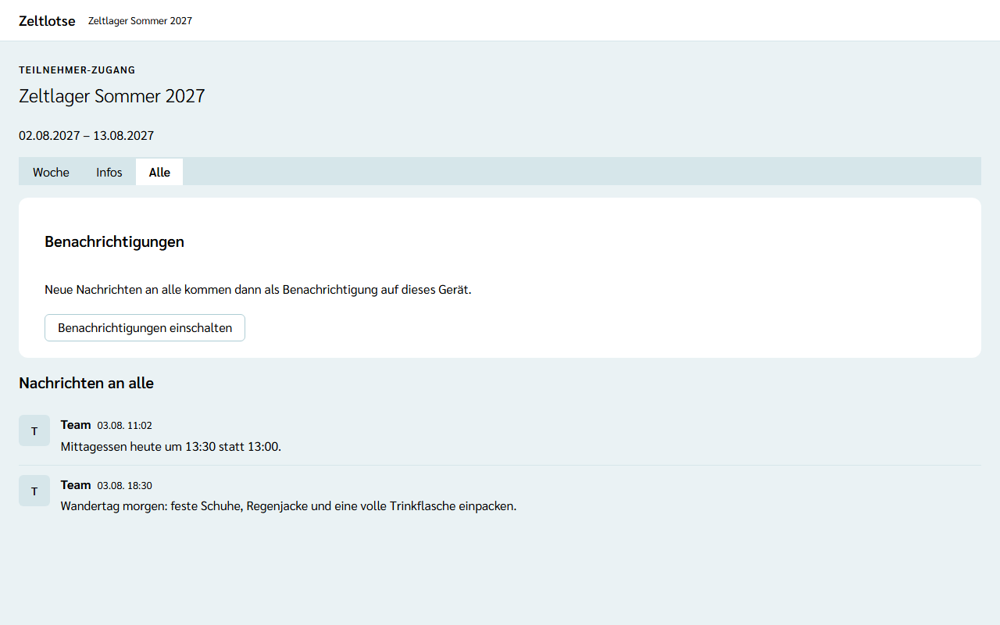

**Wer:** nur die Leitung richtet den Zugang ein. Teilnehmende brauchen dafür kein Konto und keine Anmeldung.

Auf der Freizeit wollen Teilnehmende wissen, wann es Essen gibt, wo die Hausordnung steht und was sich am Tag ändert. Dafür gibt es den **Teilnehmer-Zugang**: einen QR-Code, der am Infobrett hängt. Wer ihn mit dem Handy scannt, sieht die Wochenübersicht, die Infos der Freizeit und die Nachrichten an alle, ohne Konto.

## Einschalten

Der Teilnehmer-Zugang ist ein Modul. Die Leitung schaltet ihn in den Einstellungen der Freizeit an: Startseite der Freizeit → Knopf **Einstellungen** → Card **Module** → Kästchen **Teilnehmer-Zugang** (siehe [Module schalten](/leitung/module-schalten/)). Gleich danach erscheint ganz unten die Card **Teilnehmer-Zugang**. Ist das Modul aus, gibt es die Card nicht, und auch ein schon gedruckter QR-Code öffnet nichts mehr.

Gibt es noch keinen QR-Code, steht in der Card „Noch kein QR-Code.“ mit dem Knopf **QR-Code erzeugen**.

## QR-Code drucken und Link kopieren

Die Card zeigt den Namen der Freizeit, den QR-Code in der Mitte und darunter den Link als Text. Der QR-Code steht immer schwarz auf weißer Fläche, auch im dunklen Modus, damit jede Handy-Kamera ihn lesen kann. Am Handy füllt die Card die Breite; so lässt sich der Code auch direkt vom Bildschirm scannen.

- **Drucken** öffnet den Druck des Browsers. Auf dem Blatt (A4) stehen nur der Name der Freizeit, ein großer QR-Code und der Link, ohne Knöpfe und ohne die übrigen Einstellungen. Das Blatt kommt ans Infobrett. Im Druck lässt sich auch „Als PDF speichern“ wählen.
- **Link kopieren** legt den Link in die Zwischenablage, danach steht dort „Link kopiert.“ So lässt er sich zum Beispiel in eine Nachricht an die Eltern setzen.

## Link erneuern

Ist der QR-Code in falsche Hände geraten, zum Beispiel als Foto in einer fremden Gruppe, macht **Link erneuern** ihn ungültig. Zeltlotse fragt an Ort und Stelle nach: „Der bisherige QR-Code wird ungültig. Wer ihn schon nutzt, muss neu scannen.“ Erst **Ja, Link erneuern** erzeugt einen neuen Code. Danach öffnet der alte Code nichts mehr, und alle, die ihn schon genutzt haben, sehen „Diese Freizeit ist zu Ende.“ mit dem Zusatz „Wurde der QR-Code erneuert, hilft ein neuer Scan am Infobrett. Sonst hat die Leitung den Zugang ausgeschaltet.“ Auch ihre Benachrichtigungen enden, bis sie den neuen Code scannen und sie wieder einschalten. Den neuen Code also gleich drucken und den alten abnehmen.

## Was Teilnehmende sehen

Der QR-Code öffnet im Browser die Seite **Teilnehmer-Zugang** mit dem Knopf **Freizeit öffnen**. Erst der Tipp darauf öffnet den Zugang; der Browser merkt ihn sich bis zum Ende der Freizeit. Oben steht der Name der Freizeit, darunter drei Reiter:

- **Woche** – die Wochenübersicht mit Uhrzeit und Titel der Programmpunkte und Mahlzeiten. Am Handy steht ein Tag, über die Reiter der Tage geht es zu den anderen (heute ist vorausgewählt, solange die Freizeit läuft). Am Laptop stehen alle Tage nebeneinander.
- **Infos** – die Dokumente, die das Team für „Eltern und Teilnehmende“ freigegeben hat, zum Beispiel Infobrief, Packliste und Hausordnung (siehe [Dokumente ablegen](/mitarbeitende/dokumente/)).
- **Alle** – die Nachrichten im Kanal „Alle“, die neueste unten. Als Absender steht immer „Team“. Ein Eingabefeld gibt es nicht; Teilnehmende lesen nur.

### Was Teilnehmende nicht sehen

Keine Namen aus dem Team, keine Details der Programmpunkte, kein Material, keine Aufgaben, keine Übernahmen, nicht den Kanal „Team“, keine Freizeitpässe und keine Anmeldungen. Schreiben können sie nichts außer dem eigenen Wunsch nach Benachrichtigungen. Zeltlotse prüft das auf dem Server, nicht nur in der Oberfläche.

## Benachrichtigungen und iPhone

Im Reiter **Alle** steht die Card **Benachrichtigungen** wie in den [Kanälen](/mitarbeitende/kanaele/#benachrichtigungen-aufs-handy). Nach einem Tipp auf **Benachrichtigungen einschalten** fragt das Handy nach der Erlaubnis. Danach kommt jede neue Nachricht in „Alle“ als Benachrichtigung aufs Handy; ein Tipp darauf öffnet den Teilnehmer-Zugang. Nachrichten im Kanal „Team“ kommen nie dort an.

Auf dem iPhone kommen Benachrichtigungen erst, wenn Zeltlotse auf dem Home-Bildschirm liegt; die Card nennt die Schritte dafür. Öffnet jemand Zeltlotse später über das Symbol auf dem Home-Bildschirm, steht auf der Seite „Anmelden“ die Card **Teilnehmer-Zugang** mit dem Knopf **Zum Teilnehmer-Zugang**. Ein Konto braucht es auch dann nicht.

## Ende mit der Freizeit

Der Zugang gilt bis zum Ende des letzten Freizeittags (24:00 Uhr). Danach zeigt der QR-Code nur noch „Diese Freizeit ist zu Ende.“, und es gehen keine Benachrichtigungen mehr an Teilnehmende. Dasselbe gilt sofort, wenn die Leitung das Modul abschaltet oder den Link erneuert. Mit dem Abschluss der Freizeit löscht Zeltlotse alle Benachrichtigungs-Abos dieser Freizeit (siehe [Freizeit abschließen](/leitung/freizeit-abschliessen/) und [Was passiert mit meinen Daten](/daten/#teilnehmer-zugang)).
