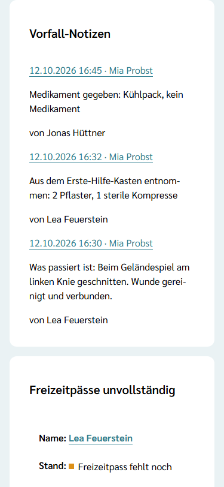
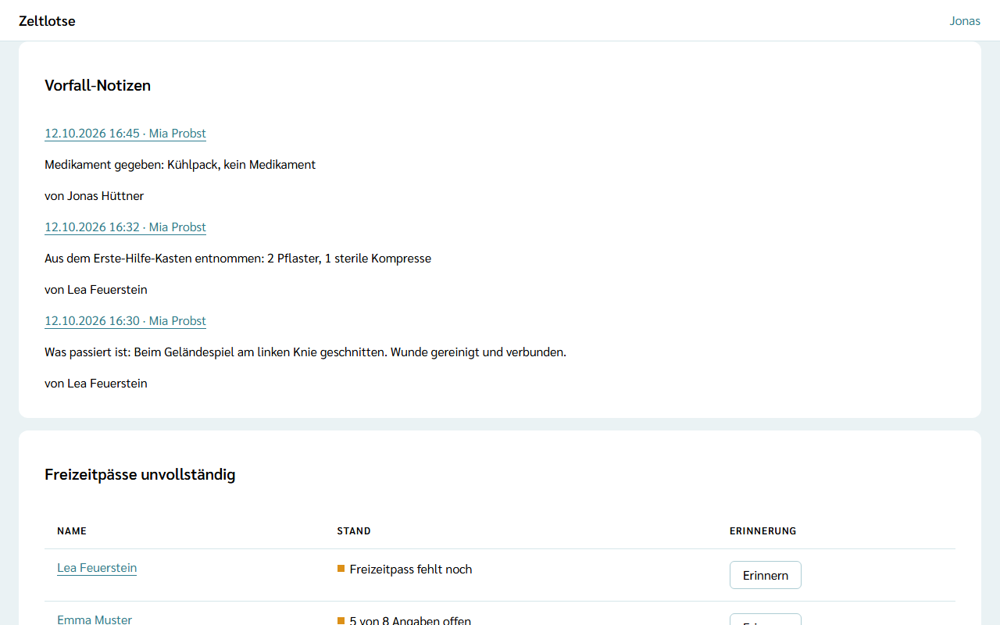

Was Leitung und Team im [Vorfall-Protokoll](/mitarbeitende/vorfall-protokoll/) einer Person festhalten, sieht die Leitung sofort als **Vorfall-Notizen** auf ihrer Startseite der Freizeit. Es gibt keine zweite Liste: Die Vorfall-Notizen sind die Einträge aller Personen der Freizeit an einer Stelle.

## Die Card auf der Startseite

Sobald es einen Eintrag gibt, steht im Leitungs-Cockpit die Card **Vorfall-Notizen**, den neuesten Eintrag oben. Jeder Eintrag zeigt:

- Datum, Uhrzeit und den Namen der betroffenen Person als Link – ein Tipp öffnet ihr Vorfall-Protokoll,
- die Art mit dem Text, zum Beispiel „Medikament gegeben: Kühlpack, kein Medikament“,
- wer den Eintrag geschrieben hat, etwa „von Lea Feuerstein“.

Die Card ist **kein Warnhinweis**: Sie zählt nicht zu den offenen Punkten unter „Warnhinweise“, und es gibt kein „gesehen“, keinen Zähler, keine Mail und keine Push-Nachricht. Das Team sieht die Card nicht; es liest die Einträge im Vorfall-Protokoll der jeweiligen Person. Ohne Einträge gibt es die Card nicht.

## Nach dem Abschluss: Archiv der Organisation

Wird die Freizeit abgeschlossen, legt Zeltlotse ihre Vorfall-Notizen ins **Archiv der Organisation**. Dort sehen Org-Admins sie, bis die Frist für Freizeit-Daten abläuft; danach löscht Zeltlotse sie endgültig – siehe [Archiv der Vorfall-Notizen](/org-admin/vorfall-archiv/). Wie die Leitung die Freizeit abschließt, steht unter [Freizeit abschließen](/leitung/freizeit-abschliessen/).
