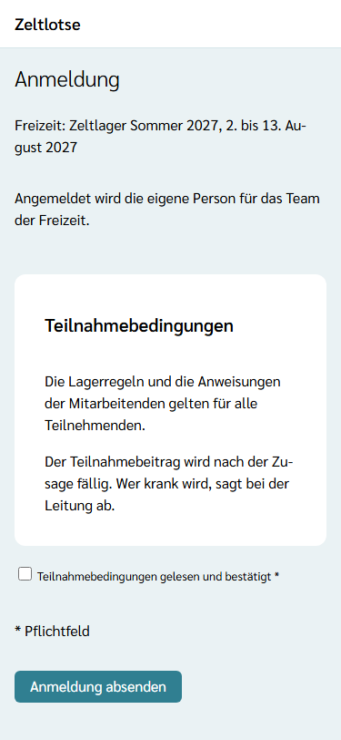
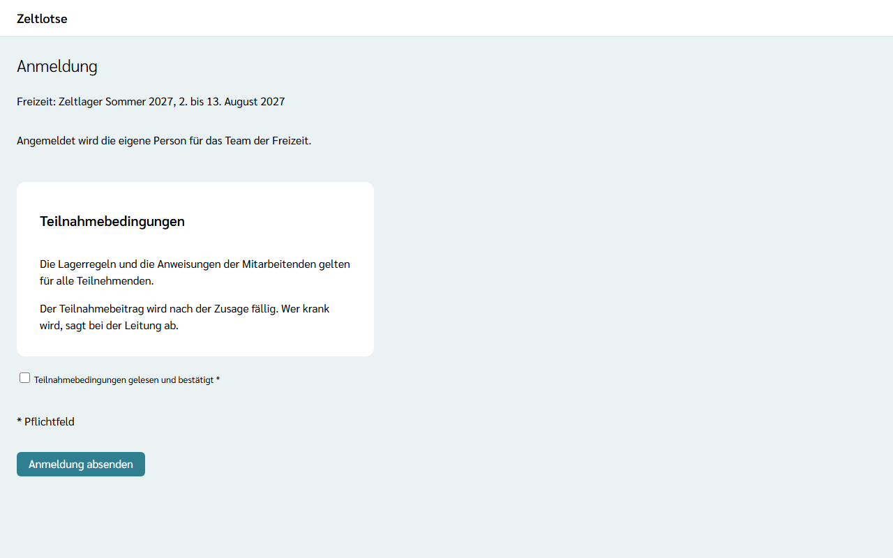

Ins Team einer Freizeit kommt, wer sich über den **Anmeldelink für Mitarbeitende** anmeldet und von der Leitung bestätigt wird. Den Link schickt die Leitung persönlich. Für das Team braucht es immer ein **eigenes Konto**: Rechte und Nachweise hängen am Konto. Eine Gast-Anmeldung gibt es für Mitarbeitende nicht.

1. Den Anmeldelink öffnen. Es erscheint die [Freizeitseite](/eltern/freizeitseite/) mit Beschreibung und Team, aber ohne „Ausgebucht“: Mitarbeitende können immer dazukommen.
2. **Anmelden** wählen. Ohne Anmeldung erscheint zuerst die Seite „Anmelden“; mit der eigenen Mail-Adresse anmelden (siehe [Anmelden](/erste-schritte/anmelden/)). Ein neues Konto entsteht dabei von selbst. Danach geht es zurück zur Anmeldung.
3. Auf der Seite **Anmeldung** steht „Angemeldet wird die eigene Person für das Team der Freizeit.“ Die Teilnahmebedingungen lesen und **Teilnahmebedingungen gelesen und bestätigt** ankreuzen.
4. **Anmeldung absenden** wählen. Es erscheint „Anmeldung eingegangen: Die Leitung meldet sich in Kürze.“

Die Seite sieht aus wie die Anmeldung mit Konto für Eltern, nur ohne die Auswahl einer Person (siehe [Kind anmelden](/eltern/kind-anmelden/#mit-konto-anmelden)):

Eine Mail gibt es bei dieser Anmeldung nicht. Die Rechte im Team entstehen erst, wenn die Leitung die Anmeldung bestätigt: Dann kommt die Mail „Anmeldung bestätigt: …“, die Freizeit erscheint auf der Startseite, und mit der ersten bestätigten Mitarbeit gehört die Person zu den Mitarbeitenden der Organisation. Sagt die Leitung ab, kommt die Mail „Anmeldung abgesagt: …“, und die Freizeit verschwindet wieder von der Startseite. Absagen geht nur über die Leitung, über den Kontakt, den sie dafür eingetragen hat. Danach am besten gleich die [Nachweise](/mitarbeitende/nachweise/) am eigenen Profil hochladen.

Erscheint „Dieser Anmeldelink ist nicht mehr gültig.“, ist die Freizeit vorbei oder die Leitung hat einen neuen Link erzeugt; die Leitung kann den aktuellen Link schicken.
