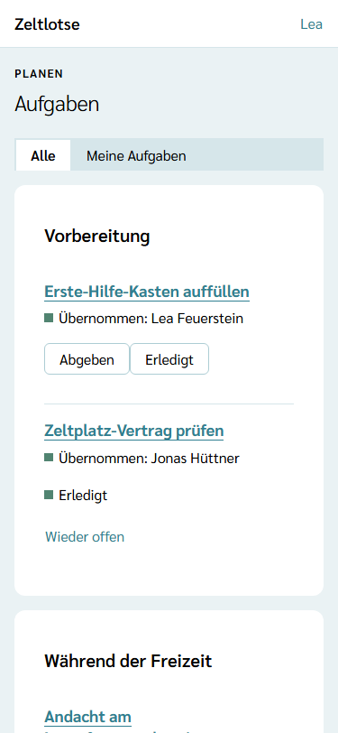
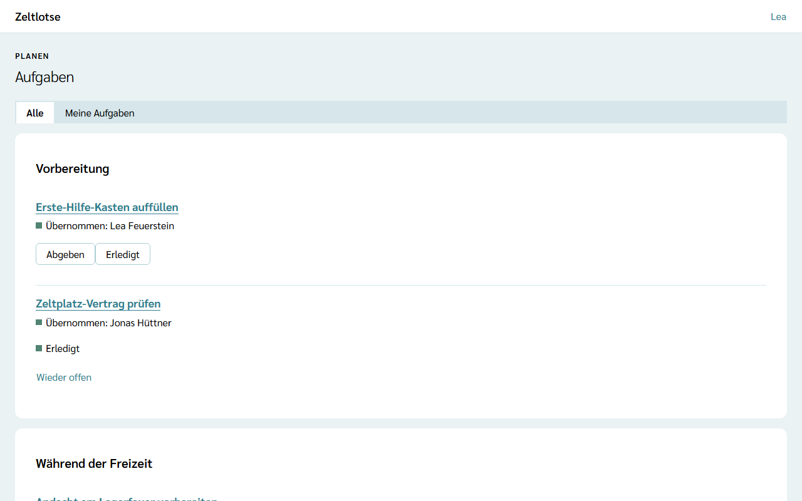
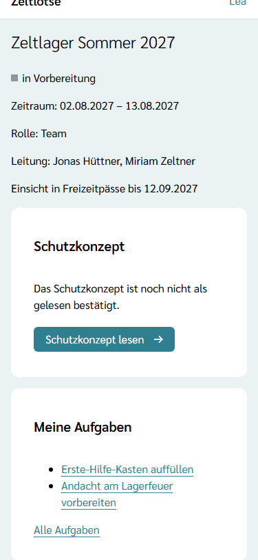
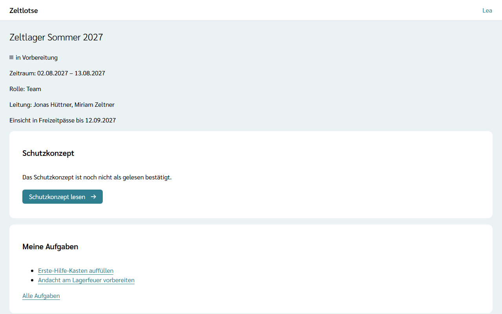

Neben dem Programm gibt es auf jeder Freizeit Dinge, die erledigt werden müssen: den Vertrag mit dem Zeltplatz prüfen, den Erste-Hilfe-Kasten auffüllen, die Andacht vorbereiten, am Ende den Platz übergeben. In Zeltlotse sind das **Aufgaben**. Leitung und Team sehen sie gemeinsam; niemand teilt zu, jede Person übernimmt selbst.

## Die Aufgaben öffnen

Startseite der Freizeit → Knopf **Aufgaben** (gleich nach **Programm**). Über der Überschrift „Aufgaben“ steht „Planen“. Die Seite ist für Leitung und Team in jeder Phase der Freizeit erreichbar.

Die Aufgaben stehen nach **Phase** in eigenen Cards:

- **Vorbereitung** – was vor der Freizeit erledigt sein muss,
- **Während der Freizeit** – was auf der Freizeit selbst ansteht,
- **Nachbereitung** – was nach dem letzten Tag noch zu tun ist.

Eine Card ohne Aufgaben fehlt. Gibt es noch gar keine Aufgaben, steht dort „Noch keine Aufgaben.“

## Die Vorlagen der Organisation sind schon drin

Wer die Aufgaben einer Freizeit zum ersten Mal öffnet, findet dort schon die **Aufgaben-Vorlagen** der Organisation, zum Beispiel „Zeltplatz-Vertrag prüfen“. Niemand muss sie abschreiben. Das passiert genau einmal: Vorlagen, die die Organisation später ergänzt, kommen nur in Freizeiten, deren Aufgaben noch niemand geöffnet hat; dabei zählt schon das Öffnen der Startseite der Freizeit, weil sie die eigenen Aufgaben mitlädt. Eine gelöschte Aufgabe aus einer Vorlage kommt nicht wieder. Die Vorlagen pflegt der Org-Admin – siehe [Aufgaben-Vorlagen](/org-admin/aufgaben-vorlagen/).

## Eine Aufgabe in der Liste

Jede Aufgabe zeigt:

- den **Titel** als Link zur Seite der Aufgabe,
- **„Übernommen: Lea Feuerstein“**, wenn jemand sie übernommen hat, sonst **„Offen“** als Warnung. Lässt sich ein Name gerade nicht laden, steht nur „Übernommen“,
- bei einer Aufgabe am Programmpunkt den Link **„Am Programmpunkt: Lagerfeuer“**,
- **„Erledigt“**, wenn jemand sie abgehakt hat.

## Ich übernehme

**Ich übernehme** an einer offenen Aufgabe trägt die eigene Person ein, mit einem Tipp und ohne Rückfrage. Danach steht dort „Übernommen: …“ mit dem eigenen Namen und der Knopf **Abgeben**. **Abgeben** macht die Aufgabe wieder frei.

Hat jemand anderes die Aufgabe übernommen, gibt es keinen Knopf: Die Leitung teilt nichts zu und nimmt nichts weg. Übernehmen zwei Personen dieselbe Aufgabe fast gleichzeitig, bekommt sie die erste; die zweite sieht „Jemand anderes hat diese Aufgabe inzwischen übernommen.“ und den neuen Stand.

## Abhaken

**Erledigt** hakt die Aufgabe ab, ebenfalls ohne Rückfrage. Abhaken darf jede Person der Freizeit, auch bei einer Aufgabe, die jemand anderes übernommen hat; die Übernahme bleibt stehen. **Wieder offen** nimmt den Haken zurück. Wer abgehakt hat, merkt sich Zeltlotse nicht.

## Meine Aufgaben

Der Reiter **Meine Aufgaben** zeigt nur die Aufgaben, die die eigene Person übernommen hat, ebenfalls nach Phase. Hat sie keine, steht dort „Keine Aufgaben übernommen.“ Der Reiter steht in der Adresse und bleibt beim Zurückkehren erhalten.

Auf der Startseite der Freizeit steht außerdem die Card **Meine Aufgaben** mit den eigenen Aufgaben, die noch nicht erledigt sind; ein Tipp auf den Titel öffnet die Aufgabe. Sind alle eigenen Aufgaben erledigt, steht dort „Alle übernommenen Aufgaben sind erledigt.“ Darunter führt **Alle Aufgaben** zur Liste. Während der Freizeit steht in der Card zusätzlich der Kurzlink **Schaden melden** zur Liste [Schäden & Verluste](/mitarbeitende/schaeden-verluste/).

## Eine Aufgabe anlegen

Unter den Cards steht **Aufgabe anlegen**:

- **Titel** – Pflicht, höchstens 120 Zeichen,
- **Phase** – vorgewählt ist die Phase, in der die Freizeit gerade steht: vor der Freizeit **Vorbereitung**, während der Freizeit **Während der Freizeit**, danach **Nachbereitung**.

**Aufgabe anlegen** speichert; die Aufgabe steht danach offen und unbesetzt in ihrer Card.

## Aufgaben am Programmpunkt

Auf der Seite eines Programmpunkts steht die Card **Aufgaben** mit den Aufgaben, die zu diesem Punkt gehören, zum Beispiel „Andacht am Lagerfeuer vorbereiten“ am Lagerfeuer. Darunter fügt **Aufgabe hinzufügen** eine neue Aufgabe an diesem Punkt hinzu; dort ist nur der Titel nötig, die Phase ist Vorbereitung und lässt sich danach ändern. Wird der Programmpunkt gelöscht, verschwinden seine Aufgaben mit. Wie Programmpunkte funktionieren, steht unter [Programm planen und übernehmen](/mitarbeitende/programm/).

## Die Seite einer Aufgabe

Ein Tipp auf den Titel öffnet die Aufgabe. Dort stehen Übernahme, Programmpunkt und „Erledigt“ wie in der Liste, dazu die Knöpfe **Ich übernehme** oder **Abgeben** und **Erledigt** oder **Wieder offen**.

In der Card **Bearbeiten**:

- **Titel** – Zeltlotse speichert beim Verlassen des Felds; darunter steht „Gespeichert“ mit „Rückgängig“.
- **Phase** – speichert sofort beim Wählen („Gespeichert: Phase gespeichert.“). Hat jemand anderes die Phase inzwischen geändert, steht oben „Die Phase wurde inzwischen geändert. Die Aufgabe ist neu geladen.“, und die Auswahl zeigt den neuen Stand.

**Aufgabe löschen** klappt eine Rückfrage auf („Diese Aufgabe löschen?“ – „Ja, löschen“ / „Nein“) und führt danach zurück zur Liste.

## Als Vorlage speichern

Was sich auf jeder Freizeit wiederholt, gehört in die Vorlagen der Organisation. **Als Vorlage speichern** auf der Seite einer Aufgabe legt eine Aufgaben-Vorlage mit ihrem Titel und ihrer Phase an. Danach steht dort „Steht in den Aufgaben-Vorlagen der Organisation.“, und der Knopf fehlt. Das gilt auch für Aufgaben, die schon aus einer Vorlage stammen. Leitung und Team dürfen das; aufräumen kann der Org-Admin auf der Seite [Aufgaben-Vorlagen](/org-admin/aufgaben-vorlagen/). Löscht er die Vorlage, bleibt die Aufgabe in der Freizeit, und der Knopf erscheint wieder.

## Nach dem Abschluss

Nach dem Abschluss der Freizeit sind die Aufgaben nur lesbar: Oben steht „Diese Freizeit ist abgeschlossen und nur lesbar.“; Knöpfe und Formulare fehlen, die Seite einer Aufgabe nennt Titel und Phase als Liste. Die Card **Meine Aufgaben** auf der Startseite fehlt dann.

Wer eine Aufgabe übernommen hat, steht auch in der Datenauskunft der Person unter „Programm“ – mehr dazu unter [Was passiert mit meinen Daten](/daten/#programm). Fälligkeitsdaten und Erinnerungen gibt es bei Aufgaben nicht; Zeltlotse schickt dazu keine Mails.
