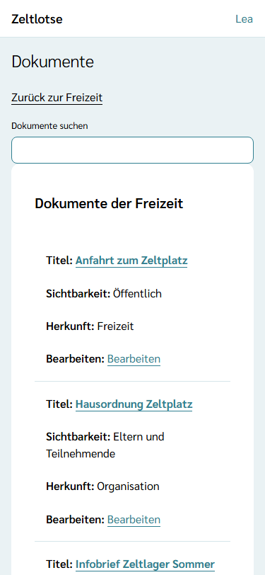
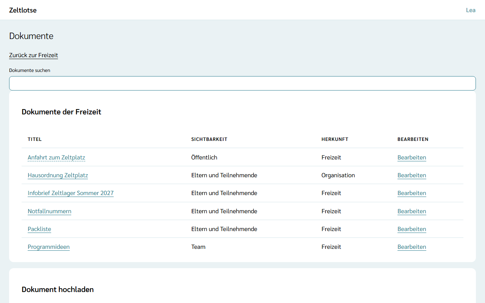
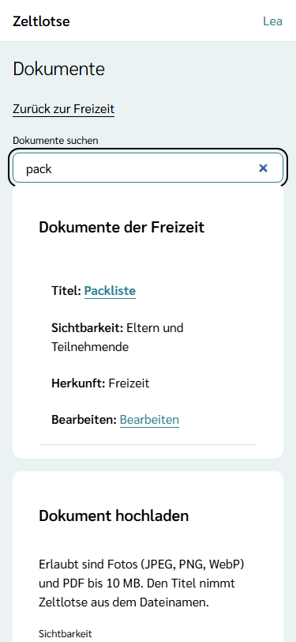
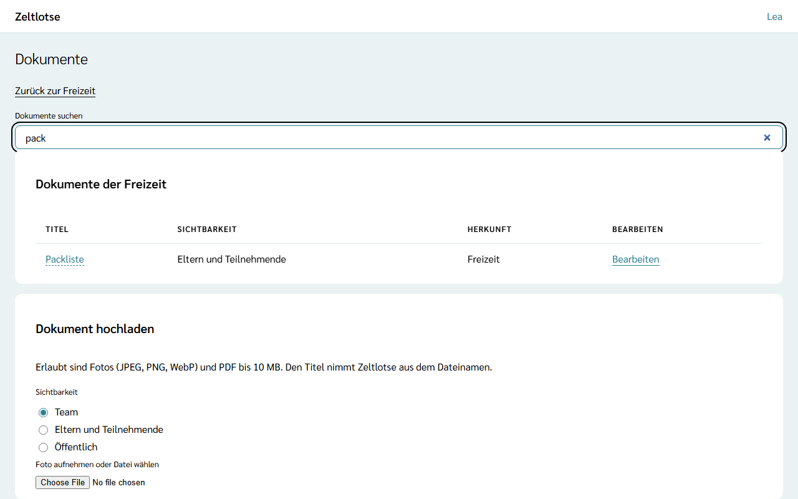
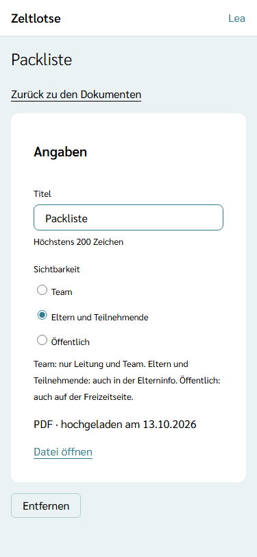
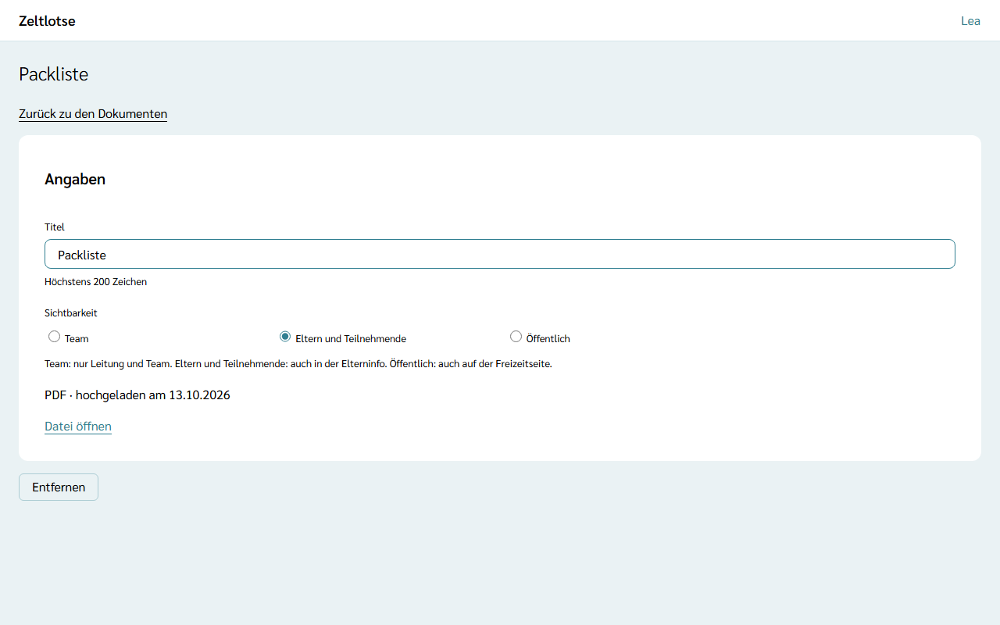

Jede Freizeit hat eine Ablage für **Dokumente**: Infobrief, Packliste, Notfallnummern, Anfahrt oder Programmideen. Leitung und Team legen dort Dateien ab und entscheiden für jedes Dokument, wer es sieht. Der Weg dorthin ist der Knopf **Dokumente** auf der Startseite der Freizeit; Leitung und Team sehen ihn beide.

## Wer ein Dokument sieht

Jedes Dokument hat genau eine **Sichtbarkeit**:

- **Team** – nur in dieser Liste für Leitung und Team der Freizeit. Das ist die Vorgabe beim Hochladen und beim Einbinden.
- **Eltern und Teilnehmende** – in dieser Liste und in der **Elterninfo**: Dort sehen es die Eltern und volljährigen Teilnehmenden zu ihrer Anmeldung, auch über den Gast-Link (siehe [Elterninfo](/eltern/elterninfo/)). Auf der Freizeitseite steht es nicht.
- **Öffentlich** – in dieser Liste und auf der öffentlichen [Freizeitseite](/eltern/freizeitseite/) für alle, die den Anmeldelink haben. In der Elterninfo steht es nicht; was Eltern nach der Anmeldung brauchen, bekommt „Eltern und Teilnehmende“.

Leitung und Team sehen immer alle Dokumente der Freizeit. Dokumente sind Arbeitsmaterial der Freizeit. Listen mit Personendaten, etwa eine Teilnehmerliste mit Telefonnummern, gehören nicht hierher; dafür gibt es die [Freizeitpässe](/mitarbeitende/freizeitpaesse/).

## Die Seite „Dokumente“

Oben steht das Suchfeld, darunter die Card **Dokumente der Freizeit** als Tabelle, sortiert nach Titel. Jede Zeile zeigt:

- den **Titel** als Link: Ein Tipp lädt die Datei herunter,
- die **Sichtbarkeit**: „Team“, „Eltern und Teilnehmende“ oder „Öffentlich“,
- die **Herkunft**: „Freizeit“ für eine hochgeladene Datei, „Organisation“ für ein eingebundenes Org-Dokument,
- den Link **Bearbeiten**.

Gibt es noch keine Dokumente, steht „Noch keine Dokumente.“

## Hochladen

In der Card **Dokument hochladen** zuerst die **Sichtbarkeit** wählen, dann eine Datei wählen oder am Handy ein Foto aufnehmen. Die Wahl lädt sofort hoch. Erlaubt sind Fotos (JPEG, PNG, WebP) und PDF bis 10 MB; geprüft wird der Inhalt der Datei, nicht ihre Endung. Den **Titel** nimmt Zeltlotse aus dem Dateinamen ohne Endung, aus „Packliste.pdf“ wird „Packliste“.

- Danach steht „Hochgeladen: Packliste.“, und die Liste zeigt das neue Dokument.
- Passt die Datei nicht, steht der Grund am Feld, zum Beispiel „Fehler: Die Datei ist größer als 10 MB.“
- Bricht die Verbindung ab, steht „Fehler: Datei nicht hochgeladen.“ mit dem Knopf **Erneut versuchen**.

## Aus der Organisation einbinden

Die Organisation kann Dokumente bereitstellen, die für alle ihre Freizeiten gelten, etwa eine Hausordnung (siehe [Org-Dokumente](/org-admin/org-dokumente/)). Die Card **Aus der Organisation einbinden** zeigt die Org-Dokumente, die diese Freizeit noch nicht eingebunden hat; gibt es keine, fehlt die Card.

**Einbinden** übernimmt ein Org-Dokument in die Liste der Freizeit, ohne es zu kopieren: Die Freizeit merkt sich nur einen Verweis, Titel und Datei pflegt weiter die Organisation. Danach steht „Eingebunden: Hausordnung Zeltplatz. Sichtbar für das Team.“ Eingebundene Dokumente sind zuerst nur für das Team sichtbar; für die Eltern freigeben ist ein bewusster zweiter Schritt auf der Seite des Dokuments. Entfernt die Organisation das Org-Dokument, verschwindet es auch aus der Freizeit.

## Suchen

Das Feld **Dokumente suchen** filtert beim Tippen beide Listen nach dem Titel, ohne Rücksicht auf Groß- und Kleinschreibung. „pack“ findet „Packliste“. Ohne Treffer steht „Keine Dokumente gefunden.“ Gesucht wird nur im Titel, nicht im Inhalt der Dateien.

## Bearbeiten

**Bearbeiten** öffnet die Seite des Dokuments:

- **Titel** – ändern und das Feld verlassen; Zeltlotse speichert sofort, darunter steht „Gespeichert · Rückgängig“. Höchstens 200 Zeichen. Bei einem eingebundenen Dokument steht der Titel nur als Text da mit dem Hinweis „Titel und Datei pflegt die Organisation.“
- **Sichtbarkeit** – ein Tipp auf „Team“, „Eltern und Teilnehmende“ oder „Öffentlich“ speichert sofort.
- **Datei öffnen** – lädt die Datei herunter.

Ändert jemand anderes gleichzeitig dasselbe Feld, steht am Feld „Inzwischen geändert – neu laden?“.

## Entfernen

Auf der Seite des Dokuments **Entfernen** wählen. Zeltlotse fragt an Ort und Stelle „Dokument Packliste aus der Freizeit entfernen?“; **Ja, entfernen** entfernt es, **Nein** lässt es stehen. Danach geht es zurück zur Liste. Eine hochgeladene Datei wird dabei gelöscht. Ein eingebundenes Dokument verschwindet nur aus dieser Freizeit; bei der Organisation bleibt es.

## Nach dem Abschluss

Ist die Freizeit abgeschlossen, steht oben „Diese Freizeit ist abgeschlossen und nur lesbar.“ Die Dokumente bleiben sichtbar und lassen sich herunterladen, aber nicht mehr hochladen, einbinden, ändern oder entfernen.

## Was noch kommt

Dokumente hängen heute an der Freizeit. Dokumente an einem **Programmpunkt**, etwa die Spielregeln zum Geländespiel, kommen mit dem Programm dazu; sie erscheinen dann ebenfalls in dieser Liste und in der Suche.
