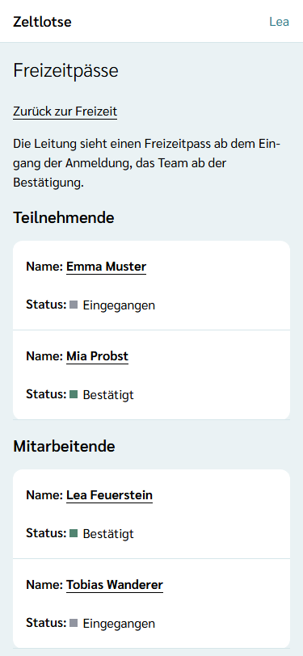
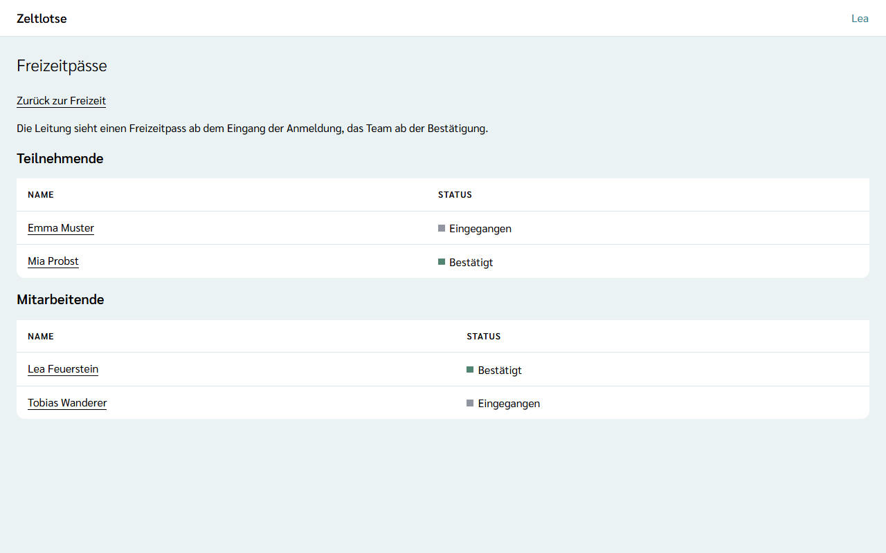
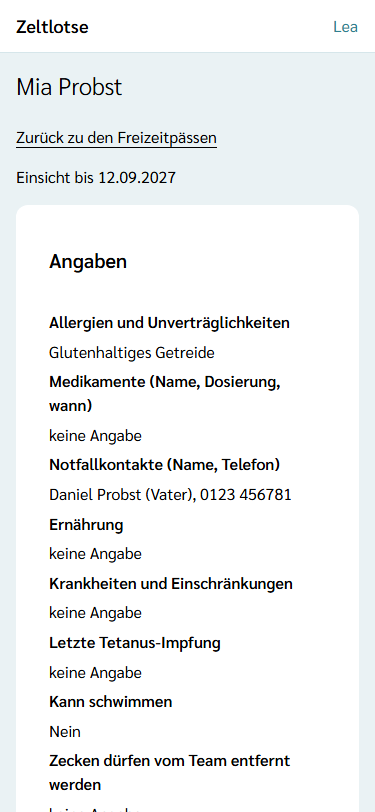
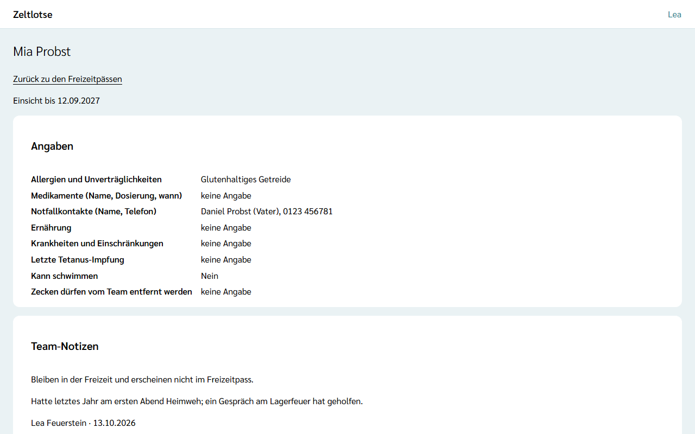
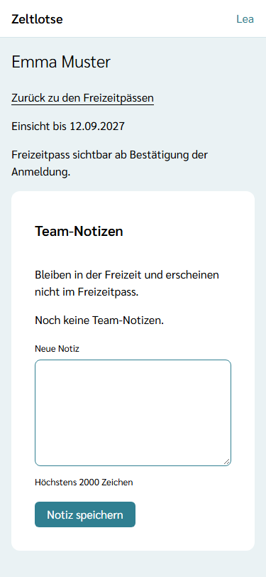
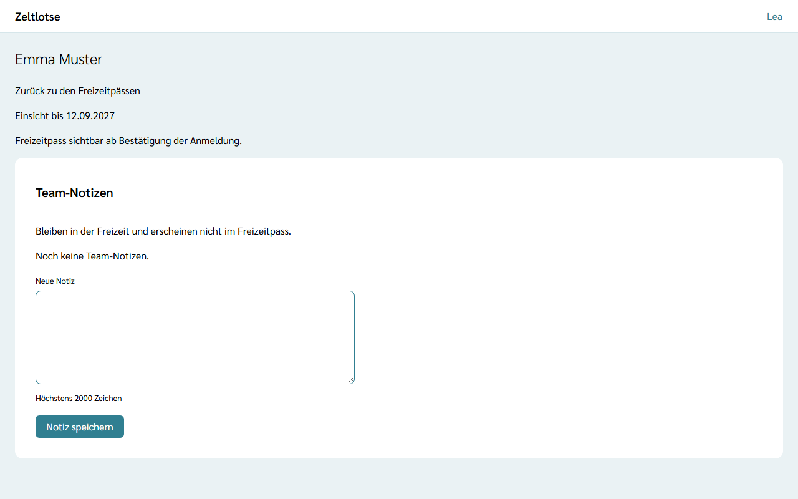

Der **Freizeitpass** enthält, was das Team auf der Freizeit über eine Person wissen muss: zum Beispiel Allergien, Medikamente und Notfallkontakte. Die Angaben gehören der Person; die Freizeit sieht sie nur befristet und nur, soweit sie danach gefragt hat. Diese Seite zeigt, wie Leitung und Team die Freizeitpässe ansehen und wo die **Team-Notizen** stehen.

## Die Seite „Freizeitpässe“

Auf der Startseite der Freizeit führt der Knopf **Freizeitpässe** zur Liste. Leitung und Team sehen ihn beide.

Die Liste hat zwei Abschnitte, **Teilnehmende** und **Mitarbeitende**, sortiert nach Nachname und Vorname. Darin stehen alle Anmeldungen, die **Eingegangen** oder **Bestätigt** sind; abgesagte Anmeldungen fehlen. Ein Tipp auf den Namen öffnet den Freizeitpass der Person. Gibt es noch keine Anmeldung, steht „Noch keine Anmeldungen.“

## Was im Freizeitpass steht

Oben stehen der Name der Person und **Einsicht bis TT.MM.JJJJ**: der letzte Tag, an dem die Freizeit den Pass sehen darf. Darunter steht, je nach Stand, eines von drei Dingen:

- **Angaben** – die Fragen, die die Freizeit abgefragt hat, mit den Antworten der Person, nur zum Lesen. Ausgewählte Optionen stehen als Text (zum Beispiel „Glutenhaltiges Getreide“), Ja/Nein als „Ja“ oder „Nein“, ein Datum als TT.MM.JJJJ. Eine unbeantwortete Frage zeigt „keine Angabe“. Fragen, die die Freizeit nicht abgefragt hat, erscheinen nicht – auch wenn die Person sie für eine andere Freizeit beantwortet hat.
- **Freizeitpass sichtbar ab Bestätigung der Anmeldung.** – das sieht das Team, solange die Anmeldung nur eingegangen ist. Die Leitung sieht die Angaben schon ab dem Eingang.
- **Einsicht beendet am TT.MM.JJJJ.** – das Freigabefenster ist zu Ende oder die Anmeldung wurde abgesagt. Angaben sind dann keine mehr zu sehen.

Ändern lassen sich die Angaben hier nicht; das tun nur die Person selbst oder ihre Eltern (siehe [Freizeitpass ausfüllen](/eltern/freizeitpass/)).

Vor der Bestätigung sieht das Team statt der Angaben den Hinweis:

Jeder Blick auf die Angaben steht im **Zugriffsprotokoll** der Person als „Freizeitpass eingesehen“, höchstens einmal am Tag je lesender Person. Die Person (oder ihre Eltern) sieht dort, wer aus der Freizeit wann hineingeschaut hat (siehe [Zugriffsprotokoll und Meine Daten](/erste-schritte/meine-daten/)).

## Team-Notizen

Unter dem Freizeitpass steht die Card **Team-Notizen**. Hier hält das Team fest, was es über eine Person wissen sollte und was nicht in den Freizeitpass gehört, etwa „Hatte letztes Jahr am ersten Abend Heimweh“. Team-Notizen **bleiben in der Freizeit und erscheinen nicht im Freizeitpass**; Eltern sehen sie weder dort noch bei den Anmeldungen.

- **Notiz schreiben:** Text ins Feld **Neue Notiz** schreiben und **Notiz speichern** wählen. Pflicht ist nur der Text, höchstens 2000 Zeichen. Ist das Feld leer, steht am Feld „Fehler: Text fehlt.“
- **Lesen:** Die neueste Notiz steht oben, darunter wer sie geschrieben hat und an welchem Tag.
- **Löschen:** Eine Notiz lässt sich nicht ändern, nur löschen. **Löschen** wählen und mit „Ja, löschen“ bestätigen. Löschen darf jedes Mitglied von Leitung und Team, auch eine Notiz von jemand anderem.

Team-Notizen sind verschlüsselt gespeichert. Die betroffene Person bekommt sie in ihrer Datenauskunft; mehr dazu unter [Was passiert mit meinen Daten](/daten/#team-notizen).
