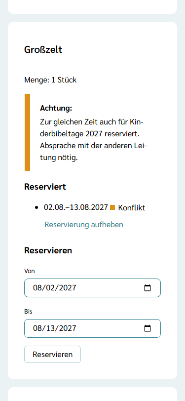
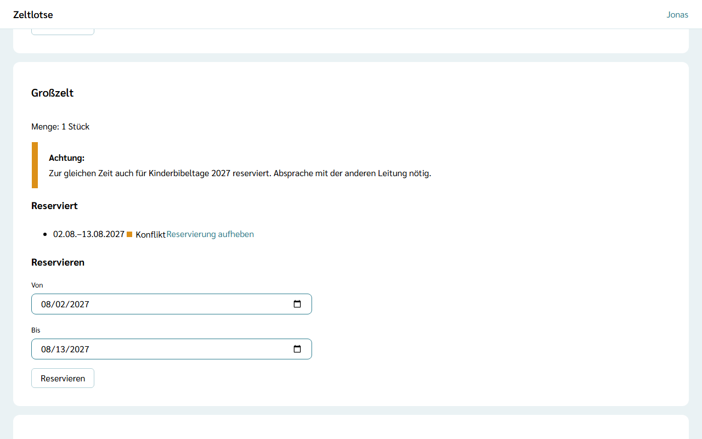

Was der Organisation gehört – Zelte, Fahnen, Kanus, Gaskocher –, steht in ihrem **Inventar**. Leitung und Team einer Freizeit reservieren daraus, was sie für ihre Tage brauchen. Andere Freizeiten der Organisation sehen das, und Zeltlotse zeigt, wenn zwei Freizeiten dasselbe Stück zur gleichen Zeit brauchen. Das Inventar selbst pflegt der Org-Admin – siehe [Inventar pflegen](/org-admin/inventar/).

## Das Inventar der Freizeit öffnen

Startseite der Freizeit → Knopf **Inventar**. Über der Überschrift „Inventar“ steht „Planen“. Je Artikel der Organisation steht eine Card mit der Menge und den Reservierungen **dieser** Freizeit. Hat die Organisation noch kein Inventar, steht dort „Die Organisation hat noch kein Inventar.“

## Reservieren

In jeder Card steht das Formular **Reservieren** mit den Feldern **Von** und **Bis**. Vorbelegt sind der erste und der letzte Tag der Freizeit; wer ein Stück nur für ein paar Tage braucht, ändert die Daten. **Reservieren** speichert die Reservierung, danach steht sie in der Card mit ihrem Zeitraum, zum Beispiel „02.08.–13.08.2027“. Liegt **Bis** vor **Von**, steht der Fehler am Feld **Bis**. Ohne Reservierung steht dort „Für diese Freizeit nicht reserviert.“

Ein Artikel lässt sich in einer Freizeit auch mehrmals reservieren, zum Beispiel für zwei getrennte Zeiträume. Ändern lässt sich eine Reservierung nicht: **Reservierung aufheben** und neu reservieren. **Reservierung aufheben** klappt eine Rückfrage auf („Reservierung aufheben?“ – „Ja, aufheben“ / „Nein“). Hängt die Reservierung an einem Material, steht es danach wieder auf **gebraucht**.

## Wenn eine andere Freizeit dasselbe braucht

Hat eine andere Freizeit der Organisation denselben Artikel für Tage reserviert, die sich mit der eigenen Reservierung überschneiden, steht in der Card die Warnung:

„Achtung: Zur gleichen Zeit auch für Kinderbibeltage 2027 reserviert. Absprache mit der anderen Leitung nötig.“

Schon ein gemeinsamer Tag zählt. Beide Reservierungen bleiben bestehen: Zeltlotse verhindert nichts und entscheidet nichts. Die Leitungen sprechen sich ab, außerhalb von Zeltlotse, zum Beispiel am Telefon. Danach hebt eine Freizeit ihre Reservierung auf und reserviert bei Bedarf für einen anderen Zeitraum neu, und die Warnung verschwindet.

## Aus dem Inventar am Programmpunkt

Auch am Material eines Programmpunkts lässt sich direkt reservieren – siehe [Material planen und packen](/mitarbeitende/material/). Unter einem Material ohne Reservierung steht die Auswahl **Aus dem Inventar** mit den Artikeln der Organisation und der Knopf **Reservieren**. Ein Tipp reserviert den gewählten Artikel für den ganzen Zeitraum der Freizeit. Danach steht am Material „Aus dem Inventar: Fahnen“; überschneidet sich die Reservierung mit einer anderen Freizeit, steht darunter dieselbe Warnung wie oben.

Mit der Reservierung setzt Zeltlotse den Stand des Materials auf **vorhanden**: Das Stück liegt im Lager bereit. Das kann einen Moment dauern; spätestens nach dem Neuladen steht es da. Wird die Reservierung im Inventar wieder aufgehoben, steht das Material wieder auf **gebraucht**. Danach setzt das Team den Stand wie gewohnt selbst, etwa auf **eingepackt**.

## Nach dem Abschluss

Nach dem Abschluss der Freizeit ist das Inventar der Freizeit nur lesbar: Oben steht „Diese Freizeit ist abgeschlossen und nur lesbar.“; das Formular **Reservieren** und **Reservierung aufheben** fehlen.
