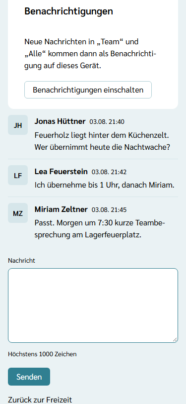
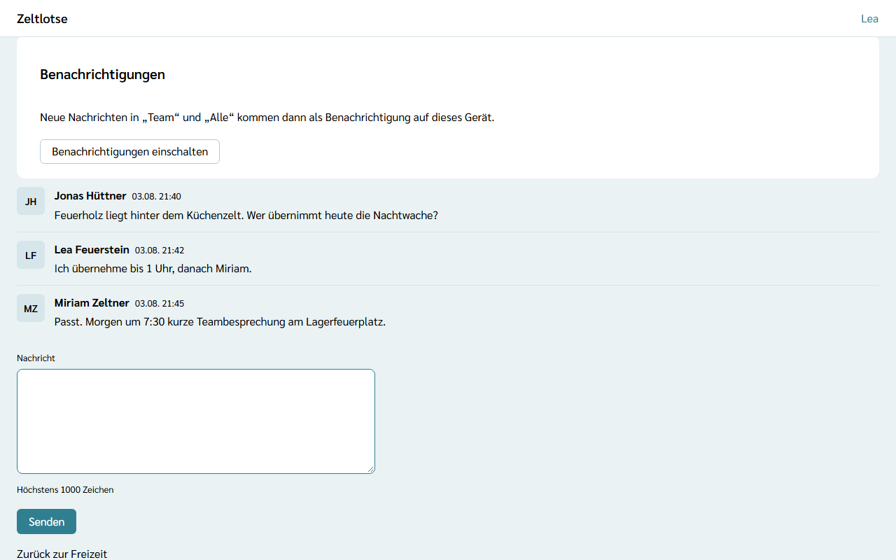
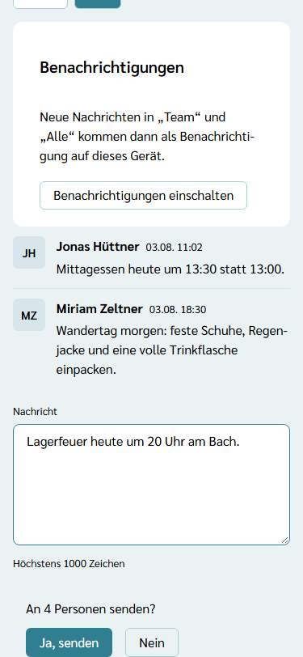
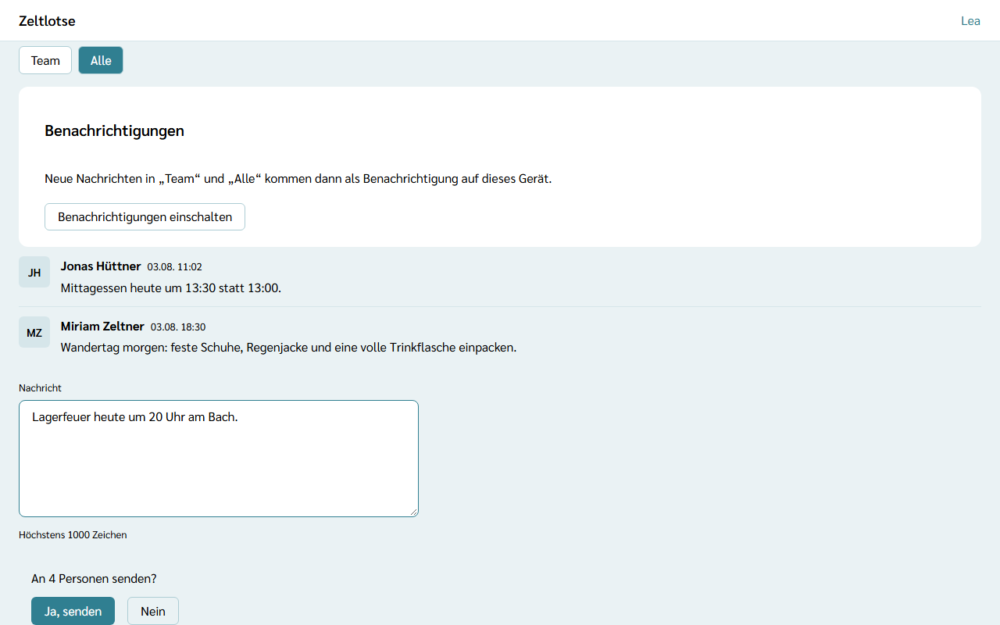

**Wer:** Leitung und Team einer Freizeit. Beide lesen und schreiben in beiden Kanälen.

Jede Freizeit hat zwei feste **Kanäle** für Kurznachrichten:

- **Team** – nur für Leitung und Team, zum Beispiel „Wer übernimmt heute die Nachtwache?“.
- **Alle** – für alle Personen der Freizeit, zum Beispiel „Mittagessen heute um 13:30 statt 13:00.“ Teilnehmende lesen hier noch nicht mit; das kommt mit dem Teilnehmer-Zugang über den QR-Code.

So laufen Absprachen nicht mehr über eine Chat-App nebenher, und jede Nachricht kann als **Benachrichtigung** (Push-Nachricht) aufs Handy kommen. Die Kanäle gibt es in jeder Freizeit; das Modul lässt sich nicht abschalten.

## Der Weg zu den Kanälen

Startseite der Freizeit → Knopf **Kanäle**. Über der Überschrift steht „Kanäle“. Mit den zwei Knöpfen **Team** und **Alle** wechselt die Seite zwischen den Kanälen; der gewählte Kanal steht in der Adresse, eine Benachrichtigung aus „Alle“ öffnet also direkt diesen Kanal.

Die Nachrichten stehen untereinander, die **neueste unten**. Die Seite öffnet am Ende, beim Eingabefeld. Zu jeder Nachricht stehen die Initialen und der Name der Person, die sie geschrieben hat, dazu Tag und Uhrzeit. Es gibt keine Zähler für ungelesene Nachrichten und kein „gelesen“.

## Eine Nachricht schreiben

Die Nachricht ins Feld **Nachricht** schreiben (höchstens 1000 Zeichen, Zeilenumbrüche bleiben erhalten) und **Senden** tippen.

- **Im Kanal „Team“** geht die Nachricht sofort hinaus.
- **Im Kanal „Alle“** klappt „Senden“ zuerst an Ort und Stelle eine Rückfrage auf: „An 4 Personen senden?“. Die Zahl nennt alle, die der Kanal erreicht: bestätigte Teilnehmende sowie Leitung und Team. Erst **Ja, senden** schickt die Nachricht ab; **Nein** klappt die Rückfrage wieder zu, und es geht nichts hinaus. Auch der Server nimmt eine Nachricht an alle nur mit dieser Bestätigung an.

Ist das Feld leer, steht der Fehler direkt am Feld. Nachrichten lassen sich nicht bearbeiten oder einzeln löschen; eine Korrektur ist eine neue Nachricht.

## Benachrichtigungen aufs Handy

Über den Nachrichten steht die Card **Benachrichtigungen**. Zeltlotse fragt nie von selbst nach der Erlaubnis für Benachrichtigungen, erst nach einem Tipp auf **Benachrichtigungen einschalten**. Danach fragt das Gerät einmal, ob Zeltlotse Mitteilungen senden darf.

- **Eingeschaltet:** Dort steht „Benachrichtigungen sind auf diesem Gerät eingeschaltet.“ Jede neue Nachricht in „Team“ oder „Alle“ kommt dann als Benachrichtigung, mit dem Namen der Freizeit, dem Kanal und dem Anfang des Textes. Ein Tipp darauf öffnet den Kanal. Wer selbst schreibt, bekommt die eigene Nachricht nicht als Benachrichtigung. Ist die Kanal-Seite gerade offen, lädt sie bei einer neuen Nachricht von selbst neu.
- **Ausschalten:** **Benachrichtigungen ausschalten** beendet die Benachrichtigungen auf diesem Gerät, für alle Freizeiten. Auch beim Abmelden enden sie, damit das Gerät keine Nachrichten der abgemeldeten Person mehr zeigt.
- **Mehrere Freizeiten:** Ist ein Gerät schon eingeschaltet, gilt das auch für jede weitere Freizeit, deren Kanäle die Person auf diesem Gerät öffnet.
- **iPhone:** Auf dem iPhone kommen Benachrichtigungen erst, wenn Zeltlotse auf dem Home-Bildschirm liegt. Die Seite zeigt dann die Schritte: in Safari auf „Teilen“ tippen, „Zum Home-Bildschirm“ wählen, Zeltlotse über das neue Symbol öffnen und hier „Benachrichtigungen einschalten“ tippen.
- **Abgelehnt:** Wurde die Erlaubnis im Gerät verweigert, steht dort „Benachrichtigungen sind auf diesem Gerät ausgeschaltet.“ mit den Schritten, wie sie in den Einstellungen wieder angehen.
- **Nicht möglich:** Kann ein Browser gar keine Benachrichtigungen empfangen, sagt die Seite das.

In allen Fällen bleiben die Kanäle lesbar und beschreibbar. Benachrichtigungen gehen nur an Personen, die gerade zu Leitung oder Team der Freizeit gehören. Zeltlotse schickt sie selbst, über den offenen Standard für Web-Push, ohne Dienste von Google, Apple oder Microsoft dazwischen außer dem Push-Dienst, den der Browser ohnehin nutzt. Benachrichtigungen enthalten nie Gesundheitsdaten und keinen Namen der Person, die geschrieben hat; Gesundheitsdaten gehören auch nicht in die Nachrichten.

## Nach dem Abschluss

Nach dem Abschluss der Freizeit steht oben „Diese Freizeit ist abgeschlossen. Die Kanäle sind nur noch lesbar.“ Die Nachrichten bleiben sichtbar; Eingabefeld und Benachrichtigungen gibt es nicht mehr.

## Datenschutz

Eine Nachricht speichert den Kanal, den Text, wann sie gesendet wurde und wer sie geschrieben hat – als Verweis auf die Person; den Namen holt die Seite aus der Freizeit. Für Benachrichtigungen speichert Zeltlotse je Gerät und Freizeit das **Push-Abo**: die Adresse beim Push-Dienst des Browsers, die Schlüssel des Browsers und die Person.

Löscht eine Person ihr Konto, bleiben ihre Nachrichten als Arbeitsdaten der Freizeit stehen, aber ohne Namen („Gelöschte Person“); ihre Push-Abos löscht Zeltlotse sofort. Kennt der Push-Dienst ein Abo nicht mehr, etwa nach dem Zurücksetzen des Handys, räumt Zeltlotse es beim nächsten Versand ab. Nach Ablauf der Löschfrist der Organisation für Freizeit-Daten löscht Zeltlotse die Nachrichten und Push-Abos der Freizeit endgültig. In der eigenen Datenauskunft stehen unter „Kanäle“ die eigenen Nachrichten und die Zahl der eigenen Push-Abos – siehe [Was passiert mit meinen Daten](/daten/#kanäle).

## Noch nicht dabei

- Teilnehmende mit dem QR-Zugang lesen den Kanal „Alle“ noch nicht mit und bekommen noch keine Benachrichtigungen.
- „Alle informieren?“ beim Ändern eines Programmpunkts, der Ansagen-Zettel und die Besprechungsnotizen kommen später.
- Nachrichten erscheinen nicht live; die Seite lädt beim Öffnen, nach dem Senden und bei einer Benachrichtigung neu.
