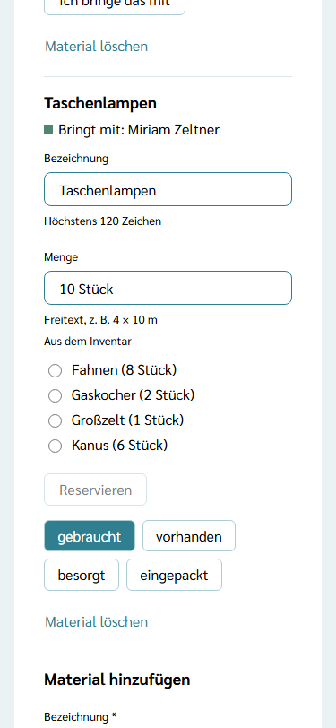
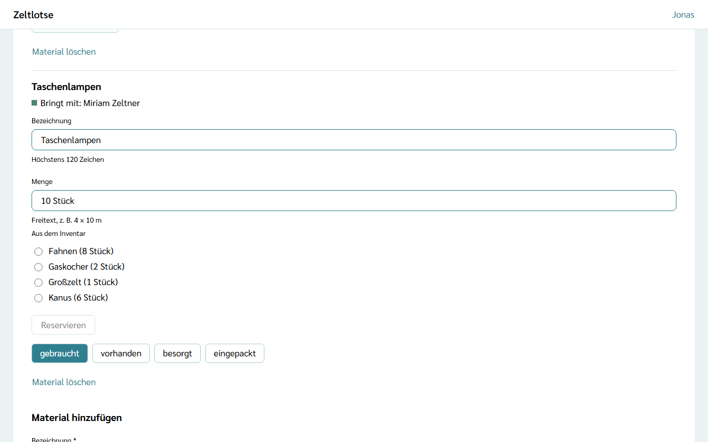
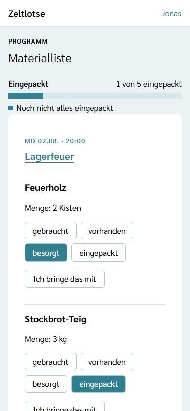
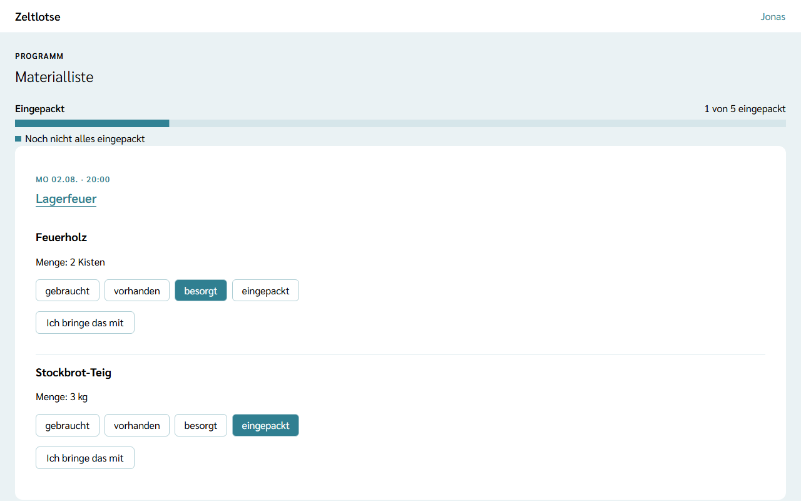

Was für einen Programmpunkt gebraucht wird, steht direkt am **Programmpunkt**: Fahnen und Seile beim Geländespiel, Feuerholz beim Lagerfeuer. Aus dem Material aller Programmpunkte entsteht von selbst die **Materialliste** – niemand muss eine eigene Liste schreiben. Leitung und Team planen das Material gemeinsam.

## Der Weg zum Material

- **Material eines Programmpunkts:** Startseite der Freizeit → **Programm** → Tipp auf den Titel des Programmpunkts. Die Card **Material** steht unter der Card „Bearbeiten“.
- **Materialliste:** Startseite der Freizeit → **Programm** → Link **Materialliste** über dem Wochenraster.

## Material hinzufügen

Am Ende der Card **Material** steht das Formular **Material hinzufügen**:

- **Bezeichnung** – Pflicht, höchstens 120 Zeichen, zum Beispiel „Seile“,
- **Menge** – freiwillig, höchstens 40 Zeichen, als freier Text, zum Beispiel „4 × 10 m“ oder „8 Stück“.

**Material hinzufügen** speichert den Eintrag. Er steht danach in der Card mit dem Stand **gebraucht** und erscheint ohne weitere Eingabe in der Materialliste. Fehlt die Bezeichnung oder ist ein Text zu lang, steht der Fehler direkt am Feld. Ohne Material steht in der Card „Noch kein Material.“

Zeltlotse rechnet Mengen nicht zusammen und kennt keine Einheiten: Was in der Menge steht, steht so in der Liste.

## Der Stand: gebraucht, vorhanden, besorgt, eingepackt

Jedes Material hat einen von vier Ständen:

- **gebraucht** – wird gebraucht, ist aber noch nicht da (so beginnt jedes Material),
- **vorhanden** – ist schon da, zum Beispiel im Lager,
- **besorgt** – ist gekauft oder ausgeliehen,
- **eingepackt** – liegt fertig im Gepäck.

Die vier Stände stehen als Knöpfe nebeneinander; der aktuelle Stand ist hervorgehoben. Ein Tipp auf einen anderen Stand speichert sofort, darunter steht „Gespeichert · Rückgängig“. **Rückgängig** stellt den vorigen Stand wieder her. Jeder Stand lässt sich direkt wählen, auch zurück, zum Beispiel von „eingepackt“ auf „gebraucht“. Klappt das Speichern nicht, steht dort „Nicht gespeichert.“ mit dem Knopf **Erneut versuchen**.

## Ich bringe das mit

Unter jedem Material, das noch niemand mitbringt, steht der Knopf **Ich bringe das mit**. Ein Tipp genügt, eine Rückfrage gibt es nicht: Danach steht am Material „Bringt mit:“ mit dem eigenen Namen, und der Knopf heißt **Doch nicht mitbringen**. Damit ist das Material wieder frei.

Ein Material bringt immer nur eine Person mit. Bringt es schon jemand anderes mit, steht dessen Name dort, und der Knopf fehlt. Haben zwei Personen gleichzeitig getippt, bekommt es die schnellere; bei der anderen steht „Jemand anderes bringt dieses Material inzwischen mit.“ Den Stand ändert „Ich bringe das mit“ nicht: Wer etwas mitbringt, setzt „besorgt“ oder „eingepackt“ selbst.

## Aus dem Inventar

Auf der Seite des Programmpunkts steht unter einem Material die Auswahl **Aus dem Inventar** mit den Artikeln der Organisation und der Knopf **Reservieren** – solange noch keine Reservierung daran hängt, die Organisation Inventar hat und die Freizeit nicht abgeschlossen ist: Ein Tipp reserviert den gewählten Artikel für den ganzen Zeitraum der Freizeit. Danach steht am Material „Aus dem Inventar:“ mit dem Artikel, und der Stand wechselt auf **vorhanden**. Braucht eine andere Freizeit denselben Artikel zur gleichen Zeit, steht darunter „Zur gleichen Zeit auch für … reserviert. Absprache mit der anderen Leitung nötig.“ Mehr dazu unter [Material aus dem Inventar reservieren](/mitarbeitende/inventar/).

## Material ändern und löschen

Auf der Seite des Programmpunkts stehen **Bezeichnung** und **Menge** jedes Materials in Feldern. Zeltlotse speichert beim Verlassen des Felds; darunter steht „Gespeichert“ mit „Rückgängig“. Hat jemand anderes dasselbe Feld inzwischen geändert, steht dort „Inzwischen geändert – neu laden?“. Eine leere Menge heißt: ohne Menge.

**Material löschen** klappt eine Rückfrage auf („„Seile“ löschen?“ – „Ja, löschen“ / „Nein“). Wird ein ganzer Programmpunkt gelöscht, verschwindet sein Material mit. Material lässt sich nicht an einen anderen Programmpunkt verschieben; dafür dort neu hinzufügen und hier löschen.

## Die Materialliste

Die **Materialliste** zeigt das Material aller Programmpunkte der Freizeit. Oben steht ein Balken mit der Zahl, wie viel schon eingepackt ist, zum Beispiel „1 von 5 eingepackt“. Darunter steht je Programmpunkt eine Card: oben Tag und Uhrzeit, darunter der Titel als Link zur Seite des Programmpunkts. In der Card steht jedes Material mit Menge, Stand und wer es mitbringt. Die Programmpunkte stehen in der Reihenfolge des Wochenrasters.

Auch in der Materialliste lassen sich der Stand setzen und **Ich bringe das mit** tippen, zum Beispiel beim Packen mit dem Handy in der Hand. Bezeichnung und Menge ändern und Material löschen geht auf der Seite des Programmpunkts.

Gibt es noch kein Material, steht dort „Noch kein Material. Material hängt an den Programmpunkten.“ mit dem Knopf **Zum Programm**.

## Nach dem Abschluss

Nach dem Abschluss der Freizeit ist das Material nur lesbar: Oben steht „Diese Freizeit ist abgeschlossen und nur lesbar.“; Felder, Knöpfe und das Formular fehlen. Der Stand steht dann als Wort mit einem farbigen Quadrat; „vorhanden“ und „besorgt“ haben dieselbe Farbe, „eingepackt“ die Farbe für Erledigtes.

## Noch nicht dabei

Eine Druckansicht der Materialliste kommt mit einer späteren Version.

Wer Material mitbringt, steht auch in der Datenauskunft der Person unter „Programm“ – mehr dazu unter [Was passiert mit meinen Daten](/daten/#programm).
