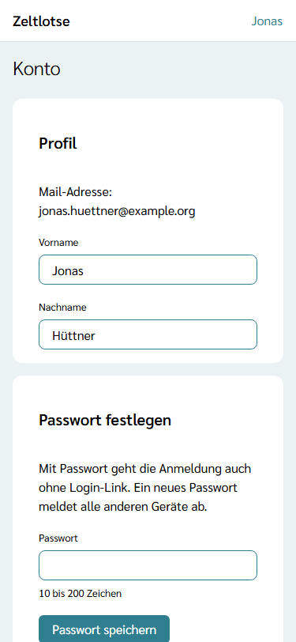
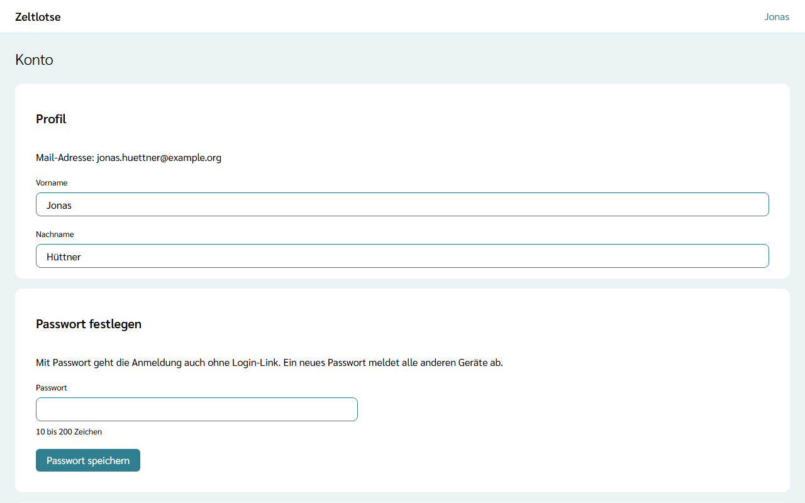
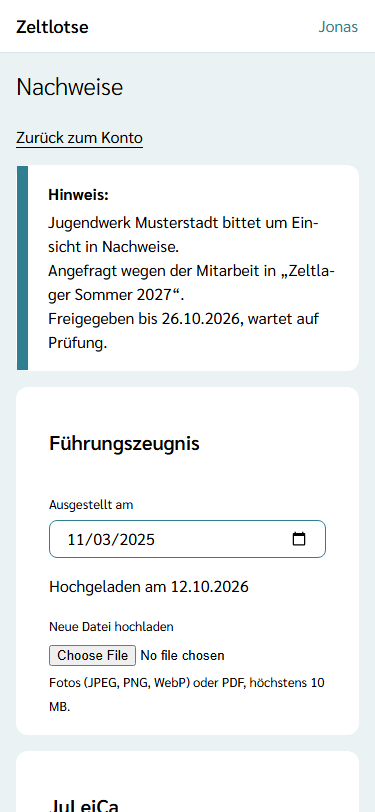
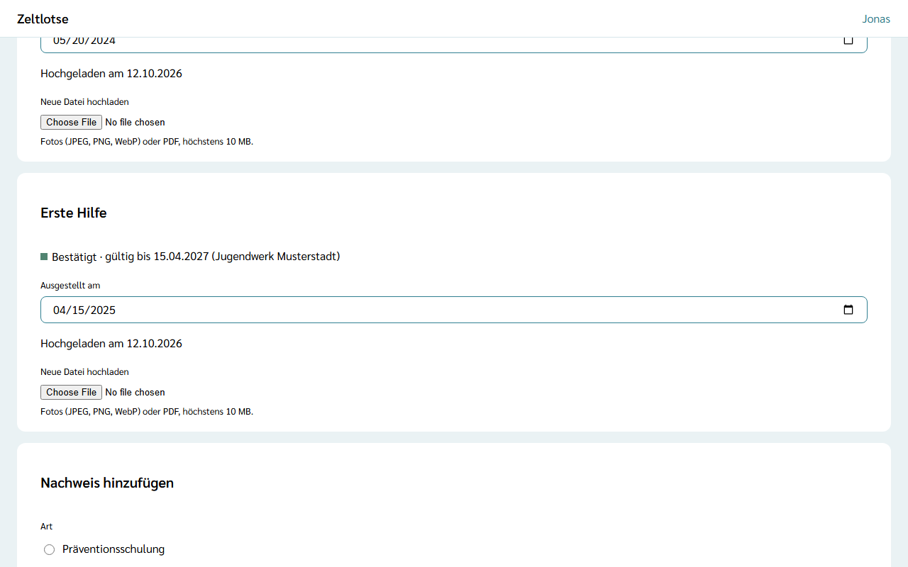

Nachweise wie **Führungszeugnis**, **JuLeiCa** (Jugendleiter-Card), **Erste Hilfe** und **Präventionsschulung** liegen einmal am eigenen Profil. Eine Organisation bekommt keine Kopie: Die Datei sieht nur eine prüfende Person, einmal und befristet. Die Organisation speichert danach nur die Bestätigung.

Die Seite **Nachweise** öffnet sich über **Konto** und dort den Knopf **Nachweise öffnen** in der Card „Nachweise“.

## Nachweis hochladen

1. Auf der Seite **Nachweise** zur Card **Nachweis hinzufügen** gehen. Sie steht dort, solange noch eine Art fehlt.
2. Unter **Art** den Nachweis wählen, etwa „Führungszeugnis“.
3. **Ausgestellt am** eintragen: das Datum auf dem Dokument, nicht das Datum des Hochladens.
4. Bei **Foto aufnehmen oder Datei wählen** die Datei wählen. Am Handy lässt sich das Dokument direkt fotografieren. Erlaubt sind Fotos (JPEG, PNG, WebP) und PDF bis 10 MB.
5. **Nachweis hinzufügen** wählen. Es erscheint „Gespeichert: Der Nachweis ist hinzugefügt.“, und der Nachweis steht als eigene Card auf der Seite.

Je Art gibt es genau einen Nachweis. Die Card zeigt „Hochgeladen am …“ oder „Noch keine Datei.“ Eine neue Datei lädt **Neue Datei hochladen** in der Card hoch; sie ersetzt die alte.

:::tip[Upload gescheitert]
Bricht die Verbindung beim Hochladen ab, bleibt der Eintrag ohne Datei gespeichert. In der Card steht dann „Fehler: Datei nicht hochgeladen.“ mit dem Knopf **Erneut versuchen**.
:::

## Ausstellungsdatum ändern

Das Feld **Ausgestellt am** in der Card speichert beim Verlassen des Feldes; danach steht dort „Gespeichert“ mit „Rückgängig“. Ein Datum in der Zukunft nimmt Zeltlotse nicht an („Fehler: Das Ausstellungsdatum liegt in der Zukunft.“).

## Einsicht freigeben

Die **erste Mitarbeit** in einer Organisation fragt die Einsicht in die Nachweise von selbst an. Braucht die Organisation später erneut Einsicht, fragt eine Leitung oder ein Org-Admin ausdrücklich an. Auf der Seite **Nachweise** steht dann zum Beispiel:

- „Hinweis: Jugendwerk Musterstadt bittet um Einsicht in Nachweise. Angefragt wegen der Mitarbeit in „Zeltlager Sommer 2027“.“ – die Anfrage ist mit der ersten Mitarbeit entstanden;
- „Hinweis: Jugendwerk Musterstadt bittet um Einsicht in Nachweise. Angefragt von Miriam Zeltner.“ – eine Person hat ausdrücklich angefragt.

So geht das Freigeben:

1. **Freigeben** wählen. Darunter klappt die Frage „Nachweise einmal zur Prüfung freigeben? Die prüfende Person sieht die Dateien bis zur Entscheidung, höchstens 14 Tage.“ auf.
2. **Ja, freigeben** wählen.

Danach steht beim Hinweis „Freigegeben bis TT.MM.JJJJ, wartet auf Prüfung.“ Freigegeben werden alle Nachweise mit Datei, die in dieser Anfrage noch nicht entschieden sind. Genau eine prüfende Person sieht die Dateien, und zwar nur bis zu ihrer Entscheidung, höchstens 14 Tage lang. Ist die Frist vorbei, ohne dass alles geprüft ist, steht beim Hinweis wieder **Freigeben**. Dieselbe Anfrage lässt sich dann erneut freigeben; schon Bestätigtes bleibt bestätigt.

## Während der Prüfung nicht änderbar

Solange ein Nachweis zur Prüfung freigegeben und noch nicht entschieden ist, lassen sich **Ausgestellt am** und die Datei nicht ändern. So bestätigt die prüfende Person genau das, was sie gesehen hat. Ein Änderungsversuch zeigt „Fehler: Der Nachweis ist gerade zur Prüfung freigegeben. Ändern geht nach der Entscheidung oder nach Ablauf der Freigabe.“

## Stand der Bestätigungen

Hat die prüfende Person einen Nachweis bestätigt, steht in seiner Card „Bestätigt · gültig bis TT.MM.JJJJ (Organisation)“. Das Datum rechnet die Organisation aus dem Ausstellungsdatum und ihrer Richtlinie aus, etwa zwei Jahre für Erste Hilfe.

Ist das Datum vorbei, steht dort stattdessen „Achtung: Abgelaufen am TT.MM.JJJJ (Organisation)“. Dann hilft ein neuer Nachweis: das neue Dokument mit **Neue Datei hochladen** hochladen, das **Ausstellungsdatum** anpassen und freigeben, sobald die Organisation erneut um Einsicht bittet.

## Abgelehnt: korrigieren

Passt etwas nicht, lehnt die prüfende Person den Nachweis mit einem Hinweis ab. In der Card steht dann zum Beispiel „Fehler: Abgelehnt: Datum passt nicht“.

1. Das **Ausstellungsdatum** korrigieren oder mit **Neue Datei hochladen** eine bessere Datei hochladen. Der Hinweis verschwindet danach.
2. Die Einsicht ist schon neu angefragt: Beim neuen Hinweis wieder **Freigeben** wählen. Freigegeben werden dabei nur die abgelehnten Nachweise; schon Bestätigtes zeigt Zeltlotse nicht noch einmal.

## Eine zweite Organisation

Arbeitet jemand in mehreren Organisationen mit, bittet jede Organisation getrennt um Einsicht: Auch die erste Mitarbeit in der zweiten Organisation fragt von selbst an, und der Hinweis nennt deren Namen. Dieselben Nachweise lassen sich dann einfach erneut freigeben, ohne sie neu hochzuladen. Jede Organisation speichert nur ihre eigene Bestätigung; in der Card stehen alle Bestätigungen untereinander, je mit dem Namen der Organisation.
