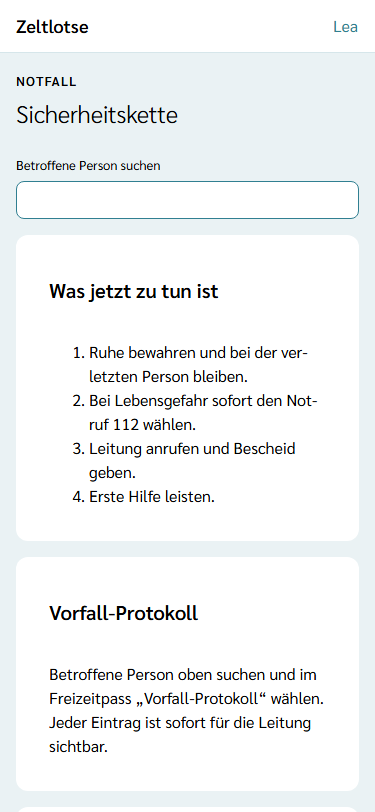
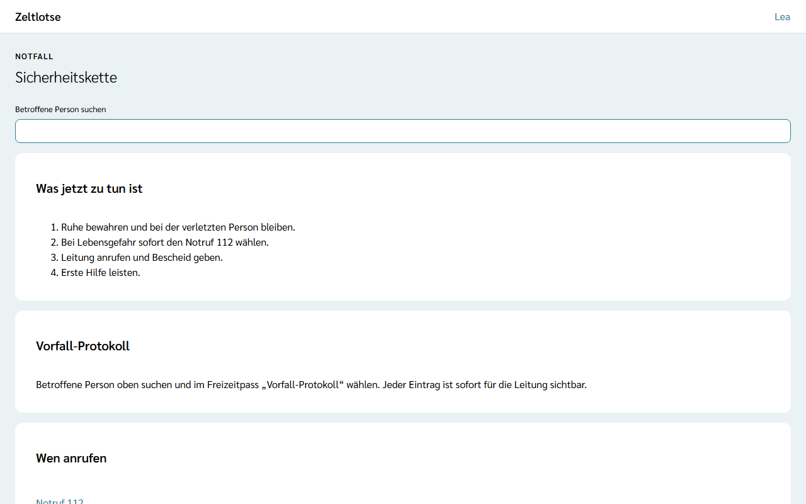
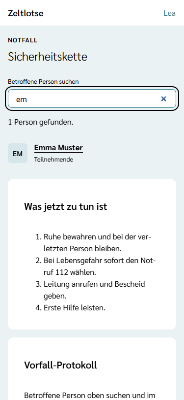
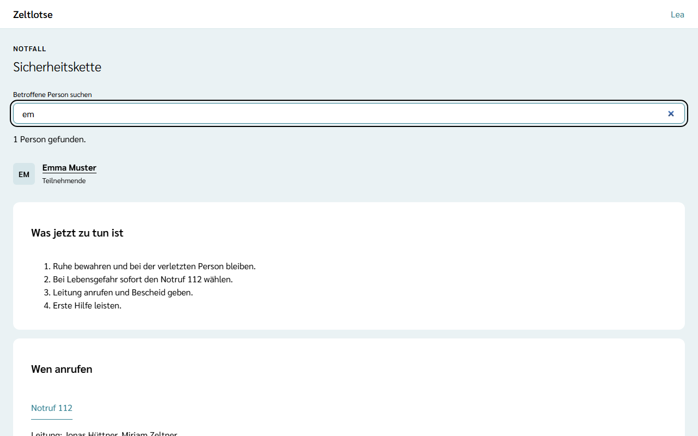

Im Notfall zählt jede Sekunde. Zeltlotse bündelt dafür zwei Dinge: die **Sicherheitskette** der Freizeit (was jetzt zu tun ist und wen man anruft) und die **Schnellsuche**, die den Freizeitpass der betroffenen Person mit Allergien, Medikamenten und Notfallkontakten öffnet. Leitung und Team sehen beides.

## Notfall-Box und Eintrag „Notfall“ während der Freizeit

Vom ersten bis zum letzten Tag der Freizeit steht auf der Startseite der Freizeit ganz oben, direkt unter dem Namen, die **Notfall-Box**:

- **Notfallhilfe öffnen** führt zur Sicherheitskette.
- **Notruf 112** ist ein Telefon-Link; am Handy startet ein Tipp den Anruf.

Darunter steht die **Schnellsuche**. Zusätzlich zeigt die App-Leiste oben auf jeder Seite dieser Freizeit den kleinen Eintrag **Notfall**, der ebenfalls zur Sicherheitskette führt.

Vor dem ersten Tag, in der Nachbereitung und nach dem Abschluss gibt es weder die Notfall-Box noch den Eintrag „Notfall“. Die Sicherheitskette bleibt trotzdem erreichbar, siehe unten.

## Sicherheitskette jederzeit über die Startseite

Auf der Startseite der Freizeit führt der Knopf **Sicherheitskette** in jeder Phase zur Sicherheitskette. So kann das Team sie schon vor der Freizeit lesen. Die Seite zeigt von oben nach unten:

1. das Suchfeld **Betroffene Person suchen**,
2. die Card **Was jetzt zu tun ist** mit den Schritten, die die Leitung festgelegt hat, nummeriert,
3. die Card **Wen anrufen**: **Notruf 112**, die Namen der Leitung mit dem Telefon der Leitung im Notfall und die Ansprechperson am Heimatort mit ihrem Telefon. Jede Nummer ist ein Telefon-Link, der sagt, wen er anruft, etwa „Leitung anrufen: 0123 456782“ oder „Ansprechperson anrufen: 0123 456783“.

Zwischen „Was jetzt zu tun ist“ und „Wen anrufen“ steht die Card **Vorfall-Protokoll**: „Betroffene Person oben suchen und im Freizeitpass „Vorfall-Protokoll“ wählen. Jeder Eintrag ist sofort für die Leitung sichtbar.“ Wie das Protokoll funktioniert, steht unter [Vorfall-Protokoll führen](/mitarbeitende/vorfall-protokoll/).

Hat die Leitung die Sicherheitskette noch nicht eingerichtet, steht oben „Hinweis: Die Sicherheitskette ist noch nicht eingerichtet.“ Suchfeld, die Namen der Leitung und „Notruf 112“ stehen trotzdem da. Wie die Leitung die Kette einrichtet, steht unter [Sicherheitskette einrichten](/leitung/sicherheitskette/).

## Schnellsuche: den Freizeitpass in zwei Schritten öffnen

Die Schnellsuche steht auf der Sicherheitskette ganz oben, während der Freizeit auch auf der Startseite und immer auf der Seite **Freizeitpässe**. Sie sucht ab dem ersten Buchstaben in Vor- und Nachnamen aller Personen der Freizeit, deren Anmeldung eingegangen oder bestätigt ist. Groß- und Kleinschreibung spielen keine Rolle.

- Jeder Treffer zeigt die Initialen, den Namen und darunter „Teilnehmende“ oder „Mitarbeitende“.
- Ein Tipp auf den Namen öffnet direkt den Freizeitpass der Person.
- Über den Treffern steht, wie viele Personen passen, zum Beispiel „1 Person gefunden.“; passt kein Name, steht „Keine Person gefunden.“

Im Freizeitpass stehen die **Notfallangaben ganz oben** und offen, ohne Aufklappen: Allergien, Medikamente und Notfallkontakte, soweit die Freizeit danach fragt. Das Team sieht den Freizeitpass **ab der Bestätigung der Anmeldung**, die Leitung schon ab dem Eingang; vorher steht beim Team „Freizeitpass sichtbar ab Bestätigung der Anmeldung.“ Mehr dazu unter [Freizeitpässe ansehen](/mitarbeitende/freizeitpaesse/). Jeder Blick auf die Angaben steht im Zugriffsprotokoll der Person.

## Ohne Netz

Während der Freizeit liegen Sicherheitskette und Notfallkarten verschlüsselt auf dem Gerät. Ohne Verbindung führt die Notfall-Box mit „Notfallhilfe öffnen“ zur gespeicherten Sicherheitskette, und die Suche öffnet die **Notfallkarte** der Person mit Allergien, Medikamenten, Krankheiten und Notfallkontakten. Wie das genau geht, steht unter [Ohne Netz arbeiten](/mitarbeitende/offline/).

Ist auf dem Gerät nichts gespeichert, zeigt die Notfall-Box nur „Notruf 112“ und den Satz „Offline gilt der ausgedruckte Notfallordner.“ Dann gilt der **ausgedruckte Notfallordner** mit den Notfallangaben je Kind. Der Knopf **Notfallordner drucken** steht auf der Sicherheitskette unter „Wen anrufen“ und auf der Seite „Freizeitpässe“; wie der Ausdruck aussieht, steht unter [Notfallordner drucken](/mitarbeitende/notfallordner/).

