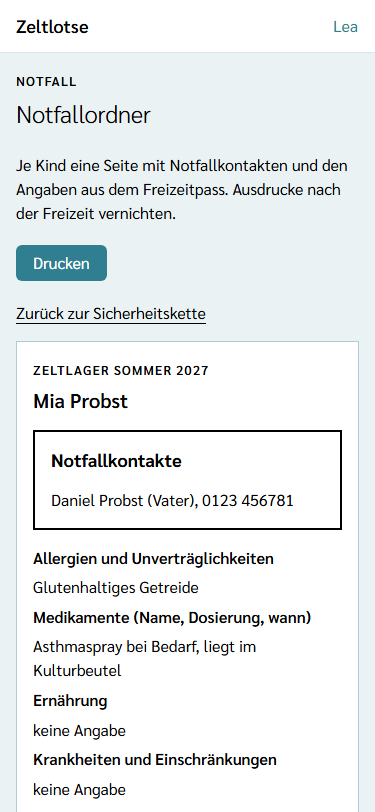
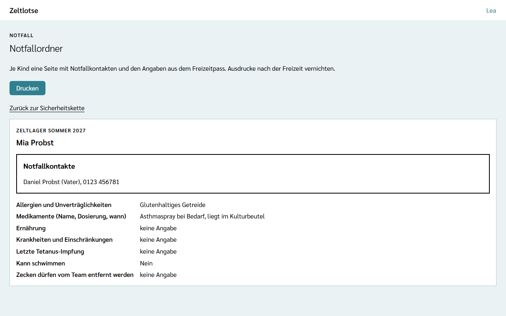

Ohne Netz lassen sich Sicherheitskette und Freizeitpässe in Zeltlotse noch nicht öffnen. Für diesen Fall gibt es den **Notfallordner**: ein Ausdruck mit je einer A4-Seite pro Kind, auf der die Notfallkontakte und die Angaben aus dem Freizeitpass stehen. Er gehört in die Lagerleitung oder in den Erste-Hilfe-Rucksack. Leitung und Team können ihn drucken.

## Wo der Notfallordner steht

Zwei Wege führen zur Druckansicht, beide mit dem Knopf **Notfallordner drucken**:

- auf der Seite **Freizeitpässe**, direkt unter „Zurück zur Freizeit“ – ab der Startseite der Freizeit also in zwei Schritten,
- auf der **Sicherheitskette** unter der Card „Wen anrufen“ (siehe [Notfall](/mitarbeitende/notfall/)).

## Was die Druckansicht zeigt

Oben stehen die Dachzeile „Notfall“, die Überschrift **Notfallordner**, der Satz „Je Kind eine Seite mit Notfallkontakten und den Angaben aus dem Freizeitpass. Ausdrucke nach der Freizeit vernichten.“, der Knopf **Drucken** und der Link „Zurück zur Sicherheitskette“. Diese Teile stehen nur am Bildschirm und erscheinen nicht auf dem Papier.

Darunter folgt je Kind eine Seite:

- oben klein der Name der Freizeit, darunter groß der Name des Kindes,
- der umrandete Kasten **Notfallkontakte** mit der Antwort aus dem Freizeitpass; fragt die Freizeit keine Notfallkontakte ab, fehlt der Kasten,
- darunter als Liste alle übrigen Fragen, die die Freizeit abgefragt hat, mit den Antworten, zum Beispiel Allergien, Medikamente und „Kann schwimmen“. Eine unbeantwortete Frage zeigt „keine Angabe“.

Ein Datum steht nicht auf dem Ausdruck; ein neuer Ausdruck zeigt immer den aktuellen Stand der Freizeitpässe. Damit der Ordner ohne Netz stimmt, vor der Abreise drucken und nach Änderungen an den Freizeitpässen erneut drucken.

## Wer im Notfallordner steht

Im Notfallordner stehen nur **Teilnehmende**, deren Anmeldung **bestätigt** ist und deren Freizeitpass für die Freizeit noch sichtbar ist, also bis zum Ende des [Freigabefensters](/daten/#freigabefenster-wann-die-einsicht-endet). Eingegangene oder abgesagte Anmeldungen und Mitarbeitende fehlen. Team-Notizen stehen nie im Notfallordner. Gibt es niemanden, der dazu passt, steht dort „Noch keine bestätigten Teilnehmenden mit sichtbarem Freizeitpass.“, und der Knopf „Drucken“ fehlt.

## Drucken

**Drucken** öffnet den Druckdialog des Browsers. Dort lässt sich ein Drucker wählen oder „Als PDF speichern“. Auf dem Papier fehlen App-Leiste, Überschrift und Knöpfe; jedes Kind beginnt auf einer neuen A4-Seite. Der Ausdruck ist schwarz auf weiß und auch auf einem Schwarz-Weiß-Drucker gut lesbar: Die Notfallkontakte erkennt man am umrandeten Kasten und an der Überschrift, nicht an einer Farbe.

## Datenschutz

Wer den Notfallordner öffnet, sieht die Freizeitpässe aller Kinder darin. Deshalb steht diese Einsicht im **Zugriffsprotokoll der Eltern** als „Freizeitpass eingesehen“, je Person und Tag einmal (siehe [Zugriffsprotokoll und Meine Daten](/erste-schritte/meine-daten/)). Zeltlotse speichert keine Kopie des Ausdrucks. Papier lässt sich aber nicht aus der Ferne löschen: **Ausdrucke nach der Freizeit vernichten.**
