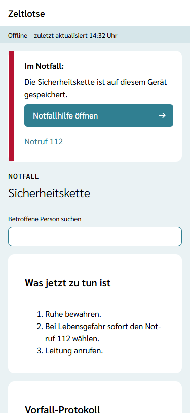
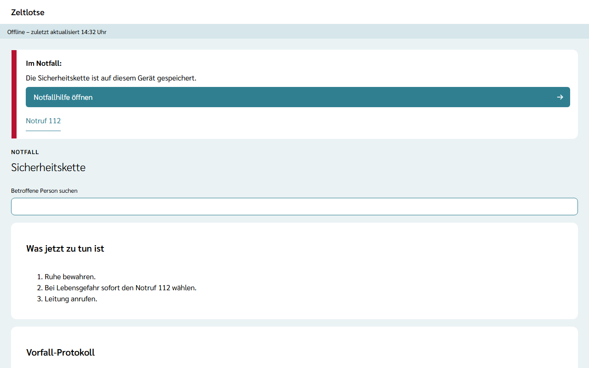
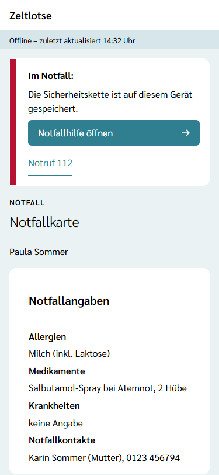
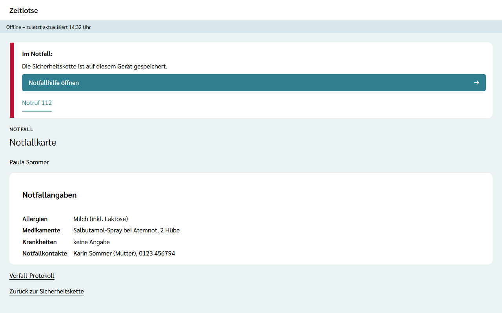
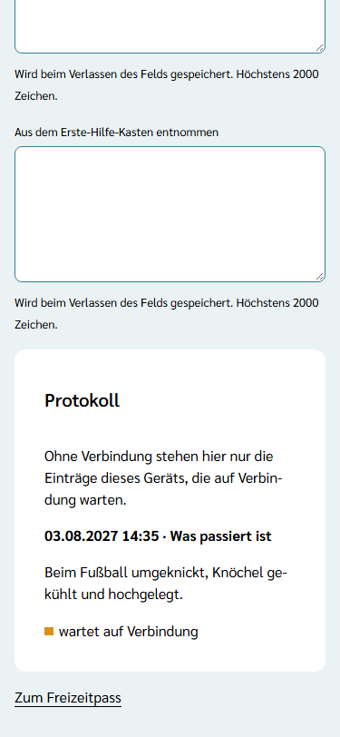
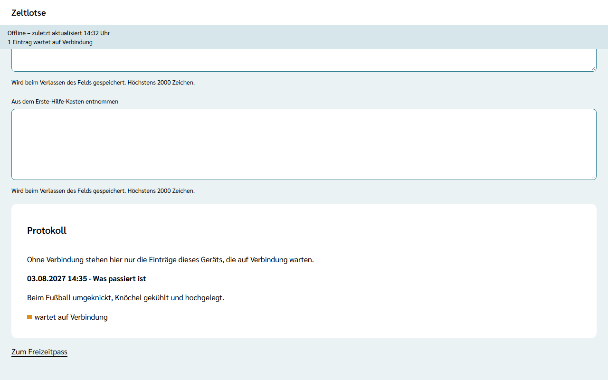
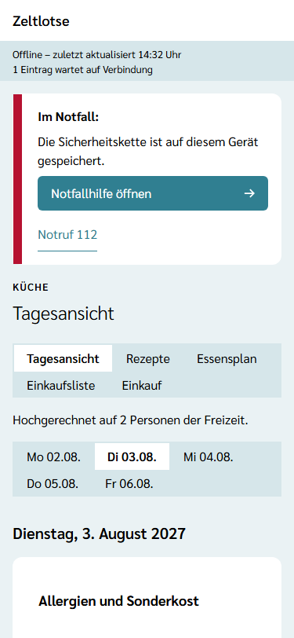
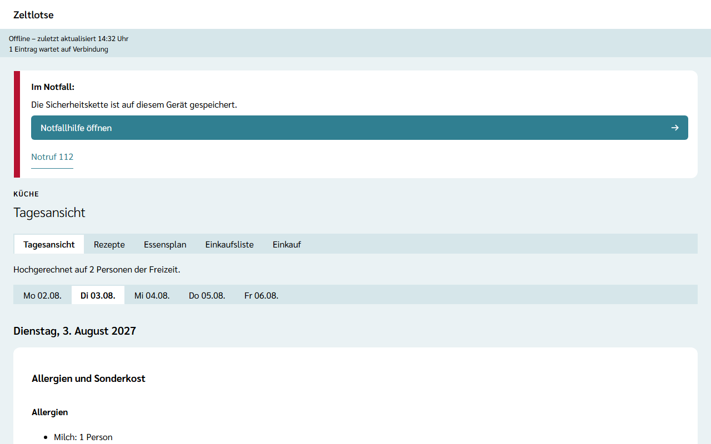

Im Zeltlager ist das Netz oft schwach oder fehlt ganz. Damit Leitung und Team im Notfall trotzdem alles Wichtige zur Hand haben, legt Zeltlotse während der Freizeit einige Seiten **verschlüsselt auf dem Gerät** ab. Ohne Netz öffnen sich dann:

- die **Sicherheitskette** (lesen),
- die **Notfallkarte** jeder Person (lesen),
- die **Küchen-Tagesansicht** (lesen),
- das **Vorfall-Protokoll** (neue Einträge schreiben).

Alle anderen Bereiche sind ohne Netz ausgegraut und mit „Offline nicht verfügbar.“ gekennzeichnet. Wie die Web-App ohne Netz startet, steht unter [Zeltlotse öffnen](/erste-schritte/zeltlotse-oeffnen/#ohne-netz-offline-ansicht-mit-notfall-box).

## Wann Zeltlotse die Daten aufs Gerät lädt

Zeltlotse lädt die Daten nur **vom ersten bis zum letzten Tag der Freizeit** und nur für Personen aus Leitung oder Team. Vorher liegt nichts auf dem Gerät. Es reicht, die Web-App während der Freizeit einmal mit Netz zu öffnen und angemeldet zu sein. Zeltlotse aktualisiert die Daten danach von selbst:

- beim Öffnen der Web-App,
- nach dem Anmelden,
- sobald das Netz nach einer Pause zurück ist.

Auf das Gerät kommen die Sicherheitskette, die Notfallkarte aller Personen der Freizeit und, wenn das Modul Verpflegung an ist, die Tagesansicht jedes Tages. Was sich danach am Server ändert, kommt erst beim nächsten Abgleich aufs Gerät: beim Öffnen von Zeltlotse, nach der Anmeldung oder wenn die Verbindung zurückkommt.

## Notfall ohne Netz

Ohne Netz steht oben die Offline-Leiste und darunter die Notfall-Box mit dem Satz „Die Sicherheitskette ist auf diesem Gerät gespeichert.“ **Notfallhilfe öffnen** führt zur gespeicherten Sicherheitskette, **Notruf 112** startet am Handy den Anruf.

Die Sicherheitskette zeigt wie gewohnt das Suchfeld, „Was jetzt zu tun ist“ und „Wen anrufen“. Der Knopf **Notfallordner drucken** ist ohne Netz ausgegraut.

Ist auf dem Gerät nichts gespeichert, etwa weil die Web-App während der Freizeit noch nie mit Netz offen war, sagt die Notfall-Box „Offline gilt der ausgedruckte Notfallordner.“ Die Seiten zeigen dann „Auf diesem Gerät nicht gespeichert.“ Dann gilt der [ausgedruckte Notfallordner](/mitarbeitende/notfallordner/).

## Notfallkarte

Ohne Netz findet die Suche **Betroffene Person suchen** die Personen, deren Notfallkarte auf dem Gerät liegt (siehe unten). Ein Tipp auf den Namen öffnet statt des Freizeitpasses die **Notfallkarte**. Sie zeigt nur die Angaben, die im Notfall zählen:

- Allergien,
- Medikamente,
- Krankheiten,
- Notfallkontakte.

Fehlt eine Angabe oder fragt die Freizeit sie nicht ab, steht dort „keine Angabe“. Darunter führen die Links **Vorfall-Protokoll** und **Zurück zur Sicherheitskette** weiter.

Auf der Notfallkarte stehen nur Personen, deren Freizeitpass das Team sehen darf, also ab der Bestätigung der Anmeldung. Wer die Freizeitpässe nicht sehen darf, bekommt keine Notfallkarten aufs Gerät.

## Vorfall-Protokoll ohne Netz

Das Vorfall-Protokoll lässt sich ohne Netz schreiben, genau wie mit Netz: Text ins Feld schreiben und das Feld verlassen. Das Feld leert sich, und der Eintrag steht oben im Protokoll mit dem Hinweis **wartet auf Verbindung**. Die Offline-Leiste zählt mit, zum Beispiel „1 Eintrag wartet auf Verbindung“.

Sobald das Netz zurück ist, schickt Zeltlotse die wartenden Einträge von selbst. Erst dann sieht die Leitung sie, mit dem Zeitpunkt, zu dem sie geschrieben wurden. Die Offline-Leiste verschwindet, wenn das Netz da ist und kein Eintrag mehr wartet. Ein Eintrag zählt dabei immer nur einmal, auch wenn das Senden wiederholt wird.

Ohne Netz zeigt das Protokoll nur die wartenden Einträge dieses Geräts, nicht die älteren Einträge vom Server. Ist die Freizeit inzwischen abgeschlossen, nimmt der Server keinen Eintrag mehr an; der wartende Eintrag verschwindet dann vom Gerät.

## Küchen-Tagesansicht ohne Netz

Die Tagesansicht zeigt ohne Netz jeden Tag der Freizeit mit Mahlzeiten, Gerichten, Allergien und Sonderkost, so wie beim letzten Abgleich. Das Kästchen **Restetag** ist ohne Netz ausgegraut.

## Wann die Daten vom Gerät verschwinden

Die Daten auf dem Gerät sind verschlüsselt. Der Schlüssel entsteht auf dem Gerät, bleibt im Browser und lässt sich aus Zeltlotse heraus nicht weitergeben. Gelöscht wird alles von selbst:

- **nach der Freizeit:** Ab Mitternacht nach dem letzten Tag zeigt Zeltlotse die Daten nicht mehr an und löscht sie, sobald die Web-App wieder geöffnet wird, auch ohne Netz,
- **beim Abmelden** und beim Löschen des Kontos,
- **wenn die Anmeldung abgelaufen ist,**
- **wenn die Person nicht mehr zu Leitung oder Team der Freizeit gehört.** Das merkt das Gerät bei der nächsten Verbindung.

Wartende Einträge des Vorfall-Protokolls werden dabei mit gelöscht. Ein Eintrag, der bis Mitternacht nach dem letzten Tag nicht gesendet ist, geht deshalb verloren; vorher die Web-App einmal mit Netz öffnen. Wer ein Gerät weitergibt, meldet sich vorher ab.

Dass die Notfallkarte einer Person auf ein Gerät geladen wurde, steht in ihrem Zugriffsprotokoll als „Notfallkarte aufs Gerät geladen“, höchstens einmal am Tag. Mehr dazu unter [Was passiert mit meinen Daten](/daten/#offline-auf-dem-gerät).
