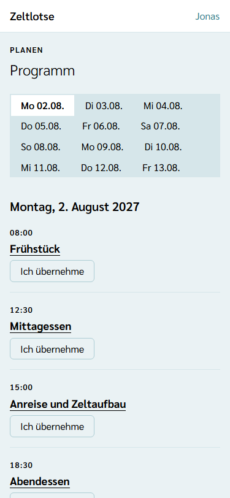
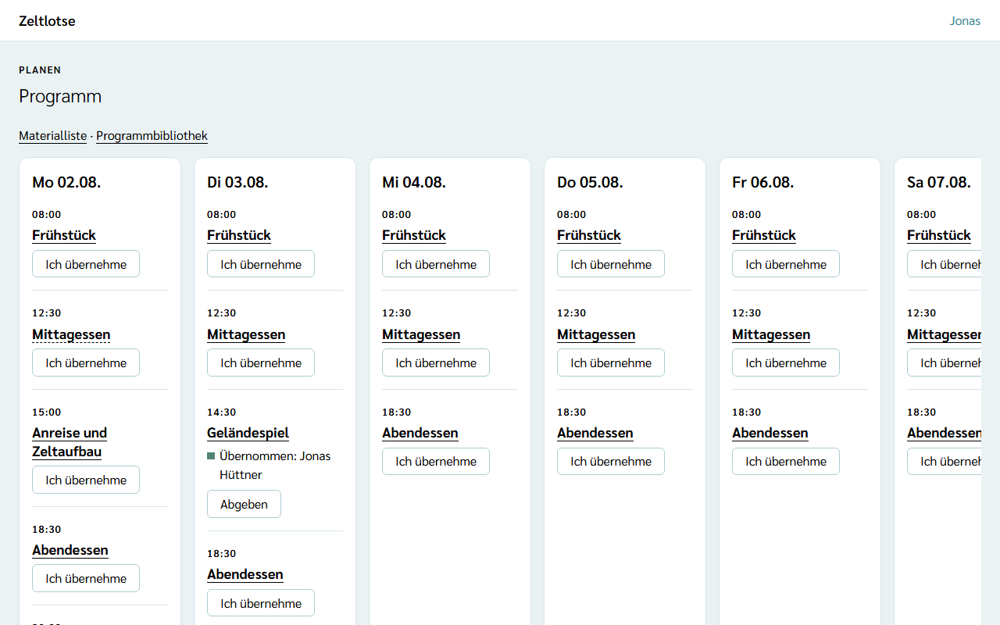
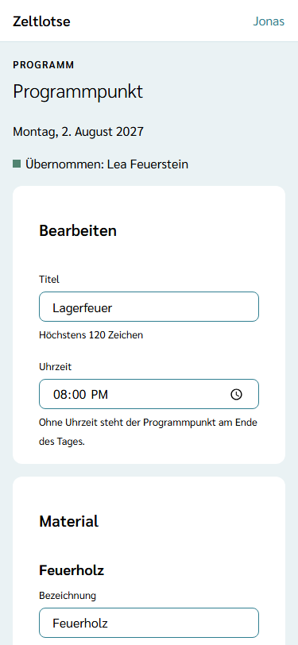
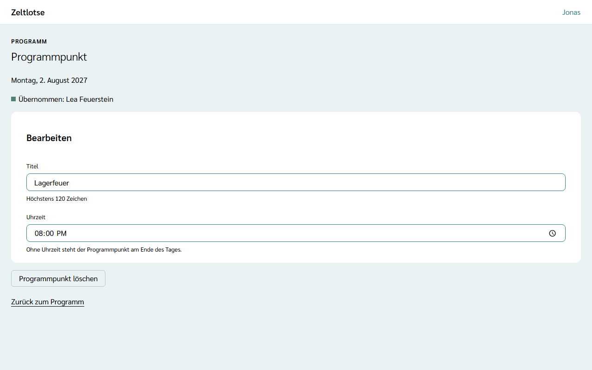
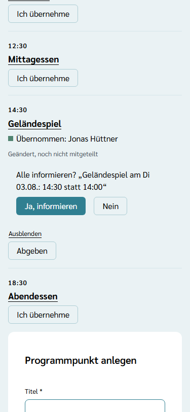
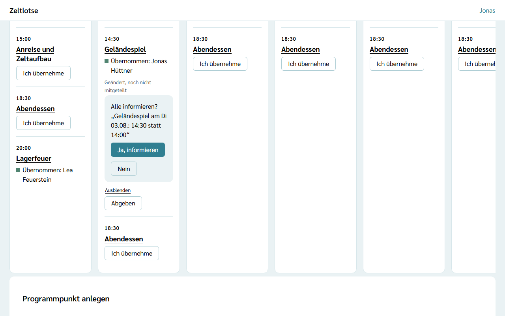

Das **Programm** einer Freizeit steht im **Wochenraster**: je Tag der Freizeit die Programmpunkte mit Uhrzeit und Titel. Leitung und Team planen es gemeinsam. Wer einen Programmpunkt vorbereitet und durchführt, übernimmt ihn selbst – die Leitung teilt nichts zu.

## Der Weg zum Programm

Auf der Startseite der Freizeit steht der Knopf **Programm**. Er führt in jeder Phase der Freizeit zum Wochenraster.

## Feste Mahlzeiten

Frühstück (08:00 Uhr), Mittagessen (12:30 Uhr) und Abendessen (18:30 Uhr) stehen von Anfang an an jedem Tag der Freizeit im Wochenraster. Uhrzeit und Titel der Mahlzeiten lassen sich ändern, zum Beispiel wenn das Mittagessen an einem Tag später ist. Löschen lassen sich die Mahlzeiten nicht. An den Mahlzeiten hängen später die Gerichte der Küche.

## Der Wochenraster am Handy und am Laptop

- **Am Handy** steht ein Tag auf einmal. Über der Liste wählen Reiter den Tag („Mo 02.08.“, „Di 03.08.“ …). Während der Freizeit ist der heutige Tag vorausgewählt, sonst der erste Tag.
- **Am Laptop** stehen alle Tage nebeneinander, je Tag eine Spalte. Passen nicht alle Tage auf den Bildschirm, lässt sich der Bereich seitlich verschieben.

Jeder Programmpunkt zeigt oben die Uhrzeit, darunter den Titel. Ein Programmpunkt ohne Uhrzeit steht am Ende des Tages. Wer einen Programmpunkt übernommen hat, steht darunter, zum Beispiel „Übernommen: Lea Feuerstein“.

## Ich übernehme

Unter jedem freien Programmpunkt steht der Knopf **Ich übernehme**. Ein Tipp genügt, eine Rückfrage gibt es nicht: Danach steht der eigene Name am Programmpunkt, und der Knopf heißt **Abgeben**. Mit **Abgeben** ist der Programmpunkt wieder frei.

Einen Programmpunkt übernimmt immer nur eine Person. Hat ihn schon jemand anderes übernommen, fehlt der Knopf. Haben zwei Personen gleichzeitig getippt, bekommt ihn die schnellere; bei der anderen steht „Jemand anderes hat diesen Programmpunkt inzwischen übernommen.“ Abgeben kann nur, wer den Programmpunkt übernommen hat.

## Programmpunkt anlegen

Unter dem Wochenraster steht die Card **Programmpunkt anlegen**:

- **Titel** – Pflicht, höchstens 120 Zeichen, zum Beispiel „Geländespiel“,
- **Tag** – ein Tag der Freizeit; vorausgewählt ist der Tag, der gerade im Reiter gewählt ist,
- **Uhrzeit** – freiwillig; ohne Uhrzeit steht der Programmpunkt am Ende des Tages.

**Programmpunkt anlegen** speichert den Punkt; am Handy wechselt der Reiter auf seinen Tag, und oben steht „Gespeichert: Programmpunkt „Geländespiel“ am Di 03.08. angelegt.“ Fehlt der Titel oder passt eine Angabe nicht, steht der Fehler direkt am Feld.

## Programmpunkt bearbeiten, verschieben und löschen

Ein Tipp auf den Titel öffnet die Seite **Programmpunkt**. Sie zeigt den Tag und wer den Punkt übernommen hat, dazu **Ich übernehme** oder **Abgeben**. Titel und Uhrzeit stehen in den Feldern darunter.

In der Card **Bearbeiten** lassen sich **Titel** und **Uhrzeit** ändern. Zeltlotse speichert beim Verlassen des Felds; darunter steht „Gespeichert“ mit „Rückgängig“. Hat jemand anderes dasselbe Feld inzwischen geändert, steht dort „Inzwischen geändert – neu laden?“.

**Verschieben** heißt: die Uhrzeit ändern. Den Tag eines Programmpunkts ändert Zeltlotse nicht; für einen anderen Tag einen neuen Programmpunkt anlegen und den alten löschen. Nach dem Verschieben fragt Zeltlotse, ob alle informiert werden sollen (siehe [Alle informieren](#alle-informieren)).

**Programmpunkt löschen** klappt eine Rückfrage auf („Diesen Programmpunkt löschen?“ – „Ja, löschen“ / „Nein“). Danach führt Zeltlotse zurück zum Wochenraster dieses Tages. Mahlzeiten haben keinen Löschen-Knopf.

## Alle informieren

Wer die Uhrzeit eines Programmpunkts ändert, zum Beispiel das Mittagessen von 13:00 auf 13:30, bekommt direkt unter dem Feld **Uhrzeit** eine Rückfrage: „Alle informieren? „Mittagessen am Di 03.08.: 13:30 statt 13:00““. Den Text bereitet Zeltlotse vor, mit Titel, Tag, neuer und alter Uhrzeit. Wurde die Uhrzeit entfernt, steht dort „ohne Uhrzeit statt 13:00“.

- **Ja, informieren** schreibt genau diesen Text in den Kanal **Alle**. Er geht wie jede Nachricht dort als Benachrichtigung aufs Handy (siehe [Kanäle, Ansagen-Zettel und Besprechung](/mitarbeitende/kanaele/)). Danach steht oben „Alle informiert: …“, und der Hinweis am Programmpunkt verschwindet. Klappt nur das Entfernen des Hinweises nicht, meldet Zeltlotse „Die Nachricht ist gesendet, der Hinweis ließ sich aber nicht entfernen.“ Dann nicht erneut informieren, sondern **Ausblenden** wählen.
- **Nein** schickt nichts. Auch wer die Seite einfach verlässt, schickt nichts.

Weil die Seite nach dem Verschieben den Programmpunkt neu lädt, steht unter **Uhrzeit** danach kein „Rückgängig“. Wer die Verschiebung zurücknehmen will, trägt die alte Uhrzeit wieder ein; damit verschwindet auch der Hinweis.

Das Ändern der Uhrzeit allein verschickt nie etwas. Solange niemand informiert hat, steht am Programmpunkt klein **„Geändert, noch nicht mitgeteilt“** – auf der Seite des Programmpunkts und am Termin im Wochenraster, für alle aus Leitung und Team, auch nach dem Neuladen. Dahinter stehen zwei Knöpfe:

- **Jetzt informieren** klappt dieselbe Rückfrage wieder auf.
- **Ausblenden** entfernt den Hinweis, ohne etwas zu schicken, zum Beispiel wenn alle schon mündlich Bescheid wissen.

Wird der Punkt noch einmal verschoben, bevor jemand informiert hat, nennt der Text weiter die zuletzt mitgeteilte Uhrzeit („14:00 statt 13:00“). Wer ihn auf die alte Uhrzeit zurückschiebt, hat nichts mehr mitzuteilen; der Hinweis verschwindet von selbst. Bekommt ein Programmpunkt zum ersten Mal eine Uhrzeit, ist das keine Verschiebung, und es kommt keine Rückfrage. Eine Änderung am Titel löst ebenfalls keine Rückfrage aus. Den vorbereiteten Text kann man in der Rückfrage nicht ändern; eine eigene Nachricht schreibt man direkt im Kanal **Alle**.

## Material am Programmpunkt

Unter der Card **Bearbeiten** steht die Card **Material**: was für den Programmpunkt gebraucht wird, mit Menge, Stand und wer es mitbringt. Über dem Wochenraster führt der Link **Materialliste** zum Material aller Programmpunkte. Wie das geht, steht unter [Material planen und packen](/mitarbeitende/material/).

Darunter steht die Card **Aufgaben** mit den Aufgaben, die zu diesem Programmpunkt gehören, und dem Formular **Aufgabe hinzufügen**. Wie Aufgaben funktionieren, steht unter [Aufgaben übernehmen und abhaken](/mitarbeitende/aufgaben/).

## Programmbibliothek

Unter der Card **Aufgaben** (nicht bei Mahlzeiten) steht die Card **Programmbibliothek**: **In Bibliothek ablegen** legt Titel, Material und Aufgaben für andere Freizeiten der Organisation ab. Neben **Materialliste** über dem Wochenraster führt der Link **Programmbibliothek** zu allen abgelegten Programmpunkten; von dort lässt sich jeder an einem Tag dieser Freizeit übernehmen. Wie das geht, steht unter [Programmpunkte ablegen und übernehmen](/mitarbeitende/programmbibliothek/).

## Nach dem Abschluss

Nach dem Abschluss der Freizeit ist das Programm nur lesbar: Oben steht „Diese Freizeit ist abgeschlossen und nur lesbar.“; die Knöpfe, die Card „Programmpunkt anlegen“ und die Felder zum Bearbeiten fehlen. Die Seite eines Programmpunkts nennt Titel und Uhrzeit dann als Liste. Ein Hinweis „Geändert, noch nicht mitgeteilt“ bleibt stehen, aber ohne „Jetzt informieren“ und „Ausblenden“.

## Noch nicht dabei

Dokumente am Programmpunkt kommen mit einer späteren Version. Teilnehmende lesen den Kanal „Alle“ und damit auch die Nachricht zu einer Verschiebung über den [Teilnehmer-Zugang per QR-Code](/leitung/teilnehmer-zugang/); dort sehen sie die Woche nur mit Uhrzeit und Titel, ohne Details und ohne Übernahmen.

Wer einen Programmpunkt übernommen hat, steht auch in der Datenauskunft der Person unter „Programm“ – mehr dazu unter [Was passiert mit meinen Daten](/daten/#programm).
