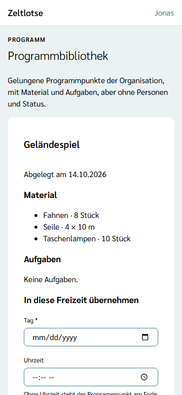
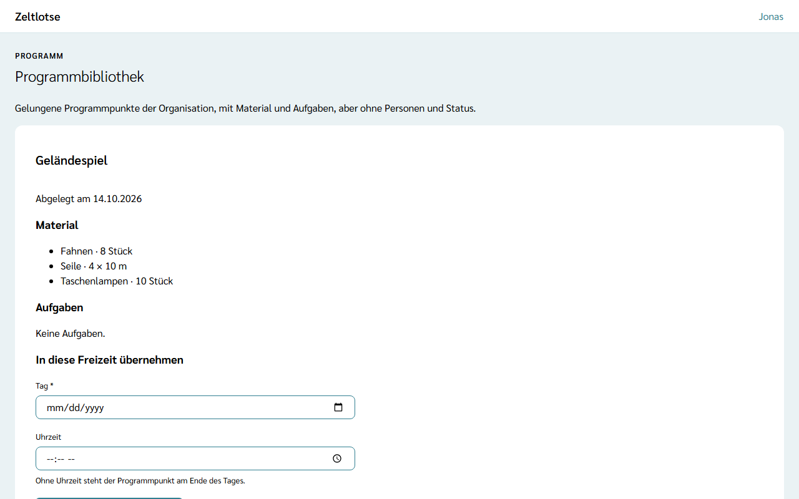

Ein Geländespiel, das gut lief, ein Lagerfeuer mit allem, was dazugehört: Solche Programmpunkte braucht die nächste Freizeit wieder. Damit sie nach der Freizeit nicht verloren gehen, legt das Team sie in der **Programmbibliothek** der Organisation ab. Jede Freizeit derselben Organisation kann sie von dort übernehmen, samt Material und Aufgaben.

Zeltlotse legt nichts von selbst ab. In die Bibliothek kommt nur, was jemand aus Leitung oder Team bewusst ablegt.

## Einen Programmpunkt ablegen

Auf der Seite eines Programmpunkts (Wochenraster → Titel des Punkts, siehe [Programm planen und übernehmen](/mitarbeitende/programm/)) steht unter der Card **Aufgaben** die Card **Programmbibliothek** mit dem Satz „Titel, Material und Aufgaben lassen sich für andere Freizeiten der Organisation ablegen.“

**In Bibliothek ablegen** legt den Programmpunkt ab, mit einem Tipp und ohne Rückfrage. Danach steht in der Card „Steht in der Programmbibliothek der Organisation.“, und der Knopf fehlt. Ein zweiter Tipp legt nichts doppelt ab. Mahlzeiten haben diese Card nicht: Frühstück, Mittag- und Abendessen stehen in jeder Freizeit ohnehin.

## Was mitkommt und was nicht

Die Bibliothek speichert eine **Momentaufnahme** des Programmpunkts zum Zeitpunkt des Ablegens:

- den **Titel**,
- das **Material** mit Bezeichnung und Menge, zum Beispiel „Seile · 4 × 10 m“,
- die **Aufgaben** am Programmpunkt mit Titel und Phase, zum Beispiel „Andacht am Lagerfeuer vorbereiten · Während der Freizeit“.

Nicht mit kommen: wer den Programmpunkt oder eine Aufgabe übernommen hat, wer Material mitbringt, der Stand des Materials („eingepackt“ und so weiter), ob eine Aufgabe erledigt ist, Reservierungen aus dem Inventar und der Tag und die Uhrzeit. Diese Dinge gehören zur alten Freizeit; die neue plant sie neu. Der Eintrag speichert also nicht, wer übernommen hat oder mitbringt. Namen gehören auch nicht in Titel und Bezeichnungen, weil der Eintrag die Löschfrist der Freizeit überdauert.

Was nach dem Ablegen am Programmpunkt geändert wird, ändert den Eintrag in der Bibliothek nicht. Einträge lassen sich nicht bearbeiten; der Org-Admin kann sie entfernen – siehe [Programmbibliothek der Organisation](/org-admin/programmbibliothek/). Wird der Programmpunkt in der Freizeit gelöscht, bleibt der Eintrag in der Bibliothek.

## Die Programmbibliothek öffnen

Wochenraster → Link **Programmbibliothek** neben **Materialliste**. Über der Überschrift „Programmbibliothek“ steht „Programm“. Die Seite zeigt alle Einträge der Organisation, egal aus welcher Freizeit sie stammen, nach Titel; gibt es denselben Titel mehrfach, steht die neueste Fassung zuerst. Jeder Eintrag ist eine Card mit Titel, „Abgelegt am …“, dem Material und den Aufgaben. Einträge anderer Organisationen sieht niemand.

Gibt es noch keine Einträge, steht dort „Noch nichts in der Programmbibliothek. Programmpunkte lassen sich an ihrer Seite mit „In Bibliothek ablegen“ hier ablegen.“

## In diese Freizeit übernehmen

Unter jedem Eintrag steht das Formular **In diese Freizeit übernehmen**:

- **Tag** – Pflicht; wählbar sind nur die Tage der Freizeit,
- **Uhrzeit** – freiwillig; ohne Uhrzeit steht der Programmpunkt am Ende des Tages.

**In diese Freizeit übernehmen** legt einen neuen Programmpunkt mit dem Titel des Eintrags an und öffnet seine Seite. Am neuen Programmpunkt stehen:

- das Material, jedes im Stand **gebraucht**, ohne dass jemand es mitbringt und ohne Reservierung; es steht damit auch in der [Materialliste](/mitarbeitende/material/),
- die Aufgaben, jede **offen** und von niemandem übernommen – siehe [Aufgaben übernehmen und abhaken](/mitarbeitende/aufgaben/).

Den Programmpunkt selbst hat danach noch niemand übernommen. Fehlt der Tag, liegt er außerhalb der Freizeit oder passt die Uhrzeit nicht, steht der Fehler direkt am Feld.

Ein übernommener Programmpunkt hängt nicht am Eintrag. Wer ihn in der neuen Freizeit verbessert, kann ihn wieder ablegen; die Bibliothek hat dann zwei Fassungen, die „Abgelegt am“ unterscheidet.

## Nach dem Abschluss

Nach dem Abschluss der Freizeit lässt sich die Programmbibliothek aus ihr heraus noch lesen, aber nichts mehr ablegen oder übernehmen: Unter dem Einleitungssatz der Bibliothek steht „Diese Freizeit ist abgeschlossen und nur lesbar.“, die Formulare und der Knopf **In Bibliothek ablegen** fehlen. Wer einen gelungenen Programmpunkt behalten will, legt ihn deshalb vor dem Abschluss ab, am besten in der Nachbereitung.
