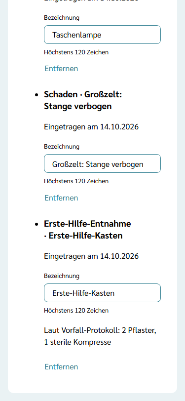
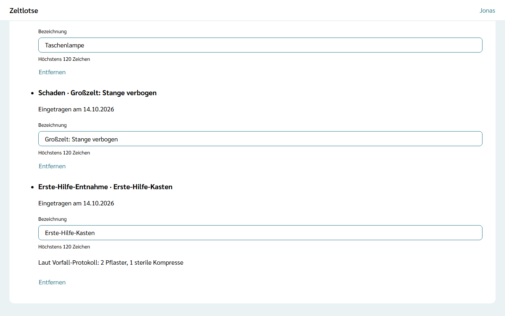

Auf jeder Freizeit geht etwas kaputt oder verloren, und aus dem Erste-Hilfe-Kasten wird etwas verbraucht. Damit die Organisation nach der Freizeit weiß, was ersetzt werden muss, führen Leitung und Team die Liste **Schäden & Verluste**. Nach dem Abschluss der Freizeit sieht die Organisation die Einträge als **Anschaffungswünsche** – siehe [Anschaffungswünsche](/org-admin/anschaffungswuensche/).

## Die Liste öffnen

Startseite der Freizeit → Knopf **Schäden & Verluste** (unter **Inventar**). Über der Überschrift „Schäden & Verluste“ steht „Ablage“. Die Seite ist für Leitung und Team in jeder Phase der Freizeit erreichbar.

## Eintragen

In der Card **Eintragen**:

- **Art** – **Schaden** (vorgewählt), **Verlust** oder **Erste-Hilfe-Entnahme**,
- **Was?** – Pflicht, höchstens 120 Zeichen, zum Beispiel „Taschenlampe“ oder „Großzelt: Stange verbogen“.

**Eintragen** speichert den Eintrag; er steht danach oben in der Card **Liste**, das Feld **Was?** ist wieder leer. Fehlt der Text oder ist er zu lang, steht der Fehler direkt am Feld. Mengen, Kosten oder eine Verbindung zu einem Artikel im [Inventar](/mitarbeitende/inventar/) gibt es nicht: Der Text sagt, was fehlt.

## Die Liste

Die Card **Liste** zeigt alle Einträge der Freizeit, der neueste oben. Jeder Eintrag hat eine Überschrift aus Art und Text, zum Beispiel „Verlust · Taschenlampe“, und darunter „Eingetragen am …“. Ohne Einträge steht dort „Noch nichts eingetragen.“

Der Text steht in einem Feld **Bezeichnung**. Zeltlotse speichert beim Verlassen des Felds; darunter steht „Gespeichert“ mit „Rückgängig“. Hat jemand anderes den Text inzwischen geändert, steht dort „Inzwischen geändert – neu laden?“.

**Entfernen** klappt eine Rückfrage auf („„Taschenlampe“ entfernen?“ – „Ja, entfernen“ / „Nein“). Danach ist der Eintrag weg, zum Beispiel wenn die Taschenlampe doch wieder aufgetaucht ist.

## Entnahmen aus dem Vorfall-Protokoll

Wer im [Vorfall-Protokoll](/mitarbeitende/vorfall-protokoll/) eine Entnahme aus dem Erste-Hilfe-Kasten festhält, muss sie hier nicht noch einmal eintragen: Zeltlotse setzt sie selbst auf die Liste, als „Erste-Hilfe-Entnahme · Erste-Hilfe-Kasten“. Das kann einen Moment dauern; spätestens nach dem Neuladen steht der Eintrag da. Darunter steht der Text aus dem Vorfall-Protokoll, zum Beispiel „Laut Vorfall-Protokoll: 2 Pflaster, 1 sterile Kompresse“.

Der Text bleibt dabei im Vorfall-Protokoll und nur dort verschlüsselt gespeichert; die Liste zeigt ihn nur Leitung und Team an. Die Organisation sieht nach dem Abschluss nur die Bezeichnung (vorgegeben „Erste-Hilfe-Kasten“), nie den Text aus dem Vorfall-Protokoll. Namen gehören deshalb nicht in die Bezeichnung. Wird derselbe Eintrag im Vorfall-Protokoll zweimal gesendet, etwa nach einem Verbindungsabbruch, steht er hier trotzdem nur einmal.

## Nach dem Abschluss

Schließt die Leitung die Freizeit ab, steht oben „Die Freizeit ist abgeschlossen. Die Einträge sind jetzt Anschaffungswünsche an die Organisation.“ Die Liste bleibt beschreibbar: Wer noch etwas vergessen hat, trägt es nach, und die Organisation sieht es sofort. Was die Organisation als erledigt markiert, verschwindet auch hier. Das Abschließen einer Freizeit kommt mit einer späteren Version.
