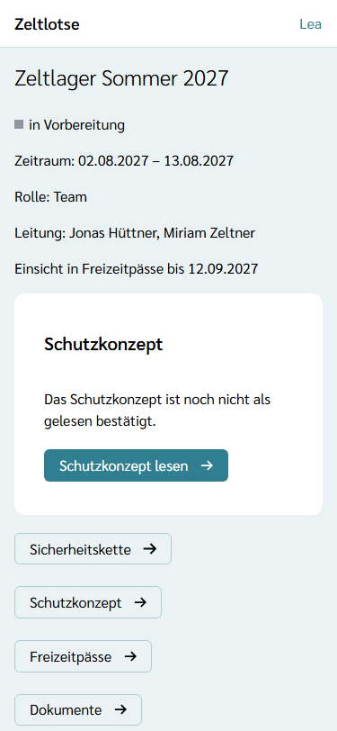
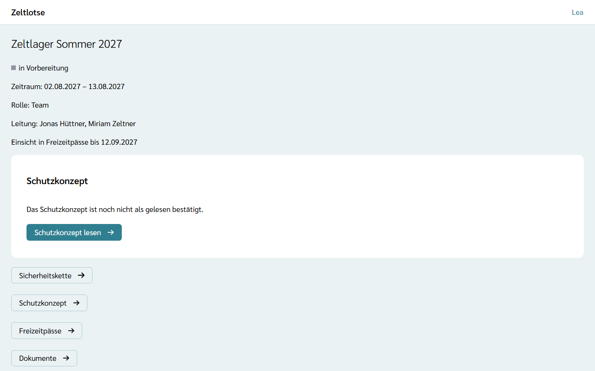
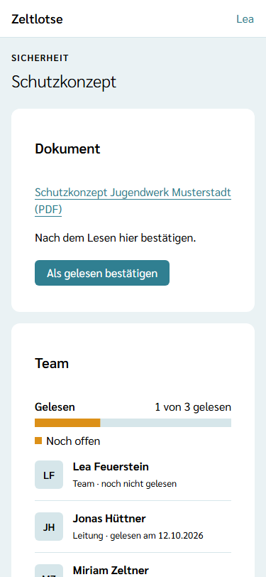
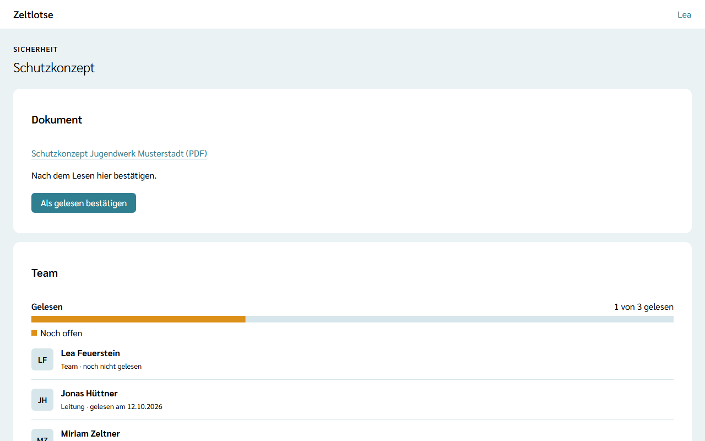

Viele Organisationen haben ein **Schutzkonzept**: Regeln, wie das Team Kinder und Jugendliche vor Grenzverletzungen schützt. Die Leitung hängt es an die Freizeit; jedes Mitglied von Leitung und Team liest es und bestätigt in Zeltlotse „gelesen“. Alle im Team sehen, wer es schon gelesen hat.

## Der Hinweis auf der Startseite

Solange das Schutzkonzept noch nicht als gelesen bestätigt ist, steht auf der Startseite der Freizeit die Card **Schutzkonzept** mit dem Satz „Das Schutzkonzept ist noch nicht als gelesen bestätigt.“ Der Knopf **Schutzkonzept lesen** führt zur Seite „Schutzkonzept“. Nach der Bestätigung verschwindet die Card. Nach dem Abschluss der Freizeit steht sie nicht mehr da.

Unabhängig davon führt der Knopf **Schutzkonzept** auf der Startseite in jeder Phase zur Seite „Schutzkonzept“.

## Datei öffnen und bestätigen

Die Seite zeigt in der Card **Dokument** den Titel und die Art der Datei, etwa „Schutzkonzept Jugendwerk Musterstadt (PDF)“. Ein Tipp darauf lädt die Datei herunter.

Darunter steht „Nach dem Lesen hier bestätigen.“ mit dem Knopf **Als gelesen bestätigen**. Danach steht dort „Als gelesen bestätigt.“ und „Gelesen am …“ mit dem Datum. Eine Bestätigung lässt sich nicht zurücknehmen. Zeltlotse prüft nicht, ob die Datei vorher geöffnet wurde; die Bestätigung ist das Wort der Person.

Nach dem Abschluss der Freizeit lässt sich nichts mehr bestätigen; die Seite bleibt lesbar.

## Wer gelesen hat

Die Card **Team** zeigt im Balken, wie viele gelesen haben, zum Beispiel „1 von 3 gelesen“. Darunter steht jede Person mit Leitung oder Team, nach Nachnamen sortiert, mit der Zeile „gelesen am …“ oder „noch nicht gelesen“. Alle in Leitung und Team sehen diese Liste.

## Wenn das Schutzkonzept ausgetauscht wird

Wählt die Leitung ein anderes Dokument als Schutzkonzept, gilt die alte Bestätigung nicht mehr: Alle stehen wieder auf „noch nicht gelesen“, und die Card auf der Startseite erscheint wieder. Hat jemand gerade die alte Fassung offen und bestätigt, steht dort „Das Schutzkonzept wurde inzwischen ausgetauscht oder entfernt.“, und die Seite zeigt den neuen Stand: das neue Dokument oder „Noch kein Schutzkonzept angehängt.“

Gibt es noch kein Schutzkonzept, steht auf der Seite „Noch kein Schutzkonzept angehängt.“ Wie die Leitung eines anhängt, steht unter [Schutzkonzept anhängen](/leitung/schutzkonzept/).
